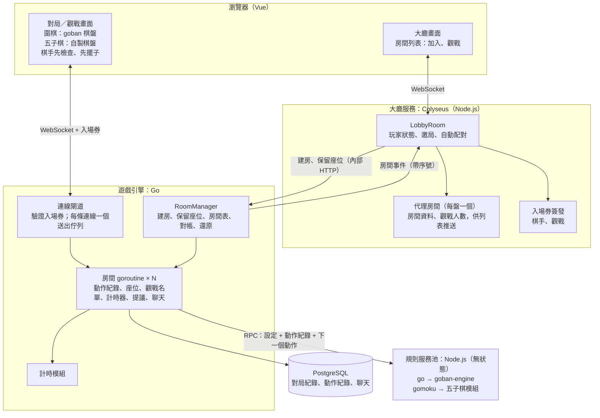
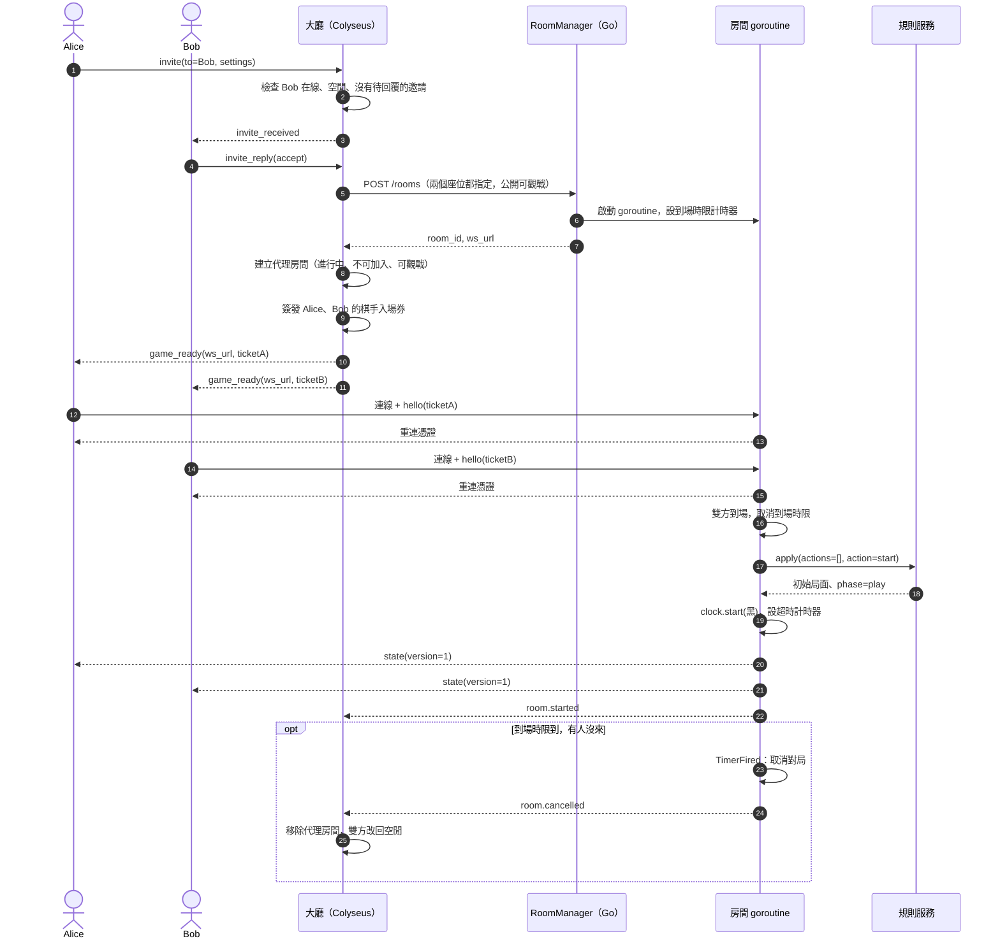
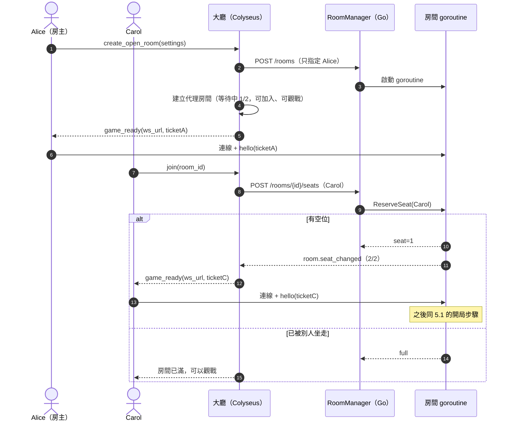
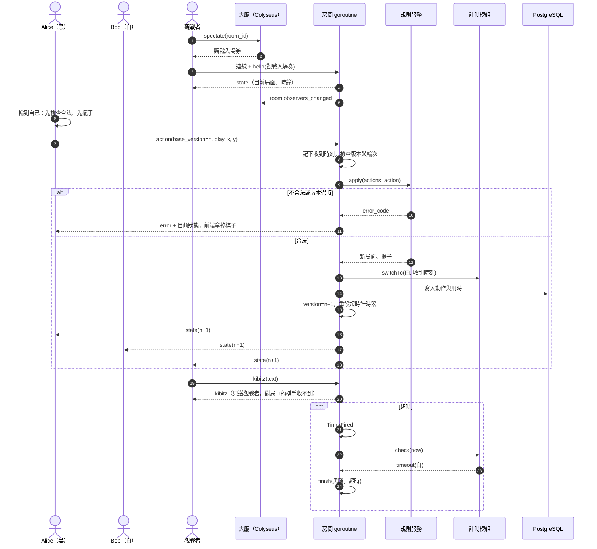
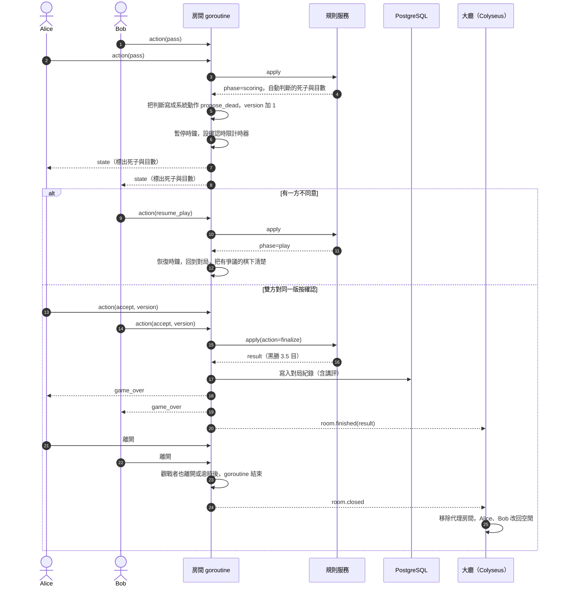

# 架構草案 v2：Colyseus 大廳 + Go 遊戲引擎 + 規則服務

> 整理日期：2026-10-31（同日修訂：補上觀戰、開放房間、版本號、階段資料、到場時限；終局改為自動判死子、雙方確認）。
> 狀態：**草案，尚未實作，關鍵假設尚未實驗驗證**（見第 9 節）。
> 前一版：[architecture.md](architecture.md)（大廳與對局都在 Colyseus）。兩者差異見第 11 節。
> 本版涵蓋圍棋與五子棋（freestyle）；井字棋等其他遊戲之後再補。流程圖以圍棋為例，因為它多了終局確認階段，最複雜。
> 圖中的函式、訊息名稱都是**虛擬碼**。

## 1. 為什麼改架構

- **大廳和對局分開**：大廳只負責「找人、建房、列房間」；對局在獨立的遊戲引擎裡跑。兩邊互不影響，玩家的焦點（在大廳或在房間）也自然分開。
- **每個房間一個 goroutine**：房間自己擁有狀態，從自己的 channel 依序處理事件（玩家動作、計時器觸發、加入離開）。用 Go 寫最直覺，也能用到多核心。
- **計時器能主動觸發事件**：超時判負、讀秒、終局確認時限到、到場時限到、進入下一階段，都是計時器送進房間的事件。
- **前後端同一份規則**：前端用 `goban` 先檢查、先擺子；後端用同一版 `goban-engine` 當裁判。
- **不重造輪子**：大廳用 Colyseus（連線、重連、房間列表推送），規則用 OGS 的 `goban-engine`。

## 2. 元件



| 元件 | 負責 | 不負責 |
| --- | --- | --- |
| 大廳服務（Colyseus） | 玩家上下線與狀態、邀局、自動配對、房間列表與觀戰人數推送、簽發入場券 | 棋盤、計時、座位的最終分配、對局中的任何判定 |
| 遊戲引擎（Go） | 房間生命週期、**座位的最終分配**、觀戰名單、計時器、提議（終局確認、之後的悔棋）、聊天與講評、寫紀錄 | 規則本身、大廳列表 |
| 規則服務（Node） | 依遊戲類型分派到對應模組；從動作紀錄重放，回答合不合法、局面、階段、結果 | 任何狀態 |
| 前端 | 顯示；棋手在對局階段用同一份規則先檢查、先擺子 | 判定結果（以伺服器為準） |

## 3. 遊戲引擎內部（Go）

### 3.1 房間狀態

房間 goroutine 保存的狀態（規則服務不保存任何東西）：

- **設定**：遊戲類型、棋盤大小、貼目、讓子、計時方式、是否計分、可見性。
- **動作紀錄**：所有被接受的動作，依序編號。不只落子，**系統提出的死子判斷、恢復對局、定案也是動作**，所以光靠動作紀錄就能重放出完整局面，包括終局時判定了哪些死子。
- **版本號**：每接受一個動作就加 1，由伺服器發號。
- **座位**：哪個座位是誰、是否已到場、是否連線中。
- **觀戰名單**。
- **提議**：例如雙方是否已確認死子判斷，以及確認的是哪一個版本。
- **計時模組的狀態**。

### 3.2 事件迴圈

每個房間只有一個 goroutine 修改它的狀態，所有事件都排進同一個 channel：

| 事件 | 來源 |
| --- | --- |
| `ReserveSeat` | RoomManager（大廳要求替某人保留座位） |
| `Join`、`Leave` | 連線閘道（棋手或觀戰者連上、斷線） |
| `Action`（落子、pass、認輸、確認結果、恢復對局） | 連線閘道 |
| `Chat`（棋手對話）、`Kibitz`（觀戰講評） | 連線閘道 |
| `TimerFired`（超時、確認時限、到場時限、斷線保留到期） | 房間自己的計時器 |
| `Shutdown` | RoomManager（伺服器關閉、管理員關房） |

處理原則：

- **計時器不直接改狀態**：時間到只送一個 `TimerFired` 進 channel。「最後一秒落子」和「超時」誰先進佇列就先處理誰。
- **先寫紀錄再廣播**：動作被接受後先寫進資料庫，再推給所有人。引擎重啟時可以從紀錄重建房間。
- **用收到訊息的時刻扣時**：以閘道收到動作的時刻為準，不包含呼叫規則服務的時間。
- **不被慢連線拖住**：房間 goroutine 不直接寫 WebSocket，而是把訊息放進每條連線自己的送出佇列，由該連線的 goroutine 負責送出。佇列滿了就斷開那條連線，對局不受影響。觀戰者多時尤其重要。
- **規則服務呼叫一定設逾時**：等待期間這個房間的其他事件會排隊，所以逾時要短（例如 2 秒），逾時處理見第 8 節。
- **錯誤隔離**：每個房間 goroutine 用 `recover` 包起來，一盤出錯不影響其他盤。

### 3.3 RoomManager

- `CreateRoom(spec)`：建立房間、啟動 goroutine、登記到房間表。
- `ReserveSeat(room_id, user)`：把請求送進房間 goroutine，由房間決定給哪個座位，或回覆已滿。座位只在房間 goroutine 裡分配，不會兩人搶到同一個位子。
- `GetRoom(id)`：連線閘道用來找到房間的 channel。
- `ListRooms()`：給大廳對帳用。
- `Restore()`：引擎啟動時，從資料庫找出未結束的對局，重建房間 goroutine。

之後若要開多個引擎程序，只要大廳選擇往哪一個建房，房間 goroutine 不用改。

## 4. 介面與協定（虛擬碼）

### 4.1 大廳 → 引擎（內部 HTTP，只接受大廳呼叫）

```text
POST /rooms
  { room_id, game: "go", settings: { board_size, komi, handicap, time_control, rated },
    seats: [ { seat: 0, user_id, name, color: "black" }, { seat: 1, user_id, name, color: "white" } ],
    visibility: { listed: true, spectate: true } }
→ { room_id, ws_url: "wss://<網域>/game/<room_id>" }
```

- **邀局、自動配對**：建房時兩個座位都已指定。
- **開放房間**：建房時只指定房主，另一個座位空著。
- `visibility` 預設公開、可觀戰。不公開、不開放觀戰之後做成建房選項。

```text
POST /rooms/{room_id}/seats   { user_id, name }
→ { seat } 或 { error: "full" | "finished" }
```

開放房間有人按「加入」時，大廳先向引擎要座位，拿到才簽發入場券。

### 4.2 引擎 → 大廳：房間事件

| 事件 | 時機 | 大廳的處理 |
| --- | --- | --- |
| `room.seat_changed` | 開放房間有人入座或離座（開局前） | 更新代理房間的人數 |
| `room.started` | 雙方都到場、開局 | 代理房間改為「進行中」 |
| `room.observers_changed` | 觀戰人數變化（合併後每幾秒送一次） | 更新代理房間的觀戰人數 |
| `room.player_disconnected`／`reconnected` | 棋手斷線、重連 | 視需要更新玩家狀態 |
| `room.cancelled` | 到場時限內有人沒來 | 移除代理房間，玩家改回空閒 |
| `room.finished` | 對局結束（附結果） | 代理房間改為「已結束」 |
| `room.closed` | 房間 goroutine 結束 | 移除代理房間，玩家改回空閒 |

- **每個事件帶房間內的序號**：大廳只處理比已知序號新的事件，重複或過期的就忽略，所以遺失重送、亂序都不會出錯。
- **傳送方式**：引擎回呼大廳的內部 HTTP 端點，失敗就重試；或維持一條常駐連線。
- **定期對帳**：大廳定期呼叫 `GET /rooms`，以引擎為準修正代理房間。

### 4.3 入場券與重連憑證

| 憑證 | 誰發 | 內容 | 有效期 | 用途 |
| --- | --- | --- | --- | --- |
| 棋手入場券 | 大廳 | `room_id, user_id, seat, role: player` | 短（例如 60 秒），只能用一次 | 第一次連進房間 |
| 觀戰入場券 | 大廳 | `room_id, user_id, role: observer` | 短，只能用一次 | 連進房間觀戰 |
| 重連憑證 | 引擎 | `room_id, user_id, seat` | 到房間關閉為止 | 斷線後直接重連 |

- 大廳和引擎共用密鑰，引擎自己驗證入場券，不用回頭問大廳。
- 入場券短效又只能用一次，外洩的風險小。重連憑證由引擎在連上後發給這條連線，只存在該玩家的瀏覽器。

### 4.4 前端 ↔ 引擎訊息

| 方向 | 訊息 |
| --- | --- |
| 前端 → 引擎 | `hello{ticket 或重連憑證}`、`action{base_version, type, x?, y?}`、`chat{text}`、`kibitz{text}` |
| 引擎 → 前端 | `state{version, 局面, 階段, 提子, 系統判定的死子與目數, 時鐘, 觀戰人數}`、`error{code, version}`、`chat`、`kibitz`（只送觀戰者）、`game_over{result}` |

- **版本號由伺服器發**：前端送動作時附上「我看到的版本」（`base_version`）。伺服器發現版本已過時，就拒絕並回傳目前狀態，前端照伺服器的狀態重畫。
- **先擺子只在對局階段**：輪到自己時，用同一份規則先檢查、先擺子；被拒絕就拿掉。確認階段雙方可能同時操作，不先做，等伺服器回傳。
- **觀戰者只能送講評**：送動作一律拒絕。

### 4.5 引擎 → 規則服務（無狀態 RPC）

規則服務依 `game` 分派：

| `game` | 模組 | 階段 |
| --- | --- | --- |
| `go` | `goban-engine`（OGS） | 對局 → 確認死子（系統自動判斷）→（可恢復對局）→ 結束 |
| `gomoku` | 五子棋模組（沿用 PoC 的 `rules.ts`，15 路、連五以上獲勝、無禁手） | 對局 → 結束 |

```text
apply({ game, settings, actions: [...動作紀錄], action, viewer?: seat | "observer" })
  → { ok, error_code?, phase, position, captures, dead_stones?, score_estimate?, result? }
```

- **動作紀錄包含所有動作**（落子、pass、認輸、系統提出的死子判斷、恢復對局、定案），重放後就能得到完整局面。所以規則服務真的不需要保存狀態。
- **自動判死子**：連續兩次 pass 後，規則服務用 `goban-engine` 的自動判斷（`autoscore`，需要搭配一個「每點歸屬」的估算器）算出死子和目數，回傳 `phase=scoring`。
- **判斷結果要記進動作紀錄**：估算可能有隨機性，同一個局面算兩次不一定一樣。所以引擎把這次的判斷結果當成一個系統動作（`propose_dead{死子集合}`）寫進紀錄，之後重放直接用紀錄裡的集合，不再重算。
- **確認由引擎的提議機制處理**：雙方都對同一個版本按「確認」，引擎才送出 `finalize`，規則服務依紀錄的死子集合算最終結果。任何一方按「恢復對局」，就回到對局階段，之後再連續 pass 會重新判斷一次。
- **`viewer`**：給誰看的畫面。圍棋和五子棋大家看到的一樣，先保留這個參數，給之後有隱藏資訊的遊戲用。
- **快取**：規則服務可以暫存「房間 ID + 版本 → 局面」，對得上就從那裡接著算。快取只是加速，不是必要的。
- **版本鎖定**：前端和規則服務必須用同一版規則程式碼：圍棋是 `goban` 與 `goban-engine`，五子棋是同一份五子棋模組。
- **只開放給引擎呼叫**：規則服務只聽本機或內網。
- **規則服務池**：Node 是單執行緒，規則計算集中在這裡，要多開幾個組成池，才能真正用到多核心。
- 遊戲引擎不判斷遊戲類型，只看規則服務回傳的 `phase` 和 `result`。五子棋可以用來檢驗引擎有沒有寫死圍棋的假設。

## 5. 流程：開局

### 5.1 邀局（自動配對相同，只是由大廳的配對佇列湊到兩人）



拒絕、還價、逾時的分支與 [architecture.md](architecture.md) 3.1 節相同，都在大廳內處理，不會建房。

### 5.2 開放房間



## 6. 流程：對局中與觀戰



## 7. 流程：終局與返回大廳



## 8. 故障與例外處理

| 情況 | 影響 | 處理 |
| --- | --- | --- |
| 棋手沒到場 | 房間卡住 | 到場時限（例如 60 秒）到就取消對局，通知大廳，雙方改回空閒 |
| 棋手斷線 | — | 保留座位；計分對局時鐘照走；用重連憑證回來 |
| 遊戲引擎重啟 | 進行中的對局中斷 | `Restore()` 從動作紀錄重建房間，**停機期間不扣時**，重建後先暫停，雙方都重連才繼續；大廳對帳 |
| 大廳重啟 | 對局不受影響 | 大廳向引擎 `GET /rooms` 重建代理房間 |
| 引擎事件遺失或亂序 | 列表不正確 | 事件帶序號、可重送；定期對帳，以引擎為準 |
| 確認時限到，有人沒回應 | 終局卡住 | 視為同意系統判斷，依紀錄的死子集合定案（此規則見待決事項） |
| 規則服務掛掉或逾時 | 無法判定動作 | 暫停雙方時鐘、通知「伺服器忙碌」、換池裡另一個規則服務重試；**不判任何人超時** |
| 觀戰者連線太慢 | 可能拖慢房間 | 送出佇列滿了就斷開該觀戰者 |

## 9. 待驗證（實驗）

1. **規則服務**：`goban-engine` 從約 300 手的動作紀錄重放、檢查下一手要多久；提子、打劫正確；終局的恢復對局、定案計分結果正確。
2. **自動判死子的品質**：`goban-engine` 的 `autoscore` 要搭配「每點歸屬」估算器。可選的有內建的簡易估算（Voronoi，可能太粗）、OGS 的 WASM 估算器（要確認能不能在 Node 上跑）、或接 KataGo。要用一批實際終局盤面比對判斷是否正確；如果只有 KataGo 夠準，KataGo 就得提前到第一版。
3. **代理房間**：Colyseus 內建的房間列表推送只列出 Colyseus 自己的房間。打算為每盤棋開一個不跑對局的代理房間，由引擎事件更新資料（狀態、人數、觀戰人數）。要確認推送正確；不行就改成在 LobbyRoom 裡自己維護列表。
4. **觀戰推送**：一盤棋 100 位觀戰者時，每手推送的延遲與記憶體用量。

## 10. 待決事項

- **確認時限到的處理**：目前定為「沒回應視為同意系統判斷」，要再確認是否公平（例如改成由沒回應的一方承擔，或直接恢復對局）。
- **能否手動修正死子**：第一版只能「確認」或「恢復對局」，不能手動標記；之後視自動判斷的準確度再決定要不要加。
- **身分驗證**：大廳怎麼確認玩家是誰（訪客名稱或登入），以及 Colyseus 的 `onAuth` 怎麼接。
- **聊天保存**：棋手對話和觀戰講評都存進資料庫，講評在對局結束後公開並寫進棋譜。保存期限待定。
- **不公開、不開放觀戰**：做成建房選項的時機。
- **延遲直播**：重要對局讓觀戰者晚幾手看到，降低場外報招的風險。第一版不做。
- **維運**：三個服務、兩種語言，加上反向代理與資料庫，部署、監控、日誌怎麼規劃。

## 11. 與 architecture.md 的差異

| 項目 | architecture.md（v1） | arch2.md（本版） |
| --- | --- | --- |
| 對局在哪裡跑 | Colyseus 的 GameRoom（Node） | Go 遊戲引擎，每房一個 goroutine |
| 服務數量 | 1 個 Node 程序 | 3 個：Colyseus 大廳、Go 引擎、Node 規則服務池 |
| 建房與座位 | `matchMaker.createRoom` + `reserveSeatFor` | 大廳呼叫引擎建房、要座位；座位由房間 goroutine 分配 |
| 玩家連線 | 一個 Colyseus client，先連大廳再進房 | 兩條 WebSocket：大廳、引擎；入場券 + 重連憑證 |
| 規則在哪裡跑 | 房間程序內直接呼叫 `goban-engine` | RPC 呼叫規則服務，每次帶完整動作紀錄 |
| 計時器 | Colyseus 的 `clock.setTimeout` | Go `time.Timer`，觸發時送事件進房間 channel |
| 房間列表 | GameRoom 的 metadata 自動推送 | 引擎事件更新代理房間，再推送；所有對局公開可觀戰 |
| 觀戰 | 未設計 | 觀戰入場券、講評只給觀戰者、每條連線獨立送出佇列 |
| 狀態同步 | 同一程序，不需要 | 引擎 → 大廳事件（帶序號）+ 定期對帳 |
| 重啟影響 | 程序重啟，大廳和對局一起中斷 | 大廳、引擎可分別重啟；停機期間不扣時 |
| 前端先擺子 | 未設計 | 對局階段先擺子；伺服器發版本號對帳 |
| 終局方式 | 雙方手動標記死子，都按完成才定案 | 系統自動判死子，雙方確認；有爭議就恢復對局 |
| 到場時限 | 未設計 | 有 |
| 遊戲範圍 | 圍棋、五子棋、井字棋 | 圍棋、五子棋（井字棋之後再補） |
