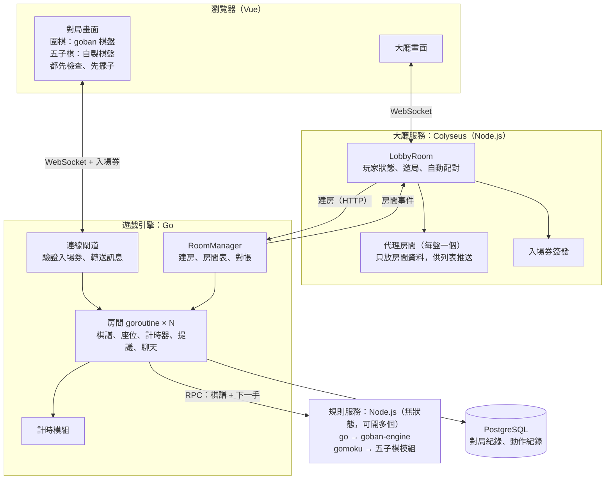
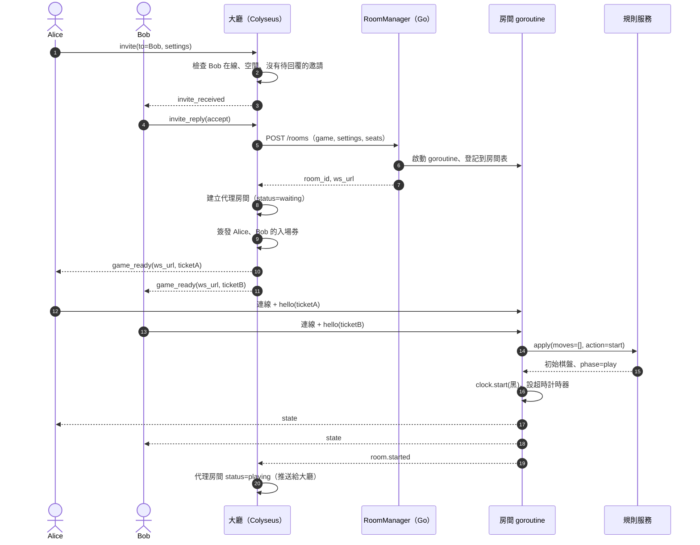
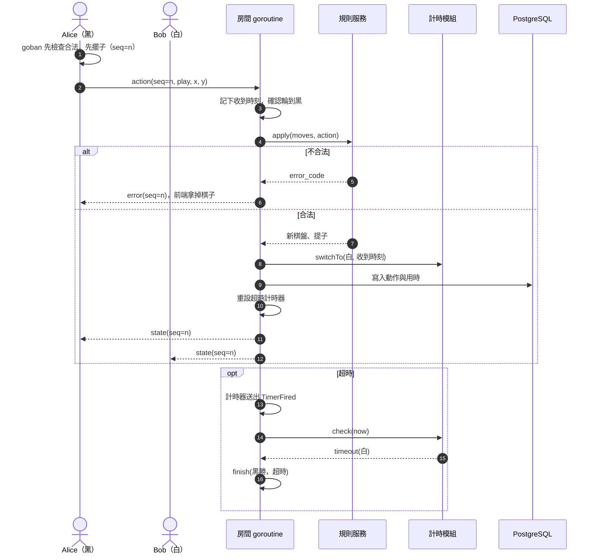
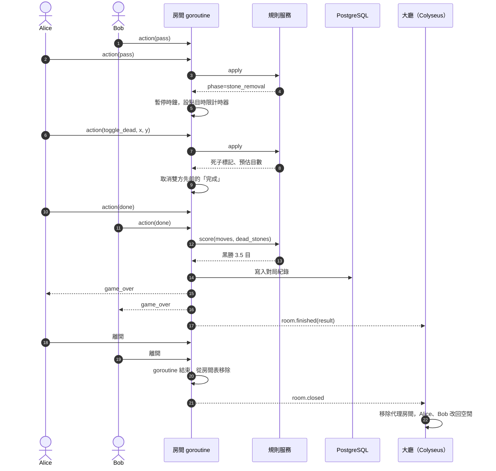

# 架構草案 v2：Colyseus 大廳 + Go 遊戲引擎 + 規則服務

> 整理日期：2026-10-31。狀態：**草案，尚未實作，兩個關鍵假設尚未實驗驗證**（見第 9 節）。
> 前一版：[architecture.md](architecture.md)（大廳與對局都在 Colyseus）。兩者差異見第 10 節。
> 本版涵蓋圍棋與五子棋（freestyle）；井字棋等其他遊戲之後再補。流程圖以圍棋為例，因為它多了點目階段，最複雜。
> 圖中的函式、訊息名稱都是**虛擬碼**。

## 1. 為什麼改架構

- **大廳和對局分開**：大廳只負責「找人、建房、列房間」；對局在獨立的遊戲引擎裡跑。兩邊互不影響，玩家的焦點（在大廳或在房間）也自然分開。
- **每個房間一個 goroutine**：房間自己擁有狀態，從自己的 channel 依序處理事件（玩家動作、計時器觸發、加入離開）。用 Go 寫最直覺，也能用到多核心。
- **計時器能主動觸發事件**：超時判負、讀秒、點目時限到、進入下一階段，都是計時器送進房間的事件。
- **前後端同一份規則**：前端用 `goban` 先檢查、先擺子；後端用同一版 `goban-engine` 當裁判。
- **不重造輪子**：大廳用 Colyseus（連線、重連、房間列表推送），規則用 OGS 的 `goban-engine`。

## 2. 元件



| 元件 | 負責 | 不負責 |
| --- | --- | --- |
| 大廳服務（Colyseus） | 玩家上下線與狀態、邀局、自動配對、房間列表推送、簽發入場券 | 棋盤、計時、對局中的任何判定 |
| 遊戲引擎（Go） | 房間的生命週期、座位、計時器、提議（點目確認、之後的悔棋）、聊天、寫紀錄 | 規則本身、大廳列表 |
| 規則服務（Node） | 依遊戲類型分派到對應模組；給棋譜和下一手，回答合不合法、下完的棋盤、階段、結果 | 任何狀態（每次從棋譜重放） |
| 前端 | 顯示；用和後端同一份規則先檢查、先擺子（圍棋用 `goban`，五子棋用五子棋模組） | 判定結果（以伺服器為準） |

## 3. 遊戲引擎內部（Go）

### 3.1 房間 goroutine 的事件迴圈

每個房間只有一個 goroutine 修改它的狀態，所有事件都排進同一個 channel：

| 事件 | 來源 |
| --- | --- |
| `Join`、`Leave` | 連線閘道（玩家連上或斷線） |
| `Action`（落子、pass、認輸、標記死子、完成） | 連線閘道 |
| `Chat` | 連線閘道 |
| `TimerFired`（超時、點目時限、斷線保留到期） | 房間自己的計時器 |
| `Shutdown` | RoomManager（伺服器關閉、管理員關房） |

處理原則：

- **計時器不直接改狀態**：時間到時只送一個 `TimerFired` 進 channel，和玩家動作一起排隊。「最後一秒落子」和「超時」誰先進佇列就先處理誰。
- **先寫紀錄再廣播**：動作被接受後，先寫進資料庫，再推給玩家。引擎重啟時可以從紀錄重建房間。
- **用收到訊息的時刻扣時**：扣時以閘道收到動作的時刻為準，不包含呼叫規則服務的時間。
- **錯誤隔離**：每個房間 goroutine 用 `recover` 包起來，一盤出錯不影響其他盤。

### 3.2 RoomManager

- `CreateRoom(spec)`：建立房間、啟動 goroutine、登記到房間表，回傳連線位址。
- `GetRoom(id)`：連線閘道用來找到房間的 channel。
- `ListRooms()`：給大廳對帳用。
- `Restore()`：引擎啟動時，從資料庫找出未結束的對局，重建房間 goroutine。

之後若要開多個引擎程序，只要大廳選擇往哪一個建房，房間 goroutine 不用改。

## 4. 介面與協定（虛擬碼）

### 4.1 大廳 → 引擎：建房

```text
POST /rooms
  { room_id, game: "go", settings: { board_size, komi, handicap, time_control, rated },
    seats: [ { seat: 0, user_id, name, color: "black" }, { seat: 1, user_id, name, color: "white" } ],
    private: true }
→ { room_id, ws_url: "wss://<網域>/game/<room_id>" }
```

### 4.2 引擎 → 大廳：房間事件

| 事件 | 時機 | 大廳的處理 |
| --- | --- | --- |
| `room.started` | 雙方都連上、開局 | 代理房間狀態改為「進行中」 |
| `room.player_disconnected`／`reconnected` | 玩家斷線、重連 | 視需要更新玩家狀態 |
| `room.finished` | 對局結束（附結果） | 代理房間狀態改為「已結束」 |
| `room.closed` | 房間 goroutine 結束 | 移除代理房間；玩家狀態改回空閒 |

傳送方式：引擎回呼大廳的 HTTP 端點，或兩者之間維持一條常駐連線（domain socket）。另外大廳定期呼叫 `GET /rooms` 對帳。

### 4.3 入場券

- 大廳用和引擎共用的密鑰簽發短效 token：`{ room_id, user_id, seat, role: player | observer, exp }`。
- 玩家連引擎時出示 token，引擎自己驗證，不用回頭問大廳。
- 有效期要涵蓋整盤棋，斷線重連才能直接用；或讓玩家回大廳換新的。

### 4.4 前端 ↔ 引擎訊息

| 方向 | 訊息 |
| --- | --- |
| 前端 → 引擎 | `hello{ticket}`、`action{seq, type, x?, y?}`、`chat{text}` |
| 引擎 → 前端 | `state{seq, 棋盤, 階段, 提子, 時鐘}`、`error{seq, code}`、`chat`、`game_over{result}` |

前端先擺子時帶著自己的 `seq`；收到 `error` 或 `state` 的序號對不上，就以伺服器的狀態重畫。

### 4.5 引擎 → 規則服務（無狀態 RPC）

規則服務依 `game` 分派：

| `game` | 模組 | 階段 |
| --- | --- | --- |
| `go` | `goban-engine`（OGS） | 對局 → 標記死子 → 結束 |
| `gomoku` | 五子棋模組（沿用 PoC 的 `rules.ts`，15 路、連五以上獲勝、無禁手） | 對局 → 結束 |

```text
apply({ game: "go" | "gomoku", settings, moves: [...棋譜], action })
  → { ok, error_code?, phase, board, captures, result? }

score({ game: "go", settings, moves, dead_stones })
  → { black: {...}, white: {...}, result }
```

- 每次都帶完整棋譜，規則服務重放後檢查下一手，不保存任何狀態。
- 可以加快取（房間 ID + 手數 → 狀態），對不上才重放。快取只是加速，不是必要的。
- 前端和規則服務的規則程式碼必須鎖定同一版本：圍棋是 `goban` 與 `goban-engine`，五子棋是同一份五子棋模組。
- `score` 只有圍棋會用到；五子棋在 `apply` 回傳 `result` 就結束。
- 遊戲引擎不判斷遊戲類型，只看規則服務回傳的 `phase` 和 `result`。五子棋可以用來檢驗引擎有沒有寫死圍棋的假設（例如點目階段）。

## 5. 流程：邀請到開局



拒絕、還價、逾時的分支與 [architecture.md](architecture.md) 3.1 節相同，都在大廳內處理，不會建房。

## 6. 流程：對局中



## 7. 流程：終局與返回大廳



## 8. 故障處理

| 情況 | 影響 | 處理 |
| --- | --- | --- |
| 遊戲引擎重啟 | 進行中的對局中斷 | `Restore()` 從資料庫重建房間；玩家用入場券重連；大廳對帳 |
| 大廳重啟 | 對局不受影響 | 大廳向引擎 `GET /rooms` 重建代理房間 |
| 規則服務掛掉或逾時 | 無法判定落子 | 暫停雙方時鐘、通知玩家、重啟規則服務後重試；**不判任何人超時** |
| 大廳與引擎認知不一致 | 列表出現幽靈房間 | 定期對帳，以引擎為準 |
| 玩家斷線 | — | 保留座位；計分對局時鐘照走 |

## 9. 待驗證（實驗）

1. **規則服務速度**：`goban-engine` 重放加檢查一盤約 300 手的棋要多久，提子、打劫、計分結果是否正確。
2. **代理房間**：Colyseus 內建的房間列表推送只列出 Colyseus 自己的房間。打算為每盤棋開一個不跑對局的代理房間，由引擎事件更新資料。要確認這樣做能正確推送；不行就改成在 LobbyRoom 裡自己維護列表。

## 10. 與 architecture.md 的差異

| 項目 | architecture.md（v1） | arch2.md（本版） |
| --- | --- | --- |
| 對局在哪裡跑 | Colyseus 的 GameRoom（Node） | Go 遊戲引擎，每房一個 goroutine |
| 服務數量 | 1 個 Node 程序 | 3 個：Colyseus 大廳、Go 引擎、Node 規則服務 |
| 建房方式 | `matchMaker.createRoom` + `reserveSeatFor` | 大廳呼叫引擎 `POST /rooms`，自己簽發入場券 |
| 玩家連線 | 一個 Colyseus client，先連大廳再進房 | 兩條 WebSocket：大廳、引擎 |
| 規則在哪裡跑 | 房間程序內直接呼叫 `goban-engine` | 透過 RPC 呼叫規則服務，每次帶完整棋譜 |
| 計時器 | Colyseus 的 `clock.setTimeout` | Go `time.Timer`，觸發時送事件進房間 channel |
| 房間列表 | GameRoom 的 metadata 自動推送 | 引擎事件更新代理房間，再推送 |
| 狀態同步 | 同一程序，不需要 | 引擎 → 大廳事件 + 定期對帳 |
| 重啟影響 | 程序重啟，大廳和對局一起中斷 | 大廳、引擎可分別重啟 |
| 前端先擺子 | 未設計 | `goban` 先檢查、先擺子，用 seq 對帳 |
| 遊戲範圍 | 圍棋、五子棋、井字棋 | 圍棋、五子棋（井字棋之後再補） |
