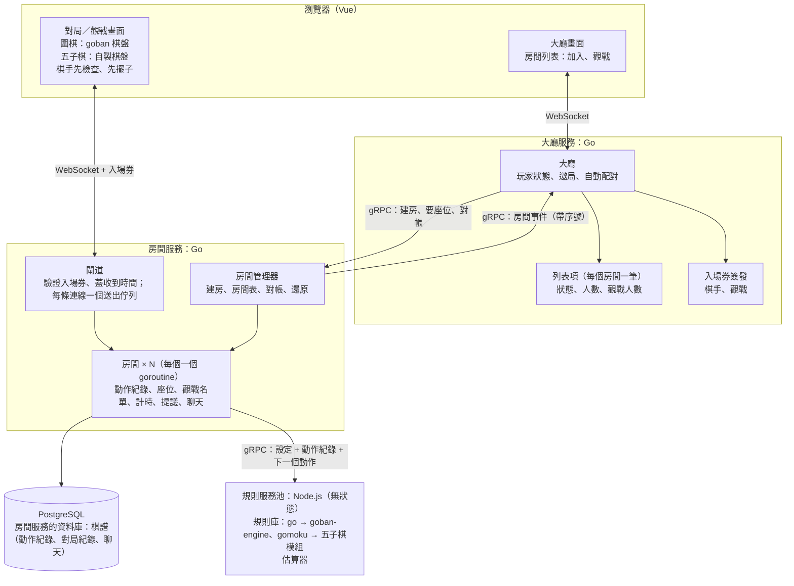
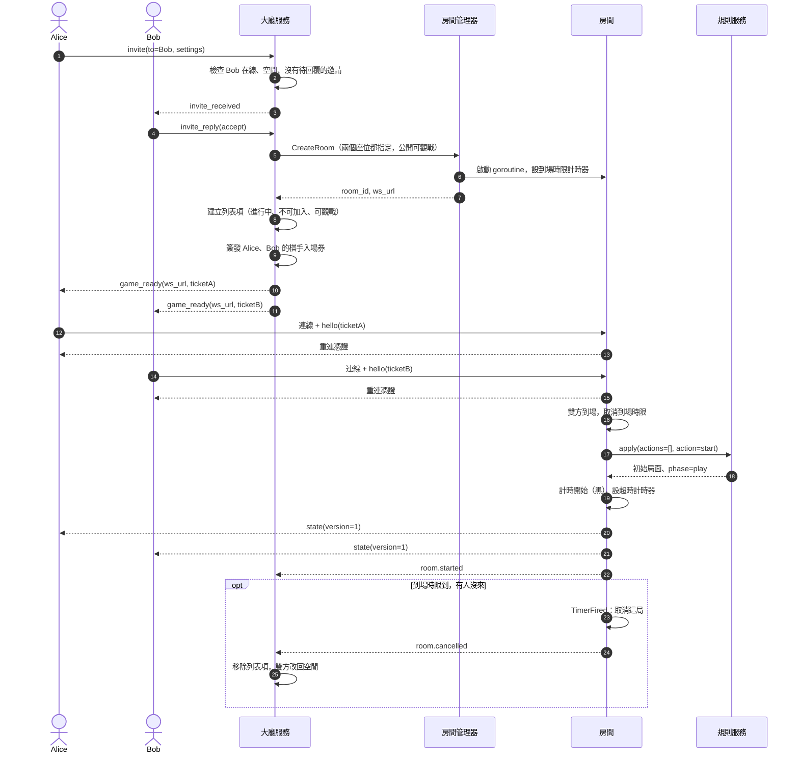
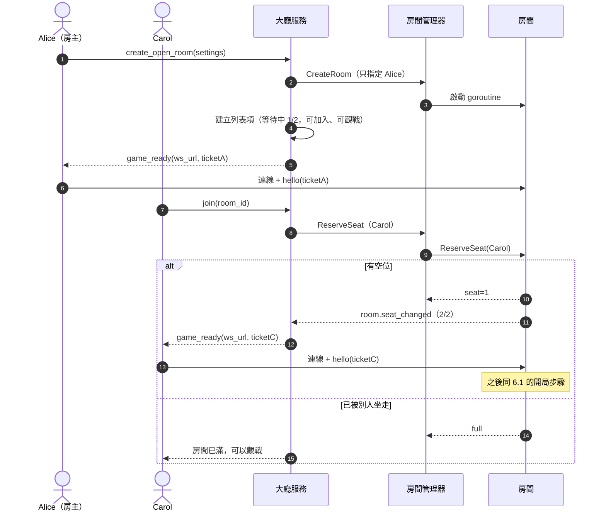
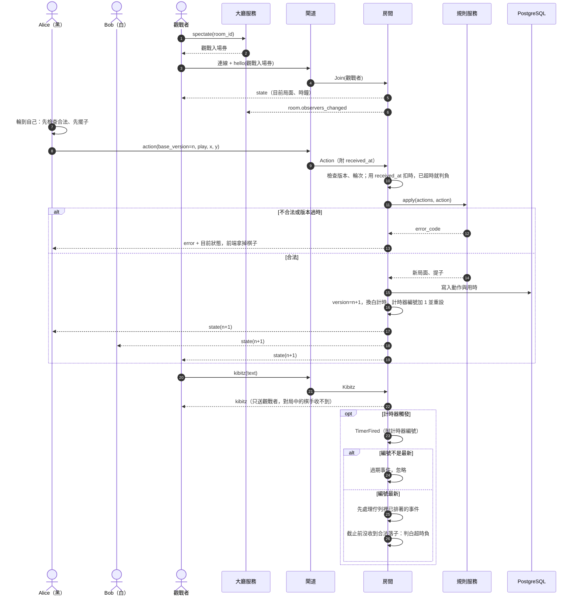
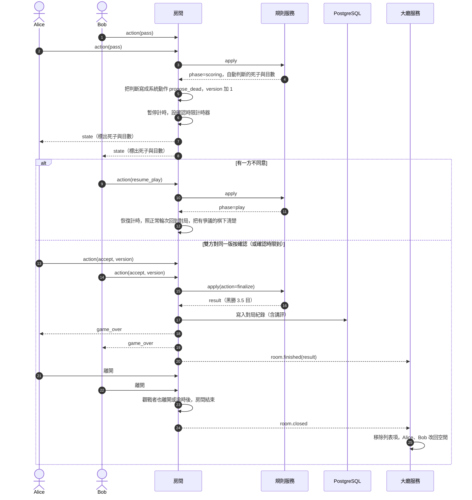

# 架構 v1：大廳服務 + 房間服務 + 規則服務

> 整理日期：2026-10-31（同日修訂：補上觀戰、開放房間、版本號、到場時限；終局改為自動判死子、雙方確認；統一用詞；修正超時判定；棋譜由房間記錄）。
> 狀態：**草案，尚未實作，關鍵假設尚未完全驗證**（見第 10 節）。
> 前一版草案：[history/architecture-colyseus.md](history/architecture-colyseus.md)（大廳與對局都在 Colyseus，已不採用）。兩者差異見第 12 節。
> **2026-10-31 決定**：大廳改為自己寫的薄 Go 大廳（不用 Colyseus），三個服務依「第 2 層分離」獨立，服務之間用 gRPC。路線與理由見 [roadmap.md](roadmap.md)。
> 本版涵蓋圍棋與五子棋（freestyle）；井字棋等其他遊戲之後再補。流程圖以圍棋為例，因為它多了終局確認階段，最複雜。
> 圖中的函式、訊息名稱都是**虛擬碼**。

## 0. 名詞

系統由三個服務組成：**大廳、房間、規則**。單講「大廳」「房間」「規則」指的是概念，加上「服務」指的是那個程序。

| 名詞 | 是什麼 | 屬於 |
| --- | --- | --- |
| **大廳服務** | 玩家狀態、邀局、配對、房間列表、簽發入場券、對局摘要（Go，獨立服務；之後需要社群功能時可換成 Nakama，見路線圖） | — |
| 列表項 | 大廳房間列表上的一筆資料（狀態、人數、觀戰人數），由大廳依房間事件維護，不跑對局 | 大廳服務 |
| **房間服務** | 跑所有房間的程序（Go） | — |
| 閘道 | 接 WebSocket、驗證入場券、蓋收到時間、把訊息送到對的房間、替每條連線送出訊息 | 房間服務 |
| 房間管理器 | 建房、房間表、對帳、重啟後還原 | 房間服務 |
| 房間 | 一桌，一個 goroutine：座位、觀戰名單、計時、提議、聊天、寫紀錄 | 房間服務 |
| 計時模組 | 扣時、讀秒、算截止時間的純計算模組，房間內使用 | 房間 |
| **規則服務** | 判斷合不合法、局面、階段、計分；無狀態（Node.js） | — |
| 規則庫 | 真正判斷規則的程式碼：`goban-engine`（圍棋）、五子棋模組 | 規則服務 |
| 估算器 | OGS 的死子估算器（`online-go/score-estimator`） | 規則服務 |
| 局 | 一盤棋本身。圍棋一個房間只有一局；之後的撲克一個房間會連續打很多局 | — |
| 動作紀錄 | 一局所有被接受的動作，規則服務靠它重放 | 房間 |
| 入場券、重連憑證 | 進房用的兩種憑證（見 5.3 節） | — |
| 棋手、觀戰者 | 房間裡的兩種角色 | — |

不使用「引擎」一詞，只保留套件本名 `goban-engine`。

## 1. 為什麼改架構

- **大廳和房間分開**：大廳只負責「找人、建房、列房間」；對局在房間服務裡跑。兩邊互不影響，玩家的焦點（在大廳或在房間）也自然分開。
- **每個房間一個 goroutine**：房間自己擁有狀態，從自己的 channel 依序處理事件（玩家動作、計時器觸發、加入離開）。用 Go 寫最直覺，也能用到多核心。
- **計時器能主動觸發事件**：超時判負、讀秒、終局確認時限到、到場時限到，都是計時器送進房間的事件。
- **前後端同一份規則**：前端用 `goban` 先檢查、先擺子；規則服務用同一版 `goban-engine` 當裁判。
- **困難的輪子用現成的，核心自己寫**：規則用 OGS 的 `goban-engine` 與估算器；大廳與房間是產品核心，自己寫，大廳保持很薄。
- **三個服務各自獨立（第 2 層分離）**：同一個 repo、三個獨立程式，只透過 proto 介面溝通，互不 import 對方的程式碼。之後要把大廳換成 Nakama，房間服務與規則服務不用改（見 2.1 節）。

## 2. 元件



| 服務 | 負責 | 不負責 |
| --- | --- | --- |
| 大廳服務 | 玩家上下線與狀態、邀局、自動配對、房間列表與觀戰人數推送、簽發入場券、對局摘要（戰績） | 棋盤、計時、座位的最終分配、對局中的任何判定、棋譜本身 |
| 房間服務 | 房間的生命週期、**座位的最終分配**、觀戰名單、計時與超時判定、提議（終局確認、之後的悔棋）、聊天與講評、**記錄棋譜**（3.5 節） | 規則本身、大廳列表 |
| 規則服務 | 依遊戲類型分派到對應規則庫；從動作紀錄重放，回答合不合法、局面、階段、結果；判死子；把棋譜轉成 SGF 等格式 | 任何狀態 |
| 前端 | 顯示；棋手在對局階段用同一份規則先檢查、先擺子 | 判定結果（以房間為準） |

### 2.1 程式碼分離（第 2 層）

```text
repo
 ├─ proto/   大廳 ↔ 房間、房間 ↔ 規則的介面定義：三個服務唯一的共同約定
 ├─ lobby/   大廳服務（Go，獨立執行檔）
 ├─ room/    房間服務（Go，獨立執行檔）
 ├─ rules/   規則服務（Node，獨立程式）
 └─ docs/    入場券格式、房間事件、名詞
```

- **互不 import**：`lobby/` 與 `room/` 不能 import 對方的程式碼，只能共用 `proto/` 產生的介面。入場券格式寫成規格，各自實作簽發與驗證；若抽成共用函式庫，裡面只能有入場券格式。
- **房間服務不知道大廳是誰做的**：只認 proto 介面與入場券。所以自己寫的 Go 大廳與之後可能換上的 Nakama 大廳，對房間服務來說是同一個介面。
- **用假大廳測房間服務**：房間服務的測試接一個依 proto 實作的假大廳；同一套約定也用來檢查真正的大廳。
- **連線分開**：玩家連大廳一條、連房間一條。

## 3. 房間（房間服務內部）

### 3.1 房間的狀態

規則服務不保存任何東西，一局的狀態全在房間裡：

- **設定**：遊戲類型、棋盤大小、規則（數子法）、貼目、讓子、計時方式、是否計分、可見性。
- **動作紀錄**：所有被接受的動作，依序編號。不只落子，**規則服務提出的死子判斷、恢復對局、定案也是動作**，所以光靠動作紀錄就能重放出完整局面。
- **版本號**：每接受一個動作就加 1，由房間發號。
- **座位**：哪個座位是誰、是否已到場、是否連線中。
- **觀戰名單**。
- **提議**：例如雙方是否已確認死子判斷，以及確認的是哪一個版本。
- **計時模組的狀態**，以及目前計時器的編號（見 3.3 節）。

### 3.2 事件迴圈

每個房間只有一個 goroutine 修改它的狀態，所有事件都排進同一個 channel：

| 事件 | 來源 | 附帶 |
| --- | --- | --- |
| `ReserveSeat` | 房間管理器（大廳要求替某人保留座位） | — |
| `Join`、`Leave` | 閘道（棋手或觀戰者連上、斷線） | 收到時間 |
| `Action`（落子、pass、認輸、確認結果、恢復對局） | 閘道 | **收到時間**、`base_version` |
| `Chat`（棋手對話）、`Kibitz`（觀戰講評） | 閘道 | 收到時間 |
| `TimerFired`（超時、確認時限、到場時限、斷線保留到期） | 房間自己的計時器 | **計時器編號** |
| `Shutdown` | 房間管理器（房間服務關閉、管理員關房） | — |

處理原則：

- **計時器不直接改狀態**：時間到只送一個 `TimerFired` 進 channel，由房間自己決定要不要判超時（見 3.3 節）。
- **先寫紀錄再廣播**：動作被接受後先寫進資料庫，再推給所有人。房間服務重啟時可以從紀錄重建房間。
- **不被慢連線拖住**：房間不直接寫 WebSocket，而是把訊息放進每條連線自己的送出佇列，由閘道替該連線送出。佇列滿了就斷開那條連線，對局不受影響。觀戰者多時尤其重要。
- **呼叫規則服務一定設逾時**：等待期間這個房間的其他事件會排隊，所以逾時要短（例如 2 秒），逾時處理見第 9 節。
- **錯誤隔離**：每個房間的 goroutine 用 `recover` 包起來，一個房間出錯不影響其他房間。

### 3.3 超時判定

**原則：房間在截止時間（含寬限）之前「收到」合法的一手，就不算超時，跟房間什麼時候處理到它無關。**

不能用「佇列裡誰先排到」來判，因為：

- 落子要先經過閘道才進房間的 channel，計時器則由別的 goroutine 直接送進來，佇列順序不等於事件實際發生的順序。
- 房間在等規則服務回應時，事件都在排隊，誰先誰後只是運氣。
- 落子後房間會重設計時器，但舊計時器可能在取消前一刻已經觸發，過期的 `TimerFired` 已經在佇列裡。

做法：

1. **閘道替每個訊息蓋收到時間**（`received_at`），之後排多久隊都不影響判定。
2. **處理落子時用收到時間扣時**：用 `received_at` 算這手用了多少時間（扣掉延遲補償）。已經超過剩餘時間加寬限，這手不算，直接判這位棋手超時。呼叫規則服務花的時間不算棋手的。
3. **`TimerFired` 帶計時器編號**：每次重設計時器編號就加 1；處理時編號不是最新的，就是過期事件，直接忽略。
4. **判超時前先清佇列**：處理 `TimerFired`、確定時間已到時，先把 channel 裡已經排著的事件拿出來處理。只要其中有截止前收到的合法落子，就以落子為準，不判超時。
5. **計時器設在截止時間加寬限之後觸發**：寬限（例如 0.5 秒）涵蓋從閘道到房間的排隊時間，讓截止前收到的落子都來得及進佇列。

### 3.4 房間管理器

- `CreateRoom(spec)`：建立房間、啟動 goroutine、登記到房間表。
- `ReserveSeat(room_id, user)`：把請求送進該房間，由房間決定給哪個座位，或回覆已滿。座位只在房間裡分配，不會兩人搶到同一個位子。
- `GetRoom(id)`：閘道用來找到房間的 channel。
- `ListRooms()`：給大廳對帳用。
- `Restore()`：房間服務啟動時，從資料庫找出未結束的局，重建房間。

之後若要開多個房間服務程序，只要大廳選擇往哪一個建房，房間的程式不用改。

### 3.5 棋譜

**棋譜由房間記錄**，存在房間服務自己的資料庫。

| 服務 | 和棋譜的關係 |
| --- | --- |
| 房間 | **記錄者**：每接受一個動作就先寫進資料庫再廣播（3.2 節）；局結束時寫入完整的對局紀錄 |
| 規則服務 | **轉換者**：不存任何東西；房間把動作紀錄交給它，它重放局面，或轉成 SGF 等棋譜格式 |
| 大廳 | **不記棋譜**：局結束時只保存一筆摘要（棋譜 ID、對手、執色、結果、時間），用來顯示戰績；要看完整棋譜時向房間服務查詢 |

棋譜的內容：

- **動作紀錄**：每個動作的序號、類型、送出者、內容、收到時間、用時。動作包含落子、pass、認輸、規則服務提出的死子判斷、恢復對局、定案。
- **局的資料**：設定（棋盤、規則、貼目、讓子、計時）、棋手與執色、開始與結束時間、結果（例如黑勝 3.5 目、超時勝）、使用的規則庫版本。
- **對話與講評**：棋手對話、觀戰講評，局結束後公開並寫進棋譜。

同一份動作紀錄有多種用途：房間服務重啟後還原房間（`Restore()`）、規則服務每次重放判斷、匯出 SGF、覆盤、之後計算等級分。所以紀錄要附規則庫版本，規則庫升級後舊棋譜才能正確重放。

資料歸屬：

- 房間服務擁有棋譜的資料表。大廳服務不能直接讀寫，只能透過房間服務提供的查詢介面（例如 `GET /records/{id}`，或 gRPC 的 `GetRecord`）。
- 兩個服務可以共用同一台 PostgreSQL，但使用不同的資料庫（或 schema）與不同的資料庫帳號，互相不能存取對方的資料。
- 寫紀錄失敗時，這個動作不算數、不廣播，並回錯誤給送出者，避免出現「大家都看到了、棋譜卻沒記到」的動作。

## 4. 規則服務

### 4.1 分派

| `game` | 規則庫 | 階段 |
| --- | --- | --- |
| `go` | `goban-engine`（OGS） | 對局 → 確認死子（規則服務自動判斷）→（可恢復對局）→ 結束 |
| `gomoku` | 五子棋模組（沿用 PoC 的 `rules.ts`，15 路、連五以上獲勝、無禁手） | 對局 → 結束 |

### 4.2 介面（無狀態 gRPC）

```text
apply({ game, settings, actions: [...動作紀錄], action, viewer?: seat | "observer" })
  → { ok, error_code?, phase, position, captures, dead_stones?, score_estimate?, result? }
```

- **動作紀錄包含所有動作**（落子、pass、認輸、規則服務提出的死子判斷、恢復對局、定案），重放後就能得到完整局面，所以規則服務不需要保存狀態。
- **`viewer`**：給誰看的畫面。圍棋和五子棋大家看到的一樣，先保留這個參數，給之後有隱藏資訊的遊戲用。
- **快取**：規則服務可以暫存「房間 ID + 版本 → 局面」，對得上就從那裡接著算。快取只是加速，不是必要的。
- **版本鎖定**：前端和規則服務必須用同一版規則庫：圍棋是 `goban` 與 `goban-engine`，五子棋是同一份五子棋模組。
- **只開放給房間服務呼叫**：規則服務只聽本機或內網。
- **規則服務池**：Node 是單執行緒，規則計算集中在這裡，要多開幾個組成池，才能真正用到多核心。
- **房間不判斷遊戲類型**，只看規則服務回傳的 `phase` 和 `result`。五子棋可以用來檢驗房間有沒有寫死圍棋的假設。

### 4.3 圍棋終局

- **自動判死子**：連續兩次 pass 後，規則服務先用估算器（`online-go/score-estimator`，MIT 授權，C++ 編成 WebAssembly 後直接在規則服務載入）算出每點歸屬，再交給 `goban-engine` 的 `autoscore` 判斷死子，最後用 `computeScore` 算分，回傳 `phase=scoring`。
  - 不用 `goban-engine` 內建的簡易估算（Voronoi）：實測判斷不了死活（見第 10 節）。
  - 不經過 `goban-engine` 載入估算器的函式：它限定只能在瀏覽器執行，所以規則服務直接載入估算器的 WebAssembly 模組。
  - `goban-engine` 在雙方 pass 後不會自己切換階段，「連續兩次 pass」由規則服務從動作紀錄判斷。
- **判斷結果要記進動作紀錄**：估算用蒙地卡羅模擬，同一個局面算兩次不一定一樣。所以房間把這次的判斷結果當成一個系統動作（`propose_dead{死子集合}`）寫進紀錄，之後重放直接用紀錄裡的集合，不再重算。
- **確認由房間的提議機制處理**：雙方都對同一個版本按「確認」，房間才送出 `finalize`，規則服務依紀錄的死子集合算最終結果。任何一方按「恢復對局」，就回到對局階段，之後再連續 pass 會重新判斷一次。
- **終局規則（已定）**：
  1. **固定數子法**（`rules: "chinese"`）。恢復對局、把有爭議的棋下清楚，在數子法下不會改變目數，所以公平。第一版不提供日本規則（數目法）。
  2. **恢復對局後照正常輪次**。雙方各 pass 一次才進入確認，各放棄一手，恢復後照常輪流，沒有人能多拿一手。
  3. **確認時限到、沒回應視為同意**判斷結果。不回應只會讓自己接受判斷，故意拖延沒有好處；時限內斷線重連仍可回應。
  4. 任何時候都可以認輸，包括確認階段。

## 5. 服務之間的協定（虛擬碼）

### 5.1 大廳服務 → 房間服務（gRPC，只接受大廳服務呼叫）

| 方法 | 輸入 | 回傳 |
| --- | --- | --- |
| `CreateRoom` | `room_id`、`game`、`settings{board_size, rules: "chinese", komi, handicap, time_control, rated}`、`seats[{seat, user_id, name, color}]`、`visibility{listed, spectate}` | `room_id`、`ws_url`（例如 `wss://<網域>/game/<room_id>`） |
| `ReserveSeat` | `room_id`、`user_id`、`name` | `seat`，或錯誤 `full`／`finished` |
| `ListRooms` | — | 所有房間的 ID、成員、狀態、觀戰人數（對帳用） |
| `GetRecord` | 棋譜 ID | 完整棋譜（3.5 節） |
| `CloseRoom` | `room_id` | 強制關房（管理用） |

- **邀局、自動配對**：建房時兩個座位都已指定。
- **開放房間**：建房時只指定房主，另一個座位空著。
- `visibility` 預設公開、可觀戰。不公開、不開放觀戰之後做成建房選項。

開放房間有人按「加入」時，大廳先呼叫 `ReserveSeat` 要座位，拿到才簽發入場券。

### 5.2 房間服務 → 大廳服務：房間事件

| 事件 | 時機 | 大廳的處理 |
| --- | --- | --- |
| `room.seat_changed` | 開放房間有人入座或離座（開局前） | 更新列表項的人數 |
| `room.started` | 雙方都到場、開局 | 列表項改為「進行中」 |
| `room.observers_changed` | 觀戰人數變化（合併後每幾秒送一次） | 更新列表項的觀戰人數 |
| `room.player_disconnected`／`reconnected` | 棋手斷線、重連 | 視需要更新玩家狀態 |
| `room.cancelled` | 到場時限內有人沒來 | 移除列表項，玩家改回空閒 |
| `room.finished` | 局結束（附摘要：棋譜 ID、棋手與執色、結果、開始與結束時間） | 列表項改為「已結束」；把摘要存進每位棋手的戰績 |
| `room.closed` | 房間結束 | 移除列表項，玩家改回空閒 |

- **每個事件帶房間內的序號**：大廳只處理比已知序號新的事件，重複或過期的就忽略，所以遺失重送、亂序都不會出錯。
- **傳送方式**：房間服務呼叫大廳服務的 gRPC 方法（例如 `ReportRoomEvent`），失敗就重試。
- **定期對帳**：大廳定期呼叫 `ListRooms`，以房間服務為準修正列表項。

### 5.3 入場券與重連憑證

| 憑證 | 誰發 | 內容 | 有效期 | 用途 |
| --- | --- | --- | --- | --- |
| 棋手入場券 | 大廳服務 | `room_id, user_id, seat, role: player` | 短（例如 60 秒），只能用一次 | 第一次連進房間 |
| 觀戰入場券 | 大廳服務 | `room_id, user_id, role: observer` | 短，只能用一次 | 連進房間觀戰 |
| 重連憑證 | 房間 | `room_id, user_id, seat` | 到房間結束為止 | 斷線後直接重連 |

- 大廳服務和房間服務共用密鑰，閘道自己驗證入場券，不用回頭問大廳。
- 入場券短效又只能用一次，外洩的風險小。重連憑證在連上後發給這條連線，只存在該棋手的瀏覽器。

### 5.4 前端 ↔ 房間

| 方向 | 訊息 |
| --- | --- |
| 前端 → 房間 | `hello{入場券 或 重連憑證}`、`action{base_version, type, x?, y?}`、`chat{text}`、`kibitz{text}` |
| 房間 → 前端 | `state{version, 局面, 階段, 提子, 判定的死子與目數, 時鐘, 觀戰人數}`、`error{code, version}`、`chat`、`kibitz`（只送觀戰者）、`game_over{result}` |

- **版本號由房間發**：前端送動作時附上「我看到的版本」（`base_version`）。房間發現版本已過時，就拒絕並回傳目前狀態，前端照房間的狀態重畫。
- **先擺子只在對局階段**：輪到自己時，用同一份規則先檢查、先擺子；被拒絕就拿掉。確認階段雙方可能同時操作，不先做，等房間回傳。
- **觀戰者只能送講評**：送動作一律拒絕。

## 6. 流程：開局

### 6.1 邀局（自動配對相同，只是由大廳的配對佇列湊到兩人）



拒絕、還價、逾時的分支與 [舊版草案](history/architecture-colyseus.md) 3.1 節相同，都在大廳內處理，不會建房。

### 6.2 開放房間



## 7. 流程：對局中與觀戰



## 8. 流程：終局與返回大廳



## 9. 故障與例外處理

| 情況 | 影響 | 處理 |
| --- | --- | --- |
| 棋手沒到場 | 房間卡住 | 到場時限（例如 60 秒）到就取消這局，通知大廳，雙方改回空閒 |
| 棋手斷線 | — | 保留座位；計分對局照常計時；用重連憑證回來 |
| 最後一秒落子與超時同時發生 | 可能誤判超時 | 依收到時間判定，見 3.3 節 |
| 房間服務重啟 | 進行中的局中斷 | 房間管理器 `Restore()` 從動作紀錄重建房間，**停機期間不扣時**，重建後先暫停，雙方都重連才繼續；大廳對帳 |
| 大廳服務重啟 | 對局不受影響 | 大廳呼叫房間服務的 `ListRooms` 重建列表項 |
| 房間事件遺失或亂序 | 列表不正確 | 事件帶序號、可重送；定期對帳，以房間服務為準 |
| 確認時限到，有人沒回應 | 終局卡住 | 視為同意判斷結果，依紀錄的死子集合定案 |
| 規則服務掛掉或逾時 | 無法判定動作 | 暫停雙方計時、通知「伺服器忙碌」、換池裡另一個規則服務重試；**不判任何人超時** |
| 觀戰者連線太慢 | 可能拖慢房間 | 送出佇列滿了就斷開該觀戰者 |

## 10. 待驗證（實驗）

1. **規則服務**（部分已驗證，2026-10-31，`goban-engine` 8.3.226）：
   - 19 路約 300 手，「重放 299 手 + 檢查第 300 手」中位數約 7.5 毫秒（最慢約 10 毫秒），每次帶完整動作紀錄可行。
   - 提子、自殺（`illegal_self_capture`）、打劫（`illegal_ko_move`）判斷正確；`computeScore` 數子法計分正確。
   - 注意：`autoscore` 會直接修改傳入的棋盤陣列，要傳副本；估算器回傳 1／2，`autoscore` 要正負數值，要先轉換。
   - 尚未驗證：恢復對局、定案的完整流程。
2. **自動判死子的品質**：
   - 內建的簡易估算（Voronoi）**不可用**：實測一顆被白棋三面包圍的黑子仍被判成活棋，白地全部不算。
   - 估算器：`goban-engine` 的載入函式限定只能在瀏覽器執行，但估算器本身是獨立的 C++ 專案（MIT），可以編成 WebAssembly 在 Node 載入。**尚未實際編譯測試**（需要允許在環境中編譯、執行外部程式碼）。
   - 要用估算器附帶的分級測試局面（沒有死子、棋形、簡單、中等、困難、非常困難）量準確度。OGS 論壇有使用者回報它常認不出大塊或複雜的死棋；因為有雙方確認與恢復對局，判斷錯誤不會判錯勝負，只是要多下幾手。
3. **觀戰推送**：一個房間 100 位觀戰者時，每手推送的延遲與記憶體用量。
4. **超時判定**：模擬「截止前 0.1 秒落子」與「規則服務回應很慢」，確認不會誤判超時，過期的計時器事件會被忽略。

## 11. 待決事項

- **能否手動修正死子**：第一版只能「確認」或「恢復對局」，不能手動標記；之後視自動判斷的準確度再決定要不要加。
- **身分驗證**：第一版用訪客名稱；之後接登入（或換成 Nakama 的帳號）。
- **聊天保存**：棋手對話和觀戰講評都存進資料庫，講評在局結束後公開並寫進棋譜。保存期限待定。
- **不公開、不開放觀戰**：做成建房選項的時機。
- **延遲直播**：重要對局讓觀戰者晚幾手看到，降低場外報招的風險。第一版不做。
- **維運**：三個服務、兩種語言，加上反向代理與資料庫，部署、監控、日誌怎麼規劃。
- **舊文件用詞**：[設計討論紀錄](design-discussion.md) 與 `history/` 中的「房間引擎」，等同本文件的「房間」。

## 12. 與舊版草案（Colyseus）的差異

| 項目 | 舊版草案（[history/architecture-colyseus.md](history/architecture-colyseus.md)） | 本版 |
| --- | --- | --- |
| 對局在哪裡跑 | Colyseus 的 GameRoom（Node） | 房間服務（Go），每個房間一個 goroutine |
| 服務數量 | 1 個 Node 程序 | 3 個獨立服務：大廳服務（Go）、房間服務（Go）、規則服務池（Node），服務之間用 gRPC |
| 建房與座位 | `matchMaker.createRoom` + `reserveSeatFor` | 大廳以 gRPC 呼叫 `CreateRoom`、`ReserveSeat`；座位由房間分配 |
| 玩家連線 | 一個 Colyseus client，先連大廳再進房 | 兩條 WebSocket：大廳、房間；入場券 + 重連憑證 |
| 規則在哪裡跑 | 房間程序內直接呼叫 `goban-engine` | RPC 呼叫規則服務，每次帶完整動作紀錄 |
| 計時器 | Colyseus 的 `clock.setTimeout` | Go `time.Timer`，觸發時送事件進房間；依收到時間判超時 |
| 房間列表 | GameRoom 的 metadata 自動推送 | 大廳依房間事件維護列表項並推送；所有對局公開可觀戰 |
| 觀戰 | 未設計 | 觀戰入場券、講評只給觀戰者、每條連線獨立送出佇列 |
| 狀態同步 | 同一程序，不需要 | 房間服務 → 大廳服務事件（帶序號）+ 定期對帳 |
| 重啟影響 | 程序重啟，大廳和對局一起中斷 | 大廳服務、房間服務可分別重啟；停機期間不扣時 |
| 前端先擺子 | 未設計 | 對局階段先擺子；房間發版本號對帳 |
| 終局方式 | 雙方手動標記死子，都按完成才定案 | 規則服務自動判死子，雙方確認；有爭議就恢復對局 |
| 到場時限 | 未設計 | 有 |
| 用詞 | 房間引擎 | 大廳、房間、規則（見第 0 節） |
| 遊戲範圍 | 圍棋、五子棋、井字棋 | 圍棋、五子棋（井字棋之後再補） |
