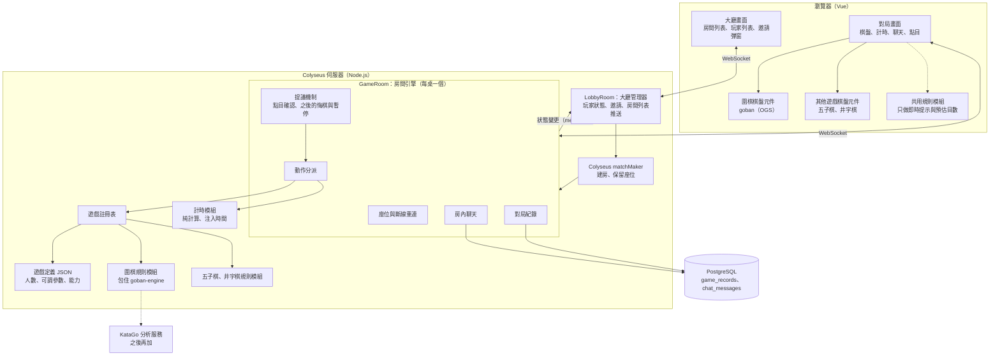
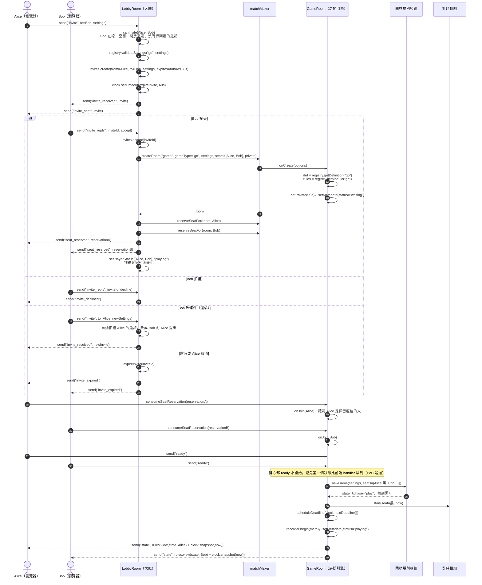
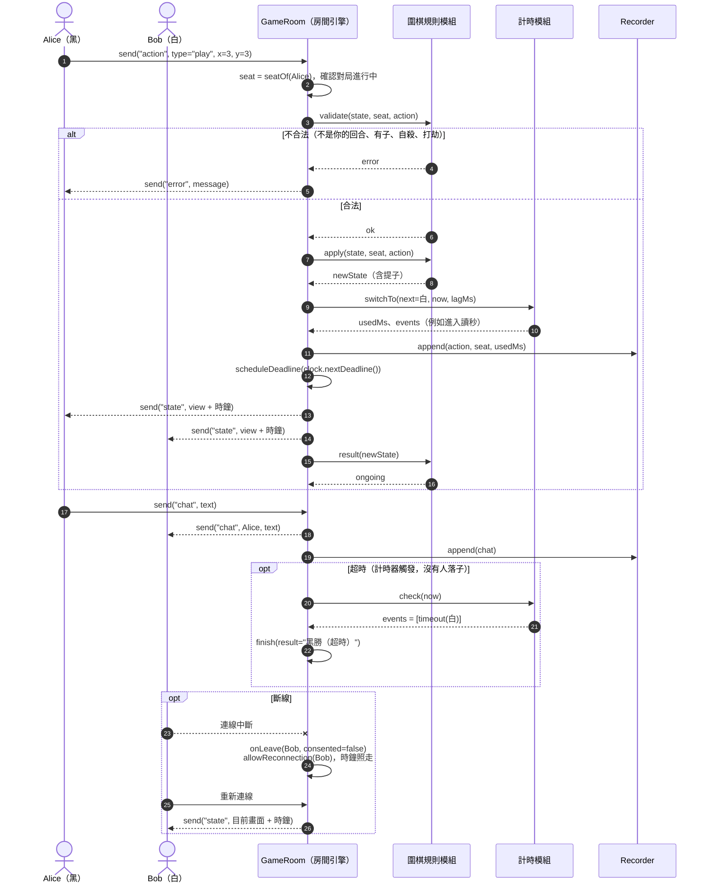
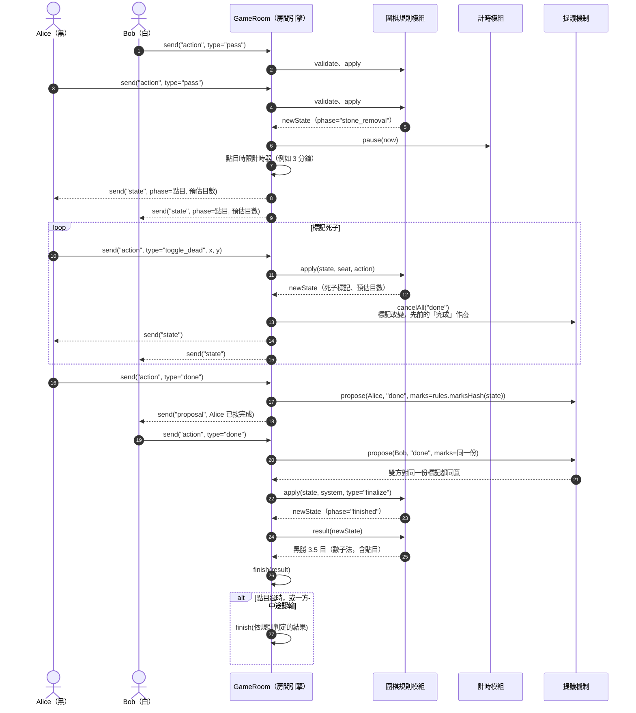
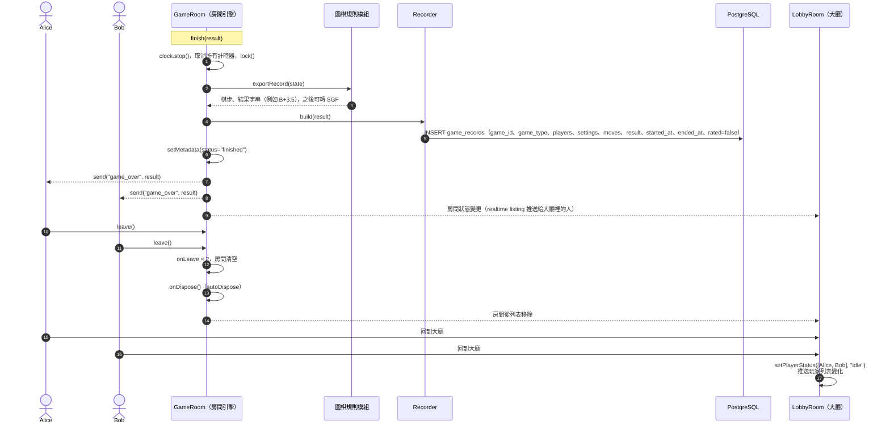

# 架構草案：Colyseus 版（圍棋第一版）

> **已不採用**（2026-10-31）。目前的規格見 [spec_v1.md](../spec_v1.md)，路線見 [roadmap.md](../roadmap.md)。

> 整理日期：2026-10-30。狀態：**草案，尚未實作**。
> 依據：[設計討論紀錄](design-discussion.md)（第 2～4、8～10 節）與 `poc/colyseus` 分支的結構（`Lobby.ts`、`GameRoom.ts`、`rules.ts`、`db.ts`）。
> 流程圖中的函式是**虛擬碼**，用來說明誰呼叫誰。Colyseus 的 API 名稱（`matchMaker.createRoom`、`reserveSeatFor`、`consumeSeatReservation`、`allowReconnection`、`presence.publish` 等）以 0.18 版型別定義為準，實作時要再確認。

## 1. 架構圖

原則（見設計討論第 2 節）：

- **大廳不碰棋盤**：LobbyRoom 只知道房間的遊戲類型、設定、座位與狀態。
- **規則模組不碰網路**：只做「狀態 + 動作 → 新狀態」，不知道玩家怎麼連線，也不知道時間。
- **計時模組不碰規則**：只做扣時、讀秒、判定超時，時間由房間引擎傳入。
- **伺服器是裁判**：前端的共用規則模組只用來即時提示，結果一律以伺服器為準。

## 2. 各模組的職責與主要函式（虛擬碼）

| 模組 | 職責 | 主要函式 |
| --- | --- | --- |
| LobbyRoom | 玩家上下線、玩家狀態（空閒／對局中）、邀請、房間列表推送 | `onJoin`、`onLeave`、`onMessage("invite")`、`onMessage("invite_reply")`、`expireInvite`、`setPlayerStatus` |
| GameRoom | 座位、動作分派、提議、聊天、計時器、紀錄、結束 | `onCreate`、`onJoin`、`onMessage("ready")`、`onMessage("action")`、`onMessage("chat")`、`onDeadline`、`finish`、`onLeave`、`onDispose` |
| 遊戲註冊表 | 依遊戲類型取得定義與規則模組 | `getDefinition(type)`、`getModule(type)`、`validateSettings(type, settings)` |
| 規則模組（GameModule） | 遊戲規則 | `newGame(settings, seats)`、`currentTurn(state)`、`phase(state)`、`validate(state, seat, action)`、`apply(state, seat, action)`、`result(state)`、`view(state, seat)`、`replay(settings, actions)`、`exportRecord(state)` |
| 計時模組（Clock） | 扣時、讀秒、超時 | `start(seat, now)`、`switchTo(next, now, lagMs)`、`pause(now)`、`resume(now)`、`nextDeadline()`、`check(now)`、`snapshot(now)` |
| 提議機制（Proposals） | 需要對方同意的事 | `propose(from, type, params)`、`respond(id, answer)`、`cancelAll(type)` |
| 對局紀錄（Recorder） | 保存事件與結果 | `begin(meta)`、`append(event)`、`build(result)`、`save(record)` |

規則模組比 PoC 多了 `phase`、`view`、動作類型與參與座位，這些是加圍棋必需的（見設計討論第 2 節與「現有介面草案的缺口」的討論）。

## 3. 流程：邀請對局到結束對局

情境：Alice 邀請 Bob 下一盤 19 路圍棋（Alice 執黑、貼目 6.5、日式讀秒）。為了好讀，拆成四段。

### 3.1 邀請到開局

### 3.2 對局中：落子與超時

### 3.3 終局：pass、點目、結算

### 3.4 結束：存紀錄、返回大廳

## 4. 待確認

- Colyseus 0.18 的實際 API：`matchMaker.createRoom`、`reserveSeatFor`、`consumeSeatReservation`、`setPrivate`、`allowReconnection`、`presence.publish` 的名稱與參數。
- 私人房間（邀局建立的房間）要不要出現在大廳的房間列表（顯示為「進行中、不可加入」，或完全隱藏）。
- 玩家狀態由誰維護：LobbyRoom 在建房時標成「對局中」，玩家回大廳時改回「空閒」；斷線未回大廳的情況要定規則。
- `goban-engine` 的資料格式怎麼對應到 `validate`、`apply`、`view`；「完成」的協商是由提議機制處理，還是直接用 `goban-engine` 內建的 stone removal 流程。
- 觀戰者的加入方式與講評頻道（設計討論第 5.5、6 節），本草案還沒畫。

## 附錄：與規格 v1 的差異

| 項目 | 本草案（Colyseus） | 規格 v1 |
| --- | --- | --- |
| 對局在哪裡跑 | Colyseus 的 GameRoom（Node） | 房間服務（Go），每個房間一個 goroutine |
| 服務數量 | 1 個 Node 程序 | 3 個獨立服務：大廳服務（Go）、房間服務（Go）、規則服務池（Node），服務之間用 gRPC |
| 建房與座位 | `matchMaker.createRoom` + `reserveSeatFor` | 大廳以 gRPC 呼叫 `CreateRoom`、`ReserveSeat`；座位由房間分配 |
| 玩家連線 | 一個 Colyseus client，先連大廳再進房 | 兩條 WebSocket：大廳、房間；入場券 + 重連憑證 |
| 規則在哪裡跑 | 房間程序內直接呼叫 `goban-engine` | 以 gRPC 呼叫規則服務，每次帶完整動作紀錄 |
| 計時器 | Colyseus 的 `clock.setTimeout` | Go `time.Timer`，觸發時送事件進房間；依收到時間判超時 |
| 房間列表 | GameRoom 的 metadata 自動推送 | 大廳依房間事件維護列表項並推送；所有對局公開可觀戰 |
| 觀戰 | 未設計 | 觀戰入場券、講評只給觀戰者、每條連線獨立送出佇列 |
| 狀態同步 | 同一程序，不需要 | 房間服務 → 大廳服務事件（帶序號）+ 定期對帳 |
| 重啟影響 | 程序重啟，大廳和對局一起中斷 | 大廳服務、房間服務可分別重啟；停機期間不扣時 |
| 前端先擺子 | 未設計 | 對局階段先擺子；房間發版本號對帳 |
| 終局方式 | 雙方手動標記死子，都按完成才定案 | 規則服務自動提出死子判斷，雙方可手動切換死子後同意；談不攏才恢復對局 |
| 到場時限 | 未設計 | 有 |
| 用詞 | 房間引擎 | 大廳、房間、規則（見第 0 節） |
| 遊戲範圍 | 圍棋、五子棋、井字棋 | 圍棋、五子棋（井字棋之後再補） |
