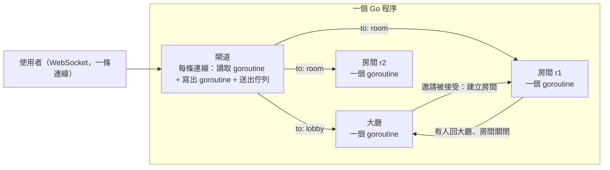

# PoC：Go 大廳（每個房間一個 goroutine）

> 日期：2026-10-31。分支：`poc/go-lobby`。程式碼在 [`go-lobby/`](../go-lobby)，原始測試結果在 [`go-lobby/results/`](../go-lobby/results)。
> 目的：驗證「大廳和房間全部用 Go 自己寫」是否可行，並用 100 位模擬使用者實際跑一次。

## 1. 結論

- **可行，而且簡單**：伺服器（閘道 + 大廳 + 房間）約 840 行 Go（含註解），加上機器人程式與單元測試共約 1,600 行。
- **100 位使用者**：所有檢查全數通過。大廳聊天送到 100 人的延遲 p99 約 3 毫秒，沒有任何訊息遺失或送錯對象，伺服器記憶體約 19 MB。
- **1,000 位使用者**（加測）：所有正確性檢查也全數通過。延遲尾端變長（p99 約 0.4 秒），主要是 1,000 人同時收廣播，而且機器人和伺服器擠在同一台 4 核心機器上。
- **沒有 goroutine 洩漏**：所有人離線後，goroutine 數回到起始的 4 個。
- **拿掉了上線廣播**：玩家上線、離線、進出房間不再推送給所有人，改成進大廳時給一份快照，之後要看再用 `who` 查詢。第一次 1,000 人測試時，上線廣播造成約 100 萬則訊息的風暴（見第 5 節）。

## 2. 架構



- **一條連線**：每則訊息標明 `to: "lobby"` 或 `to: "room"`，閘道依此送到大廳或該使用者目前所在的房間。
- **大廳是一個 goroutine**：玩家表、邀請、房間表都只由它修改，不用鎖，事件一次處理一件。
- **每個房間一個 goroutine**：只管自己的成員和聊天。這個 PoC 沒有棋盤、規則和計時。
- **焦點分開**：玩家在房間時，收不到大廳聊天與房間列表的更新；回到大廳時重新收到一份快照（`welcome`）。私訊和邀請不論在哪都收得到。
- **慢連線直接踢掉**：每條連線有自己的送出佇列（256 則）。佇列滿了就斷開該連線，大廳和房間不會被它拖住。
- **已關閉的房間不會卡住送訊息的人**：送給已關閉房間的訊息直接丟棄。

### 檔案

| 檔案 | 內容 |
| --- | --- |
| `internal/lobby/protocol.go` | 訊息格式 |
| `internal/lobby/client.go` | 使用者（送出佇列、踢除、目前所在房間）與統計計數 |
| `internal/lobby/lobby.go` | 大廳 goroutine：加入、離開、聊天、私訊、`who`、邀請、開房、回大廳 |
| `internal/lobby/room.go` | 房間 goroutine：房內聊天、離開、清空就關閉 |
| `internal/server/server.go` | 閘道：WebSocket、第一則訊息認身分、轉送、`/stats` |
| `cmd/server` | 伺服器主程式 |
| `cmd/bots` | 模擬使用者與結果報告 |
| `internal/lobby/lobby_test.go` | 10 個單元測試 |

## 3. 協定

| 方向 | 送往 | 類型 | 說明 |
| --- | --- | --- | --- |
| 使用者 → | `lobby` | `hello{name}` | 第一則訊息，訪客名稱（不驗證） |
| 使用者 → | `lobby` | `chat{text}` | 大廳聊天，只有在大廳時能送 |
| 使用者 → | `lobby` | `dm{to, text}` | 私訊，對方在大廳或房間都收得到 |
| 使用者 → | `lobby` | `who` | 查詢玩家列表 |
| 使用者 → | `lobby` | `invite{to}`、`invite_reply{invite_id, accept}` | 邀請、接受或拒絕 |
| 使用者 → | `room` | `chat{text}`、`leave` | 房內聊天、回大廳 |
| → 使用者 | `lobby` | `welcome{you, players, rooms}` | 進大廳或回大廳時的快照 |
| → 使用者 | `lobby` | `players`、`chat`、`dm`、`invite`、`invite_result`、`rooms`、`error` | |
| → 使用者 | `room:<id>` | `room_joined`、`chat`、`member_left`、`error` | |

邀請規則：只能邀請在大廳、沒有待回覆邀請的人；30 秒逾時；邀請者離線時自動取消；只有被邀請者能回覆。

## 4. 測試

### 4.1 單元測試（10 個，含 race 偵測）

重複名稱拒絕、大廳聊天、私訊只給對象、邀請開房與房內聊天隔離、回大廳與關房、邀請規則、離線取消邀請、慢連線被踢、上線不廣播、`who` 列出狀態。

### 4.2 模擬使用者（`cmd/bots`）

30 秒分三段：

1. **0～10 秒**：所有人在大廳，平均每 2 秒聊一句，約一成是私訊。
2. **10～20 秒**：前 25 對互相邀請、開房、各在房內聊 5 句；其他人繼續在大廳聊。
3. **20～30 秒**：房裡的人回大廳，大家繼續聊；最後每個人用 `who` 查玩家列表。

自動檢查：

- 第一段的每一句大廳聊天，都要剛好送到所有人（含自己）。
- 每則私訊剛好送到對象一次，不能送錯人。
- 在房間裡的人收不到大廳聊天；任何人都收不到別的房間的聊天。
- 所有邀請都開得了房，所有人都回得了大廳。
- 最後每個人 `who` 看到的大廳人數，要等於總人數。
- 延遲由送出者附上送出時間，收到時計算（同一台機器，時鐘相同）。

## 5. 結果

環境：雲端容器，4 核心；伺服器和機器人在同一台機器上。Go 1.24.7，`github.com/coder/websocket` v1.8.13。

| 項目 | 100 位 | 1,000 位（加測） |
| --- | --- | --- |
| 設定 | 每 2 秒聊一句，25 對開房 | 每 10 秒聊一句，250 對開房 |
| 全部連上 | 29 ms | 444 ms |
| 大廳聊天 | 1,032 句，送達 94,570 次 | 2,129 句，送達約 196 萬次 |
| 大廳聊天延遲 p50／p95／p99 | 1.25／2.1／3.25 ms | 11.9／56／417 ms |
| 第一段聊天全數送達 | 355／355 | 817／817 |
| 私訊剛好送達一次 | 138／138 | 255／255 |
| 開房、進房 | 25 房、50 人 | 250 房、500 人 |
| 房內聊天延遲 p50／p99 | 0.36／1.2 ms | 0.34／201 ms |
| 最後 `who` 正確 | 100／100 | 1,000／1,000 |
| 隔離違規、錯誤 | 0、0 | 0、0 |
| 被踢的慢連線 | 0 | 0 |
| 伺服器 goroutine（連線中 → 全部離線後） | 304 → 4 | 3,004 → 4 |
| 伺服器 heap（全部連上時） | 3.4 MB | 49 MB |
| 伺服器 RSS | 約 19 MB | 約 95 MB |

每條連線用 3 個 goroutine（讀取、寫出，加上 HTTP 本身），所以 100 人是 304 個、1,000 人是 3,004 個。

### 第一次 1,000 人測試：上線廣播風暴

最初的版本，每個人上線都會把「某某上線了」推給大廳裡所有人。1,000 人在 3 秒內上線，就產生約 100 萬則上線通知，塞爆送出佇列：

- 212 條連線因佇列滿被當成慢連線踢掉，之後邀請、私訊、聊天接連失敗。
- 全部連上花了 3.3 秒，大廳聊天延遲 p99 達 1.75 秒。

先試過「每 200 毫秒合併成一則」，100 人時沒問題；最後依討論決定**完全不做上線廣播**，改成快照加 `who` 查詢。改完後 1,000 人全部連上只要 0.44 秒，沒有任何連線被踢。

### 其他觀察

- **`welcome` 快照會隨人數變大**：每個人進大廳都會拿到完整玩家列表，1,000 人時每份約 50 KB，所以全部連上時 heap 到 49 MB。人更多時，快照應該只給人數或分頁，列表靠 `who` 分頁查詢。
- **1,000 人時延遲的尾端**：大廳聊天每句要送給 1,000 人，30 秒內共約 236 萬則送出；機器人解析這些訊息也佔用同一台機器的 CPU。要看伺服器真正的上限，得把機器人放到另一台機器。
- **房間列表仍然廣播**：開房、關房時推送給大廳裡的人。這次沒有造成問題，但人多時也可以改成查詢或合併送出。

## 6. 沒有做的

- 規則、棋盤、計時（房間只有聊天）。
- 身分驗證（直接信任訪客名稱）、資料庫、斷線重連、心跳。
- 觀戰、開放房間、自動配對。
- 多個程序或多台機器。

## 7. 怎麼執行

```bash
cd go-lobby
go test -race ./...                       # 單元測試
go run ./cmd/server -addr 127.0.0.1:8910  # 伺服器（另一個終端機）
go run ./cmd/bots -n 100 -duration 30s -out results/run-100.json
go run ./cmd/bots -n 1000 -duration 30s -chat-every 10s -pairs 250 -out results/run-1000.json
curl http://127.0.0.1:8910/stats          # 伺服器統計
```

1,000 人測試需要足夠的檔案描述子（例如 `ulimit -n 20000`）。

## 8. 下一步

- 房間加上規則服務呼叫與計時，驗證 arch2 的超時判定（依收到時間、計時器編號、判超時前先清佇列）。
- 加上斷線重連、心跳、身分驗證。
- 機器人放到另一台機器，量伺服器的實際上限。
- `welcome` 快照改成只給人數，`who` 改成分頁。
