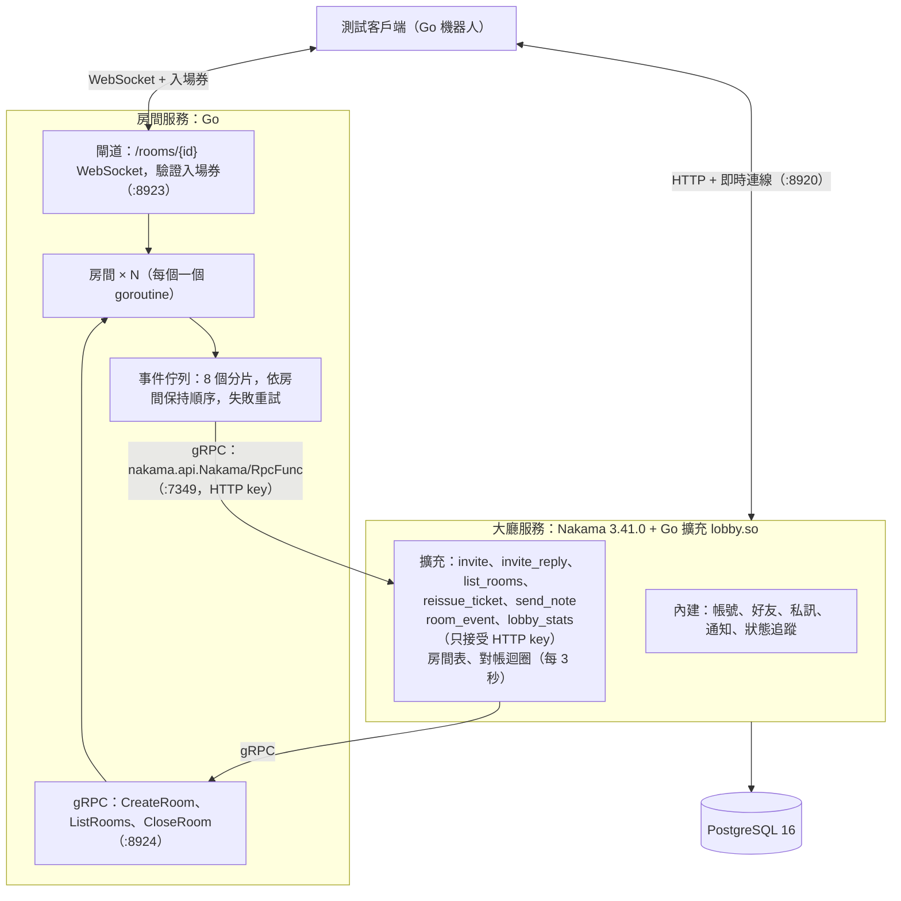

# PoC 結果：Nakama 大廳 + Go 房間服務

> 日期：2026-10-31。分支：`poc/nakama-lobby-go-room`。規格：[poc-nakama-lobby-go-room.md](poc-nakama-lobby-go-room.md)。
> 程式碼在 [`nakama-lobby-go-room/`](../nakama-lobby-go-room)，原始測試結果在 [`nakama-lobby-go-room/results/`](../nakama-lobby-go-room/results)。
> 環境：一台 16 核心、31 GB 記憶體的 Linux 主機；Nakama、PostgreSQL、房間服務在 Docker 裡，測試客戶端在同一台主機上直接執行。

## 1. 結論

- **可行**：第一次完整執行 `scripts/test.sh` 時，情境 A～E 全部通過；之後情境 B 加了重連檢查（共 38 項），第二次完整執行時 A～D 共 121 項全部通過。情境 E 在第二次執行時遇到 Nakama 加好友偶發 500（見 3.3），已在測試客戶端加上重試，但**加上重試後的完整重跑被中斷，還沒有驗證**（見第 8 節）。每個情境都在清空的資料庫上從頭執行。單元測試 12 個（含 race 偵測）全部通過。
- **最大的風險確實會發生，但可以解決**：Go 擴充只要有一個共用套件版本和 Nakama 不同，Nakama 就會**拒絕啟動**（不是只停用擴充）。`go mod tidy` 會自動挑到比 Nakama 舊的 `golang.org/x/sys` 等 4 個套件。在 `go.mod` 鎖定這 4 個版本，並加上自動比對腳本後就穩定了（見 4.1）。
- **社群功能幾乎不用寫**：帳號、好友、私訊（含保存）、持久化通知、好友上線狀態全部用 Nakama 內建。自己寫的大廳擴充約 840 行，只有邀局、房間列表、入場券、接收房間事件和對帳。
- **大廳 ↔ 房間雙向 gRPC 可行**：房間 → 大廳走 Nakama 本身的 gRPC API（方式 A），不用在 Nakama 裡另開服務。100 人負載下，事件從房間服務送到大廳 p99 約 1.2 毫秒；Nakama 暫停、重啟、房間服務重啟都能靠序號和對帳恢復正確。
- **主要代價**：多了一套兩個服務之間的同步（事件序號、對帳、入場券），以及 Go 擴充的編譯限制。大廳狀態只放在 Nakama 程序的記憶體裡，正式版要另外處理（見第 4 節第 7 題）。

## 2. 架構與實作決定



### 2.1 檔案

| 路徑 | 內容 |
| --- | --- |
| `proto/yiarena/room/v1/room.proto` | gRPC 介面：`RoomService` 與 `RoomEvent` |
| `proto/roompb/` | 產生的程式碼（已提交；改 proto 後執行 `scripts/gen-proto.sh`） |
| `proto/ticket/` | 入場券格式（簽發與驗證共用，只用標準函式庫） |
| `lobby-plugin/` | Nakama Go 擴充：`main.go`（載入、註冊）、`lobby.go`（房間表、邀請、推送）、`rpc.go`（各 RPC、處理房間事件）、`reconcile.go`（對帳） |
| `room-service/` | 房間服務：`internal/room`（房間 goroutine、房間管理器）、`internal/gateway`（WebSocket、入場券）、`internal/rpcserver`（gRPC）、`internal/lobbyclient`（送事件給大廳） |
| `bots/` | 測試客戶端：`nk/`（最小 Nakama 客戶端）、`roomc/`（房間客戶端）、`scenario_a.go`～`scenario_e.go` |
| `scripts/` | `up.sh`（建置並啟動）、`reset.sh`（清空重來）、`test.sh`（全部測試）、`build-plugin.sh`、`check-plugin-deps.sh`、`gen-proto.sh` |
| `results/` | 每個情境的 JSON 結果、`test-run.log`、擴充版本不符時的錯誤紀錄 |

程式行數（不含產生的程式碼）：大廳擴充 843 行；房間服務 991 行，加上單元測試 414 行；入場券 94 行；測試客戶端 2,158 行。

### 2.2 實作決定（規格沒有規定、由我決定的部分）

1. **房間列表推送：自訂 stream**。Nakama 的 stream 可以自訂模式編號（內建用 0～7），這裡用模式 100、label `rooms`。每個新的連線 session 在 `RegisterEventSessionStart` 裡用 `StreamUserJoin` 加入，並設成 **hidden**，加入時不會對其他人廣播 presence（避免先前 1,000 人時的上線風暴）。房間新增、變更、移除時用 `StreamSend` 推送 `{op, version, room}`，客戶端收到的是 `stream_data`。`list_rooms` 給一份快照與同一個 `version`，客戶端可以用 version 判斷推送有沒有漏。
2. **房間事件走方式 A**：房間服務用 gRPC 呼叫 Nakama 的 `nakama.api.Nakama/RpcFunc`，在 `api.Rpc` 帶 `http_key`，id 為 `room_event`，payload 是 protojson 編碼的 `RoomEvent`。不需要使用者 session。擴充只接受沒有使用者身分的呼叫（一般使用者呼叫會得到 `server_only`）。
3. **事件帶完整房間快照**：每個事件附房間當下的狀態（成員、連線中、等待中或進行中、序號），所以後到的事件一定比較新。大廳記每個房間最後處理的序號，不比它大的一律忽略；房間移除後序號保留 10 分鐘（墓碑），晚到或重送的事件不會讓房間復活。
4. **玩家狀態由大廳寫進 Nakama 的狀態追蹤**：Nakama 的狀態存在每個 session 在 status stream 上的 presence。大廳用 `StreamUserList` 找出該使用者所有 session，再用 `StreamUserUpdate` 把 status 改成 `idle` 或 `playing`，Nakama 會自動推給追蹤這個人的玩家（`status_presence_event`）。新 session 連上時，session start hook 依房間表設定初始狀態。
5. **「線上」的判定**：使用者在 notifications stream（模式 0）上有 presence，就表示有即時連線。
6. **大廳狀態只在記憶體**：房間表、邀請、序號都放在擴充內、用一把 mutex 保護。Nakama 重啟後，房間表靠 `ListRooms` 重建；待回覆的邀請會遺失（PoC 接受）。
7. **對帳**：Nakama 啟動時馬上做一次，之後每 3 秒一次（`RECONCILE_INTERVAL_SEC`）。以房間服務為準：大廳沒有的房間就加入，房間服務沒有的就移除。兩個保護：正在建房（`CreateRoom` 還沒回來）的不刪；快照請求送出之後才建立的房間不刪。`ListRooms` 回傳房間服務的 instance ID，重啟時會記錄在 log。
8. **邀請流程**：被邀請者用使用者名稱指定。邀請者或被邀請者只要有待回覆的邀請、或正在房間裡，就不能再邀或被邀（`pending_invite`、`busy`）。接受時先在房間表放一筆「建房中」的紀錄佔住雙方，再呼叫 `CreateRoom`，成功後才列出房間、簽發入場券、送 `game_ready` 通知、把狀態設為「對局中」。
9. **入場券**：自訂的 `base64url(JSON) + "." + HMAC-SHA256`，只用 Go 標準函式庫，不替擴充增加任何相依套件（見 4.1）。房間位址是 `ws://…/rooms/{room_id}`，所以「別的房間的入場券」可以直接比對路徑。閘道的檢查順序：格式 → 簽章 → 過期 → 房間 ID 符合 → 角色 → 房間存在 → 未使用過 → 是房間成員。
10. **房間的到場與斷線**：建房後 30 秒（`ARRIVAL_TIMEOUT`）內有成員沒連上，房間取消。開局後斷線的成員保留座位 60 秒（`DISCONNECT_GRACE`），期間可以用 `reissue_ticket` 換新的入場券回來（發 `room.player_reconnected`）；逾時視為離開。所有成員都離開時房間關閉。同一個人重複連線時，新的連線取代舊的。
11. **事件發送**：8 個分片的佇列，同一個房間的事件永遠進同一個分片，順序不變。每次呼叫設 3 秒逾時，失敗就退避重試（100 毫秒起，最長 2 秒），不會放棄。
12. **情境 C5 的「一般通知」**：加了一個 `send_note` RPC，寄持久化通知（code 200）給指定使用者。
13. **gRPC 位址用 `passthrough:///`**：每次連線都重新查名稱，避免啟動順序造成的 DNS 錯誤被快取（見第 5 節問題 2）。容器重啟換了 IP 也不受影響。
14. **測試客戶端用 Go**：自己寫了一個最小的 Nakama 客戶端，直接用 nakama-common 的 protobuf 型別，以 protojson（proto 欄位名稱）編碼，與 Nakama 一致。
15. **密鑰**：入場券密鑰、HTTP key、server key、資料庫與管理後台密碼都從環境變數讀取。Docker Compose 裡的預設值都以 `local-only-` 開頭，只供本機測試。

### 2.3 協定摘要

| 方向 | 訊息 |
| --- | --- |
| 客戶端 → 大廳 RPC | `invite{to}`、`invite_reply{invite_id, accept}`、`list_rooms`、`reissue_ticket`、`send_note{to, text}` |
| 大廳 → 客戶端通知 | 101 收到邀請、102 被拒絕、103 邀請逾時、104 `game_ready{room_id, ws_url, ticket, expires_at}`、105 房間取消、200 一般通知 |
| 大廳 → 客戶端推送 | 房間列表 `stream_data{op: upsert/remove, version, room}`；好友狀態 `status_presence_event`（Nakama 內建） |
| 客戶端 ↔ 房間 | 送 `hello{ticket}`、`chat{text, id, sent_at}`、`leave`；收 `welcome`、`chat`、`member_joined`、`member_disconnected`、`member_left`、`left`、`room_closed{reason}`、`error{code}` |
| 房間 → 大廳事件 | `room.started`、`room.player_disconnected`、`room.player_reconnected`、`room.closed`、`room.cancelled` |

## 3. 測試結果

執行 `scripts/test.sh`：先跑單元測試，再對每個情境 `scripts/reset.sh`（`docker compose down -v` 後重新啟動）一次，然後執行機器人。每一項都是程式自動判定，結果寫進 `results/scenario-*.json`。

### 3.1 單元測試

| 套件 | 測試 |
| --- | --- |
| `room-service/internal/room`（8 個） | 開局、聊天、清空即關房；事件序號遞增（含快照序號）；送給已關閉房間不會卡住（1,000 則，遠超過房間的 256 緩衝）；到場時限取消；開局後到場計時器停止；斷線保留逾時視為離開；非成員被拒；慢連線被踢、房間照常 |
| `room-service/internal/gateway`（2 個，10 種情況） | 有效入場券；同一張用第二次；沒有入場券；第一則不是 hello；不是 JSON；過期；別的房間；簽章錯誤；房間不存在；不是成員；已用入場券的過期清理 |
| `room-service/internal/lobbyclient`（1 個） | 送出失敗會重試，同一房間的事件順序不變 |
| `proto/ticket`（1 個） | 簽發與驗證、密鑰錯誤、過期、竄改、格式錯誤 |

### 3.2 情境 A～D

| 情境 | 檢查 | 結果 | 重點 |
| --- | --- | --- | --- |
| A 好友、私訊 | 20 | ✅ 全部通過 | 好友邀請通知（Nakama 內建 code -2）、互相確認；追蹤狀態看到 Bob 在線且為 idle；私訊頻道邀請通知（code -1）；Bob 收到私訊（約 2 ms），Carol 沒收到；登出後 Alice **立即**（< 1 ms）看到離線，再登入立即看到上線 |
| B 邀局到房間結束 | 38 | ✅ 全部通過 | 通知帶房間位址與入場券；（加測）Bob 的房間連線斷掉後，大廳收到 `room.player_disconnected`、列表顯示 1 人連線，Bob 用 `reissue_ticket` 換新入場券回到房間，大廳收到 `room.player_reconnected`，聊天正常；連上後 Carol 即時收到房間「進行中」推送、看到雙方「對局中」；房內聊天雙向；Carol 用四種方式進房都被拒絕並斷線（`no_ticket`、`ticket_used`、`wrong_room`、`ticket_expired`，過期的那張是真的等了 61 秒）；離開後房間在約 1 ms 內從列表移除、狀態回到 idle |
| C 邀局的例外 | 30 | ✅ 全部通過 | 拒絕後可再邀；待回覆邀請時被邀與邀人都被拒（`pending_invite`）；對局中被邀與邀人都被拒（`busy`）；離線不能邀（`offline`），但持久化通知在對方再登入後收得到；邀請 60.0 秒逾時；接受後只有一方連上，30.0 秒後房間取消，雙方收到通知、回到空閒 |
| D 故障與對帳 | 33 | ✅ 全部通過 | 見下表 |

情境 D 的細節：

| 步驟 | 結果 |
| --- | --- |
| D1 對局中重啟房間服務 | 從 `docker compose restart room` 開始算，約 0.9 秒後大廳（對帳）移除房間、推送給 Carol，雙方回到 idle，沒有幽靈房間；玩家的房間連線被斷開 |
| D2 對局中重啟 Nakama | Nakama 重啟期間房內聊天照常、房間連線沒斷。Nakama 起來後，大廳啟動時的第一次對帳就從 `ListRooms` 重建了房間（`reconcile_added=1`），玩家用原本的 session token 重新連上後，狀態恢復為「對局中」 |
| D3 事件送不出去 | `docker compose pause nakama` 期間雙方離開，`room.closed` 在房間服務排隊並重試；`unpause` 後事件送達，大廳移除房間（恢復後約 0.1 秒），`events_applied` 只加 1。再手動重送一個舊事件（seq=1），大廳回 `applied=false`，房間沒有復活 |

### 3.3 情境 E：100 人負載

> 本節數字來自第一次完整執行（10／10 通過）。第二次完整執行時，建立好友的步驟有 Nakama 回 500，E1 兩項檢查沒過（8／10），E4 的正確性檢查仍全部通過。原因與處理見本節最後。

設定：100 位使用者，每人隨機 3～5 位好友（共 254 對，雙方確認），每人追蹤好友狀態、與每位好友開私訊頻道。量測時間 30 秒：每人平均每 2 秒私訊一位隨機好友；25 對在前 10 秒內陸續邀局 → 接受 → 進房 → 各聊 5 句 → 離開。

| 項目 | 結果 |
| --- | --- |
| 登入（自訂 ID 驗證 + 即時連線，20 個同時） | 全部 100 人 69 ms；每人 p50／p95／p99 = 9.7／32.7／40.6 ms |
| 私訊延遲（1,462 則） | p50／p95／p99 = 1.3／16.6／26.7 ms，最大 30.5 ms |
| 接受邀請 → 雙方都連上房間 | p50／p95 = 1.7／1.9 ms，最大 8.0 ms |
| 房內聊天延遲（500 則） | p50／p95／p99 = 0.19／0.39／0.54 ms |
| 房間事件：房間服務 → 大廳（50 個） | p50／p95／p99 = 0.73／1.14／1.20 ms |
| Nakama | CPU 平均 5%、最高 7%；記憶體最高 83 MB |
| PostgreSQL | CPU 平均 1%、最高 7%；記憶體最高 85 MB |
| 房間服務 | CPU 最高 1.2%；記憶體最高 11 MB（heap 2.4 MB）；goroutine 最多 48 個 |

| 正確性檢查 | 結果 |
| --- | --- |
| 每則私訊剛好送達一次 | ✅ 1,462／1,462（遺失、重複、送錯、送出失敗都是 0） |
| 所有邀局都成功開房、聊天、關房 | ✅ 25／25 |
| 大廳沒有殘留的房間、邀請、對局中玩家 | ✅ |
| 房間服務沒有殘留的房間、連線、待送事件 | ✅（goroutine 回到 20，慢連線被踢 0） |
| 好友看到的最後狀態都不是「對局中」 | ✅ 所有參與對局者的每位好友看到的最後狀態都是 idle |

延遲由送出方附上時間戳記、收到時計算，同一台主機時鐘相同。房間事件延遲由大廳擴充計算（房間服務與 Nakama 容器共用主機時鐘）。

goroutine：剛啟動、大廳已連上時是 18 個；送出第一個事件後多了往 Nakama 的 gRPC 連線，變成 20 個。之後連跑兩次小型負載，結束後都回到 20 個，沒有洩漏。

**Nakama 加好友偶發 500**：第二次執行時，254 對裡有 Nakama 回 500（`Error while trying to add friends`），log 是 PostgreSQL 的 `duplicate key value violates unique constraint "user_edge_pkey"`。每一對只由一個 goroutine 依序加兩次，不會重複送。查 Nakama 3.41.0 的程式碼與資料表：

- `user_edge` 的主鍵是 `(source_id, state, position)`，`position` 是 `time.Now().UTC().UnixNano()`。
- 插入時的 `ON CONFLICT` 只涵蓋 `(source_id, destination_id)`，不涵蓋主鍵。
- 所以兩個同時進行、牽涉同一個使用者的加好友，若拿到同一個奈秒時間，就會撞主鍵。在這台主機上實測，20 個 goroutine 同時呼叫 100 萬次 `time.Now()`，有 5,771 次奈秒值重複。

這是推測，有上述證據支持，但沒有直接重現單一次碰撞。它只影響情境 E 的準備步驟，不是本 PoC 要驗證的部分。處理：測試客戶端遇到 500 時最多重試 3 次，並把重試次數記在結果的 `friend_add_http_500_retried`。**加上重試後還沒有完整重跑過**（見第 8 節）。正式版的客戶端加好友也要能重試。

### 3.4 加測：1,000 人（下次做）

這次先跳過，標記為下次做。之前試跑過一次（`results/scenario-e-1000.json`），當時還沒有加好友的重試，也遇到同樣的 500（2,507 對裡 2 次），其他正確性檢查（私訊剛好一次、250 對開房關房、沒有殘留）都通過。這份結果只當參考，下次要在加上重試後重新跑：

```bash
(cd bots && go run . -scenario E -n 1000 -pairs 250 -dm-every 10s)
```

## 4. 規格第 7 節問題的回答

### 4.1 Go 擴充能不能當 gRPC 客戶端？

**可以**，擴充裡直接用 `google.golang.org/grpc` 呼叫房間服務，和 Nakama 本身的 gRPC 共用同一份套件，沒有衝突。前提是所有共用套件的版本都要和 Nakama 一模一樣：

- Nakama 3.41.0 用 **Go 1.27.1** 編譯，`heroiclabs/nakama-pluginbuilder:3.41.0` 也是 1.27.1。
- 第一次編譯時，`go mod tidy` 挑的版本是 `golang.org/x/net v0.57.0`、`x/sys v0.47.0`、`x/text v0.40.0`、`genproto/googleapis/rpc 20260706…`，都**比 Nakama 用的舊**（Nakama 是 v0.59.0、v0.48.0、v0.42.0、`20260908043556-f8649ddbbfe6`）。原因是 `grpc v1.84.0` 本身要求的最低版本比 Nakama 實際用的低。
- 結果 Nakama 啟動時印出 `plugin was built with a different version of package golang.org/x/sys/unix`，然後以 **fatal** 結束（整個 Nakama 起不來，不是只略過擴充）。原始 log 在 `results/plugin-version-mismatch.log`。
- 解法：在 `lobby-plugin/go.mod` 明確寫死這 4 個版本。另外寫了 `scripts/check-plugin-deps.sh`：從 Nakama 映像取出執行檔，用 `go version -m` 列出它和 `lobby.so` 的所有相依版本並逐一比對，有不同就失敗。`scripts/up.sh` 每次都會先跑它。
- 最後鎖定的版本：nakama-common v1.48.0、grpc v1.84.0、protobuf v1.36.12、x/net v0.59.0、x/sys v0.48.0、x/text v0.42.0、genproto/googleapis/rpc v0.0.0-20260908043556-f8649ddbbfe6。
- 為了少一個風險，入場券沒有用 JWT 套件，自己用標準函式庫寫（約 90 行）。
- **每次升級 Nakama 都要重新對一次版本**；用比對腳本可以在 CI 自動抓出來。

### 4.2 房間事件回報走哪條路？

**方式 A**（Nakama 本身的 gRPC API + HTTP key），所有測試都用它，沒有實作方式 B。

- **延遲**：100 人負載時 p99 1.2 毫秒。
- **可靠性**：房間服務那邊有佇列與重試；大廳靠序號去重、事件帶完整快照、加上對帳。D3 驗證了 Nakama 暫停時事件會排隊重送，而且只被處理一次。要注意 Nakama 暫停（程序凍結）時 TCP 仍然連得上，請求會一直卡住，所以每次呼叫一定要設逾時。
- **難易**：很簡單。房間服務只需要 nakama-common 的 `api.Rpc` 型別，用 `grpc.ClientConn.Invoke` 呼叫一個方法，約 20 行；擴充端就是一般的 `RegisterRpc`。
- **為什麼不用方式 B**：方式 B 要在 Nakama 程序裡多開一個 port、自己管理 gRPC 伺服器的生命週期，Nakama 重載擴充或關閉時也不會幫你關。方式 A 已經滿足所有需求。缺點是 payload 只能是字串，所以事件以 protojson 包在字串裡，失去一點型別檢查；另外 HTTP key 要妥善保管，它可以呼叫所有 RPC（擴充裡要自己限制哪些 RPC 只給伺服器呼叫，這次用「沒有使用者身分」來判斷）。

### 4.3 房間列表怎麼即時推送？

用 Nakama 的 **stream**（自訂模式 100），見 2.2 第 1 點。B3、B6、C6、D1 都驗證了 Carol 在大廳即時收到新增與移除，延遲約 1 毫秒。限制：

- 需要自己定義推送格式和版本號；客戶端要自己用「快照 + 增量」組出列表。
- 加入 stream 要在伺服器端做（這裡用 session start hook）。Nakama 沒有「只推給在大廳畫面的人」的概念，目前所有連線都會收到；人很多時要改成客戶端按需訂閱（例如加一個 `subscribe_rooms` RPC，進出大廳畫面時加入或離開 stream），或是合併送出。
- `StreamSend` 沒有送達保證，斷線期間的推送會漏；客戶端重連後要重新拿快照。

### 4.4 好友上線狀態夠用嗎？

**夠用**。

- **延遲**：正常登出（關閉連線）時，追蹤者在 1 毫秒內收到離線；重新登入時 1 毫秒內收到上線（A5）。
- **斷線多久才判定離線**：連線卡住、不回應 ping 的情況（A6 加測：客戶端停止讀取），追蹤者在 **25.0 秒**後才看到離線。這對應 Nakama 預設值：每 15 秒 ping 一次（`socket.ping_period_ms`）、等 pong 25 秒（`socket.pong_wait_ms`），可以調短。真正的網路中斷（半開的 TCP）會一樣靠這個逾時，這次沒有另外模擬。
- **伺服器能改狀態**：大廳可以用 `StreamUserUpdate` 把玩家狀態改成「對局中」，追蹤者自動收到，不用自己廣播。
- **注意**：
  - 狀態只推給有追蹤的人，正好符合「不做上線廣播」的要求；但每次連線都要重新追蹤（Nakama 重啟後客戶端要重新呼叫 `status_follow`）。
  - 新連線的初始狀態是空字串，session start hook 是非同步的，追蹤者可能先看到 `""` 再看到 `idle`，客戶端應該把空字串當成空閒。
  - **客戶端自己也能改狀態**（`status_update`），玩家可以把自己顯示成空閒。邀局的檢查是看大廳的房間表，不受影響，但顯示的狀態可能被竄改。正式版要用 `RegisterRtBefore("StatusUpdate")` 擋掉客戶端改狀態。這次沒有做。

### 4.5 入場券

- **簽發**：大廳在 `invite_reply` 接受時、`reissue_ticket` 時簽發。內容：房間 ID、使用者 ID、名稱、角色（棋手）、到期時間（60 秒）、唯一編號。格式為 `base64url(JSON).base64url(HMAC-SHA256)`，密鑰從環境變數 `TICKET_SECRET` 讀取（Nakama 透過 `--runtime.env` 傳給擴充）。
- **驗證**：閘道在連線的第一則訊息 `hello` 驗證，順序見 2.2 第 9 點，閘道不用回頭問大廳。被拒絕時先回 `error{code}` 再斷線。
- **只能用一次**：房間服務在記憶體裡記住用過的編號，直到入場券過期（過期的本來就會被拒絕，所以可以清掉）。同一張入場券第二次出現就回 `ticket_used`。房間服務重啟後這份記錄會消失，但舊房間也一起消失了，舊入場券會因為房間不存在而被拒絕。正式版若房間服務會還原房間，就要把已用編號存起來，或讓入場券綁定 instance ID。

### 4.6 工作量

以 AI 協助開發、在同一次工作階段完成，粗估：

| 部分 | 時間（粗估） | 說明 |
| --- | --- | --- |
| 讀規格與參考資料、查 Nakama 原始碼 | 約 30 分鐘 | 查 HTTP key 怎麼通過 gRPC 驗證、status stream 怎麼運作、自訂 stream、私訊頻道規則 |
| gRPC 介面、入場券 | 約 15 分鐘 | |
| 大廳擴充 | 約 40 分鐘 | 含版本衝突的排查與鎖定約 15 分鐘 |
| 房間服務與單元測試 | 約 40 分鐘 | 沿用 `poc/go-lobby` 的連線、送出佇列寫法 |
| 測試客戶端與情境 A～E | 約 60 分鐘 | 最多行數的部分 |
| 跑測試、除錯 | 約 30 分鐘 | DNS 快取、通知代碼兩個問題 |

人工開發預估 4～6 天，其中 Nakama 的學習（stream、status、通知代碼、擴充編譯）就要 1～2 天。

和 `poc/go-lobby`（全部自己寫）相比：

- **省掉的**：帳號與登入驗證（`poc/go-lobby` 直接信任訪客名稱）、好友（`poc/go-lobby` 沒有）、私訊的保存與離線通知（`poc/go-lobby` 的私訊只在記憶體、離線收不到）、好友上線狀態的追蹤與推送、session 與重連的 token。這些在 Nakama 都是現成的，而且有資料庫。
- **多出來的**：
  - 擴充的編譯環境與版本鎖定（一次性，但每次升級 Nakama 都要再對）。
  - 兩個服務之間的同步：事件、序號、墓碑、對帳、建房中的狀態，`poc/go-lobby` 在同一個程序裡完全不需要。
  - 入場券的簽發與驗證。
  - Nakama 的 API 學習成本。
  - 客戶端要接兩條連線（Nakama、房間）。
- 行數：`poc/go-lobby` 的伺服器（大廳 + 房間 + 閘道）約 810 行；這次大廳擴充約 840 行，房間服務約 990 行。行數相近，但這次多了帳號、好友、持久化通知、狀態追蹤、入場券、事件可靠送達、對帳，少了自己寫大廳聊天與上線狀態。

### 4.7 建議

**適合當正式架構**，建議採用，但要先處理下列風險：

1. **擴充版本鎖定**：每次升級 Nakama 都要重新編譯、對齊版本。把 `check-plugin-deps.sh` 放進 CI；Nakama 升級當成需要測試的變更。
2. **大廳狀態在記憶體、單節點**：房間表可以從房間服務重建，但待回覆的邀請、事件序號會在 Nakama 重啟時遺失。開源版 Nakama 是單節點（多節點叢集是 Nakama Enterprise 的功能），所以大廳的水平擴充受限。100 人時 Nakama 的 CPU 最高約 7%、記憶體 83 MB，單節點在初期應該夠用；更大規模的數字要等 1,000 人加測（3.4）。若要持久化邀請，可以存進 Nakama 的 storage。
3. **客戶端可以改自己的狀態**：要加 `StatusUpdate` 的 before hook（見 4.4）。
4. **兩條連線**：客戶端同時接 Nakama 與房間服務，重連、錯誤處理要做好。房間服務重啟目前會中斷對局（PoC 沒有資料庫）；正式版要依 arch2 從動作紀錄還原。
5. **Nakama 的一些行為要記在開發規範**：內建通知代碼（-1 私訊邀請、-2 好友邀請…）、狀態初始為空字串、離線判定靠 ping 逾時（預設最多約 25 秒）、大量同時加好友可能偶爾回 500。
6. **gRPC 用 `passthrough:///`** 或確保啟動順序，避免 DNS 錯誤被快取。

## 5. 遇到的問題

1. **擴充版本不符，Nakama 起不來**
   - 現象：`plugin was built with a different version of package golang.org/x/sys/unix`，Nakama fatal 結束。
   - 原因：`go mod tidy` 依 grpc 的需求挑了比 Nakama 舊的 4 個套件版本。
   - 解法：在 `go.mod` 寫死與 Nakama 相同的版本，用 `check-plugin-deps.sh` 自動比對（見 4.1）。
2. **大廳連不到房間服務：`dns: A record lookup error … server misbehaving`**
   - 現象：在容器裡用 `getent` 查得到 `room`，但擴充的 gRPC 一直失敗。
   - 原因：Nakama 比房間服務的容器先啟動，第一次查名稱失敗；gRPC 預設的 DNS resolver 會把失敗結果保留一段時間再重查。
   - 解法：gRPC 位址改用 `passthrough:///room:8924`（房間服務連 Nakama 也一樣），每次連線都交給系統重新查名稱，容器重啟換 IP 也沒問題。
3. **私訊邀請通知等不到**（測試程式的錯）
   - 原因：我把 Nakama 內建通知代碼記反了：私訊邀請是 **-1**，好友邀請是 **-2**。
   - 解法：修正，並在 A2 加測好友邀請通知。
4. **Nakama 暫停時請求卡住**：`docker compose pause` 時 TCP 握手由核心完成，連線看起來正常，請求卻永遠等不到回應。房間服務每次送事件都設 3 秒逾時，所以會重試而不是卡死。這是設計就預期要處理的，在 D3 實際看到。
5. **大量同時加好友偶爾 500**：100 人時就會發生，推測是 Nakama `user_edge` 主鍵含奈秒時間戳記而撞鍵，見 3.3。測試客戶端改成重試並計數。
6. **重跑情境前一定要清空資料庫**：同一批帳號重跑情境 E 時，上一次的好友關係還在，「好友數與預期一致」會失敗。`scripts/test.sh` 每個情境前都會 `reset.sh`。

## 6. 怎麼執行

需要 Docker（含 Compose）與 Go 1.27.1 以上（測試客戶端與單元測試在主機上執行；擴充與房間服務在容器內編譯）。

```bash
cd nakama-lobby-go-room
./scripts/up.sh          # 編譯擴充 → 比對版本 → 建置並啟動全部服務
./scripts/reset.sh       # 清空資料庫重來（docker compose down -v 後再啟動）
./scripts/test.sh        # 單元測試 + 情境 A～E（每個情境前自動清空），約 5 分鐘
./scripts/test.sh B      # 只跑某個情境

# 個別執行
(cd room-service && go test -race ./...)
(cd bots && go run . -scenario E -n 1000 -pairs 250 -dm-every 10s)   # 1,000 人加測（下次做）
curl localhost:8923/stats                                              # 房間服務統計
curl -X POST 'localhost:8920/v2/rpc/lobby_stats?http_key=local-only-http-key&unwrap=true' -d '{}'   # 大廳統計
docker compose down -v   # 全部停止並刪除資料
```

埠號：Nakama 客戶端 API 8920、管理後台 8921（帳號 admin，密碼為 `CONSOLE_PASSWORD`）、Nakama gRPC 8922、房間服務 WebSocket 8923、房間服務 gRPC 8924、PostgreSQL 5444。

可以用環境變數覆寫的設定：`TICKET_SECRET`、`NAKAMA_HTTP_KEY`、`NAKAMA_SERVER_KEY`、`DB_PASSWORD`、`CONSOLE_PASSWORD`、`INVITE_TIMEOUT_SEC`（預設 60）、`RECONCILE_INTERVAL_SEC`（預設 3）、`ARRIVAL_TIMEOUT`（預設 30s）、`DISCONNECT_GRACE`（預設 60s）。

## 7. 沒做到的部分

驗收條件全部達成。以下是範圍外或刻意沒做的：

- **方式 B**（在 Nakama 裡另開 gRPC 伺服器）：方式 A 已經可行，沒有實作，只做文字比較（4.2）。
- **真正的網路中斷**：用「客戶端停止讀取、不回 pong」模擬卡住的連線（A6）；沒有用防火牆製造半開的 TCP。
- **客戶端改狀態的防護**（`StatusUpdate` before hook）：只記錄為風險。
- **邀請持久化**：Nakama 重啟時待回覆的邀請會遺失。
- **斷線保留逾時的端對端測試**：斷線後用 `reissue_ticket` 回房已在情境 B 加測；斷線超過 60 秒視為離開，只有單元測試涵蓋。
- **1,000 人加測**：下次做（3.4）。
- 規格明訂不做的：棋盤、規則、計時、網頁前端、觀戰、開放房間、自動配對、多台房間服務、Redis、上線廣播。

## 8. 本次中斷紀錄（2026-10-31）

### 8.1 執行紀錄

| 次序 | 內容 | 結果 |
| --- | --- | --- |
| 第 1 次 `scripts/test.sh` | 單元測試 + A～E | 全部通過（A 20、B 32、C 30、D 33、E 10）。3.3 的 100 人數字來自這次 |
| 加測 | 1,000 人試跑 | 8／10，加好友 500（見 3.4） |
| 修改 | 情境 B 加斷線重連的 6 項檢查 | — |
| 第 2 次 `scripts/test.sh` | 單元測試 + A～E | A～D 全部通過（B 38）；E 8／10，加好友 500 |
| 修改 | 情境 E 的加好友遇 500 重試（最多 3 次）並計數 | 程式已改，`go vet` 通過 |
| 第 3 次 `scripts/test.sh` + 1,000 人 | 驗證重試 | **使用者中斷** |
| 第 4 次 `scripts/test.sh` | 驗證重試（不跑 1,000 人） | **使用者中斷** |

### 8.2 目前狀態

- 程式碼與本文件都**還沒有提交、推送**。
- `nakama-lobby-go-room/results/` 裡的檔案可能**不一致**：第 3、4 次執行被中斷，`test-run.log` 與部分 `scenario-*.json` 可能被覆寫到一半，不能直接當成最終結果。
- 情境 E 加上重試後**尚未驗證**。
- Docker Compose 的服務可能還在執行（`docker compose -p poc-nakama-lobby-go-room down -v` 可以停掉）。

### 8.3 下次要做的

1. 重跑 `scripts/test.sh`，確認 A～E 全部通過，用這次的結果更新第 1、3 節（特別是 3.3 的數字與 `friend_add_http_500_retried`）。
2. 1,000 人加測（3.4）。
3. 刪掉過時的 `results/scenario-e-1000.json`，或用新的結果取代。
4. 提交並推送到 `poc/nakama-lobby-go-room`。
