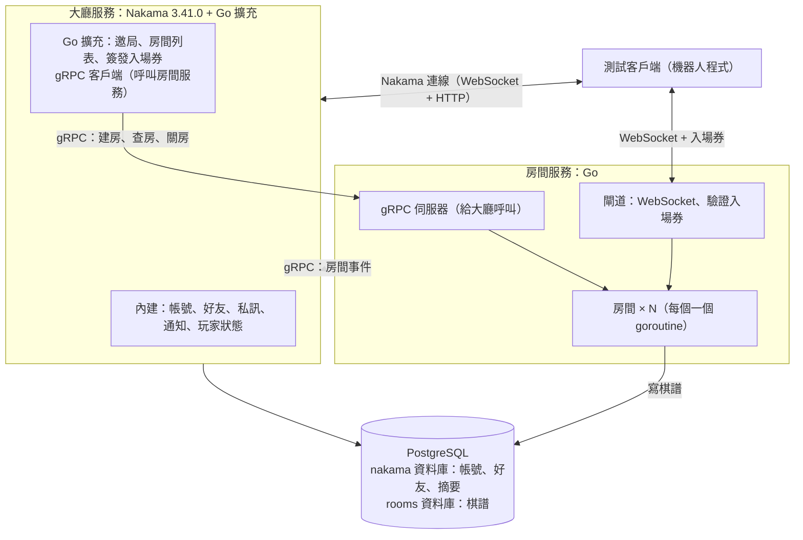

# PoC 規格：Nakama 大廳 + Go 房間服務

> 給負責實作的 AI 閱讀。整理日期：2026-10-31（同日補上：棋譜由房間記錄）。分支：`poc/nakama-lobby-go-room`（從 `main` 開出）。
> **執行時機**：依 `main` 分支的 `docs/roadmap.md`，第一個版本先用自己寫的 Go 大廳，本規格留到里程碑 3（需要好友、私訊等社群功能時）才執行，且驗證以一週為上限。
> 本文件只描述要做什麼、怎麼驗收，不含程式碼。實作細節由你決定，但必須符合第 4 節的限制與第 8 節的驗收條件。

## 0. 給實作者的工作方式

1. 先讀完本文件，再讀第 2 節列出的參考資料。
2. 所有工作只在 `poc/nakama-lobby-go-room` 分支進行，**不要修改或合併到 `main`**。
3. 遇到本文件沒寫清楚的地方，選最簡單、符合第 3 節架構原則的做法，並記錄在結果文件的「實作決定」一節。
4. 某個驗收項目做不到時，不要跳過或偽造結果：寫明做不到的原因、試過什麼、卡在哪裡。
5. 做完後依第 9 節的格式寫結果文件，連同程式碼一起提交並推送到同一分支。

## 1. 背景與目的

這是一個線上棋類平台（先做圍棋，之後加五子棋等），架構分成三個服務：

| 服務 | 負責 |
| --- | --- |
| **大廳服務** | 帳號、好友、私訊、玩家狀態、邀局、房間列表、簽發入場券；保存對局摘要（戰績） |
| **房間服務** | 每個房間（一桌）一個 goroutine：座位、計時、聊天；**記錄棋譜**（存在房間服務自己的資料庫） |
| **規則服務** | 判斷落子合法、計分、把棋譜轉成 SGF 等格式（本 PoC 不需要） |

**棋譜歸屬**：棋譜由房間記錄，存在房間服務自己的資料庫；規則服務只負責轉換格式，不存任何東西；大廳不記棋譜，只在局結束時保存一筆摘要（誰對誰、結果、棋譜 ID），要看完整棋譜時透過 gRPC 向房間服務查詢。

先前的實驗結論：

- 自己用 Go 寫大廳可行（見 `poc/go-lobby`），但好友、私訊、帳號等社群功能都要自己做。
- Nakama 內建這些社群功能。先前放棄 Nakama，是因為它的 TypeScript 擴充只能用 ES5、對局迴圈是 tick 模型；這兩個問題在「Nakama 只當大廳、對局在外部 Go 房間服務」的架構下都不存在。

**本 PoC 要驗證：用 Nakama 當大廳、Go 房間服務跑房間、兩者之間用 gRPC 溝通，是否可行、要花多少工、有哪些坑。**

本 PoC 的房間**只有聊天，沒有棋盤和規則**，重點在大廳與房間的整合。

## 2. 參考資料（在 repo 的其他分支）

用 `git show <分支>:<路徑>` 讀取。

| 分支 | 路徑 | 用途 |
| --- | --- | --- |
| `main` | `docs/architecture_v1.md` | 三分離架構的完整設計：名詞（第 0 節）、房間事件、入場券、事件序號、對帳、超時判定。本 PoC 的房間服務與協定以它為準，但大廳換成 Nakama |
| `poc/go-lobby` | `docs/poc-go-lobby.md`、`go-lobby/` | Go 房間 goroutine、閘道、送出佇列、慢連線踢除、機器人測試程式的寫法與結果，可以直接參考 |
| `poc/nakama` | `docker-compose.yml`、`server/`、`test-screenshot/README.md` | Nakama 3.41.0 的 Docker 啟動方式、先前遇到的問題（例如前端漏收第一個狀態） |
| `main` | `docs/roadmap.md` | 路線與里程碑；本規格屬於里程碑 3 |
| `main` | `docs/design-discussion.md` | 邀局、觀戰、計時等設計討論 |

## 3. 架構

架構原則（必須遵守）：

1. **大廳不碰房間內容**：大廳只知道房間的 ID、成員、狀態，以及局結束後的摘要。
2. **房間服務不碰社群功能**：不存帳號、不管好友，只認入場券。
3. **棋譜由房間記錄**：房間服務擁有棋譜資料；大廳不能直接讀寫房間服務的資料表，只能透過 gRPC 查詢。
4. **大廳與房間之間只用 gRPC**，兩個方向都是：
   - 大廳 → 房間：建房、查詢房間、強制關房、查詢棋譜。
   - 房間 → 大廳：開局、有人連上或斷線、結束、關房。
5. **瀏覽器（或測試客戶端）不講 gRPC**：連大廳用 Nakama 的連線，連房間用 WebSocket。
6. **以房間服務為準**：大廳與房間服務的認知不一致時，以房間服務為準（對帳）。

## 4. 技術限制與選擇

| 項目 | 規定 |
| --- | --- |
| Nakama | 3.41.0（與 `poc/nakama` 相同），用 Docker 執行 |
| Nakama 擴充語言 | **Go**（不要用 TypeScript，避開 ES5 限制） |
| Go 擴充的編譯 | 必須用與 Nakama 3.41.0 相同的 Go 版本與相依套件編譯，使用 Heroic Labs 官方的 `nakama-pluginbuilder` 映像。**這是本 PoC 最大的風險之一**（見第 7 節） |
| 房間服務 | Go，獨立程序（可用 Docker 或直接執行） |
| 通訊 | 大廳 ↔ 房間：gRPC；客戶端 ↔ 房間：WebSocket（JSON 訊息） |
| 資料庫 | PostgreSQL 16，同一台伺服器上分兩個資料庫：`nakama`（Nakama 用）與 `rooms`（房間服務用，存棋譜）。兩個服務用不同的資料庫帳號，房間服務的帳號不能存取 `nakama`，反之亦然 |
| 啟動 | 一個 Docker Compose 專案（專案名 `poc-nakama-lobby-go-room`），一個指令能啟動全部，一個指令能清空重來 |
| 測試客戶端 | 用程式模擬使用者（Go 或 Node 皆可）。可以用 Nakama 官方客戶端函式庫。**不需要做網頁前端** |

埠號（避免和其他 PoC 衝突）：

| 用途 | 埠 |
| --- | --- |
| Nakama 客戶端 API（HTTP 與即時連線） | 8920 |
| Nakama 管理後台 | 8921 |
| Nakama gRPC API（伺服器對伺服器） | 8922 |
| 房間服務 WebSocket | 8923 |
| 房間服務 gRPC（只給大廳） | 8924 |
| PostgreSQL | 5444 |

## 5. 要實作的功能

### 5.1 大廳（Nakama + Go 擴充）

**使用 Nakama 內建功能**（不要自己重寫）：

- 帳號：用 Nakama 的自訂 ID 登入（custom authentication），使用者名稱即訪客名稱。
- 好友：加好友、接受好友邀請、列出好友。
- 玩家狀態：好友上線、離線、目前狀態（空閒、對局中）透過 Nakama 的狀態追蹤（status）功能取得。
- 私訊：Nakama 的一對一聊天頻道。
- 通知：Nakama 的應用內通知（in-app notification），包含玩家離線時的持久化通知。

**Go 擴充要自己寫的**（以 Nakama RPC 提供給客戶端）：

| RPC | 功能 |
| --- | --- |
| `invite` | 邀請某位線上玩家下棋。檢查：對方存在、不是自己、雙方都空閒、雙方都沒有待回覆的邀請。送通知給對方。邀請 60 秒逾時 |
| `invite_reply` | 被邀請者接受或拒絕。接受時：透過 gRPC 請房間服務建房 → 為雙方簽發入場券 → 以通知把「房間位址 + 入場券」送給雙方 → 把雙方狀態設為「對局中」 |
| `list_rooms` | 列出目前的房間（ID、成員、狀態） |
| `my_games` | 列出呼叫者的對局摘要（從 Nakama 儲存讀取，不經過房間服務） |
| `get_record` | 取得某局的完整棋譜：透過 gRPC 向房間服務查詢。只有該局的成員能查（本 PoC 的權限規則） |

**對局摘要**：收到 `room.closed` 時，大廳把事件附帶的摘要（棋譜 ID、成員、開始與結束時間、結果、訊息數）存進 Nakama 的儲存功能（storage），每位成員各一份，供 `my_games` 使用。

**房間列表的即時更新**：Nakama 的 `matchList` 只列它自己的對局，看不到外部房間。請選一種方式把房間的新增、變更、移除推給在大廳的玩家（例如 Nakama 的 stream 或通知），在結果文件說明選了什麼、為什麼。輪詢 `list_rooms` 只能當備案，若最後用輪詢，要說明推送為什麼做不到。

**接收房間事件**：房間服務以 gRPC 回報事件，大廳收到後更新玩家狀態、房間列表，必要時發通知。實作方式二選一，請在結果文件說明選擇與理由：

- **方式 A（優先嘗試）**：房間服務透過 **Nakama 本身的 gRPC API**（8922 埠），以伺服器金鑰（server key / http key）呼叫 Go 擴充註冊的 RPC（例如 `room_event`）。
- **方式 B**：Go 擴充在 Nakama 程序內自己啟動一個 gRPC 伺服器，房間服務直接呼叫它。

### 5.2 房間服務（Go）

沿用 `poc/go-lobby` 的房間模型與 `docs/architecture_v1.md`（`main` 分支）的協定：

**gRPC 服務（給大廳呼叫）**

| 方法 | 說明 |
| --- | --- |
| `CreateRoom` | 輸入：房間 ID、成員（使用者 ID 與名稱）。建立房間 goroutine，回傳房間的 WebSocket 位址 |
| `ListRooms` | 回傳所有房間的 ID、成員、狀態（等待中、進行中）。給大廳對帳用 |
| `CloseRoom` | 強制關閉房間（管理用） |
| `GetRecord` | 輸入棋譜 ID，回傳完整棋譜（見下方「棋譜」） |

**房間事件（房間服務呼叫大廳）**

| 事件 | 時機 |
| --- | --- |
| `room.started` | 所有成員都已連上 |
| `room.player_disconnected`、`room.player_reconnected` | 成員斷線、重連 |
| `room.closed` | 所有成員都離開，房間 goroutine 結束。附帶對局摘要：棋譜 ID、成員、開始與結束時間、結果（本 PoC 固定為「正常結束」）、訊息數 |
| `room.cancelled` | 到場時限（30 秒）內有成員沒連上，房間取消 |

每個事件帶房間內遞增的序號；大廳收到重複或過期的序號要忽略。送出失敗要重試。

**WebSocket（客戶端連房間）**

- 連上後第一則訊息必須出示入場券。入場券無效、過期、已用過，或不是這個房間的，就拒絕並斷線。
- 房內訊息：聊天、離開。聊天只送給同房成員。
- 每條連線有獨立的送出佇列，佇列滿就斷開該連線（同 `poc/go-lobby`）。
- 送給已關閉房間的訊息不能讓送訊息的人卡住（同 `poc/go-lobby`）。

**棋譜**

本 PoC 沒有棋盤，所以「棋譜」就是房間的動作紀錄：成員進出與每一則聊天。正式版會再加上落子等動作，資料結構要能直接延伸。

- **先寫紀錄再廣播**：每個被接受的動作（加入、聊天、離開）先寫進 `rooms` 資料庫，成功後才送給房內成員。寫入失敗時，這個動作不算數，回錯誤給送出者。
- **內容**：每個動作有房間內遞增的序號、類型、送出者、內容、閘道收到的時間。
- **局的資料**：棋譜 ID（可以等於房間 ID）、成員、開始與結束時間、結果。
- 用棋譜可以完整還原房間內發生的事（本 PoC 不需要實作還原，但資料要足夠）。
### 5.3 入場券

- 由大廳（Go 擴充）簽發，房間服務驗證，兩者共用一把密鑰（從環境變數讀取，不要寫死在程式碼裡）。
- 內容：房間 ID、使用者 ID、名稱、角色（棋手）、到期時間（60 秒）、唯一編號。
- 只能使用一次：房間服務記住已用過的編號。
- 斷線重連：本 PoC 可以讓玩家回大廳呼叫 RPC 換一張新的入場券（例如 `reissue_ticket`），不需要另做重連憑證。

### 5.4 不要做的

- 棋盤、規則、計時、計分。
- 網頁前端。
- 觀戰、開放房間、自動配對。
- 多台房間服務、Redis。
- 從棋譜還原進行中的房間、匯出 SGF。
- 上線廣播：不要把每個人的上線、離線推給所有人（先前的實驗顯示 1,000 人同時上線會造成訊息風暴）。好友的上線狀態用 Nakama 的狀態追蹤即可，它只推給追蹤的人。

## 6. 測試情境

用程式模擬使用者執行，結果寫進結果文件。每個情境都要能重複執行（先清空資料庫再跑）。

### 情境 A：好友、私訊

1. Alice、Bob、Carol 登入。
2. Alice 加 Bob 為好友，Bob 接受。Carol 不是任何人的好友。
3. Alice 追蹤好友狀態，能看到 Bob 在線。
4. Alice 私訊 Bob，Bob 收到；Carol 收不到。
5. Bob 登出，Alice 看到 Bob 離線；Bob 再登入，Alice 看到 Bob 上線。

### 情境 B：邀局到房間結束

1. Alice 邀請 Bob；Bob 收到通知。
2. Bob 接受；雙方都收到「房間位址 + 入場券」的通知。
3. 雙方用入場券連上房間；大廳收到 `room.started`，雙方在大廳的狀態變成「對局中」，房間列表出現這個房間，**Carol 在大廳能即時看到**。
4. Alice 和 Bob 在房內互相聊天，雙方都收到。
5. Carol 嘗試用以下方式進房，都必須被拒絕：
   - 沒有入場券；
   - 拿 Alice 用過的入場券；
   - 拿過期的入場券；
   - 拿別的房間的入場券。
6. Alice、Bob 離開房間；大廳收到 `room.closed`，房間從列表移除，雙方狀態回到「空閒」，Carol 能即時看到。
7. 棋譜：
   - Alice、Bob 呼叫 `my_games`，都看到這一局的摘要，Carol 看不到；
   - Alice 呼叫 `get_record`，拿到的棋譜包含所有聊天，順序與數量和實際送出的一致；
   - Carol 呼叫 `get_record` 查這一局，被拒絕；
   - 直接查 `rooms` 資料庫，確認棋譜存在房間服務的資料表裡，`nakama` 資料庫只有摘要。

### 情境 C：邀局的例外

1. Bob 拒絕 Alice 的邀請：Alice 收到拒絕通知，雙方都回到可邀請狀態。
2. Alice 邀請 Bob 後 60 秒內沒人回覆：邀請逾時，雙方收到通知。
3. Alice 已有待回覆的邀請時，Carol 邀請 Alice：被拒絕。
4. Alice 邀請正在對局中的人：被拒絕。
5. Bob 離線時 Alice 邀請他：
   - 第一版規則是「只能邀請線上玩家」，應被拒絕；
   - 另外驗證 Nakama 的持久化通知：在 Bob 離線時用一般通知寄給他，Bob 再登入後能收到。
6. 接受邀請後，有一方 30 秒內沒有連進房間：房間取消，大廳收到 `room.cancelled`，雙方回到空閒。

### 情境 D：故障與對帳

1. 房間進行中重啟房間服務：大廳要能發現房間消失（對帳或事件），更新房間列表與玩家狀態，不能留下幽靈房間。
2. 重啟 Nakama：房間服務裡進行中的房間不受影響；Nakama 起來後，大廳透過 `ListRooms` 重建房間列表。
3. 房間事件送出失敗（例如 Nakama 暫時連不上）：恢復後事件會重送，大廳不會重複處理（`room.closed` 重送時，摘要不會存成兩份）。
4. `rooms` 資料庫暫時連不上：房內聊天被拒絕並回錯誤，不會出現「大家都看到了、棋譜卻沒記到」的訊息。

### 情境 E：100 人負載

1. 100 個使用者登入 Nakama，每人隨機加 3～5 位好友。
2. 30 秒內：大家互相私訊；25 對邀局、進房、房內聊天、離開。
3. 量測並記錄：
   - 登入時間；
   - 私訊延遲（p50、p95、p99）；
   - 從「接受邀請」到「雙方都連上房間」的時間；
   - 房內聊天延遲；
   - 房間事件從房間服務到大廳的延遲；
   - Nakama 與房間服務的記憶體、CPU、goroutine 數（房間服務）。
4. 正確性：每則私訊剛好送達一次；所有邀局都成功開房並關房；最後沒有殘留的房間、邀請或「對局中」狀態；每一局的棋譜訊息數和實際送出的一致，每位棋手的 `my_games` 都有正確的摘要。

## 7. 必須回答的問題

結果文件要逐一回答：

1. **Go 擴充能不能當 gRPC 客戶端**：Nakama 本身已經包含 gRPC 等套件，擴充若使用不同版本會無法載入。實際用 `nakama-pluginbuilder` 編譯時遇到什麼問題、怎麼解決、最後鎖定哪些版本。
2. **房間事件回報走哪條路**：方式 A 或 B，延遲、可靠性、寫起來的難易。
3. **房間列表怎麼即時推送**：用了 Nakama 的哪個功能，有什麼限制。
4. **好友上線狀態**：Nakama 的狀態追蹤是否夠用（延遲、斷線多久才判定離線）。
5. **入場券**：簽發與驗證的做法，只能用一次是怎麼確保的。
6. **棋譜**：「先寫紀錄再廣播」對房內聊天延遲的影響（和 `poc/go-lobby` 沒有資料庫時比較）；摘要放在 Nakama 儲存是否合適。
7. **工作量**：各部分實作時間粗估，以及和 `poc/go-lobby`（全部自己寫）相比，哪些省了工、哪些多了工。
8. **建議**：這個組合適不適合當正式架構，主要風險是什麼。

## 8. 驗收條件

全部達成才算完成；做不到的要在結果文件說明原因。

- [ ] 一個指令啟動全部服務，一個指令清空重來。
- [ ] Go 擴充用 `nakama-pluginbuilder` 編譯並成功載入 Nakama 3.41.0。
- [ ] 大廳 ↔ 房間兩個方向都用 gRPC。
- [ ] 情境 A～D 全部通過，每個步驟有自動檢查（不是人工看 log）。
- [ ] 情境 E 跑完，正確性檢查全部通過，量測數字寫進結果文件。
- [ ] 房間服務有單元測試（至少：入場券驗證、只能用一次、房間清空即關閉、事件序號遞增、送給已關閉房間不會卡住、寫紀錄失敗時動作不廣播）。
- [ ] 棋譜存在 `rooms` 資料庫，`nakama` 資料庫只有摘要；兩個服務的資料庫帳號互相不能存取對方的資料庫。
- [ ] 結果文件回答第 7 節所有問題。
- [ ] 密鑰、伺服器金鑰都從環境變數讀取，沒有寫死在程式碼或提交進 repo（Docker Compose 可以用僅供本機測試的預設值，並註明）。

## 9. 交付物

| 路徑（建議） | 內容 |
| --- | --- |
| `nakama-lobby-go-room/docker-compose.yml` | Nakama、PostgreSQL、房間服務 |
| `nakama-lobby-go-room/lobby-plugin/` | Nakama Go 擴充 |
| `nakama-lobby-go-room/room-service/` | Go 房間服務（含單元測試、`rooms` 資料庫的建表與遷移） |
| `nakama-lobby-go-room/proto/` | gRPC 介面定義 |
| `nakama-lobby-go-room/bots/` | 測試客戶端（情境 A～E） |
| `nakama-lobby-go-room/scripts/` | 啟動、清空、執行全部測試的腳本 |
| `nakama-lobby-go-room/results/` | 原始測試結果（JSON 或文字） |
| `docs/poc-nakama-lobby-go-room-results.md` | 結果文件 |

結果文件格式（參考 `poc/go-lobby` 分支的 `docs/poc-go-lobby.md`）：

1. **結論**：三到五點，先講可不可行。
2. **架構與實作決定**：實際的做法，以及所有本文件沒規定、由你決定的地方。
3. **測試結果**：情境 A～E 的檢查項目與結果（表格），情境 E 的量測數字。
4. **第 7 節問題的回答**。
5. **遇到的問題**：每個問題的現象、原因、解法。
6. **怎麼執行**。
7. **沒做到的部分**與原因。

用詞請遵守 `docs/architecture_v1.md` 第 0 節（`main` 分支）：大廳、房間、規則；不使用「引擎」一詞（套件名稱除外）。
