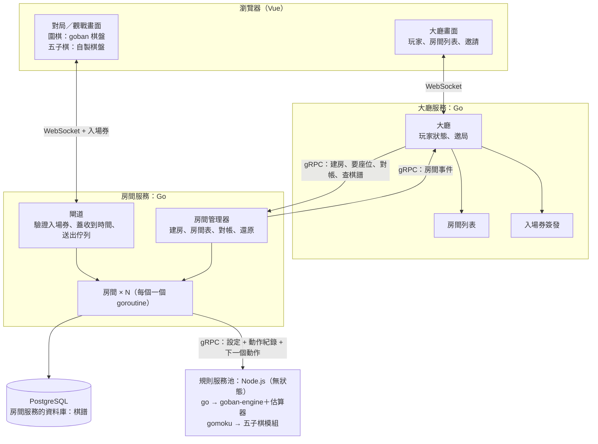
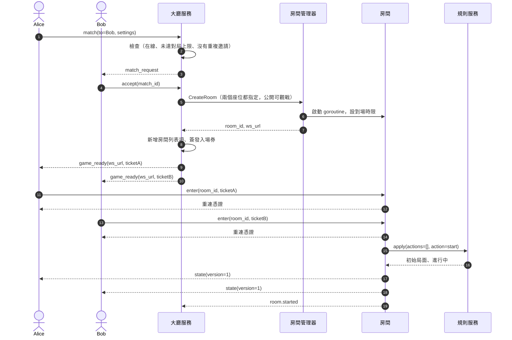
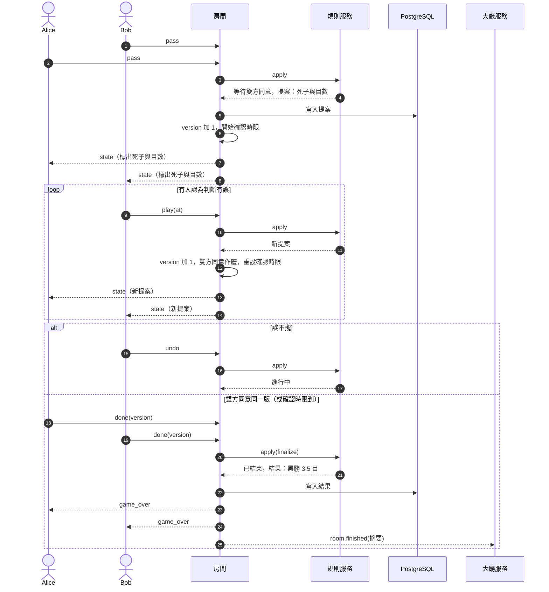
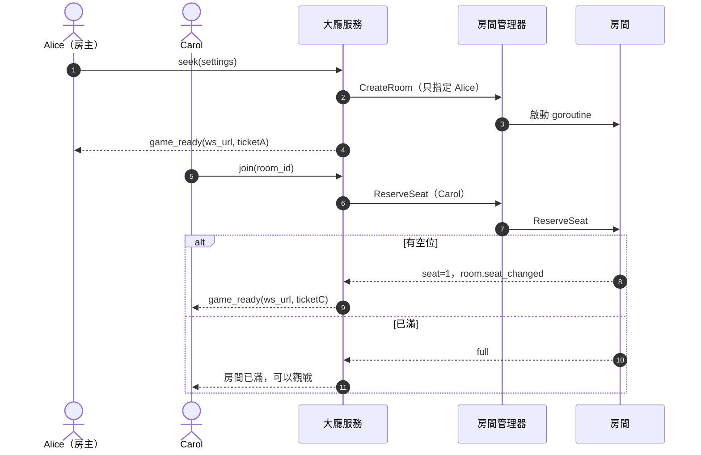

# 規格 v1

> 整理日期：2026-11-01。狀態：**設計階段，尚未實作**。
> 本文件是全部功能的規格；**M1 的實作規格見 [spec_v2.md](spec_v2.md)**。
> 本文件只寫系統「怎麼運作」。每個功能的階段見 [feature-list.md](feature-list.md)，實作順序見 [roadmap.md](roadmap.md)，決定的理由見 [decisions.md](decisions.md)（文中以 D-xx 標註）。
> 圖與介面中的函式名稱是**虛擬碼**；前端指令名稱沿用 NNGS（D-22），M1 的完整定義見 [spec_v2.md](spec_v2.md)。

## 1. 概觀

### 1.1 目標

線上棋類平台，先做好圍棋，之後擴充五子棋等其他遊戲。新增遊戲時只需要加規則模組與棋盤元件，平台本身不改。

### 1.2 系統組成

系統由三個服務組成：**大廳服務、房間服務、規則服務**（D-01）。



### 1.3 名詞

| 名詞 | 意思 |
| --- | --- |
| 大廳服務 | 玩家狀態、邀局、房間列表、簽發入場券、戰績摘要（Go，獨立程式） |
| 房間服務 | 跑所有房間的程式（Go）；內含閘道、房間管理器、房間 |
| 房間 | 一桌，一個 goroutine：座位、觀戰名單、時限、同意狀態、聊天、記錄棋譜 |
| 規則服務 | 判斷動作合不合法、局面、階段、結果；無狀態（Node.js） |
| 規則庫 | 真正判斷規則的程式碼：`goban-engine`（圍棋）、五子棋模組 |
| 估算器 | OGS 的死子估算器（`online-go/score-estimator`），規則服務用來提出死子判斷 |
| 局 | 一盤棋本身。圍棋一個房間只有一局 |
| 動作紀錄 | 一局所有被接受的動作，依序編號；規則服務靠它重放 |
| 階段 | 一局的狀態，只有三種：`進行中`、`等待雙方同意`、`已結束` |
| 提案 | 「等待雙方同意」階段要雙方都同意才定案的內容（圍棋是死子判斷與目數，悔棋是撤回幾手） |
| 入場券、重連憑證 | 進房用的兩種憑證（4.6 節） |
| 棋手、觀戰者 | 房間裡的兩種角色 |

## 2. 服務與程式碼

### 2.1 服務職責

| 服務 | 負責 | 不負責 |
| --- | --- | --- |
| 大廳服務 | 登入、玩家列表與狀態、邀局、房間列表、簽發入場券、戰績摘要 | 棋盤、時限、座位的最終分配、任何對局判定、棋譜本身 |
| 房間服務 | 房間生命週期、座位分配、觀戰名單、時限與超時判定、收集同意、聊天與講評、記錄棋譜 | 規則本身、大廳列表 |
| 規則服務 | 依遊戲類型分派到規則庫；重放動作紀錄並判斷合法、局面、階段、結果；提出提案；轉換棋譜格式 | 任何狀態 |
| 前端 | 顯示；棋手在 `進行中` 階段用同一份規則先檢查、先擺子 | 判定結果（以房間為準） |

### 2.2 程式碼分離

```text
repo
 ├─ proto/   大廳 ↔ 房間、房間 ↔ 規則的介面定義：三個服務唯一的共同約定
 ├─ lobby/   大廳服務（Go，獨立執行檔）
 ├─ room/    房間服務（Go，獨立執行檔）
 ├─ rules/   規則服務（Node，獨立程式）
 └─ docs/
```

- `lobby/` 與 `room/` 不得 import 對方的程式碼，只能共用 `proto/` 產生的介面。入場券格式寫成規格（4.6 節），各自實作簽發與驗證（D-01）。
- 房間服務只認 proto 介面與入場券，不知道大廳是誰實作的。
- 房間服務的測試使用依 proto 實作的假大廳，以及一個最簡單的假遊戲（例如連三子就結束）；房間程式碼不改就要能跑圍棋與假遊戲（D-10）。
- 服務之間用 gRPC（D-03）；瀏覽器用 WebSocket，大廳一條、房間一條。

## 3. 功能規格

每個功能依「行為、服務、訊息、例外、里程碑」描述。訊息的完整格式見第 4 章。

### 3.1 登入與大廳

**里程碑**：M1

**行為**

- 第一則訊息必須是 `login{name}`（指令名稱沿用 NNGS，D-22）。名稱只能用英數字與底線，長度 1～20，不可與線上玩家重複。
- 登入成功後收到 `welcome`：自己的名稱、目前的玩家列表（含狀態）、房間列表。
- 玩家可以同時在多個房間（D-21）：同時對局上限預設 5 盤，觀戰上限預設 10 盤（M2）。玩家列表顯示每人正在對局與觀戰的房間數。
- **不推送**其他玩家的上線、離線與狀態變化（D-09）。玩家用 `who` 查詢最新列表。
- 房間列表的新增、變更、移除會推送給在大廳的玩家。列表包含所有房間（預設公開可觀戰，D-15）：遊戲、棋盤大小、棋手、狀態（`等待中`、`進行中`、`已結束`）、觀戰人數。
- 大廳連線在玩家對局時仍保持，照常收房間列表推送與個人通知（邀請、私訊）。

**服務**：大廳服務。

**例外**：名稱不合法或重複 → `error{invalid_name | name_taken}` 並斷線。

### 3.2 約局

**里程碑**：邀請、接受、拒絕、撤回、逾時為 M1；還價、待回覆列表、不接受邀請開關、讓子為 M2。

**行為**

- 邀請者送出 `match{to, settings}`。`settings`：遊戲（M1 只有圍棋）、棋盤大小（M1：9、19）、執色（黑、白、隨機）、貼目、讓子（M2）。
- 大廳依序檢查，任一項不符就回錯誤：
  1. 對方在線；
  2. 不是自己；
  3. 雙方都未達同時對局上限；
  4. 自己送出的待回覆邀請未達上限（預設 5），且兩人之間沒有其他待回覆的邀請；
  5. 對方沒有關閉邀請（M2）。
- 邀請通過後推送給雙方，60 秒逾時。
- 被邀請者回覆：
  - **接受**：大廳呼叫房間服務 `CreateRoom`（兩個座位都指定），為雙方簽發入場券，以 `game_ready{room_id, ws_url, ticket}` 推給雙方，房間加進雙方的對局列表。
  - **拒絕**：通知雙方，邀請結束。
  - **還價**（M2）：用不同的設定回邀，視為拒絕原邀請，改由被邀請者向對方提出新邀請。
- 邀請者可以撤回尚未回覆的邀請。
- 邀請在以下情況自動結束，並通知仍在線的一方：逾時、任一方與大廳斷線。
- 兩人同時互相邀請：以大廳先處理到的為準，後到的因「兩人之間已有待回覆的邀請」被拒絕。
- 開局後不清除雙方其他的邀請（可以同時下多盤）。

**服務**：大廳服務（檢查、邀請狀態、簽發入場券）、房間服務（建房）。



**例外**：`no_such_player`、`invalid`（邀請自己）、`busy`（不空閒或已有待回覆的邀請）、`no_such_invite`（邀請不存在或不是給你的）。

### 3.3 入房與重連

**里程碑**：入房、基本重連、到場時限為 M1；保留座位倒數、跨裝置重連為 M2。

**行為**

- 前端與房間服務只開一條連線，同時承載多個房間；每則訊息帶 `room_id`（D-21）。每個房間各自出示入場券。入場券無效、過期、已用過、或不屬於這個房間，就拒絕進入該房間（不斷開連線）。
- 座位只由房間分配；大廳以 `CreateRoom` 指定座位，或以 `ReserveSeat` 向房間要座位（開放房間，3.9 節）。
- 連上後房間發給該連線一張**重連憑證**，前端存在瀏覽器（sessionStorage）。重新整理頁面或斷線後，用重連憑證連回原座位，並收到目前的完整狀態。
- 到場時限：建房後 60 秒內有棋手沒連上，這局取消（3.6 節）。

**服務**：房間服務（閘道驗證、房間分配座位）、大廳服務（簽發入場券）。

**例外**：`invalid_ticket`、`ticket_used`、`ticket_expired`、`room_closed`。

### 3.4 對局

**里程碑**：M1

**行為**

- 棋手的動作：`play{x, y}`、`pass`、`resign`。每個動作附上 `base_version`（自己看到的狀態版本）。
- 房間收到動作後：
  1. 確認送出者是棋手、階段允許這個動作、`base_version` 等於目前版本；
  2. 呼叫規則服務 `apply` 判斷合不合法；
  3. 合法：先寫進棋譜，成功後版本加 1，把新狀態推給所有棋手與觀戰者；
  4. 不合法：只回 `error{code, version}` 給送出者，附目前狀態。
- 圍棋規則：提子、禁止自殺、positional superko；連續兩次 pass 進入終局（3.5 節）。
- **先擺子**：在 `進行中` 階段輪到自己時，前端用與規則服務同一版的規則庫先檢查並立刻顯示；伺服器拒絕或版本不符時，依伺服器回傳的狀態重畫（D-14）。
- **棋手對話**：`say{text}` 只送給同房的棋手，存進棋譜。

**服務**：房間服務、規則服務。

**例外**：`not_your_turn`、`occupied`、`suicide`、`ko`、`stale_version`、`wrong_phase`、`not_a_player`。

### 3.5 終局

**里程碑**：M1

**行為**

- 雙方連續 pass 後，規則服務回傳 `等待雙方同意`，提案為**死子判斷與目數**（由估算器提出，6.3 節）。
- 房間把提案寫進棋譜，版本加 1，暫停棋鐘（M2 起），開始確認時限（60 秒）。
- 在此階段，棋手可以：
  - **切換死子** `play{at}`：與 NNGS 相同，此階段輸入座標即切換該塊棋的死活。規則服務更新提案；版本加 1，**雙方先前的同意全部作廢**，確認時限重新計算。
  - **同意** `done{version}`：同意目前版本的提案。雙方都同意同一版本時，房間送出 `finalize`，規則服務依提案計算結果，這局 `已結束`。
  - **恢復對局** `undo`：與 NNGS 相同，此階段的 `undo` 即回到 `進行中`，照正常輪次繼續下（D-07）。之後再連續 pass 會重新提案。
  - **認輸** `resign`：任何時候都可以。
- 確認時限到：未回應者視為同意目前的提案（D-07）。
- 計分採數子法（中國規則）。結果格式例如 `黑勝 3.5 目`、`白中盤勝`、`黑超時勝`、`中止`。

**服務**：規則服務（判斷、提案、計分）、房間服務（收集同意、時限、記錄）。



**例外**：`wrong_phase`（非此階段送出切換或同意）、`stale_version`（同意的不是目前版本）。

### 3.6 時限與棋鐘

**里程碑**：保底時限為 M1；棋鐘為 M2。

**保底時限**（不是棋鐘，用來保證房間一定會結束，D-13）

| 時限 | 條件 | 到期時 |
| --- | --- | --- |
| 到場時限 60 秒 | 建房後有棋手沒連上 | 這局取消，回報 `room.cancelled` |
| 確認時限 60 秒 | `等待雙方同意` 時有人不回應 | 視為同意目前提案，定案 |
| 全員斷線時限 5 分鐘 | 所有棋手都斷線 | 這局 `中止`，寫進棋譜，回報 `room.finished`，房間關閉 |

**棋鐘**（M2）

- 計時方式：日式讀秒，設定為基本時間、讀秒次數、每次讀秒秒數（例如 10 分鐘 + 3 次 30 秒）。基本時間用完進入讀秒；每手在讀秒時間內下完則該次讀秒不消耗；超過則用掉一次；用完判超時負。
- 時鐘以伺服器為準（D-18）；前端依伺服器附上的「剩餘時間」與「起算時刻」自行倒數顯示，每次收到狀態就校正。
- **延遲補償**：房間服務定期量測每位棋手的連線延遲。每手扣時 = 收到時間 − 換手時間 − min(估計單程延遲, 1 秒)；整局累計補償上限 30 秒。
- **超時判定**：房間在截止時間加寬限（0.5 秒）之前**收到**合法的一手，就不算超時（D-08，做法見 5.3 節）。
- `等待雙方同意` 階段暫停棋鐘；恢復對局時繼續。
- 斷線不停錶（計分對局）。
- 悔棋不退還時間。
- 每手記錄用時與補償量，寫進棋譜。

**服務**：房間服務（計時模組、計時器）。

### 3.7 悔棋

**里程碑**：M2

**行為**

- 棋手在 `進行中` 階段送出 `undo` 請求悔棋。房間建立一個提案（撤回幾手），推給對手（D-19）。
- 撤回手數由請求時的輪次決定：

  | 請求時機 | 撤回 | 撤回後輪到 |
  | --- | --- | --- |
  | 自己剛下完，對手還沒下 | 1 手 | 自己 |
  | 對手已回應一手，輪到自己 | 2 手 | 自己 |

- 對手回覆同意則撤回；回覆拒絕或直接落子視為拒絕。
- 同一局同時最多一個悔棋請求；被拒絕後，請求者要再下一手才能再請求。
- 每局次數上限與計分對局是否允許，由建房設定決定。
- 撤回由規則服務重放剩餘的動作完成，不直接修改局面；悔棋請求、同意、拒絕都寫進棋譜。
- 請求期間棋鐘照走。

**服務**：房間服務（提案與同意）、規則服務（重放）。

### 3.8 觀戰與講評

**里程碑**：M2

**行為**

- 觀戰者在大廳點選房間觀戰，大廳簽發觀戰入場券（`role: observer`）。
- 觀戰者連上後立即收到目前狀態，之後每次更新都會收到。
- **講評** `kibitz{text}` 只送給觀戰者；對局中的棋手收不到。局結束後講評公開並寫進棋譜（D-12）。
- 觀戰者不能送對局動作。
- 觀戰人數變化由房間合併後（每幾秒一次）回報大廳，顯示在房間列表。

**服務**：大廳服務（觀戰入場券）、房間服務。

### 3.9 開放房間

**里程碑**：M2

**行為**

- 房主送出 `seek{settings}`。大廳呼叫 `CreateRoom`（只指定房主），房間列表顯示 `等待中 1/2`。
- 其他玩家按加入：大廳呼叫 `ReserveSeat`，拿到座位才簽發入場券；已滿則回覆 `full`，玩家可改為觀戰。
- 坐滿後的開局步驟同 3.2 節。



### 3.10 棋譜與戰績

**里程碑**：記錄、查看棋譜、我的對局紀錄為 M1；匯出 SGF 為 M2。

**行為**

- 房間記錄每一局的棋譜（D-11，內容見 7.1 節）：每個動作先寫進資料庫，成功後才廣播。
- 局結束時，房間回報 `room.finished`，附摘要；大廳把摘要存進雙方的戰績。
- 玩家可在大廳查看自己的對局紀錄（摘要列表），並查看任一局的完整棋譜（大廳向房間服務 `GetRecord`）。
- 匯出 SGF（M2）：規則服務把動作紀錄轉成 SGF。

**服務**：房間服務（記錄、查詢）、大廳服務（戰績摘要）、規則服務（格式轉換）。

## 4. 介面

### 4.1 前端 ↔ 大廳

| 方向 | 訊息 |
| --- | --- |
| 前端 → 大廳 | `login{name}`、`who`、`games`、`match{to, settings}`、`accept{match_id}`、`decline{match_id}`、`withdraw{match_id}`、`pending`、`rejoin{room_id}`、`results`、`moves{room_id}`；M2：`seek{settings}`（開放房間）、`join{room_id}`、`observe{room_id}` |
| 大廳 → 前端 | `welcome{you, players, rooms, games}`、`players`、`rooms{op: add/update/remove, room}`、`match_request`、`match_sent`、`match_result{match_id, result}`、`pending`、`game_ready{room_id, ws_url, ticket}`、`results`、`moves`、`error{code, message}` |

### 4.2 前端 ↔ 房間

| 方向 | 訊息 |
| --- | --- |
| 前端 → 房間 | 所有訊息帶 `room_id`：`enter{入場券 或 重連憑證}`、`play{at, base_version}`、`pass`、`resign`、`done{version}`、`undo`、`score`、`say{text}`、`refresh`、`leave`；M2：悔棋的請求與回覆、`kibitz{text}` |
| 房間 → 前端 | 所有訊息帶 `room_id`：`state{version, 階段, view, proposal, 同意狀態, 時鐘, 觀戰人數}`、`reconnect_token`、`score`、`error{code, version}`、`say`、`kibitz`（只送觀戰者）、`game_over{result}` |

`view`、`proposal`、`result` 由規則服務產生，房間原樣轉送；前端依遊戲類型顯示。

### 4.3 大廳服務 → 房間服務（gRPC）

| 方法 | 輸入 | 回傳 |
| --- | --- | --- |
| `CreateRoom` | `room_id`、`game`、`settings`、`seats[{seat, user_id, name, color}]`（開放房間只填房主）、`visibility{listed, spectate}` | `room_id`、`ws_url` |
| `ReserveSeat` | `room_id`、`user_id`、`name` | `seat`，或 `full`／`finished` |
| `ListRooms` | — | 所有房間的 ID、成員、狀態、觀戰人數 |
| `GetRecord` | `record_id` | 完整棋譜 |
| `CloseRoom` | `room_id` | 強制關房（管理用） |

### 4.4 房間服務 → 大廳服務：房間事件（gRPC）

| 事件 | 時機 | 大廳的處理 |
| --- | --- | --- |
| `room.seat_changed` | 開放房間有人入座或離座 | 更新列表人數 |
| `room.started` | 所有棋手到場、開局 | 列表改為 `進行中` |
| `room.observers_changed` | 觀戰人數變化（合併送出） | 更新觀戰人數 |
| `room.player_disconnected`、`room.player_reconnected` | 棋手斷線、重連 | 視需要更新玩家狀態 |
| `room.cancelled` | 到場時限到 | 移除列表項，玩家改回 `空閒` |
| `room.finished` | 局結束，附摘要（棋譜 ID、棋手與執色、結果、開始與結束時間） | 列表改為 `已結束`，存戰績 |
| `room.closed` | 房間結束 | 移除列表項，玩家改回 `空閒` |

- 每個事件帶房間內遞增的序號；大廳忽略重複或過期的事件。
- 送出失敗就重試。
- 大廳定期呼叫 `ListRooms` 對帳，以房間服務為準。

### 4.5 房間服務 → 規則服務（gRPC）

```text
apply({ game, settings, actions: [...動作紀錄], action, state?, viewer?: seat | "observer" })
  → { ok, error_code?, phase: 進行中 | 等待雙方同意 | 已結束, view, proposal?, result?, state? }
```

- 每次帶完整動作紀錄；規則服務不保存任何狀態（D-05）。
- `state`（可選）：規則服務可回傳不透明的狀態，房間只保存、下次原樣帶回；規則服務拿得到可用的 `state` 就接著算，否則從動作紀錄重放。第一版不使用。
- `viewer`：給誰看的畫面，供之後有隱藏資訊的遊戲使用。
- 逾時 2 秒（見第 8 章）。

### 4.6 入場券與重連憑證

| 憑證 | 簽發者 | 內容 | 有效期 | 用途 |
| --- | --- | --- | --- | --- |
| 棋手入場券 | 大廳服務 | `room_id, user_id, seat, role: player, 唯一編號, 到期時間` | 60 秒，只能用一次 | 第一次連進房間 |
| 觀戰入場券 | 大廳服務 | `room_id, user_id, role: observer, 唯一編號, 到期時間` | 60 秒，只能用一次 | 觀戰 |
| 重連憑證 | 房間 | `room_id, user_id, seat` | 到房間結束 | 重新連回 |

- 入場券以大廳服務與房間服務共用的密鑰簽章（密鑰由環境變數提供）；閘道自行驗證，並記住已用過的編號。

## 5. 房間內部

### 5.1 房間的狀態

- 設定：遊戲、棋盤大小、規則、貼目、讓子、計時方式、是否計分、可見性。
- 動作紀錄與版本號（每接受一個動作加 1）。
- 座位：誰、是否到場、是否連線中。
- 觀戰名單。
- 同意狀態：各棋手是否同意目前提案、同意的版本。
- 計時模組的狀態、目前計時器的編號。
- 規則服務回傳的不透明狀態（可選）。

房間不含任何遊戲專屬的邏輯，只依規則服務回傳的階段、提案與結果行事（D-10）。

### 5.2 事件迴圈

每個房間只有一個 goroutine 修改它的狀態；所有事件排進同一個 channel，依序處理。

| 事件 | 來源 | 附帶 |
| --- | --- | --- |
| `ReserveSeat` | 房間管理器 | — |
| `Join`、`Leave` | 閘道 | 收到時間 |
| `Action` | 閘道 | 收到時間、`base_version` |
| `Chat`、`Kibitz` | 閘道 | 收到時間 |
| `TimerFired` | 房間的計時器 | 計時器編號 |
| `Shutdown` | 房間管理器 | — |

處理原則：

- 計時器觸發時只送 `TimerFired` 進 channel，不直接修改狀態。
- 動作先寫進資料庫，成功後才廣播；寫入失敗則這個動作不算數，回錯誤給送出者。
- 房間不直接寫 WebSocket；訊息放進每條連線各自的送出佇列，由閘道送出。佇列滿了就斷開該連線。
- 呼叫規則服務一定設逾時。
- 每個房間的 goroutine 以 `recover` 保護，一個房間出錯不影響其他房間。

### 5.3 超時判定

原則：房間在截止時間加寬限之前**收到**合法的一手，就不算超時，與房間何時處理到無關（D-08）。

1. 閘道替每則訊息蓋收到時間（`received_at`）。
2. 處理落子時，用 `received_at` 計算用時；已超過剩餘時間加寬限，這手不算，判超時負。呼叫規則服務花的時間不算棋手的。
3. 每次重設計時器，計時器編號加 1；`TimerFired` 的編號不是最新的就忽略。
4. 處理有效的 `TimerFired` 時，先處理 channel 中已排隊的事件；其中有截止前收到的合法落子，就以落子為準。
5. 計時器設在截止時間加寬限之後觸發。

### 5.4 房間管理器

- `CreateRoom`：建立房間、啟動 goroutine、登記到房間表。
- `ReserveSeat`：轉給房間，由房間分配座位或回覆已滿。
- `GetRoom`：閘道用來找到房間的 channel。
- `ListRooms`：給大廳對帳。
- `Restore`：房間服務啟動時，從資料庫找出未結束的局，重放動作紀錄重建房間；停機期間不扣時，重建後暫停，所有棋手重連才繼續。

### 5.5 計時模組

- 純計算：所有操作由房間傳入目前時間，模組不讀系統時間、不設計時器。
- 介面：開始計時、換手（傳入收到時間與延遲補償，回傳用時與事件）、暫停、繼續、查詢下一個截止時間、檢查是否超時、取得給前端的快照、序列化。
- 事件：進入讀秒、用掉一次讀秒、超時。
- 以座位編號運作，不假設兩人或輪流。
- 支援的計時方式：日式讀秒（M2）；加拿大讀秒、Fischer 加秒、包乾（未來）。

## 6. 規則服務

### 6.1 分派

| `game` | 規則庫 | 階段 |
| --- | --- | --- |
| `go` | `goban-engine`（OGS） | `進行中` →（連續兩次 pass）`等待雙方同意` →（雙方同意）`已結束`；恢復對局回到 `進行中` |
| `gomoku`（M2） | 五子棋模組：15 路、連五以上獲勝、無禁手 | `進行中` →（連成五子）`已結束` |

### 6.2 通用階段與提案

- 階段只有 `進行中`、`等待雙方同意`、`已結束` 三種，是否進入哪個階段由規則服務決定。
- `等待雙方同意` 時附上提案；房間只負責記錄、廣播、收集同意，不解讀內容。
- 規則服務提出的提案（例如死子判斷）以系統動作寫進動作紀錄，重放時直接使用紀錄中的提案，不重新計算。
- 棋手提出的請求（例如悔棋）同樣以提案表示，由規則服務決定合不合法、同意後如何變化。

### 6.3 圍棋

- 規則：提子、禁止自殺、positional superko、讓子、貼目、數子法。
- 判斷合法與計分：`goban-engine`。雙方 pass 後 `goban-engine` 不會自動切換階段，「連續兩次 pass」由規則服務從動作紀錄判斷。
- 死子判斷：估算器（C++，編成 WebAssembly 在規則服務載入）算出每點歸屬，交給 `goban-engine` 的 `autoscore` 判斷死子，再以 `computeScore` 計分。不使用 `goban-engine` 內建的簡易估算（D-17）。
- 切換死子：`goban-engine` 的 `toggleSingleGroupRemoval`，再重新計分。
- 實作注意：`autoscore` 會修改傳入的棋盤陣列，要傳副本；估算器回傳 1／2，`autoscore` 需要正負數值，要先轉換。

### 6.4 部署

- 規則服務無狀態，可開多個組成池。
- 只接受房間服務呼叫（本機或內網）。
- 前端與規則服務必須使用同一版規則庫：圍棋為 `goban` 與 `goban-engine`；五子棋為同一份五子棋模組。棋譜記錄所用的規則庫版本。

## 7. 資料

### 7.1 棋譜

- **動作紀錄**：每個動作的序號、類型、送出者、內容、收到時間、用時與延遲補償。
- **局的資料**：設定、棋手與執色、開始與結束時間、結果、規則庫版本。
- **對話與講評**：棋手對話、觀戰講評（局結束後公開）。
- 同一份紀錄用於：房間還原、規則服務重放、查看棋譜、匯出 SGF、之後的等級分計算。

### 7.2 戰績摘要

大廳保存：棋譜 ID、對手、執色、結果、開始與結束時間。完整棋譜只存在房間服務。

### 7.3 資料庫歸屬

- 房間服務擁有棋譜的資料表；大廳服務只能透過 `GetRecord` 查詢。
- 兩個服務可共用同一台 PostgreSQL，但使用不同的資料庫（或 schema）與不同的資料庫帳號，互相不能存取對方的資料。

## 8. 故障處理

| 情況 | 處理 |
| --- | --- |
| 棋手沒到場 | 到場時限到，這局取消，雙方改回 `空閒` |
| 單一棋手斷線 | 保留座位；計分對局照常計時；用重連憑證回來（保留座位倒數為 M2） |
| 所有棋手都斷線 | 全員斷線時限到，這局 `中止`，房間關閉 |
| 最後一秒落子與超時同時發生 | 依收到時間判定（5.3 節） |
| 房間服務重啟 | `Restore` 重建進行中的房間；停機期間不扣時；大廳對帳 |
| 大廳服務重啟 | 對局不受影響；大廳以 `ListRooms` 重建房間列表 |
| 房間事件遺失或亂序 | 事件帶序號、可重送；定期對帳 |
| 確認時限到無人回應 | 視為同意目前提案 |
| 規則服務當機或逾時 | 暫停計時、通知棋手「伺服器忙碌」、改用池中其他規則服務重試；不判任何人超時 |
| 寫棋譜失敗 | 動作不算數、不廣播，回錯誤給送出者 |
| 連線太慢 | 送出佇列滿了就斷開該連線 |
