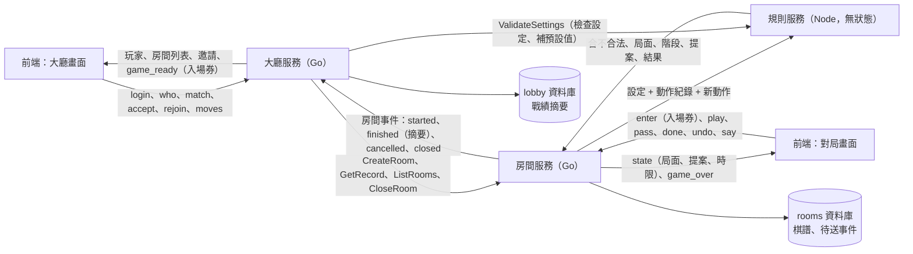
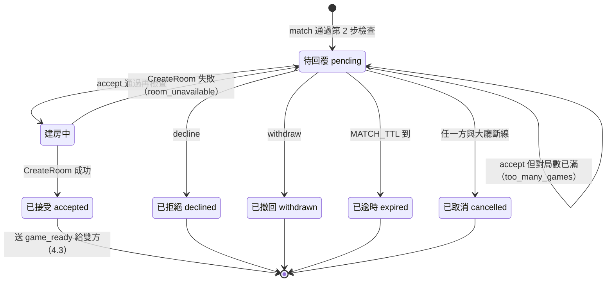
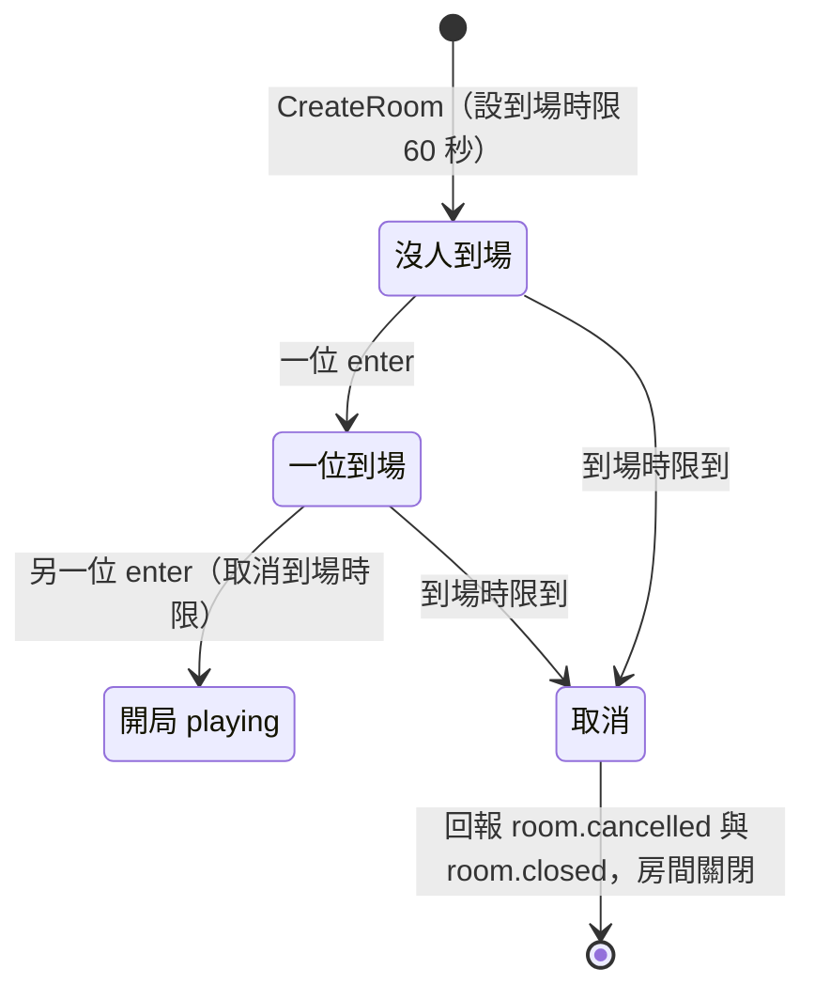
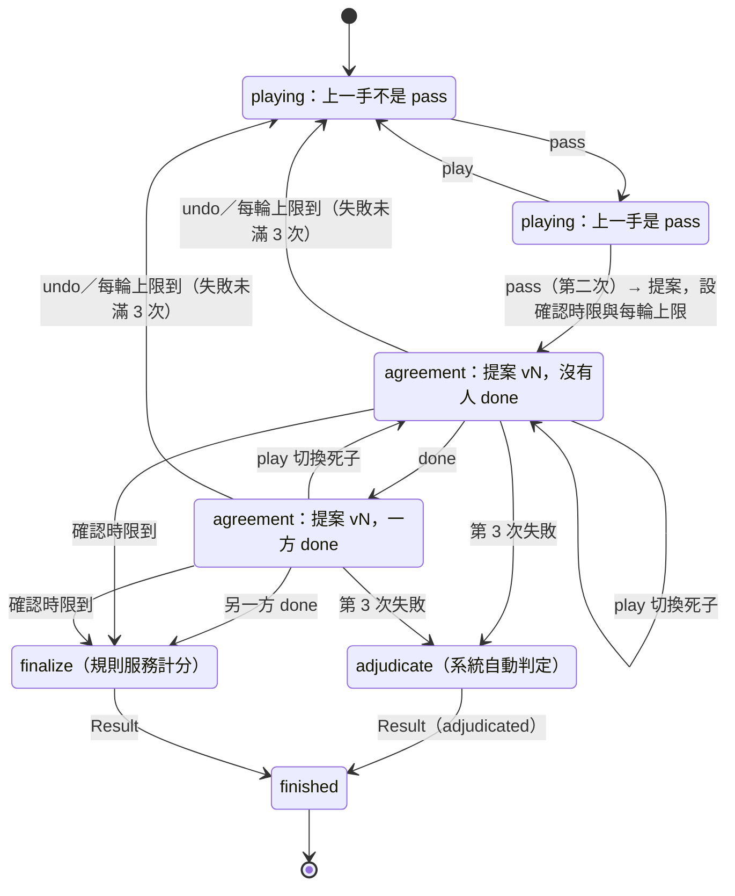
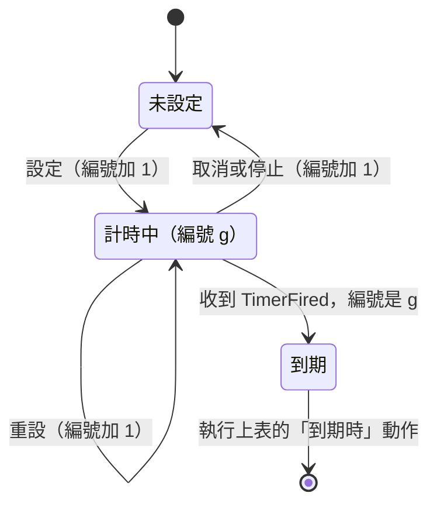
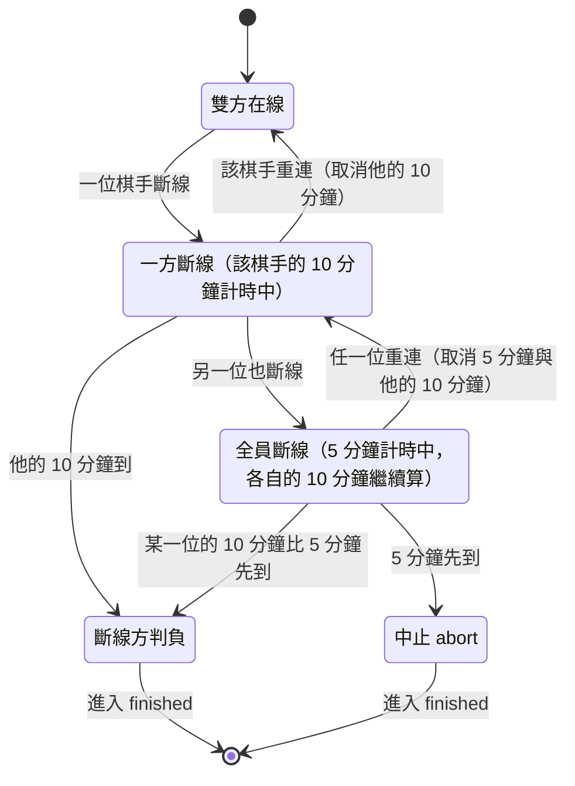
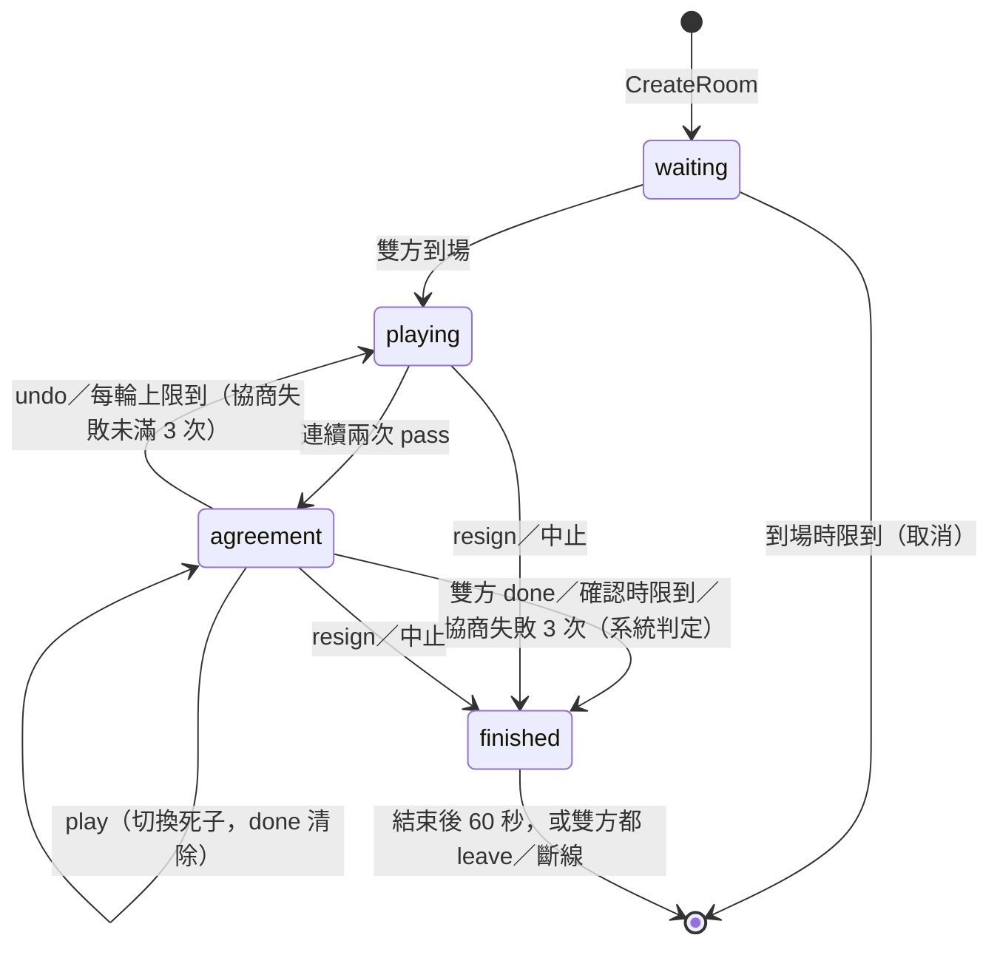

# 規格 v2：里程碑 1（能完整下一盤圍棋與五子棋）

> 整理日期：2026-11-01。狀態：**M1 的實作規格**。
> 只涵蓋 M1。完整的功能規劃見 [spec_v1.md](spec_v1.md)，階段見 [feature-list.md](feature-list.md)，理由見 [decisions.md](decisions.md)（文中以 D-xx 標註）。
> 訊息以 JSON 描述欄位；實際的 proto 定義在 `proto/`，以本文件為準。
> **指令名稱沿用 NNGS**（D-22），對照見附錄 A；**一位玩家可以同時在多個房間對局**（D-21）；**M1 同時支援圍棋與五子棋**（D-23）。
> 2026-11-02 依「遊戲知識只放在規則服務」調整三個服務的分工（D-27）：大廳不驗證遊戲設定、房間不解析座標與提案、座位改用 `1`／`2`。
> 2026-11-01 參考 NNGS 1.1.22 原始碼的做法補齊疏漏（斷線、終局確認、版本號等），對照見附錄 C。

## 1. 範圍

**M1 要做到**：訪客在大廳約局，進房下完 9 路或 19 路圍棋（雙方確認死子與目數後定案），或 15 路五子棋（連成五子即結束），結果與棋譜保存下來。一位玩家可以同時進行多盤對局。五子棋用來證明平台不改程式就能跑第二種遊戲（D-10、D-23）。

**M1 包含**

- 訪客登入、玩家列表（`who`）、房間列表（`games` 與推送）
- 約局：`match`（含設定）、`accept`、`decline`、`withdraw`、`pending`、逾時
- 同時參與多個房間（多盤對局）
- 建房、入場券、重連憑證、從大廳回到對局（`rejoin`）
- 對局：落子、`pass`、`resign`、`say`、`refresh`
- 圍棋終局：死子提案、點選切換死子、`done`、`undo`（回到對局）、`score`、數子法計分；點目每輪限時，協商失敗 3 次由系統自動判定（D-26）
- 五子棋：15 路 freestyle（無禁手），連五以上獲勝，下滿和局
- 保底時限（不是棋鐘），包括斷線 10 分鐘判負（D-25）
- 棋譜記錄、`moves`、`results`
- 強制關房（管理用）

**M1 不包含**：棋鐘、悔棋（對局中的 `undo`）、觀戰與講評、開放房間、還價、`open` 開關、讓子、五子棋的連珠規則（禁手）、帳號登入、私訊與好友、大廳聊天、匯出 SGF。

## 2. 系統組成

| 服務 | 語言 | 對外 | 對內 |
| --- | --- | --- | --- |
| 大廳服務 | Go | WebSocket（前端） | gRPC 伺服器（接收房間事件）；gRPC 客戶端（呼叫房間服務；呼叫規則服務驗證設定） |
| 房間服務 | Go | WebSocket（前端） | gRPC 伺服器（接收大廳呼叫）；gRPC 客戶端（呼叫大廳、規則服務） |
| 規則服務 | Node.js | — | gRPC 伺服器（接收房間的 `Apply`、大廳的 `ValidateSettings`） |
| PostgreSQL | — | — | 兩個資料庫：`lobby`、`rooms`，各自的帳號 |

**資料流向**（每條線上是傳的資料）：

- **棋譜只在房間服務**：大廳要看棋譜得用 `GetRecord` 問房間；大廳自己只存戰績摘要（D-11）。
- **規則服務不存任何資料**：每次由房間帶完整的動作紀錄來重放（D-05）。
- **前端連房間要靠大廳發的入場券**：大廳與房間之間不同步玩家連線，只靠入場券與房間事件。
- 大廳與房間只透過 gRPC 溝通，不共用資料庫（D-01）。
- **遊戲知識只在規則服務**（D-27）：大廳不知道有哪些設定、房間不知道座標與提案的格式，遇到都交給規則服務。大廳呼叫規則服務只為了驗證設定；規則服務沒有狀態，所以不會造成資料不一致。

**連線**：前端與大廳一條 WebSocket；與房間服務**一條 WebSocket，同時承載多個房間**，每則訊息帶 `room_id`（D-21）。

開發用埠號（可由環境變數覆寫）：

| 用途 | 埠 |
| --- | --- |
| 大廳 WebSocket | 8930 |
| 大廳 gRPC | 8931 |
| 房間 WebSocket | 8932 |
| 房間 gRPC | 8933 |
| 規則 gRPC | 8934 |
| PostgreSQL | 5445 |

**伺服器設定**（環境變數，括號內為預設值）：

| 設定 | 預設 |
| --- | --- |
| `MAX_GAMES_PER_PLAYER`：每人同時對局上限 | 5 |
| `MAX_PENDING_MATCHES`：每人同時送出的待回覆邀請上限 | 5 |
| `MATCH_TTL`：邀請逾時 | 60 秒 |
| `HEARTBEAT`：WebSocket ping 間隔；連續 2 次沒有回應即視為斷線 | 20 秒 |
| `TICKET_SECRET`：入場券簽章密鑰 | （必填） |
| `ESTIMATOR`：死子估算器 `on`／`off`（只有規則服務讀取） | `on` |
| `AGREEMENT_ROUND_LIMIT`：每一輪點目的上限，切換死子不會重設 | 3 分鐘 |
| `MAX_AGREEMENT_ROUNDS`：點目協商失敗幾次後，改由系統自動判定勝負 | 3 |

程式碼結構與分離規則見 [spec_v1.md 2.2 節](spec_v1.md#22-程式碼分離)：`lobby/` 與 `room/` 互不 import，只共用 `proto/`（D-01）；`lobby/` 與 `room/` 裡不得出現任何遊戲名稱或遊戲規則（D-27）。

## 3. 資料定義

### 3.1 對局設定 `Settings`

`Settings` 對大廳與房間來說是**看不懂內容的 JSON**，只有 `game` 欄位是通用的。大廳在 `match` 時呼叫規則服務 `ValidateSettings`：不合法 → `invalid_settings`；合法則回傳**補上預設值**的設定，之後一路原樣傳遞（D-27）。

| 欄位 | 說明 |
| --- | --- |
| `game` | 通用欄位：遊戲名稱。M1 規則服務支援 `go`、`gomoku`；預設 `go` |
| 其他欄位 | 由各遊戲定義，見下表 |

M1 規則服務接受的設定：

| 欄位 | 型別 | 圍棋 `go` | 五子棋 `gomoku` |
| --- | --- | --- | --- |
| `size` | 整數 | `9`、`19`，預設 `19` | `15`，預設 `15` |
| `color` | 字串 | 座位 `1`（發出邀請者）執的顏色：`B`、`W`、`random`，預設 `random` | 同左 |
| `komi` | 數字 | 0～10，間隔 0.5，預設 `7.5` | 不使用 |
| `rules` | 字串 | `chinese`（數子法，D-07） | `freestyle`（無禁手） |

不屬於該遊戲的欄位會被忽略。`random` 由規則服務依開局時房間給的種子決定（5.5 節），大廳不決定顏色。

### 3.2 座標

座標是遊戲自己的事：房間把 `at` 原樣轉給規則服務，格式錯誤由規則服務回 `invalid_coordinate`（D-27）。M1 的圍棋與五子棋沿用 NNGS 寫法：欄為英文字母（跳過 `I`），列為數字、由下往上算，例如 19 路的 `A1` 是左下角、`T19` 是右上角；15 路五子棋為 `A1`～`P15`。

### 3.3 玩家 `Player`

| 欄位 | 說明 |
| --- | --- |
| `name` | 訪客名稱：英數字與底線，1～20 字元。**比對不分大小寫**（`Alice` 與 `alice` 是同一個名稱，與 NNGS 相同），顯示時保留登入時的寫法 |
| `games` | 正在對局的 `room_id` 列表（0～`MAX_GAMES_PER_PLAYER` 個） |

### 3.4 邀請 `Match`

| 欄位 | 說明 |
| --- | --- |
| `match_id` | 大廳產生 |
| `room_id` | 大廳在建立邀請時就產生；接受後建房用這個 ID，重送 `CreateRoom` 也用同一個（5.3 節） |
| `from`、`to` | 玩家名稱 |
| `settings` | `Settings` |
| `expires_at` | 建立後 `MATCH_TTL` |

### 3.5 房間列表項 `RoomItem`

| 欄位 | 說明 |
| --- | --- |
| `room_id` | |
| `settings` | 完整的 `Settings`（含 `game`）；前端依遊戲決定怎麼顯示 |
| `players` | `[{seat, name}]`，座位 `1` 是發出邀請者、`2` 是被邀請者 |
| `status` | `waiting`（等待棋手到場）、`playing`、`finished` |

### 3.6 局面 `View`（由規則服務產生，房間原樣轉送）

`View` 的內容由各遊戲定義，房間不解讀（D-27）。M1 的圍棋與五子棋：

| 欄位 | 說明 |
| --- | --- |
| `colors` | 座位對應的顏色，例如 `{1: B, 2: W}` |
| `board` | 二維陣列，0 空、1 黑、2 白 |
| `to_move` | 輪到的顏色 `B` 或 `W`（給前端顯示；是否輪到由規則服務判斷） |
| `last_move` | 最後一手的座標或 `pass` |
| `move_number` | 手數 |
| `captures` | 只有圍棋：`{B, W}` 各自提掉的子數 |
| `win_line` | 只有五子棋：連成五子的座標，結束時給前端標示 |

### 3.7 提案 `Proposal`（終局時）

提案的內容由各遊戲定義，**房間不解讀**，只認得它的版本（等於提案產生時的 `state.version`）與雙方誰已 `done`（D-27）。圍棋的提案：

| 欄位 | 說明 |
| --- | --- |
| `dead` | 判為死子的座標列表 |
| `score` | `{B: {stones, territory, total}, W: {stones, territory, komi, total}}` |
| `result` | 依目前提案計算的結果，例如 `B+3.5` |

### 3.8 結果 `Result`

| 欄位 | 說明 |
| --- | --- |
| `winner` | 獲勝的座位 `1`、`2`，或 `none`（和局、中止、取消） |
| `reason` | `score`（圍棋點目）、`five`（五子棋連五）、`board_full`（五子棋下滿和局）、`resign`（認輸）、`disconnect`（斷線超過 10 分鐘判負）、`adjudicated`（點目協商失敗 3 次，系統判定）、`abort`（中止）、`cancelled`（棋手沒到場，沒有開局） |
| `detail` | 只用於 `abort`：`all_disconnected`（全員斷線）、`time_limit`（對局總時長）、`admin`（強制關房）、`restart`（房間服務重啟） |
| `text` | 由規則服務產生（中止、取消由房間產生 `Void`），沿用 SGF 的 `RE` 寫法，不含自然語言：`B+3.5`、`W+R`、`B+`（連五獲勝）、`W+F`（對方斷線判負）、`0`（和局）、`Void`（中止、取消）。畫面上的文字由前端依 `winner`、`reason`、`detail` 組出 |

## 4. 功能

### 4.1 登入與大廳

1. 前端連上大廳，第一則訊息送 `login{name}`。
2. 名稱不合法 → `error{invalid_name}` 並斷線。
3. 名稱已經有大廳連線 → **踢掉舊連線**（舊連線收到 `error{logged_in_elsewhere}` 後斷線），新連線登入成功；與 NNGS 對註冊帳號的做法相同。M1 是測試階段，不防止別人冒用名稱；身分驗證等 M3 的註冊系統（D-24）。
4. 成功 → `welcome{you, players, rooms, games}`，其中 `games` 是自己正在進行的房間（重新登入時用來回到對局）。
5. 玩家列表**不推送**（D-09）；前端送 `who` 取得 `players`。
6. 房間列表：送 `games` 取得完整列表；房間新增、狀態變更、移除時，大廳主動推送 `rooms{op, room}` 給**所有連著大廳的玩家**（對局中的玩家也收得到，是否顯示由前端決定）。
7. 玩家與大廳斷線：他送出與收到的待回覆邀請都結束（`cancelled`），與 NNGS 相同；他進行中的對局不受影響（對局在房間服務，另有連線）。
8. 大廳以單一事件迴圈處理所有指令；呼叫房間服務 `CreateRoom` 在另一個 goroutine 進行，完成後把結果送回事件迴圈（因此有 4.2 節的「建房中」狀態），等待期間不會卡住其他玩家的指令。

### 4.2 約局

1. 發出：`match{to, settings}`。大廳呼叫規則服務 `ValidateSettings`，取得補上預設值的設定；不合法 → `error{invalid_settings}`；規則服務無法連線 → `error{rules_unavailable}`。
2. 大廳依序檢查，失敗就回對應錯誤：
   1. 對方在線 → `no_such_player`；
   2. 不是自己 → `invalid`；
   3. 雙方的對局數都小於 `MAX_GAMES_PER_PLAYER` → `too_many_games`（某位玩家的對局數 = 他 `games` 中的房間 + 他參與、正在「建房中」的邀請）；
   4. 自己送出的待回覆邀請少於 `MAX_PENDING_MATCHES` → `too_many_matches`；
   5. 兩人之間沒有其他待回覆的邀請（任一方向）→ `duplicate_match`。
3. 通過：建立 `Match`（同時產生 `room_id`），送 `match_request` 給對方，送 `match_sent` 給自己。
4. 回覆與結束：

   | 指令或事件 | 誰可以 | 結果 |
   | --- | --- | --- |
   | `accept{match_id}` | 被邀請者 | 再檢查一次雙方對局數（滿了 → `too_many_games`，邀請保留）；通過則進入「建房中」並呼叫 `CreateRoom`（4.3）：成功 → 雙方收到 `match_result{accepted}`；失敗 → 被邀請者收到 `error{room_unavailable}`，邀請回到待回覆 |
   | `decline{match_id}` | 被邀請者 | 雙方收到 `match_result{declined}` |
   | `withdraw{match_id}` | 邀請者 | 雙方收到 `match_result{withdrawn}` |
   | 逾時 | — | 雙方收到 `match_result{expired}` |
   | 任一方與大廳斷線 | — | 仍在線的一方收到 `match_result{cancelled}` |

5. 不是邀請的對象卻 `accept`／`decline`，或不是邀請者卻 `withdraw` → `no_such_match`。
6. 與某個邀請有關的錯誤都帶 `match_id`：`error{code, message, match_id}`，前端才分得出是哪一個邀請失敗。
7. `pending` → 回傳自己送出與收到的待回覆邀請。
8. 一個人可以同時有多個邀請；與 NNGS 不同的是，開局後**不會**清掉雙方其他的邀請（多房間下仍可再開局）。
9. **建房中**：等待 `CreateRoom` 回應的期間，`accept`／`decline`／`withdraw` 都回 `no_such_match`，逾時不觸發，斷線也不取消（房間建好後，斷線的一方可用 `rejoin` 進房，否則由到場時限取消）。若回到待回覆時已超過 `MATCH_TTL`，立即逾時。

邀請的狀態：

第 2 步檢查失敗時不建立 `Match`，只回 `error`。除了「建房中」以外，每次狀態改變都會送 `match_result` 給雙方（`cancelled` 只送給仍在線的一方）；結束的邀請從 `pending` 列表移除。

### 4.3 建房與入房

1. `accept` 通過後，大廳以邀請的 `room_id` 呼叫房間服務 `CreateRoom`：發出邀請者坐座位 `1`，被邀請者坐座位 `2`。大廳不決定顏色。
2. 房間服務建立房間、啟動 goroutine、設到場時限，回傳 `ws_url`。
3. 大廳為雙方簽發棋手入場券（4.9 節），送 `game_ready{room_id, ws_url, ticket, seat}` 給雙方；把 `room_id` 加進雙方的 `games`；推送 `rooms{op: add}`（`waiting`）。
4. 前端若還沒連房間服務就先連上；之後送 `enter{room_id, ticket}`。同一條連線可以 `enter` 多個房間。
5. 閘道驗證入場券：無效 → `error{room_id, invalid_ticket | ticket_used | ticket_expired}`（只拒絕這個房間，不斷開連線）。
6. 成功 → 房間送 `reconnect_token{room_id, token}` 與 `state`。
   - 這個座位若已經有另一條連線（例如另一個分頁），**舊連線離開這個房間**（送 `error{room_id, entered_elsewhere}`），舊的重連憑證作廢；同一個座位同時只有一條連線（與 NNGS「同名登入就踢掉舊的」相同）。
7. 兩位棋手都到場：房間產生一個隨機種子，以 `start{seed}` 呼叫規則服務開局（規則服務依設定與種子決定顏色），送 `state` 給雙方，回報 `room.started`。

房間在 `waiting` 階段的狀態：

到場的一方在 `waiting` 斷線不會退回「沒人到場」（座位已確定），只是還不能開局；`waiting` 期間不跑斷線時限，由到場時限保底。

**取消**：已進房的棋手收到 `game_over{result: {winner: none, reason: cancelled, text: Void}}`（還沒開局，結果由房間產生，不呼叫規則服務）；`games` 資料表記為 `cancelled`，不產生戰績。大廳收到 `room.cancelled` 後把房間從雙方的 `games` 移除，推送 `rooms{op: remove}`；沒進房的一方由此得知這局取消。

### 4.4 對局

所有對局指令都帶 `room_id`，以下省略。

1. 指令分成兩類（第 6 章）：
   - **房間指令**（房間自己處理）：`enter`、`leave`、`say`、`refresh`、`done`、`score`。
   - **遊戲指令**（房間轉給規則服務）：M1 有 `play{at, base_version}`、`pass{base_version}`、`undo`、`resign`。房間不知道它們的意思，只把指令名稱與參數原樣包成 `Action`，加上送出者的座位。
2. 遊戲指令的處理順序：
   1. 這條連線已 `enter` 這個房間且是棋手 → 否則 `not_in_room`（房間）；
   2. 階段是 `playing` 或 `agreement` → 否則 `wrong_phase`（房間；`waiting` 與 `finished` 不接受遊戲指令）；
   3. 有帶 `base_version` 時，等於目前版本 → 否則 `stale_version`（房間）；
   4. 呼叫規則服務 `Apply`，由規則服務判斷其他一切：這個階段能不能用（`wrong_phase`）、是否輪到（`not_your_turn`）、座標格式（`invalid_coordinate`）、合不合法（圍棋 `occupied`、`suicide`、`ko`、`out_of_board`）、這個遊戲有沒有這個指令（`not_supported`，例如五子棋的 `pass`）。
   - 例：圍棋 `playing` 階段只有輪到的人能 `play`、`pass`；`agreement` 階段雙方都能 `play`（切換死子）與 `undo`；`resign` 兩個階段都能用，不必輪到自己。這些都是規則服務的判斷。
3. 合法：寫入棋譜（第 8 章）；成功後版本加 1，送新的 `state` 給雙方。
   - **版本**（`state.version`）只在局面、提案或階段改變時加 1（規則服務回傳的 `view`、`proposal` 或 `phase` 有變）：`play`、`pass`、切換死子、`undo`（回到對局）、每輪上限到期的自動恢復對局、定案（雙方 `done` 或確認時限到）、系統判定、`resign`、斷線判負、中止、取消。
   - 一次改變只加 1，即使寫入多筆紀錄：例如第二次 `pass` 會寫入 `pass` 與 `propose` 兩筆，版本只加 1。
   - `done`、`say`、棋手連線狀態改變**不會**讓版本加 1。所以一方送 `done` 後，另一方手上的版本仍然有效；聊天也不會讓對手正要送的落子變成 `stale_version`。
4. 錯誤只回給送出者：`error{room_id, code, version, state}`。
5. **先擺子**：前端在 `playing` 階段輪到自己時，用與規則服務同一份規則庫先檢查並顯示（圍棋用 `goban`，五子棋用五子棋模組）；收到 `error` 或版本不符時，依 `state` 重畫（D-14）。
6. `say{text}`：1～500 字元，送給同房的棋手，寫入資料庫（與 NNGS 相同，NNGS 也把 `say` 存在棋局裡；但 `moves` 不回傳，見 4.8）。
7. `refresh`：重送目前的 `state`。
8. **五子棋的結束**：落子後連成五子以上，規則服務直接回傳 `finished` 與 `Result{winner, reason: five}`；棋盤下滿仍沒人連五則為和局（`reason: board_full`）。五子棋不會進入 `agreement` 階段。
9. **連線狀態**：棋手在房間斷線或重連時，房間送 `state` 給在線的對手（`connected` 改變，版本不變），並回報大廳 `room.player_disconnected`／`room.player_reconnected`。

### 4.5 圍棋終局

以下是圍棋的流程。房間只處理通用的部分：規則服務回傳 `agreement` 階段與提案時，房間收集雙方的 `done`、管時限、計算協商失敗次數；提案內容與切換死子都由規則服務處理。

1. 連續兩次 `pass`（中間沒有落子）→ 規則服務回傳階段 `agreement` 與提案。
2. **初始提案**：規則服務用估算器判斷死子（D-17）。`ESTIMATOR=off` 或估算失敗時，初始提案為**沒有死子**，由雙方手動點選；流程不變。
3. 房間把 `pass` 與提案（`propose`）寫入棋譜，版本加 1（只加一次），設確認時限（60 秒）與每輪上限（3 分鐘），送 `state` 給雙方。
4. 在 `agreement` 階段，棋手可以：

   | 指令 | 效果 |
   | --- | --- |
   | `play{at, base_version}` | 與 NNGS 相同，點目時輸入座標就是**切換該塊棋的死活**（規則服務的解讀）；規則服務回傳新提案；版本加 1；**雙方的 `done` 清除**（房間看到提案改變就清除）；確認時限重新計算 |
   | `done{version}` | 同意目前版本的提案；`version` 不是目前版本 → `stale_version`。`done` 寫入棋譜（含版本），不改變版本 |
   | `undo` | 房間原樣轉給規則服務；圍棋在點目時把 `undo` 解讀為**回到對局**：階段回到 `playing`，照正常輪次繼續（D-07），死子標記清除。雙方都可以送。與 NNGS 的差別見附錄 A.3 |
   | `score` | 房間重送目前的提案（房間不解讀內容） |
   | `resign` | 認輸，對局結束 |

5. 雙方都對同一版本 `done` → 房間送 `finalize` 給規則服務，取得 `Result`，階段 `finished`。
6. 確認時限到：
   - 沒有 `done` 的棋手**都在線** → 視為同意目前提案（D-07），同第 5 步。
   - 沒有 `done` 的棋手中有人**斷線** → **不定案**（D-25）：確認時限停止，等他重連；他重連時確認時限重新設為 60 秒。若一直沒回來，10 分鐘後他判負（4.6 節）。NNGS 在點目中斷線也不會替斷線的人同意，而是封盤。
   - 斷線期間，在線的一方仍可切換死子；斷線者重連後看到的是最新提案，`done` 也已清除。
7. 結束時：寫入結果，送 `game_over{result}` 給雙方，回報 `room.finished`。
8. **協商失敗與自動判定**（D-26）：故意亂切換死子很難靠規則禁止，所以改成限制協商的次數與長度，談不攏就交給系統判定，亂改沒有好處：
   - **每一輪點目最多 `AGREEMENT_ROUND_LIMIT`（3 分鐘）**，從進入 `agreement` 開始算，切換死子**不會**重設。確認時限（60 秒）照舊，先到者先處理。
   - **有棋手斷線時，每輪上限暫停**，他重連後以剩餘時間繼續。否則斷線的人會因為每輪上限到期而被算成協商失敗、甚至被系統判定；斷線一律由斷線時限處理（10 分鐘判負，D-25）。
   - **一輪協商失敗**：該輪以 `undo` 或每輪上限到期結束，而不是定案。
   - 失敗未滿 `MAX_AGREEMENT_ROUNDS`（3）次：回到 `playing`，照 D-07 繼續下（每輪上限到期時，由房間自動送 `resume`）。
   - **第 3 次失敗**：不再回到對局。房間送 `adjudicate` 給規則服務，由系統**自動判定勝負**，局結束（`Result.reason: adjudicated`）；棋譜照常保存，並在 `games` 標記 `adjudicated`，之後可在後台複查。
   - M1 的自動判定：用估算器（D-17）判斷死子後計分，**不採用任何一方的切換**；`ESTIMATOR=off` 時，以盤面上所有棋子都活計分（前兩輪談不攏時，雙方都有機會把對方的死子提掉，所以仍然公平）。之後改用 KataGo 判定（D-26），只換規則服務裡的判定程式，房間與大廳不需要改。
   - 失敗次數由房間計算：規則服務回傳的階段從 `agreement` 變回 `playing` 就算一次（通用的「等待雙方同意」處理，不涉及圍棋規則，D-10、D-27）；第 3 次失敗時房間不送 `resume`，改送 `adjudicate`；`state` 帶 `round`（目前第幾輪），前端在 `agreement` 階段提示「第 3 輪再談不攏將由系統判定」。

雙 pass 之後的狀態（只有圍棋）：

- 切換死子：提案版本加 1（vN+1）、重設確認時限；`done` 都要帶目前版本 `done{vN}`。
- `undo`：死子標記清除，照正常輪次繼續。
- 任何狀態下 `resign` 或保底時限中止，都直接到 `finished`（圖中省略）。
- 確認時限到期時若沒有 `done` 的一方斷線，不會轉到「finalize」，而是停在原狀態（第 6 步）。
- 已 `done` 的一方再送 `done` 不改變狀態；`done` 帶的版本不是 vN → `stale_version`，狀態不變。
- 切換死子由**任一方**送出都會清除**雙方**的 `done`，包括送出者自己的。
- 從 `undo` 回到 `playing` 後，要再連續兩次 `pass` 才會重新進入 `agreement`，重新產生初始提案（版本號繼續累加，不重設）。
- **防止一直切換死子**（D-26）：見第 8 步。

### 4.6 保底時限

M1 沒有棋鐘，但房間一定要會結束（D-13）。每個房間各自計算。

| 時限 | 開始 | 取消 | 到期時 |
| --- | --- | --- | --- |
| 到場 60 秒 | 建房 | 兩位棋手都到場 | 這局取消（4.3 節）：回報 `room.cancelled` 與 `room.closed`，房間關閉 |
| 點目每輪 3 分鐘 | 進入 `agreement`；斷線的棋手重連時以剩餘時間繼續 | 定案、`undo`、認輸；有棋手斷線時暫停 | 算一次協商失敗：未滿 3 次自動 `resume` 回到 `playing`；第 3 次由系統自動判定（4.5 節第 8 步） |
| 確認 60 秒 | 進入 `agreement`、提案改變、斷線的棋手重連 | 定案、`undo`、認輸 | 沒有 `done` 的一方都在線：視為同意，定案；有人斷線：不定案，等他重連（4.5 節第 6 步） |
| 單一棋手斷線 10 分鐘 | 一位棋手的連線斷開 | 該棋手重連 | **斷線方判負**：房間送 `forfeit{seat}` 給規則服務，取得 `Result{winner: 對手, reason: disconnect}`（D-25） |
| 全員斷線 5 分鐘 | 兩位棋手都斷線 | 任一位重連 | 這局中止（`abort`） |
| 對局總時長 6 小時 | 開局 | — | 這局中止（`abort`） |
| 結束後 60 秒 | 局結束 | 兩位棋手都 `leave` 或都斷線 | 房間關閉 |

斷線判負與中止的局同樣寫入結果與棋譜，回報 `room.finished`。斷線判負的結果由規則服務產生（誰算對手、結果怎麼寫是遊戲的事）；中止與取消不分勝負，結果由房間直接產生 `Void`，規則服務無法連線時也能結束。斷線判負計入戰績；中止（`Result{winner: none, reason: abort, detail}`）不分勝負。一位玩家斷線時，他所在的每個房間都各自開始計時。

**斷線的判定**：房間服務與大廳每 `HEARTBEAT`（20 秒）送一次 WebSocket ping，連續 2 次沒有 pong（約 40 秒）或連線關閉，即視為斷線；斷線時限從判定斷線的時間開始算。

各階段會跑的時限（進入 `finished` 時，其他時限全部取消）：

| 階段 | 時限 |
| --- | --- |
| `waiting` | 到場 |
| `playing` | 對局總時長、斷線（單一棋手、全員） |
| `agreement` | 對局總時長、斷線（單一棋手、全員）、確認、點目每輪上限 |
| `finished` | 結束後 |

**每一個計時器**的狀態（計時器編號的做法見 [spec_v1.md 5.3](spec_v1.md#53-超時判定)）：

- 計時器到期只把 `TimerFired{編號}` 放進房間的事件佇列，不直接改狀態；房間依序處理，所以排在它前面的指令（例如確認時限前送到的 `done` 或切換死子）會先生效，切換死子會重設確認時限，使這個 `TimerFired` 變成舊編號而被忽略。
- 收到編號不是 g 的 `TimerFired`（已取消或已重設的舊計時）一律忽略，狀態不變。
- 「取消」與「重設」都讓編號加 1，因此已經在佇列裡的舊 `TimerFired` 一律無效。
- 「暫停」（點目每輪上限遇到斷線）＝取消並記住剩餘時間；「繼續」＝以剩餘時間重新設定。兩者都讓編號加 1。

**斷線時限**（`playing`、`agreement` 階段）：

- 每位棋手的 10 分鐘各自獨立，從**他自己**斷線時開始算，不因對方斷線或重連而重設。
- 全員斷線時：先斷線的人的 10 分鐘若比全員斷線的 5 分鐘先到，他判負；否則這局中止、不分勝負（兩人都不在，無法判斷誰逃避）。
- 點目（`agreement`）中斷線也一樣：10 分鐘沒回來就判負，不會因為點目而改用系統判定；斷線期間確認時限不替他同意（4.5 節第 6 步），每輪上限也暫停（4.5 節第 8 步）。
- 「斷線」指該棋手在這個房間沒有任何連線；他重新 `enter` 這個房間才算重連，只重連大廳不算。

### 4.7 重連

**同一個分頁**（重新整理、網路斷線）：

1. 前端在 sessionStorage 保存每個房間的重連憑證（`room_id → token`）。
2. 重新連上房間服務後，對每個房間送 `enter{room_id, reconnect_token}`。
3. 房間驗證後回到原座位，**換發新的重連憑證**（舊的立即失效），並送目前的 `state`。同一座位若還有舊連線，舊連線離開該房間。
4. 房間已關閉 → `error{room_id, room_closed}`。

**新分頁或其他裝置**（沒有重連憑證）：

1. 玩家用同一個名稱 `login` 大廳，舊的大廳連線被踢掉（4.1 節）；`welcome.games` 列出他進行中的房間。
2. 送 `rejoin{room_id}` → 大廳確認他是該房間的棋手，重新簽發入場券，送 `game_ready`；之後同 4.3 節第 4 步。舊分頁在這個房間的連線被踢掉（4.3 節第 6 步）。

M1 以名稱識別玩家，不保留名稱、不驗證身分（測試階段）；M3 有註冊系統後再處理（D-24）。

### 4.8 棋譜與戰績

1. 每個被接受的指令都寫入房間服務的資料庫，成功後才廣播（D-11）。
2. 局結束時，房間回報 `room.finished`，附摘要；大廳把摘要寫入 `lobby` 資料庫，雙方各一筆（依 `Result.winner` 的座位算出各自的勝、負、和、無效），並把 `room_id` 從雙方的 `games` 移除。
3. `results` → 大廳回傳自己的摘要列表（最新在前，最多 50 筆）。
4. `moves{room_id}` → 大廳以 gRPC 向房間服務 `GetRecord` 查詢，回傳棋譜。任何人都可以查，進行中的局也可以（與 NNGS 相同：NNGS 的 `moves` 除了不公開的對局，誰都能查；M1 沒有不公開的對局）。
5. `moves` 回傳的棋譜**只包含對局動作**（落子、pass、提案、`done`、結果等），**不包含 `say`**，與 NNGS 的 `moves` 只列棋步相同。

### 4.9 入場券與重連憑證

| 憑證 | 簽發者 | 格式與內容 | 有效期 |
| --- | --- | --- | --- |
| 棋手入場券 | 大廳 | 以 `TICKET_SECRET` 做 HMAC-SHA256 簽章；內容 `room_id, name, seat (1/2), jti, exp` | 60 秒，只能用一次 |
| 重連憑證 | 房間 | 128 位元隨機字串，存在房間的座位資料中，不簽章 | 到房間關閉；每次重連成功即換發，舊的作廢 |

- 閘道記住已使用的 `jti`，到入場券過期為止。
- 重連憑證不簽章，因為房間本來就保存座位資料，比對即可，並且能隨時作廢。M1 的房間服務重啟時對局直接中止，憑證不需要在重啟後有效。

### 4.10 強制關房

- 管理用：大廳以 gRPC 呼叫 `CloseRoom{room_id}`（M1 只需能從命令列或測試呼叫）。
- `waiting` 的房間：記為取消，同 4.3 節的「取消」。
- `playing`、`agreement` 的房間：記為中止（`detail: admin`），送 `game_over` 給在線棋手，回報 `room.finished` 與 `room.closed`。
- `finished` 的房間：直接關閉，回報 `room.closed`。

## 5. 介面

每則訊息：`{"type": "...", "data": {...}}`。

### 5.1 前端 ↔ 大廳（WebSocket）

| 方向 | `type` | `data` |
| --- | --- | --- |
| → 大廳 | `login` | `{name}` |
| → 大廳 | `who` | — |
| → 大廳 | `games` | — |
| → 大廳 | `match` | `{to, settings}` |
| → 大廳 | `accept` | `{match_id}` |
| → 大廳 | `decline` | `{match_id}` |
| → 大廳 | `withdraw` | `{match_id}` |
| → 大廳 | `pending` | — |
| → 大廳 | `rejoin` | `{room_id}` |
| → 大廳 | `results` | — |
| → 大廳 | `moves` | `{room_id}` |
| ← 大廳 | `welcome` | `{you, players: [Player], rooms: [RoomItem], games: [room_id]}` |
| ← 大廳 | `players` | `{players: [Player]}` |
| ← 大廳 | `rooms` | `{op: add/update/remove, room: RoomItem}`（推送）或 `{rooms: [RoomItem]}`（回應 `games`） |
| ← 大廳 | `match_request` | `Match`（給被邀請者） |
| ← 大廳 | `match_sent` | `Match`（給邀請者） |
| ← 大廳 | `match_result` | `{match_id, result: accepted/declined/withdrawn/expired/cancelled}` |
| ← 大廳 | `pending` | `{sent: [Match], received: [Match]}` |
| ← 大廳 | `game_ready` | `{room_id, ws_url, ticket, seat}` |
| ← 大廳 | `results` | `{results: [Summary]}` |
| ← 大廳 | `moves` | `GameRecord`（第 8 章） |
| ← 大廳 | `error` | `{code, message, match_id?, room_id?}`（與某個邀請或房間有關時帶上） |

### 5.2 前端 ↔ 房間服務（WebSocket，一條連線承載多個房間）

所有訊息的 `data` 都帶 `room_id`。

| 方向 | `type` | `data`（除 `room_id` 外） |
| --- | --- | --- |
| → 房間 | `enter` | `{ticket}` 或 `{reconnect_token}` |
| → 房間 | `play` | `{at, base_version}` |
| → 房間 | `pass` | `{base_version}` |
| → 房間 | `resign` | — |
| → 房間 | `done` | `{version}` |
| → 房間 | `undo` | —（M1 只在 `agreement` 階段有效） |
| → 房間 | `score` | — |
| → 房間 | `say` | `{text}` |
| → 房間 | `refresh` | — |
| → 房間 | `leave` | —（局結束後離開） |
| ← 房間 | `reconnect_token` | `{token}` |
| ← 房間 | `state` | `{version, phase: waiting/playing/agreement/finished, seats: {1: {name, connected, done?}, 2: {...}}, view: View, proposal?: Proposal, round?, deadlines: {名稱: 到期時間}}` |
| ← 房間 | `score` | `{proposal: Proposal}`（目前的提案，內容由規則服務定義） |
| ← 房間 | `say` | `{from, text}` |
| ← 房間 | `game_over` | `{result: Result}`（棋譜 ID 即 `room_id`） |
| ← 房間 | `error` | `{code, version?, state?}` |

`deadlines` 列出目前所有在跑的保底時限，供前端倒數顯示；名稱為 `arrival`（到場）、`confirm`（確認）、`disconnect_1`、`disconnect_2`（單一棋手斷線）、`all_disconnected`（全員斷線）、`round_limit`（點目每輪上限）、`total`（對局總時長）、`close`（結束後）。前端自行決定顯示哪些，建議優先顯示 `confirm` 與對手的斷線倒數。

### 5.3 大廳 → 房間（gRPC `RoomService`）

| 方法 | 請求 | 回應 |
| --- | --- | --- |
| `CreateRoom` | `{room_id, settings, players: [{seat: 1, name}, {seat: 2, name}]}` | `{ws_url}` |
| `ListRooms` | — | `{rooms: [RoomItem]}`（包含 `finished` 但尚未關閉的房間） |
| `GetRecord` | `{room_id}` | `GameRecord` |
| `CloseRoom` | `{room_id}` | — |

- **`CreateRoom` 是冪等的**：同一個 `room_id` 重送，房間已存在就直接回傳 `ws_url`，不會建第二間。大廳呼叫逾時 5 秒；逾時就把邀請退回待回覆（4.2 節），之後再 `accept` 用同一個 `room_id` 重送。
- 逾時但房間其實已建好、之後也沒有再 `accept` 的房間，沒有人進房，由到場時限自動取消；大廳收到不認得的房間的事件時直接忽略。

### 5.4 房間 → 大廳（gRPC `LobbyEvents`）

`ReportRoomEvent{room_id, seq, type, payload}`。

| `type` | `payload` | 大廳的處理 |
| --- | --- | --- |
| `room.started` | — | 列表項改為 `playing` |
| `room.player_disconnected`、`room.player_reconnected` | `{name}` | 記錄（M1 不另外通知） |
| `room.cancelled` | — | 從雙方的 `games` 移除，移除列表項（推送 `rooms{op: remove}`） |
| `room.finished` | `Summary`（第 8 章） | 寫入戰績，從雙方的 `games` 移除，列表項改為 `finished` |
| `room.closed` | — | 移除列表項 |

- `seq` 為房間內遞增序號；大廳忽略不大於已處理序號的事件。
- **事件先存再送**：房間把事件與對應的狀態變更寫進同一個資料庫交易（`outbox` 資料表，第 8 章），再由背景程序依 `seq` 送出；大廳回應成功才刪除，失敗以指數退避（最長間隔 30 秒）**一直重試**。因此 `room.finished` 的戰績不會因為大廳暫時無法連線而遺失。
- `room.finished` 的處理是冪等的（8.2 節的唯一鍵），重送不會重複寫入。
- 大廳每 30 秒呼叫 `ListRooms` 對帳：房間服務沒有的房間，從列表與玩家的 `games` 移除；房間服務有、大廳沒有的房間，補進列表與玩家的 `games`。

### 5.5 房間 → 規則（gRPC `RulesService`）

| 方法 | 請求 | 回應 |
| --- | --- | --- |
| `Apply` | `{settings, actions: [Action], action: Action}` | `{ok, error_code?, phase, view, proposal?, result?}` |
| `ValidateSettings` | `{settings}` | `{ok, error_code?, settings}`（補上預設值的設定）；大廳在 `match` 時呼叫 |

- `Action`：`{type, seat?, data?}`，`data` 的內容由遊戲定義（例如 `{at: "D4"}`）。
  - **遊戲指令**：棋手送的遊戲指令原樣轉成 `Action`，`type` 就是指令名稱（M1：`play`、`pass`、`undo`、`resign`）。房間不知道它們的意思；`play` 在點目時是切換死子、`undo` 在點目時是回到對局，都是規則服務的解讀。
  - **系統動作**（房間在通用流程中送出）：`start{seed}`（開局，`seed` 是房間產生的隨機種子）、`propose{proposal}`（記錄規則服務提出的提案）、`finalize`（雙方同意後定案）、`resume`（每輪上限到期，結束這輪協商）、`adjudicate`（協商失敗 3 次，系統判定）、`forfeit{seat}`（該座位斷線判負）。
  - `done` 不送規則服務：同意由房間收集，雙方同意後房間送 `finalize`。
  - `propose`：規則服務回傳新的初始提案時，房間把它記成一筆 `propose`；重放時直接使用，不重新估算。
- **規則服務必須是確定性的**：同樣的 `settings` 與 `actions`，重放結果一定相同，所以**不得使用隨機數或目前時間**；需要隨機時用 `start` 帶來的種子（D-27）。
- 規則服務不保存狀態，每次重放 `actions`（D-05）。`settings` 內含 `game`，規則服務依此分派。`actions` 只包含遊戲指令與上列系統動作；棋譜中的 `enter`、`leave`、`done`、`say`、`abort`、`cancel` 等紀錄由房間過濾掉，不送規則服務。
- 房間呼叫逾時 2 秒；逾時或錯誤時，該指令回 `error{rules_unavailable}`，不寫入紀錄。

## 6. 房間的階段與指令

圖中的 `pass`、`undo`、`play` 是圍棋的例子；房間實際只看規則服務回傳的階段變化。

房間只認得下表的階段與**房間指令**；遊戲指令（`play`、`pass`、`undo`、`resign` 等）在 `playing`、`agreement` 一律轉給規則服務，能不能用由規則服務決定（D-27）。

| 階段 | 房間指令 | 遊戲指令 |
| --- | --- | --- |
| `waiting` | `say`、`refresh` | 不接受（`wrong_phase`） |
| `playing` | `say`、`refresh` | 轉給規則服務 |
| `agreement` | `done`、`score`、`say`、`refresh` | 轉給規則服務 |
| `finished` | `say`、`refresh`、`leave`（一方 `leave` 只是他離開；兩位都離開才關房） | 不接受（`wrong_phase`） |

房間內部的原則（事件迴圈、先寫紀錄再廣播、送出佇列、計時器編號、`recover`）同 [spec_v1.md 第 5 章](spec_v1.md#5-房間內部)；M1 沒有棋鐘，計時器只用於第 4.6 節的保底時限。閘道依訊息的 `room_id` 把指令送到對應房間的事件佇列；一條連線 `enter` 的每個房間，都各自是房間的一條棋手連線。

## 7. 規則服務

規則服務依 `settings.game` 分派到規則庫。房間與大廳不判斷遊戲類型（D-10、D-27）。每個規則庫負責：

- 驗證設定、補預設值（`ValidateSettings`）；
- 依設定與 `start` 的種子決定座位對應的顏色；
- 解析座標、判斷輪到誰、每個階段能用哪些遊戲指令、合不合法；
- 產生 `View`、提案、`Result`（包括 `resign` 與 `forfeit` 的結果寫法）；
- 自己的錯誤代碼（第 10 章列的是 M1 會出現的）。

### 7.1 圍棋（`goban-engine`）

- 以 `goban-engine` 重放 `actions`，判斷合法、提子、打劫（positional superko）、禁止自殺；座標由 `D4` 形式轉為 (x, y)。
- `pass` 後判斷是否連續兩次 pass；是則進入 `agreement` 並產生提案：
  - 估算器可用：估算器算出每點歸屬 → `autoscore` 判死子 → `computeScore` 計分。
  - 估算器不可用：死子為空，直接 `computeScore`。
- `agreement` 階段：`play` 以 `toggleSingleGroupRemoval` 切換後重新計分；`undo` 與系統動作 `resume` 都回到 `playing`，清除死子標記。雙方都能送，不檢查輪次。
- `playing` 階段：只有輪到的人能 `play`、`pass`，否則 `not_your_turn`；`resign` 任何一方都能送。
- `adjudicate`：用估算器判斷死子後計分（不採用棋手的切換）；估算器不可用時以盤面所有棋子都活計分；回傳 `finished` 與 `Result{reason: adjudicated}`（D-26）。
- `finalize`：依最後的提案產生 `Result`。
- `resign`、`forfeit{seat}`：該座位的對手獲勝，`text` 為 `W+R`／`B+R` 或 `W+F`／`B+F`。
- `start{seed}`：`color` 為 `random` 時，依種子決定座位 `1` 執黑或執白。
- 實作注意：`autoscore` 會修改傳入的棋盤陣列，要傳副本；估算器回傳 1／2，要轉換成正負數值。

### 7.2 五子棋（五子棋模組）

- 規則模組沿用三框架 PoC 的 `rules.ts`（含單元測試）：15 路、黑先、輪流落子、不可下在已有棋子的點。
- 落子後檢查四個方向，連成五子以上即獲勝（freestyle，無禁手）。
- 棋盤下滿仍沒人連五：和局。
- 不支援 `pass`、`undo`、`resume`、`propose`、`finalize`、`adjudicate`（回 `not_supported`）；`resign`、`forfeit` 與圍棋相同。
- 連成五子時 `view.win_line` 回傳那五顆（以上）的座標。
- 前端用同一份模組做先擺子的檢查。

## 8. 資料庫

### 8.1 `rooms` 資料庫（房間服務擁有）

| 資料表 | 欄位 |
| --- | --- |
| `games` | `room_id`、`settings`（JSON）、`players`（JSON：`[{seat, name}]`）、`status`、`result`（JSON）、`adjudicated`（布林，供後台複查）、`rules_version`、`created_at`、`started_at`、`ended_at` |
| `actions` | `room_id`、`seq`、`type`、`seat`、`data`（JSON：座標、提案、版本、對話內容）、`received_at` |
| `outbox` | `room_id`、`seq`、`type`、`payload`（JSON）、`created_at`；送給大廳的事件，大廳確認後刪除（5.4 節） |

- `games.status`：`waiting`、`playing`、`agreement`、`finished`、`cancelled`。
- `actions.type`：遊戲指令（M1：`play`、`pass`、`undo`、`resign`）、系統動作（`start`、`propose`、`finalize`、`resume`、`adjudicate`、`forfeit`）與房間紀錄（`enter`、`leave`、`done`、`say`、`abort`、`cancel`）。
- `GameRecord` = `games` 一筆 + 依 `seq` 排序的 `actions`（`say` 除外，4.8 節）。棋譜 ID 即 `room_id`。
- `rules_version` 記錄規則服務使用的規則庫版本（`goban-engine` 或五子棋模組）。

### 8.2 `lobby` 資料庫（大廳服務擁有）

| 資料表 | 欄位 |
| --- | --- |
| `summaries` | `player`、`room_id`、`game`、`settings`（JSON）、`seat`、`opponent`、`outcome`（`win`、`loss`、`draw`、`void`）、`reason`、`result`（`Result.text`）、`ended_at` |

- `Summary`（`room.finished` 的 payload）：`room_id, settings, players: [{seat, name}], result: Result, started_at, ended_at`；大廳拆成雙方各一筆，`outcome` 由 `Result.winner` 與自己的座位算出（大廳不需要知道顏色）。
- `(player, room_id)` 唯一，重送的事件不會產生重複資料。

## 9. 故障處理

| 情況 | M1 的處理 |
| --- | --- |
| 寫入棋譜失敗 | 指令不算數，回 `error{storage_unavailable}` |
| `CreateRoom` 失敗或逾時（5 秒） | 邀請回到待回覆，被邀請者收到 `error{room_unavailable}`，可以再 `accept`；重送用同一個 `room_id`，不會建出兩間（5.3 節） |
| 規則服務無法連線（大廳） | `match` 回 `error{rules_unavailable}`，邀請不建立 |
| 規則服務逾時或錯誤 | 指令不算數，回 `error{rules_unavailable}`；棋手可以重送 |
| 房間服務重啟 | 進行中的局中止（M1 不還原）：房間服務啟動時，把 `games.status` 為 `waiting` 的記為取消、`playing`／`agreement` 的記為中止（`detail: restart`），並寫入 `outbox` 照常回報大廳（戰績不會遺失）；之後送出 `outbox` 中尚未送出的事件 |
| 大廳服務重啟 | 對局不受影響；玩家重新 `login`；大廳以 `ListRooms` 重建房間列表與每位玩家的 `games` |
| 房間事件送不出去 | 存在 `outbox`，一直重試到大廳確認（5.4 節）；列表另以對帳修正 |
| 送出佇列滿（連線太慢） | 斷開該連線；棋手用重連憑證回到所有房間 |
| 心跳沒有回應 | 視為斷線（4.6 節），關閉連線 |

## 10. 錯誤代碼

| 代碼 | 來源 | 意思 |
| --- | --- | --- |
| `invalid_name` | 大廳 | 登入名稱不合法 |
| `logged_in_elsewhere` | 大廳 | 同一個名稱在別處登入，這條連線被踢掉 |
| `invalid_settings` | 大廳（由規則服務判斷） | 對局設定不合法 |
| `no_such_player` | 大廳 | 對方不在線 |
| `invalid` | 大廳 | 邀請自己 |
| `too_many_games` | 大廳 | 一方已達同時對局上限 |
| `too_many_matches` | 大廳 | 自己送出的待回覆邀請已達上限 |
| `duplicate_match` | 大廳 | 兩人之間已有待回覆的邀請 |
| `no_such_match` | 大廳 | 邀請不存在，或你不能對它做這個動作 |
| `room_unavailable` | 大廳 | 房間服務無法建房，邀請保留 |
| `not_your_game` | 大廳 | `rejoin` 的房間不是你的對局 |
| `no_such_record` | 大廳 | 棋譜不存在 |
| `invalid_ticket`、`ticket_used`、`ticket_expired` | 房間 | 入場券有問題 |
| `invalid_token` | 房間 | 重連憑證無效或已作廢 |
| `room_closed` | 房間 | 房間已關閉 |
| `entered_elsewhere` | 房間 | 同一個座位從別的連線進入，這條連線離開該房間 |
| `not_in_room` | 房間 | 這條連線沒有以棋手身分進入此房間 |
| `wrong_phase` | 房間、規則 | 目前階段不允許此指令 |
| `stale_version` | 房間 | 版本已過時 |
| `not_your_turn` | 規則 | 還沒輪到你 |
| `invalid_coordinate` | 規則 | 座標格式錯誤 |
| `occupied`、`suicide`、`ko`、`out_of_board` | 規則 | 落子不合法 |
| `not_supported` | 規則 | 此遊戲不支援這個指令（例如五子棋的 `pass`） |
| `rules_unavailable` | 大廳、房間 | 規則服務暫時無法連線 |
| `storage_unavailable` | 房間 | 資料庫暫時無法寫入 |

標「規則」的代碼由各遊戲的規則庫定義，房間原樣轉給前端；之後的遊戲可以有自己的代碼（例如連珠的 `forbidden`），房間與大廳不需要改。

## 11. 驗收條件

- [ ] Alice 對 Bob `match`，Bob `accept`，雙方用入場券 `enter` 房間；房間列表即時出現此房間。
- [ ] `decline`、`withdraw`、逾時、一方與大廳斷線，都正確結束邀請並通知；`pending` 列出正確的邀請。
- [ ] 超過同時對局上限、待回覆邀請上限、兩人重複邀請時，回正確的錯誤代碼。
- [ ] 在 19 路與 9 路棋盤各下完一局：提子、打劫正確，不合法的落子回正確的錯誤代碼。
- [ ] **多房間**：Alice 同時與 Bob、Carol 各下一盤，兩盤的指令經同一條連線送出，各自正確送到對的房間，互不影響。
- [ ] 連續兩次 `pass` 進入終局：點目時輸入座標會切換死子並清除雙方的 `done`；雙方 `done` 同一版本後定案。也測「`undo` 回到對局 → 再次 pass → 定案」與「確認時限到自動定案」。
- [ ] `ESTIMATOR=off` 時，終局流程仍可完成（手動點死子）。
- [ ] `resign` 可以在 `playing` 與 `agreement` 結束對局。
- [ ] 重新整理頁面，用重連憑證回到所有進行中的房間；舊的重連憑證失效。
- [ ] 開新分頁，以同名 `login` 後用 `rejoin` 回到對局，舊分頁的大廳連線與房間連線被踢掉；名稱大小寫不同也算同一個。
- [ ] `CreateRoom` 失敗時，被邀請者收到帶 `match_id` 的 `room_unavailable`，邀請仍可再 `accept`；兩個邀請同時建房不會超過對局上限。
- [ ] 一方送 `done` 後，另一方用原本的版本送 `done` 仍然成功；對方切換死子後才送的舊版本 `done` 回 `stale_version`。
- [ ] 點目時一方斷線，確認時限到期不會定案；他重連後確認時限重新計算。
- [ ] 一方斷線超過 10 分鐘判負（`W+F`／`B+F`），計入雙方戰績；雙方都斷線且 5 分鐘先到時中止、不分勝負。
- [ ] 點目時雙方不停切換死子：3 分鐘後自動恢復對局；第 3 次協商失敗時局結束，結果為系統判定（`adjudicated`），棋譜完整保存。
- [ ] 大廳停機期間結束的局，大廳恢復後戰績仍會寫入；房間服務重啟時，進行中的局記為中止並出現在戰績中。
- [ ] 到場時限、單一棋手斷線、全員斷線、結束後關房，都在時限內完成，不留下殘留的房間或 `games` 紀錄。
- [ ] 棋譜完整存在 `rooms` 資料庫；`results` 與 `moves` 回傳正確；大廳的 `lobby` 資料庫只有摘要。
- [ ] 下完一局五子棋：連五獲勝、下滿和局都正確，五子棋送 `pass` 回 `not_supported`；**房間服務與大廳服務沒有為五子棋寫任何專屬的程式碼**，只有規則服務多一個模組、前端多一個棋盤元件（D-10、D-23）。
- [ ] 三個服務各自獨立啟動；`lobby/` 與 `room/` 沒有互相 import。
- [ ] `lobby/` 與 `room/` 的程式碼裡沒有遊戲名稱、座標、顏色、提案欄位；大廳的設定檢查全部來自 `ValidateSettings`，房間不解析座標也不檢查輪次（D-27）。
- [ ] 同樣的 `actions` 重放兩次，規則服務回傳完全相同的結果（包括 `random` 執色）。
- [ ] `CreateRoom` 用同一個 `room_id` 重送兩次，只建一間房。

## 附錄 A：NNGS 指令對照與函式呼叫（M1）

NNGS 1.1.22 的完整指令對照見 [feature-list.md 附錄](feature-list.md#附錄nngs-指令對照)。本附錄只列 M1 範圍。

### A.1 命名原則

- **前端送出的指令名稱沿用 NNGS**（例如 `who`、`match`、`accept`、`say`、`done`），語意盡量相同；參數改成 JSON 欄位（D-22）。
- **座標沿用 NNGS 的寫法**：例如 `D4`（3.2 節）。
- NNGS 的指令打在一條 telnet 連線上；我們分成兩條連線：**大廳指令**送大廳服務，**對局指令**送房間服務（D-01）。
- NNGS 以遊戲編號指定對局，而且同一時間只能下一盤，對局指令預設作用在「目前這盤」；我們允許同時多盤（D-21），所以對局指令都帶 `room_id`。
- 少數指令是我們新增、NNGS 沒有的：`enter`（以入場券進房）、`rejoin`（從大廳回到對局）、`leave`（離開已結束的房間）。
- NNGS 只有圍棋；五子棋沿用同一套指令（`match` 時設 `game: gomoku`），不使用圍棋專屬的 `pass`、`done`、`score` 與點目階段的 `undo`。

### A.2 大廳指令

| NNGS 指令 | M1 指令 | 函式呼叫（大廳服務） | 架構差異與做法 |
| --- | --- | --- | --- |
| 登入時輸入名稱 | `login{name}` | `Gateway.Accept` → `Lobby.Login(name)` → 檢查名稱 → 同名有舊連線則 `Session.Kick()` → `Session.Send(welcome)` | NNGS 的登入是 telnet 提示；我們是 WebSocket 的第一則訊息。同名重複登入照 NNGS 對註冊帳號的做法踢掉舊的（M1 不驗證身分） |
| `who` | `who` | `Lobby.Who()` → 回傳 `players` | NNGS 的篩選參數（例如 `who o`）M1 不做 |
| `games` | `games` | `Lobby.Games()` → 回傳房間列表 | NNGS 只能查；我們另外在列表變化時主動推送 `rooms` |
| `match bob B 19 10 10` | `match{to, settings}` | `Lobby.Match()` → `RulesClient.ValidateSettings()`（gRPC）→ `checkMatch()` → `Matches.Create()` → `Session(to).Send(match_request)` | 時間、讀秒參數 M1 不支援（棋鐘在 M2）；多了 `komi`。邀請會逾時（NNGS 沒有逾時） |
| `accept [n]` | `accept{match_id}` | `Lobby.Accept()` → 再檢查對局數 → `RoomClient.CreateRoom()`（gRPC）→ `Tickets.Sign()` × 2 → 雙方 `Send(game_ready)` | **架構差異最大的一步**：NNGS 接受當下就開局；我們要建房、簽入場券，玩家再另外連進房間服務（4.3 節） |
| `decline [who]` | `decline{match_id}` | `Lobby.Decline()` → `Matches.End(declined)` → 雙方 `Send(match_result)` | |
| `withdraw` | `withdraw{match_id}` | `Lobby.Withdraw()` → `Matches.End(withdrawn)` | |
| `pending` | `pending` | `Lobby.Pending()` → 回傳自己送出與收到的邀請 | |
| `results [user]` | `results` | `Lobby.Results()` → 讀 `lobby.summaries` | M1 只查自己（NNGS 可查任何人） |
| `moves [game]` | `moves{room_id}` | `RoomClient.GetRecord()`（gRPC） | NNGS 的棋步在伺服器記憶體或檔案；我們的棋譜在房間服務的資料庫，大廳只能用 gRPC 查（D-11） |
| `quit` | （關閉連線） | `Lobby.Logout()` → 結束他所有的邀請 | NNGS 斷線時把進行中的對局封盤；我們的對局在房間服務，不受大廳連線影響 |
| — | `rejoin{room_id}` | `Lobby.Rejoin()` → 確認是棋手 → `Tickets.Sign()` → `Send(game_ready)` | NNGS 沒有；我們的對局在另一個服務，沒有重連憑證時由大廳重發入場券（4.7 節） |
| `help`、`alias`、`set`、`toggle` 等文字介面指令 | 不實作 | — | 網頁介面取代 |

### A.3 對局指令

| NNGS 指令 | M1 指令 | 函式呼叫（房間服務 → 規則服務） | 架構差異與做法 |
| --- | --- | --- | --- |
| （開局即在對局中） | `enter{room_id, ticket}` 或 `enter{room_id, reconnect_token}` | `Gateway.Route` → `Tickets.Verify()` 或核對重連憑證 → `Room.Join(seat)` → `Send(reconnect_token, state)` | NNGS 開局時兩人已在同一條連線上；我們要出示入場券，斷線後用重連憑證回來 |
| 座標（例如 `D4`） | `play{room_id, at, base_version}` | `Gateway` 蓋收到時間 → 依 `room_id` 送進 `Room.events` → `Room.handleCommand()` → `RulesClient.Apply()`（gRPC）→ `goban-engine.place()` → `Store.AppendAction()` → `Room.broadcastState()` | NNGS 在同一個程式裡直接改棋盤；我們由規則服務重放判斷、房間先寫棋譜再廣播。多了 `base_version`（D-14）與 `room_id`（D-21） |
| `pass` | `pass{room_id, base_version}` | 同上；`RulesClient.Apply()` 判斷是否連續兩次 pass | |
| `resign` | `resign{room_id}` | `Room.handleCommand()` → `RulesClient.Apply()` → `Room.finish()` → `LobbyClient.ReportRoomEvent(room.finished)`（gRPC） | 結束後要回報大廳更新列表與戰績；NNGS 在同一程式內直接處理 |
| `say` | `say{room_id, text}` | `Room.handleSay()` → `Store.AppendAction()` → 送給對手 | |
| `refresh` | `refresh{room_id}` | `Room.sendState()` | 每次指令後本來就會推送狀態 |
| `status` | 不實作 | — | 與 `refresh` 重複 |
| 點目階段輸入座標 | `play{room_id, at, base_version}` | 在 `agreement` 階段，`RulesClient.Apply()` 解讀為切換死活（`toggleSingleGroupRemoval`）→ 新提案 → `Room.clearDone()` | 與 NNGS 相同；差別是**任一方改動都會清除雙方的 `done`**，而且一開始會有估算器提出的判斷 |
| `undo`（點目階段） | `undo{room_id}` | 房間原樣轉送：`RulesClient.Apply(undo)` → 規則服務在 `agreement` 階段解讀為回到 `playing` | **與 NNGS 不同**：NNGS 會撤回最後一個 `pass`（第二個 pass 的人重下，而且他再 pass 一次就直接回到點目）；我們照 D-07，兩個 pass 都保留、照正常輪次由下一位下，要再連續兩次 pass 才回到點目。對局中的 `undo`（悔棋）是 M2 |
| `done` | `done{room_id, version}` | `Room.handleDone()` → 記錄同意 → 雙方都同意同一版本 → `RulesClient.Apply(finalize)` → `Room.finish()` | NNGS 兩人都 `done` 就定案，任一方移除死子都清除雙方的 `done`（與我們相同）；我們另外要指定版本，避免同意到對方剛改過的判斷。NNGS 沒有確認時限；我們有，但不替斷線的人同意（D-25） |
| `score` | `score{room_id}` | `Room.sendProposal()` | 房間重送目前的提案，不解讀內容；每次提案的 `state` 已附目數 |
| — | `leave{room_id}` | `Room.Leave()` | NNGS 沒有；我們的房間在局結束後保留 60 秒，可提前離開 |

### A.4 M1 不實作的相關指令

| NNGS 指令 | 用途 | 階段 |
| --- | --- | --- |
| `match`（用不同條件回發） | 還價 | M2 |
| `open` | 是否接受邀請 | M2 |
| `handicap` | 讓子 | M2 |
| `time`、`pause`、`unpause`、`addtime` | 計時 | 棋鐘 M2；暫停、加時未來 |
| `undo`（對局中） | 悔棋 | M2 |
| `observe`、`kibitz`、`all` | 觀戰、講評（可邊下邊看，不能觀戰自己的對局） | M2 |
| `sgf`、`mail` | 取得棋譜檔 | 匯出 SGF M2 |
| `adjourn`、`load`、`stored` | 封盤、續下 | 未來 |
| `tell`、`censor`、`stats` | 私訊、封鎖、個人資料 | M3 |
| `komi` | 對局中改貼目 | 不做（建房時設定） |
| `tmatch`、`teach`、`pair` | 比賽、研究盤、連棋 | 未來 |
| `nuke`（管理） | 把玩家踢下線 | M1 以房間服務 gRPC `CloseRoom` 直接中止對局；NNGS 沒有直接結束對局的指令 |

## 附錄 B：約局流程對照（NNGS ↔ M1）

### B.1 流程

| 步驟 | NNGS | M1 |
| --- | --- | --- |
| 1. 發出邀請 | `match bob B 19 10 10`：對手、執色、棋盤、時間、讀秒 | `match{to: "bob", settings: {color: "B", size: 19, komi: 7.5}}`；沒有時間設定（棋鐘在 M2），多了貼目 |
| 2. 發出前的檢查 | 自己不在對局中；對手在線；不是自己（自己請用 `teach`）；雙方沒有互相封鎖；對手是 `open` 狀態；對手不在對局中；待回覆的邀請數未達上限 | 對手在線；不是自己；雙方都未達同時對局上限；自己的待回覆邀請未達上限；兩人之間沒有其他待回覆的邀請 |
| 3. 自己的狀態 | 發出邀請時自動把自己設為 `open` | 不變 |
| 4. 對方收到 | 文字提示，附「用 `match alice W 19 10 10` 接受或 `decline alice` 拒絕」 | `match_request`，附設定與 `match_id` |
| 5. 接受 | `accept`，或回發完全相同的 `match`（顏色互補） | `accept{match_id}`；接受時再檢查一次對局數 |
| 6. 還價 | 用不同條件回發 `match`：自動拒絕原邀請，改由對方提出新邀請 | M1 沒有（M2） |
| 7. 拒絕 | `decline` | `decline{match_id}` |
| 8. 撤回 | `withdraw` | `withdraw{match_id}` |
| 9. 查看 | `pending` | `pending` |
| 10. 逾時 | **沒有**，邀請一直留著，直到處理或登出 | 60 秒自動結束 |
| 11. 開局 | 接受的當下立刻開局；雙方本來就連在同一台伺服器上 | 大廳 `CreateRoom` → 簽發入場券 → 雙方 `enter` 房間 → 都到場才開局；60 秒內沒到場則取消 |
| 12. 開局後的清理 | 清掉雙方其他所有約局邀請 | 不清掉：允許多盤同時進行（D-21） |
| 13. 通知其他人 | 推送「Match N: X vs Y」給開啟 `ginform` 的玩家 | 推送 `rooms{op: add}` 給所有連著大廳的玩家 |
| 14. 一方登出 | 清掉他所有的邀請（對方收到撤回通知） | 邀請結束，仍在線的一方收到 `match_result{cancelled}`；他進行中的對局不受影響 |

### B.2 主要差異

| 項目 | NNGS | M1 | 原因 |
| --- | --- | --- | --- |
| 同時對局數 | 一盤 | 最多 `MAX_GAMES_PER_PLAYER`（預設 5） | 支援同時多盤（D-21） |
| 同時的邀請數 | 多個，有上限 | 送出最多 `MAX_PENDING_MATCHES`（預設 5），同一對玩家之間一個 | 避免同一對玩家重複邀請 |
| 逾時 | 無 | 60 秒 | 網頁上離開不一定會登出，避免邀請一直掛著 |
| 接受方式 | `accept` 或回發相同條件 | `accept` | 網頁按鈕不需要用「回發相同條件」表示接受 |
| 還價 | 有 | M2 | M1 先求能下完一盤 |
| `open` 開關 | 有，發邀請會自動打開 | M2 | 同上 |
| 封鎖檢查 | 有 | M3（封鎖功能在 M3） | |
| 開局 | 立即 | 經過入場券與到場時限 | 大廳與房間是不同服務（D-01），玩家要另外連進房間 |
| 計時設定 | 有 | M2 | M1 沒有棋鐘 |

## 附錄 C：參考 NNGS 原始碼修正的項目

2026-11-01 檢查規格時發現的疏漏，參考 NNGS 1.1.22 原始碼的做法修正。

| 項目 | NNGS 的做法（原始碼位置） | M1 的修正 | 本文 |
| --- | --- | --- | --- |
| 同名重複登入 | 註冊帳號：踢掉舊連線（`command.c` 的 `boot_out`）；訪客：拒絕 | 踢掉舊連線（測試階段不驗證身分，D-24） | 4.1 |
| 名稱大小寫 | 登入名稱一律轉小寫比對（`command.c` 的 `stolower(login)`） | 比對不分大小寫 | 3.3 |
| 同一座位兩條連線 | 一個名稱只能有一條連線 | 同一座位只留最新的連線，舊的收到 `entered_elsewhere` | 4.3 |
| 斷線 | 對局封盤（`gamedb.c` 的 `game_disconnect` → `END_LOSTCONNECTION` → `game_save`），不分勝負、可續下；邀請全部清除 | **與 NNGS 不同**：單一棋手斷線 10 分鐘判負（避免輸棋的人斷線逃避）；全員斷線 5 分鐘中止、不分勝負；邀請全部清除 | 4.6（D-25） |
| 點目中的同意 | 兩人都 `done` 才定案，沒有時限；任一方移除死子就清除雙方的 `done`（`gameproc.c`） | 確認時限到只替**在線**的人同意；斷線者不視為同意 | 4.5（D-25） |
| 點目時的輪次 | 移除死子、`undo` 不檢查輪次（`com_undo` 在 `STAT_SCORING` 時跳過檢查） | `agreement` 階段不檢查輪次 | 4.4 |
| 點目時的 `undo` | 撤回最後一個 pass，`num_pass = 1` | 保留 D-07（照正常輪次），在附錄 A.3 寫明差異 | A.3 |
| 切換死子次數 | 不限制，沒有時限 | 每輪點目 3 分鐘；協商失敗 3 次即保存棋譜、由系統自動判定勝負（D-26） | 4.5 |
| `say` 與棋譜 | `say` 存進棋局紀錄（`com_say` → `add_kib`）；`moves` 只列棋步 | `say` 寫入資料庫，`moves` 不回傳 | 4.8 |
| `moves` 的權限 | 任何人可查，除非是不公開的對局（`com_moves`） | 任何人可查（M1 沒有不公開的對局） | 4.8 |
| 伺服器關機 | 所有進行中的對局封盤（`TerminateCleanup`） | 房間服務重啟後，進行中的局記為中止並照常回報戰績 | 第 9 章 |

另外修正了規格本身的問題（與 NNGS 無關）：版本號只在局面或提案改變時加 1（4.4）；`resign` 只在 `playing`、`agreement`（4.4）；兩位都 `leave` 才關房（第 6 章）；「建房中」的邀請計入對局數（4.2）；錯誤帶 `match_id`（4.2）；取消時通知棋手（4.3）；心跳（4.6）；`deadlines` 列出所有時限（5.2）；`outbox` 保證房間事件送達（5.4）；`ListRooms` 與 `Summary` 補 `game`（5.3、8.2）；`Result.text` 改用 SGF 寫法（3.8）；強制關房依階段處理（4.10）。
