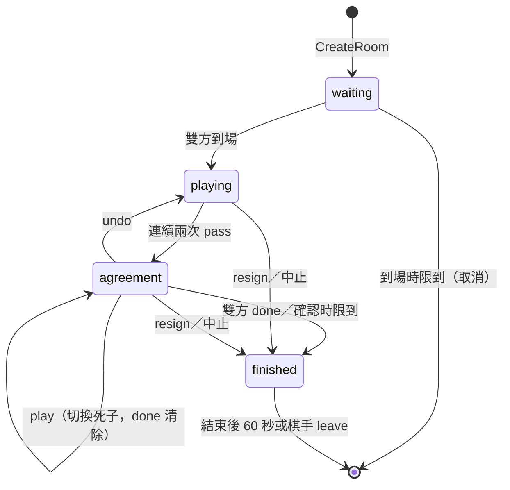

# 規格 v2：里程碑 1（能完整下一盤圍棋與五子棋）

> 整理日期：2026-11-01。狀態：**M1 的實作規格**。
> 只涵蓋 M1。完整的功能規劃見 [spec_v1.md](spec_v1.md)，階段見 [feature-list.md](feature-list.md)，理由見 [decisions.md](decisions.md)（文中以 D-xx 標註）。
> 訊息以 JSON 描述欄位；實際的 proto 定義在 `proto/`，以本文件為準。
> **指令名稱沿用 NNGS**（D-22），對照見附錄 A；**一位玩家可以同時在多個房間對局**（D-21）；**M1 同時支援圍棋與五子棋**（D-23）。

## 1. 範圍

**M1 要做到**：訪客在大廳約局，進房下完 9 路或 19 路圍棋（雙方確認死子與目數後定案），或 15 路五子棋（連成五子即結束），結果與棋譜保存下來。一位玩家可以同時進行多盤對局。五子棋用來證明平台不改程式就能跑第二種遊戲（D-10、D-23）。

**M1 包含**

- 訪客登入、玩家列表（`who`）、房間列表（`games` 與推送）
- 約局：`match`（含設定）、`accept`、`decline`、`withdraw`、`pending`、逾時
- 同時參與多個房間（多盤對局）
- 建房、入場券、重連憑證、從大廳回到對局（`rejoin`）
- 對局：落子、`pass`、`resign`、`say`、`refresh`
- 圍棋終局：死子提案、點選切換死子、`done`、`undo`（回到對局）、`score`、數子法計分
- 五子棋：15 路 freestyle（無禁手），連五以上獲勝，下滿和局
- 保底時限（不是棋鐘）
- 棋譜記錄、`moves`、`results`
- 強制關房（管理用）

**M1 不包含**：棋鐘、悔棋（對局中的 `undo`）、觀戰與講評、開放房間、還價、`open` 開關、讓子、五子棋的連珠規則（禁手）、帳號登入、私訊與好友、大廳聊天、匯出 SGF。

## 2. 系統組成

| 服務 | 語言 | 對外 | 對內 |
| --- | --- | --- | --- |
| 大廳服務 | Go | WebSocket（前端） | gRPC 伺服器（接收房間事件）；gRPC 客戶端（呼叫房間服務） |
| 房間服務 | Go | WebSocket（前端） | gRPC 伺服器（接收大廳呼叫）；gRPC 客戶端（呼叫大廳、規則服務） |
| 規則服務 | Node.js | — | gRPC 伺服器（接收房間呼叫） |
| PostgreSQL | — | — | 兩個資料庫：`lobby`、`rooms`，各自的帳號 |

**連線**：前端與大廳一條 WebSocket；與房間服務**一條 WebSocket，同時承載多個房間**，每則訊息帶 `room_id`（D-21）。

開發用埠號（可由環境變數覆寫）：

| 用途 | 埠 |
| --- | --- |
| 大廳 WebSocket | 8930 |
| 大廳 gRPC | 8931 |
| 房間 WebSocket | 8932 |
| 房間 gRPC | 8933 |
| 規則 gRPC | 8934 |
| PostgreSQL | 5445 |

**伺服器設定**（環境變數，括號內為預設值）：

| 設定 | 預設 |
| --- | --- |
| `MAX_GAMES_PER_PLAYER`：每人同時對局上限 | 5 |
| `MAX_PENDING_MATCHES`：每人同時送出的待回覆邀請上限 | 5 |
| `MATCH_TTL`：邀請逾時 | 60 秒 |
| `TICKET_SECRET`：入場券簽章密鑰 | （必填） |
| `ESTIMATOR`：死子估算器 `on`／`off` | `on` |

程式碼結構與分離規則見 [spec_v1.md 2.2 節](spec_v1.md#22-程式碼分離)：`lobby/` 與 `room/` 互不 import，只共用 `proto/`（D-01）。

## 3. 資料定義

### 3.1 對局設定 `Settings`

| 欄位 | 型別 | M1 允許值 | 預設 |
| --- | --- | --- | --- |
| `game` | 字串 | `go`、`gomoku` | `go` |
| `size` | 整數 | 圍棋 `9`、`19`；五子棋 `15` | 圍棋 `19`；五子棋 `15` |
| `color` | 字串 | `B`、`W`、`random`（發出邀請者執的顏色） | `random` |
| `komi` | 數字 | 只用於圍棋：0～10，間隔 0.5 | `7.5` |
| `rules` | 字串 | 圍棋 `chinese`（數子法，D-07）；五子棋 `freestyle`（無禁手） | 依遊戲 |
| `rated` | 布林 | `false` | `false` |

不屬於該遊戲的欄位（例如五子棋的 `komi`）會被忽略。

### 3.2 座標

沿用 NNGS 寫法：欄為英文字母（跳過 `I`），列為數字、由下往上算，例如 19 路的 `A1` 是左下角、`T19` 是右上角；15 路五子棋為 `A1`～`P15`。規則服務內部再轉成 (x, y)。

### 3.3 玩家 `Player`

| 欄位 | 說明 |
| --- | --- |
| `name` | 訪客名稱：英數字與底線，1～20 字元，線上不可重複 |
| `games` | 正在對局的 `room_id` 列表（0～`MAX_GAMES_PER_PLAYER` 個） |

### 3.4 邀請 `Match`

| 欄位 | 說明 |
| --- | --- |
| `match_id` | 大廳產生 |
| `from`、`to` | 玩家名稱 |
| `settings` | `Settings` |
| `expires_at` | 建立後 `MATCH_TTL` |

### 3.5 房間列表項 `RoomItem`

| 欄位 | 說明 |
| --- | --- |
| `room_id` | |
| `game`、`size` | |
| `black`、`white` | 棋手名稱 |
| `status` | `waiting`（等待棋手到場）、`playing`、`finished` |

### 3.6 局面 `View`（由規則服務產生，房間原樣轉送）

| 欄位 | 說明 |
| --- | --- |
| `board` | 二維陣列，0 空、1 黑、2 白 |
| `to_move` | `B` 或 `W` |
| `captures` | `{B, W}` 各自提掉的子數 |
| `last_move` | 最後一手的座標或 `pass` |
| `move_number` | 手數 |

### 3.7 提案 `Proposal`（終局時）

| 欄位 | 說明 |
| --- | --- |
| `dead` | 判為死子的座標列表 |
| `score` | `{B: {stones, territory, total}, W: {stones, territory, komi, total}}` |
| `result` | 依目前提案計算的結果，例如 `B+3.5` |

### 3.8 結果 `Result`

| 欄位 | 說明 |
| --- | --- |
| `winner` | `B`、`W`，或 `none`（和局、中止） |
| `reason` | `score`（圍棋點目）、`five`（五子棋連五）、`board_full`（五子棋下滿和局）、`resign`（認輸）、`abort`（中止） |
| `text` | 例如 `B+3.5`、`W+R`、`B+5`（連五）、`和局`、`中止` |

## 4. 功能

### 4.1 登入與大廳

1. 前端連上大廳，第一則訊息送 `login{name}`。
2. 名稱不合法 → `error{invalid_name}` 並斷線；已被使用或在保留期內（4.7 節）→ `error{name_taken}` 並斷線。
3. 成功 → `welcome{you, players, rooms, games}`，其中 `games` 是自己正在進行的房間（重新登入時用來回到對局）。
4. 玩家列表**不推送**（D-09）；前端送 `who` 取得 `players`。
5. 房間列表：送 `games` 取得完整列表；房間新增、狀態變更、移除時，大廳主動推送 `rooms{op, room}` 給**所有連著大廳的玩家**（對局中的玩家也收得到，是否顯示由前端決定）。
6. 玩家與大廳斷線：他送出與收到的待回覆邀請都結束（`cancelled`）；他進行中的對局不受影響。

### 4.2 約局

1. 發出：`match{to, settings}`。`settings` 缺漏的欄位用預設值；不合法 → `error{invalid_settings}`。
2. 大廳依序檢查，失敗就回對應錯誤：
   1. 對方在線 → `no_such_player`；
   2. 不是自己 → `invalid`；
   3. 雙方的對局數都小於 `MAX_GAMES_PER_PLAYER` → `too_many_games`；
   4. 自己送出的待回覆邀請少於 `MAX_PENDING_MATCHES` → `too_many_matches`；
   5. 兩人之間沒有其他待回覆的邀請（任一方向）→ `duplicate_match`。
3. 通過：建立 `Match`，送 `match_request` 給對方，送 `match_sent` 給自己。
4. 回覆與結束：

   | 指令或事件 | 誰可以 | 結果 |
   | --- | --- | --- |
   | `accept{match_id}` | 被邀請者 | 再檢查一次雙方對局數（滿了 → `too_many_games`，邀請保留）；通過則建房（4.3），雙方收到 `match_result{accepted}` |
   | `decline{match_id}` | 被邀請者 | 雙方收到 `match_result{declined}` |
   | `withdraw{match_id}` | 邀請者 | 雙方收到 `match_result{withdrawn}` |
   | 逾時 | — | 雙方收到 `match_result{expired}` |
   | 任一方與大廳斷線 | — | 仍在線的一方收到 `match_result{cancelled}` |

5. 不是邀請的對象卻 `accept`／`decline`，或不是邀請者卻 `withdraw` → `no_such_match`。
6. `pending` → 回傳自己送出與收到的待回覆邀請。
7. 一個人可以同時有多個邀請；與 NNGS 不同的是，開局後**不會**清掉雙方其他的邀請（多房間下仍可再開局）。

### 4.3 建房與入房

1. `accept` 通過後，大廳決定執色（`random` 時隨機），呼叫房間服務 `CreateRoom`。
2. 房間服務建立房間、啟動 goroutine、設到場時限，回傳 `ws_url`。
3. 大廳為雙方簽發棋手入場券（4.9 節），送 `game_ready{room_id, ws_url, ticket, color}` 給雙方；把 `room_id` 加進雙方的 `games`；推送 `rooms{op: add}`（`waiting`）。
4. 前端若還沒連房間服務就先連上；之後送 `enter{room_id, ticket}`。同一條連線可以 `enter` 多個房間。
5. 閘道驗證入場券：無效 → `error{room_id, invalid_ticket | ticket_used | ticket_expired}`（只拒絕這個房間，不斷開連線）。
6. 成功 → 房間送 `reconnect_token{room_id, token}` 與 `state`。
7. 兩位棋手都到場：房間呼叫規則服務開局，送 `state` 給雙方，回報 `room.started`。

### 4.4 對局

所有對局指令都帶 `room_id`，以下省略。

1. 輪到的棋手送：
   - `play{at, base_version}`：`at` 為座標，例如 `D4`；
   - `pass{base_version}`：只有圍棋；五子棋送 `pass` → `not_supported`；
   - `resign`：任何階段都可以。
2. 房間依序檢查：
   1. 這條連線已 `enter` 這個房間且是棋手 → 否則 `not_in_room`；
   2. 階段允許此指令（第 6 章）→ 否則 `wrong_phase`；
   3. `base_version` 等於目前版本 → 否則 `stale_version`；
   4. 輪到送出者 → 否則 `not_your_turn`；
   5. 座標格式正確 → 否則 `invalid_coordinate`；
   6. 呼叫規則服務 `Apply`；不合法 → `occupied`、`suicide`、`ko`、`out_of_board`、`not_supported`。
3. 合法：寫入棋譜（第 8 章）；成功後版本加 1，送新的 `state` 給雙方。
4. 錯誤只回給送出者：`error{room_id, code, version, state}`。
5. **先擺子**：前端在 `playing` 階段輪到自己時，用與規則服務同一份規則庫先檢查並顯示（圍棋用 `goban`，五子棋用五子棋模組）；收到 `error` 或版本不符時，依 `state` 重畫（D-14）。
6. `say{text}`：1～500 字元，送給同房的棋手，寫入棋譜。
7. `refresh`：重送目前的 `state`。
8. **五子棋的結束**：落子後連成五子以上，規則服務直接回傳 `finished` 與 `Result{winner, reason: five}`；棋盤下滿仍沒人連五則為和局（`reason: board_full`）。五子棋不會進入 `agreement` 階段。

### 4.5 圍棋終局

1. 連續兩次 `pass`（中間沒有落子）→ 規則服務回傳階段 `agreement` 與提案。
2. **初始提案**：規則服務用估算器判斷死子（D-17）。`ESTIMATOR=off` 或估算失敗時，初始提案為**沒有死子**，由雙方手動點選；流程不變。
3. 房間把提案寫入棋譜，版本加 1，設確認時限（60 秒），送 `state` 給雙方。
4. 在 `agreement` 階段，棋手可以：

   | 指令 | 效果 |
   | --- | --- |
   | `play{at, base_version}` | 與 NNGS 相同，點目時輸入座標就是**切換該塊棋的死活**；規則服務回傳新提案；版本加 1；**雙方的 `done` 清除**；確認時限重新計算 |
   | `done{version}` | 同意目前版本的提案；`version` 不是目前版本 → `stale_version` |
   | `undo` | 與 NNGS 相同，點目時 `undo` 就是**回到對局**：階段回到 `playing`，照正常輪次繼續（D-07），死子標記清除 |
   | `score` | 回傳目前提案的目數 |
   | `resign` | 認輸，對局結束 |

5. 雙方都對同一版本 `done` → 房間送 `finalize` 給規則服務，取得 `Result`，階段 `finished`。
6. 確認時限到：沒有 `done` 的一方視為同意目前提案（D-07），同第 5 步。
7. 結束時：寫入結果，送 `game_over{result, record_id}` 給雙方，回報 `room.finished`。

### 4.6 保底時限

M1 沒有棋鐘，但房間一定要會結束（D-13）。每個房間各自計算。

| 時限 | 開始 | 取消 | 到期時 |
| --- | --- | --- | --- |
| 到場 60 秒 | 建房 | 兩位棋手都到場 | 這局取消：回報 `room.cancelled`，房間關閉 |
| 確認 60 秒 | 進入 `agreement`、提案改變 | 定案、`undo`、認輸 | 沒有 `done` 的一方視為同意，定案 |
| 單一棋手斷線 10 分鐘 | 一位棋手的連線斷開 | 該棋手重連 | 這局中止（`abort`） |
| 全員斷線 5 分鐘 | 兩位棋手都斷線 | 任一位重連 | 這局中止（`abort`） |
| 對局總時長 6 小時 | 開局 | — | 這局中止（`abort`） |
| 結束後 60 秒 | 局結束 | — | 房間關閉（棋手也可以先送 `leave`） |

中止的局同樣寫入結果與棋譜，回報 `room.finished`。一位玩家斷線時，他所在的每個房間都各自開始計時。

### 4.7 重連

**同一個分頁**（重新整理、網路斷線）：

1. 前端在 sessionStorage 保存每個房間的重連憑證（`room_id → token`）。
2. 重新連上房間服務後，對每個房間送 `enter{room_id, reconnect_token}`。
3. 房間驗證後回到原座位，**換發新的重連憑證**（舊的立即失效），並送目前的 `state`。同一座位若還有舊連線，舊連線離開該房間。
4. 房間已關閉 → `error{room_id, room_closed}`。

**新分頁或其他裝置**（沒有重連憑證）：

1. 玩家用同一個名稱 `login` 大廳，`welcome.games` 列出他進行中的房間。
2. 送 `rejoin{room_id}` → 大廳確認他是該房間的棋手，重新簽發入場券，送 `game_ready`；之後同 4.3 節第 4 步。

**名稱保留**：玩家與大廳斷線後，只要他還有進行中的房間，他的名稱保留 10 分鐘（與單一棋手斷線時限一致），期間其他人不能用這個名稱登入。保留期內本人重新登入不受限制（M1 以名稱識別訪客；真正的身分驗證在 M3）。

### 4.8 棋譜與戰績

1. 每個被接受的指令都寫入房間服務的資料庫，成功後才廣播（D-11）。
2. 局結束時，房間回報 `room.finished`，附摘要；大廳把摘要寫入 `lobby` 資料庫，雙方各一筆，並把 `room_id` 從雙方的 `games` 移除。
3. `results` → 大廳回傳自己的摘要列表（最新在前，最多 50 筆）。
4. `moves{room_id}` → 大廳以 gRPC 向房間服務 `GetRecord` 查詢，回傳棋譜。進行中的局也可以查（M1 不限制誰可以查）。

### 4.9 入場券與重連憑證

| 憑證 | 簽發者 | 格式與內容 | 有效期 |
| --- | --- | --- | --- |
| 棋手入場券 | 大廳 | 以 `TICKET_SECRET` 做 HMAC-SHA256 簽章；內容 `room_id, name, seat (B/W), jti, exp` | 60 秒，只能用一次 |
| 重連憑證 | 房間 | 128 位元隨機字串，存在房間的座位資料中，不簽章 | 到房間關閉；每次重連成功即換發，舊的作廢 |

- 閘道記住已使用的 `jti`，到入場券過期為止。
- 重連憑證不簽章，因為房間本來就保存座位資料，比對即可，並且能隨時作廢。M1 的房間服務重啟時對局直接中止，憑證不需要在重啟後有效。

### 4.10 強制關房

- 管理用：大廳以 gRPC 呼叫 `CloseRoom{room_id}`（M1 只需能從命令列或測試呼叫）。
- 房間把這局記為中止，送 `game_over` 給在線棋手，回報 `room.finished` 與 `room.closed`。

## 5. 介面

每則訊息：`{"type": "...", "data": {...}}`。

### 5.1 前端 ↔ 大廳（WebSocket）

| 方向 | `type` | `data` |
| --- | --- | --- |
| → 大廳 | `login` | `{name}` |
| → 大廳 | `who` | — |
| → 大廳 | `games` | — |
| → 大廳 | `match` | `{to, settings}` |
| → 大廳 | `accept` | `{match_id}` |
| → 大廳 | `decline` | `{match_id}` |
| → 大廳 | `withdraw` | `{match_id}` |
| → 大廳 | `pending` | — |
| → 大廳 | `rejoin` | `{room_id}` |
| → 大廳 | `results` | — |
| → 大廳 | `moves` | `{room_id}` |
| ← 大廳 | `welcome` | `{you, players: [Player], rooms: [RoomItem], games: [room_id]}` |
| ← 大廳 | `players` | `{players: [Player]}` |
| ← 大廳 | `rooms` | `{op: add/update/remove, room: RoomItem}`（推送）或 `{rooms: [RoomItem]}`（回應 `games`） |
| ← 大廳 | `match_request` | `Match`（給被邀請者） |
| ← 大廳 | `match_sent` | `Match`（給邀請者） |
| ← 大廳 | `match_result` | `{match_id, result: accepted/declined/withdrawn/expired/cancelled}` |
| ← 大廳 | `pending` | `{sent: [Match], received: [Match]}` |
| ← 大廳 | `game_ready` | `{room_id, ws_url, ticket, color}` |
| ← 大廳 | `results` | `{results: [Summary]}` |
| ← 大廳 | `moves` | `GameRecord`（第 8 章） |
| ← 大廳 | `error` | `{code, message}` |

### 5.2 前端 ↔ 房間服務（WebSocket，一條連線承載多個房間）

所有訊息的 `data` 都帶 `room_id`。

| 方向 | `type` | `data`（除 `room_id` 外） |
| --- | --- | --- |
| → 房間 | `enter` | `{ticket}` 或 `{reconnect_token}` |
| → 房間 | `play` | `{at, base_version}` |
| → 房間 | `pass` | `{base_version}` |
| → 房間 | `resign` | — |
| → 房間 | `done` | `{version}` |
| → 房間 | `undo` | —（M1 只在 `agreement` 階段有效） |
| → 房間 | `score` | — |
| → 房間 | `say` | `{text}` |
| → 房間 | `refresh` | — |
| → 房間 | `leave` | —（局結束後離開） |
| ← 房間 | `reconnect_token` | `{token}` |
| ← 房間 | `state` | `{version, phase: waiting/playing/agreement/finished, black, white, connected: {B, W}, view: View, proposal?: Proposal, done?: {B, W}, deadline?}` |
| ← 房間 | `score` | `Proposal.score` |
| ← 房間 | `say` | `{from, text}` |
| ← 房間 | `game_over` | `{result: Result, record_id}` |
| ← 房間 | `error` | `{code, version?, state?}` |

`deadline` 是目前生效的保底時限的到期時間，供前端倒數顯示。

### 5.3 大廳 → 房間（gRPC `RoomService`）

| 方法 | 請求 | 回應 |
| --- | --- | --- |
| `CreateRoom` | `{room_id, settings, black: {name}, white: {name}}` | `{ws_url}` |
| `ListRooms` | — | `{rooms: [{room_id, status, black, white}]}` |
| `GetRecord` | `{room_id}` | `GameRecord` |
| `CloseRoom` | `{room_id}` | — |

### 5.4 房間 → 大廳（gRPC `LobbyEvents`）

`ReportRoomEvent{room_id, seq, type, payload}`。

| `type` | `payload` | 大廳的處理 |
| --- | --- | --- |
| `room.started` | — | 列表項改為 `playing` |
| `room.player_disconnected`、`room.player_reconnected` | `{name}` | 記錄（M1 不另外通知） |
| `room.cancelled` | — | 從雙方的 `games` 移除，移除列表項 |
| `room.finished` | `Summary`（第 8 章） | 寫入戰績，從雙方的 `games` 移除，列表項改為 `finished` |
| `room.closed` | — | 移除列表項 |

- `seq` 為房間內遞增序號；大廳忽略不大於已處理序號的事件。
- 失敗以指數退避重試，最多 1 分鐘；之後靠對帳修正。
- 大廳每 30 秒呼叫 `ListRooms` 對帳：房間服務沒有的房間，從列表與玩家的 `games` 移除。

### 5.5 房間 → 規則（gRPC `RulesService`）

| 方法 | 請求 | 回應 |
| --- | --- | --- |
| `Apply` | `{game, settings, actions: [Action], action: Action}` | `{ok, error_code?, phase, view, proposal?, result?}` |

- `Action`：`{type, seat?, at?, proposal?}`。`type` 為 `start`、`play`、`pass`、`resign`、`resume`、`propose`、`finalize`。
  - 房間把棋手的指令原樣轉成 `Action`：`play` → `play`；點目階段的 `undo` → `resume`；`done` 不送規則服務（同意由房間收集），雙方同意後由房間送 `finalize`。
  - `play` 在 `agreement` 階段由規則服務解讀為切換死子。
  - `propose` 是系統動作：記錄規則服務提出的提案，重放時直接使用，不重新估算。
- 規則服務不保存狀態，每次重放 `actions`（D-05）。
- 房間呼叫逾時 2 秒；逾時或錯誤時，該指令回 `error{rules_unavailable}`，不寫入紀錄。

## 6. 房間的階段與指令

| 階段 | 允許的指令 |
| --- | --- |
| `waiting` | `say`、`refresh` |
| `playing` | `play`、`pass`（輪到者，只有圍棋）、`resign`、`say`、`refresh` |
| `agreement` | `play`（切換死子）、`done`、`undo`（回到對局）、`score`、`resign`、`say`、`refresh`（只有圍棋會進入此階段） |
| `finished` | `say`、`refresh`、`leave` |

房間內部的原則（事件迴圈、先寫紀錄再廣播、送出佇列、計時器編號、`recover`）同 [spec_v1.md 第 5 章](spec_v1.md#5-房間內部)；M1 沒有棋鐘，計時器只用於第 4.6 節的保底時限。閘道依訊息的 `room_id` 把指令送到對應房間的事件佇列；一條連線 `enter` 的每個房間，都各自是房間的一條棋手連線。

## 7. 規則服務

規則服務依 `game` 分派到規則庫。房間不判斷遊戲類型（D-10）。

### 7.1 圍棋（`goban-engine`）

- 以 `goban-engine` 重放 `actions`，判斷合法、提子、打劫（positional superko）、禁止自殺；座標由 `D4` 形式轉為 (x, y)。
- `pass` 後判斷是否連續兩次 pass；是則進入 `agreement` 並產生提案：
  - 估算器可用：估算器算出每點歸屬 → `autoscore` 判死子 → `computeScore` 計分。
  - 估算器不可用：死子為空，直接 `computeScore`。
- `agreement` 階段的 `play`：以 `toggleSingleGroupRemoval` 切換後重新計分。
- `resume`：回到 `playing`，清除死子標記。
- `finalize`：依最後的提案產生 `Result`。
- `resign`：產生 `W+R` 或 `B+R`。
- 實作注意：`autoscore` 會修改傳入的棋盤陣列，要傳副本；估算器回傳 1／2，要轉換成正負數值。

### 7.2 五子棋（五子棋模組）

- 規則模組沿用三框架 PoC 的 `rules.ts`（含單元測試）：15 路、黑先、輪流落子、不可下在已有棋子的點。
- 落子後檢查四個方向，連成五子以上即獲勝（freestyle，無禁手）。
- 棋盤下滿仍沒人連五：和局。
- 不支援 `pass`、`resume`、`propose`、`finalize`（回 `not_supported`）。
- 前端用同一份模組做先擺子的檢查。

## 8. 資料庫

### 8.1 `rooms` 資料庫（房間服務擁有）

| 資料表 | 欄位 |
| --- | --- |
| `games` | `room_id`、`settings`（JSON）、`black`、`white`、`status`、`result`（JSON）、`rules_version`、`created_at`、`started_at`、`ended_at` |
| `actions` | `room_id`、`seq`、`type`、`seat`、`data`（JSON：座標、提案、對話內容）、`received_at` |

- `GameRecord` = `games` 一筆 + 依 `seq` 排序的 `actions`。棋譜 ID 即 `room_id`。
- `rules_version` 記錄規則服務使用的規則庫版本（`goban-engine` 或五子棋模組）。

### 8.2 `lobby` 資料庫（大廳服務擁有）

| 資料表 | 欄位 |
| --- | --- |
| `summaries` | `player`、`room_id`、`opponent`、`color`、`result`（文字）、`size`、`ended_at` |

- `Summary`（`room.finished` 的 payload）：`room_id, black, white, size, result, started_at, ended_at`；大廳拆成雙方各一筆。
- `(player, room_id)` 唯一，重送的事件不會產生重複資料。

## 9. 故障處理

| 情況 | M1 的處理 |
| --- | --- |
| 寫入棋譜失敗 | 指令不算數，回 `error{storage_unavailable}` |
| 規則服務逾時或錯誤 | 指令不算數，回 `error{rules_unavailable}`；棋手可以重送 |
| 房間服務重啟 | 進行中的局中止（M1 不還原）；大廳對帳時從列表與玩家的 `games` 移除 |
| 大廳服務重啟 | 對局不受影響；玩家重新 `login`；大廳以 `ListRooms` 重建房間列表與每位玩家的 `games` |
| 房間事件遺失 | 重試；最後以對帳修正 |
| 送出佇列滿（連線太慢） | 斷開該連線；棋手用重連憑證回到所有房間 |

## 10. 錯誤代碼

| 代碼 | 來源 | 意思 |
| --- | --- | --- |
| `invalid_name`、`name_taken` | 大廳 | 登入名稱不合法、已被使用或在保留期內 |
| `invalid_settings` | 大廳 | 對局設定不合法 |
| `no_such_player` | 大廳 | 對方不在線 |
| `invalid` | 大廳 | 邀請自己 |
| `too_many_games` | 大廳 | 一方已達同時對局上限 |
| `too_many_matches` | 大廳 | 自己送出的待回覆邀請已達上限 |
| `duplicate_match` | 大廳 | 兩人之間已有待回覆的邀請 |
| `no_such_match` | 大廳 | 邀請不存在，或你不能對它做這個動作 |
| `not_your_game` | 大廳 | `rejoin` 的房間不是你的對局 |
| `no_such_record` | 大廳 | 棋譜不存在 |
| `invalid_ticket`、`ticket_used`、`ticket_expired` | 房間 | 入場券有問題 |
| `invalid_token` | 房間 | 重連憑證無效或已作廢 |
| `room_closed` | 房間 | 房間已關閉 |
| `not_in_room` | 房間 | 這條連線沒有以棋手身分進入此房間 |
| `wrong_phase` | 房間 | 目前階段不允許此指令 |
| `stale_version` | 房間 | 版本已過時 |
| `not_your_turn` | 房間 | 還沒輪到你 |
| `invalid_coordinate` | 房間 | 座標格式錯誤 |
| `occupied`、`suicide`、`ko`、`out_of_board` | 規則 | 落子不合法 |
| `not_supported` | 規則 | 此遊戲不支援這個指令（例如五子棋的 `pass`） |
| `rules_unavailable`、`storage_unavailable` | 房間 | 暫時無法處理 |

## 11. 驗收條件

- [ ] Alice 對 Bob `match`，Bob `accept`，雙方用入場券 `enter` 房間；房間列表即時出現此房間。
- [ ] `decline`、`withdraw`、逾時、一方與大廳斷線，都正確結束邀請並通知；`pending` 列出正確的邀請。
- [ ] 超過同時對局上限、待回覆邀請上限、兩人重複邀請時，回正確的錯誤代碼。
- [ ] 在 19 路與 9 路棋盤各下完一局：提子、打劫正確，不合法的落子回正確的錯誤代碼。
- [ ] **多房間**：Alice 同時與 Bob、Carol 各下一盤，兩盤的指令經同一條連線送出，各自正確送到對的房間，互不影響。
- [ ] 連續兩次 `pass` 進入終局：點目時輸入座標會切換死子並清除雙方的 `done`；雙方 `done` 同一版本後定案。也測「`undo` 回到對局 → 再次 pass → 定案」與「確認時限到自動定案」。
- [ ] `ESTIMATOR=off` 時，終局流程仍可完成（手動點死子）。
- [ ] `resign` 可以在 `playing` 與 `agreement` 結束對局。
- [ ] 重新整理頁面，用重連憑證回到所有進行中的房間；舊的重連憑證失效。
- [ ] 開新分頁，以同名 `login` 後用 `rejoin` 回到對局；保留期內他人無法使用該名稱。
- [ ] 到場時限、單一棋手斷線、全員斷線、結束後關房，都在時限內完成，不留下殘留的房間或 `games` 紀錄。
- [ ] 棋譜完整存在 `rooms` 資料庫；`results` 與 `moves` 回傳正確；大廳的 `lobby` 資料庫只有摘要。
- [ ] 下完一局五子棋：連五獲勝、下滿和局都正確，五子棋送 `pass` 回 `not_supported`；**房間服務與大廳服務沒有為五子棋寫任何專屬的程式碼**，只有規則服務多一個模組、前端多一個棋盤元件（D-10、D-23）。
- [ ] 三個服務各自獨立啟動；`lobby/` 與 `room/` 沒有互相 import。

## 附錄 A：NNGS 指令對照與函式呼叫（M1）

NNGS 1.1.22 的完整指令對照見 [feature-list.md 附錄](feature-list.md#附錄nngs-指令對照)。本附錄只列 M1 範圍。

### A.1 命名原則

- **前端送出的指令名稱沿用 NNGS**（例如 `who`、`match`、`accept`、`say`、`done`），語意盡量相同；參數改成 JSON 欄位（D-22）。
- **座標沿用 NNGS 的寫法**：例如 `D4`（3.2 節）。
- NNGS 的指令打在一條 telnet 連線上；我們分成兩條連線：**大廳指令**送大廳服務，**對局指令**送房間服務（D-01）。
- NNGS 以遊戲編號指定對局，而且同一時間只能下一盤，對局指令預設作用在「目前這盤」；我們允許同時多盤（D-21），所以對局指令都帶 `room_id`。
- 少數指令是我們新增、NNGS 沒有的：`enter`（以入場券進房）、`rejoin`（從大廳回到對局）、`leave`（離開已結束的房間）。
- NNGS 只有圍棋；五子棋沿用同一套指令（`match` 時設 `game: gomoku`），不使用圍棋專屬的 `pass`、`done`、`score` 與點目階段的 `undo`。

### A.2 大廳指令

| NNGS 指令 | M1 指令 | 函式呼叫（大廳服務） | 架構差異與做法 |
| --- | --- | --- | --- |
| 登入時輸入名稱 | `login{name}` | `Gateway.Accept` → `Lobby.Login(name)` → 檢查名稱與保留期 → `Session.Send(welcome)` | NNGS 的登入是 telnet 提示；我們是 WebSocket 的第一則訊息 |
| `who` | `who` | `Lobby.Who()` → 回傳 `players` | NNGS 的篩選參數（例如 `who o`）M1 不做 |
| `games` | `games` | `Lobby.Games()` → 回傳房間列表 | NNGS 只能查；我們另外在列表變化時主動推送 `rooms` |
| `match bob B 19 10 10` | `match{to, settings}` | `Lobby.Match()` → `checkMatch()` → `Matches.Create()` → `Session(to).Send(match_request)` | 時間、讀秒參數 M1 不支援（棋鐘在 M2）；多了 `komi`。邀請會逾時（NNGS 沒有逾時） |
| `accept [n]` | `accept{match_id}` | `Lobby.Accept()` → 再檢查對局數 → `RoomClient.CreateRoom()`（gRPC）→ `Tickets.Sign()` × 2 → 雙方 `Send(game_ready)` | **架構差異最大的一步**：NNGS 接受當下就開局；我們要建房、簽入場券，玩家再另外連進房間服務（4.3 節） |
| `decline [who]` | `decline{match_id}` | `Lobby.Decline()` → `Matches.End(declined)` → 雙方 `Send(match_result)` | |
| `withdraw` | `withdraw{match_id}` | `Lobby.Withdraw()` → `Matches.End(withdrawn)` | |
| `pending` | `pending` | `Lobby.Pending()` → 回傳自己送出與收到的邀請 | |
| `results [user]` | `results` | `Lobby.Results()` → 讀 `lobby.summaries` | M1 只查自己（NNGS 可查任何人） |
| `moves [game]` | `moves{room_id}` | `RoomClient.GetRecord()`（gRPC） | NNGS 的棋步在伺服器記憶體或檔案；我們的棋譜在房間服務的資料庫，大廳只能用 gRPC 查（D-11） |
| `quit` | （關閉連線） | `Lobby.Logout()` → 結束他所有的邀請 → 有進行中的對局則保留名稱 | |
| — | `rejoin{room_id}` | `Lobby.Rejoin()` → 確認是棋手 → `Tickets.Sign()` → `Send(game_ready)` | NNGS 沒有；我們的對局在另一個服務，沒有重連憑證時由大廳重發入場券（4.7 節） |
| `help`、`alias`、`set`、`toggle` 等文字介面指令 | 不實作 | — | 網頁介面取代 |

### A.3 對局指令

| NNGS 指令 | M1 指令 | 函式呼叫（房間服務 → 規則服務） | 架構差異與做法 |
| --- | --- | --- | --- |
| （開局即在對局中） | `enter{room_id, ticket}` 或 `enter{room_id, reconnect_token}` | `Gateway.Route` → `Tickets.Verify()` 或核對重連憑證 → `Room.Join(seat)` → `Send(reconnect_token, state)` | NNGS 開局時兩人已在同一條連線上；我們要出示入場券，斷線後用重連憑證回來 |
| 座標（例如 `D4`） | `play{room_id, at, base_version}` | `Gateway` 蓋收到時間 → 依 `room_id` 送進 `Room.events` → `Room.handleCommand()` → `RulesClient.Apply()`（gRPC）→ `goban-engine.place()` → `Store.AppendAction()` → `Room.broadcastState()` | NNGS 在同一個程式裡直接改棋盤；我們由規則服務重放判斷、房間先寫棋譜再廣播。多了 `base_version`（D-14）與 `room_id`（D-21） |
| `pass` | `pass{room_id, base_version}` | 同上；`RulesClient.Apply()` 判斷是否連續兩次 pass | |
| `resign` | `resign{room_id}` | `Room.handleCommand()` → `RulesClient.Apply()` → `Room.finish()` → `LobbyClient.ReportRoomEvent(room.finished)`（gRPC） | 結束後要回報大廳更新列表與戰績；NNGS 在同一程式內直接處理 |
| `say` | `say{room_id, text}` | `Room.handleSay()` → `Store.AppendAction()` → 送給對手 | |
| `refresh` | `refresh{room_id}` | `Room.sendState()` | 每次指令後本來就會推送狀態 |
| `status` | 不實作 | — | 與 `refresh` 重複 |
| 點目階段輸入座標 | `play{room_id, at, base_version}` | 在 `agreement` 階段，`RulesClient.Apply()` 解讀為切換死活（`toggleSingleGroupRemoval`）→ 新提案 → `Room.clearDone()` | 與 NNGS 相同；差別是**任一方改動都會清除雙方的 `done`**，而且一開始會有估算器提出的判斷 |
| `undo`（點目階段） | `undo{room_id}` | `agreement` 階段：`RulesClient.Apply(resume)` → 回到 `playing` | 與 NNGS 相同；對局中的 `undo`（悔棋）是 M2 |
| `done` | `done{room_id, version}` | `Room.handleDone()` → 記錄同意 → 雙方都同意同一版本 → `RulesClient.Apply(finalize)` → `Room.finish()` | NNGS 兩人都 `done` 就定案；我們要指定版本，避免同意到對方剛改過的判斷 |
| `score` | `score{room_id}` | `Room.sendScore()` | 每次提案的 `state` 已附目數 |
| — | `leave{room_id}` | `Room.Leave()` | NNGS 沒有；我們的房間在局結束後保留 60 秒，可提前離開 |

### A.4 M1 不實作的相關指令

| NNGS 指令 | 用途 | 階段 |
| --- | --- | --- |
| `match`（用不同條件回發） | 還價 | M2 |
| `open` | 是否接受邀請 | M2 |
| `handicap` | 讓子 | M2 |
| `time`、`pause`、`unpause`、`addtime` | 計時 | 棋鐘 M2；暫停、加時未來 |
| `undo`（對局中） | 悔棋 | M2 |
| `observe`、`kibitz`、`all` | 觀戰、講評（可邊下邊看，不能觀戰自己的對局） | M2 |
| `sgf`、`mail` | 取得棋譜檔 | 匯出 SGF M2 |
| `adjourn`、`load`、`stored` | 封盤、續下 | 未來 |
| `tell`、`censor`、`stats` | 私訊、封鎖、個人資料 | M3 |
| `komi` | 對局中改貼目 | 不做（建房時設定） |
| `tmatch`、`teach`、`pair` | 比賽、研究盤、連棋 | 未來 |
| `nuke`（管理） | 把玩家踢下線 | M1 以房間服務 gRPC `CloseRoom` 直接中止對局；NNGS 沒有直接結束對局的指令 |

## 附錄 B：約局流程對照（NNGS ↔ M1）

### B.1 流程

| 步驟 | NNGS | M1 |
| --- | --- | --- |
| 1. 發出邀請 | `match bob B 19 10 10`：對手、執色、棋盤、時間、讀秒 | `match{to: "bob", settings: {color: "B", size: 19, komi: 7.5}}`；沒有時間設定（棋鐘在 M2），多了貼目 |
| 2. 發出前的檢查 | 自己不在對局中；對手在線；不是自己（自己請用 `teach`）；雙方沒有互相封鎖；對手是 `open` 狀態；對手不在對局中；待回覆的邀請數未達上限 | 對手在線；不是自己；雙方都未達同時對局上限；自己的待回覆邀請未達上限；兩人之間沒有其他待回覆的邀請 |
| 3. 自己的狀態 | 發出邀請時自動把自己設為 `open` | 不變 |
| 4. 對方收到 | 文字提示，附「用 `match alice W 19 10 10` 接受或 `decline alice` 拒絕」 | `match_request`，附設定與 `match_id` |
| 5. 接受 | `accept`，或回發完全相同的 `match`（顏色互補） | `accept{match_id}`；接受時再檢查一次對局數 |
| 6. 還價 | 用不同條件回發 `match`：自動拒絕原邀請，改由對方提出新邀請 | M1 沒有（M2） |
| 7. 拒絕 | `decline` | `decline{match_id}` |
| 8. 撤回 | `withdraw` | `withdraw{match_id}` |
| 9. 查看 | `pending` | `pending` |
| 10. 逾時 | **沒有**，邀請一直留著，直到處理或登出 | 60 秒自動結束 |
| 11. 開局 | 接受的當下立刻開局；雙方本來就連在同一台伺服器上 | 大廳 `CreateRoom` → 簽發入場券 → 雙方 `enter` 房間 → 都到場才開局；60 秒內沒到場則取消 |
| 12. 開局後的清理 | 清掉雙方其他所有約局邀請 | 不清掉：允許多盤同時進行（D-21） |
| 13. 通知其他人 | 推送「Match N: X vs Y」給開啟 `ginform` 的玩家 | 推送 `rooms{op: add}` 給所有連著大廳的玩家 |
| 14. 一方登出 | 清掉他所有的邀請（對方收到撤回通知） | 邀請結束，仍在線的一方收到 `match_result{cancelled}`；他進行中的對局不受影響 |

### B.2 主要差異

| 項目 | NNGS | M1 | 原因 |
| --- | --- | --- | --- |
| 同時對局數 | 一盤 | 最多 `MAX_GAMES_PER_PLAYER`（預設 5） | 支援同時多盤（D-21） |
| 同時的邀請數 | 多個，有上限 | 送出最多 `MAX_PENDING_MATCHES`（預設 5），同一對玩家之間一個 | 避免同一對玩家重複邀請 |
| 逾時 | 無 | 60 秒 | 網頁上離開不一定會登出，避免邀請一直掛著 |
| 接受方式 | `accept` 或回發相同條件 | `accept` | 網頁按鈕不需要用「回發相同條件」表示接受 |
| 還價 | 有 | M2 | M1 先求能下完一盤 |
| `open` 開關 | 有，發邀請會自動打開 | M2 | 同上 |
| 封鎖檢查 | 有 | M3（封鎖功能在 M3） | |
| 開局 | 立即 | 經過入場券與到場時限 | 大廳與房間是不同服務（D-01），玩家要另外連進房間 |
| 計時設定 | 有 | M2 | M1 沒有棋鐘 |
