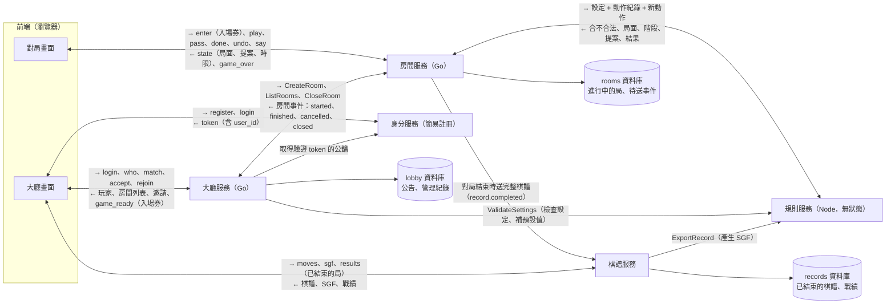
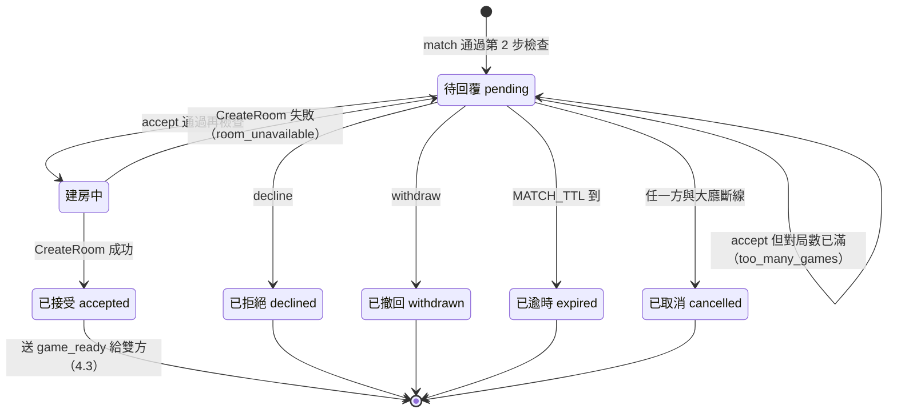
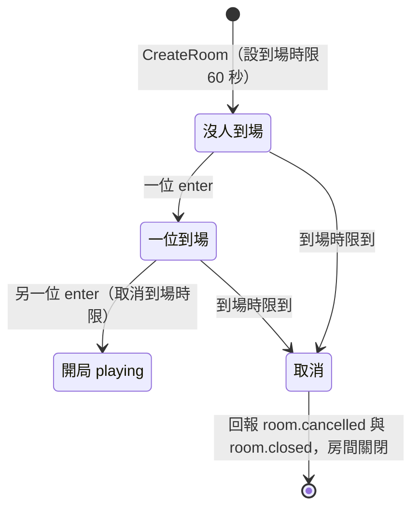
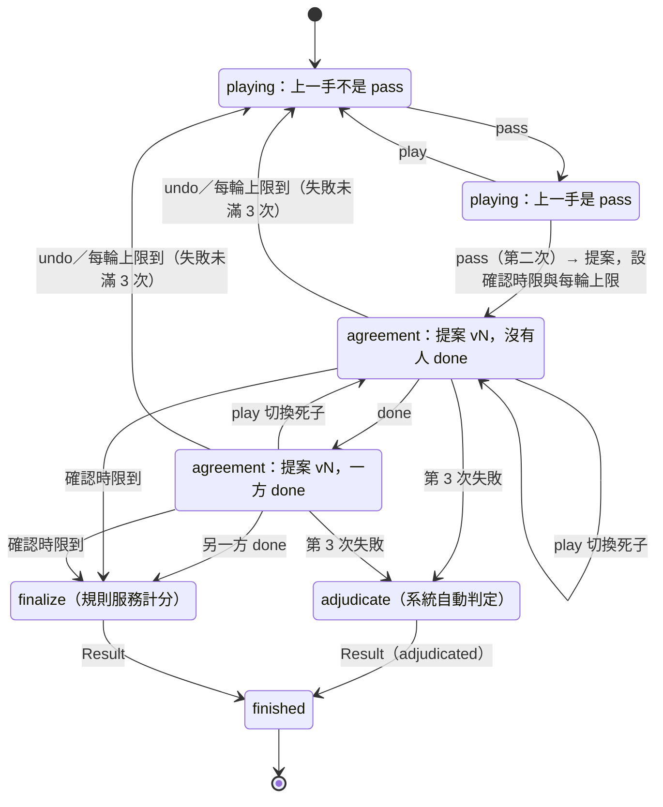
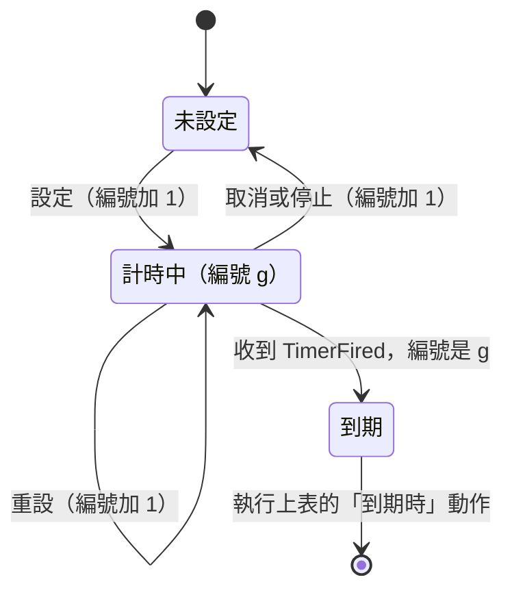
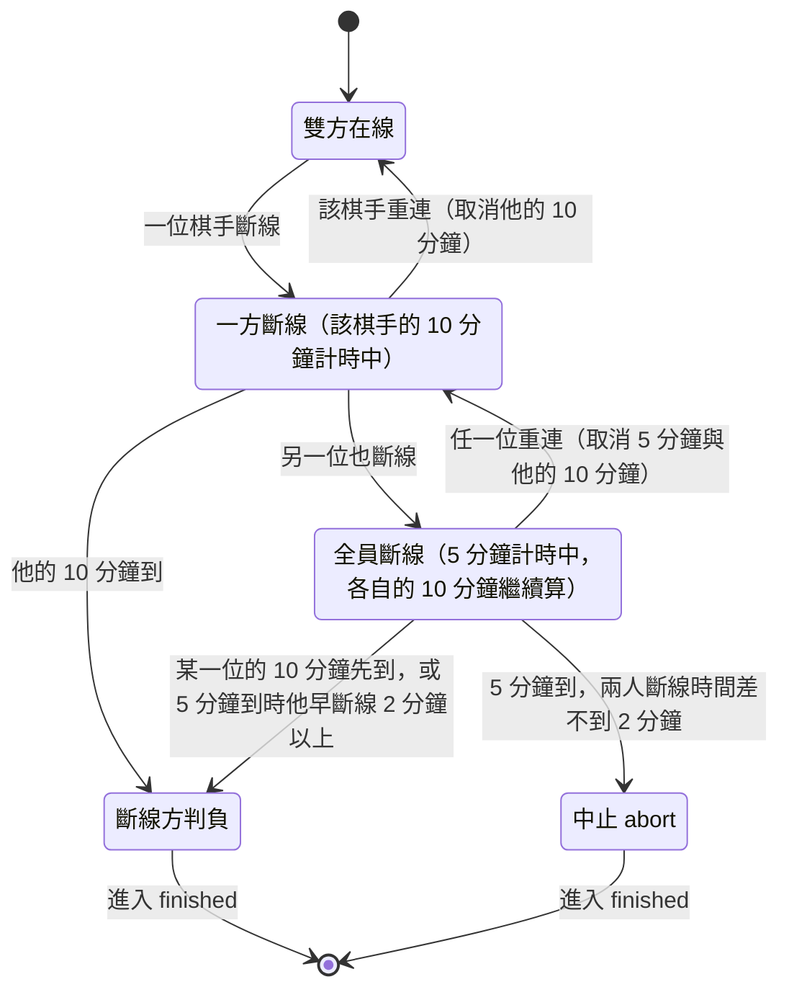
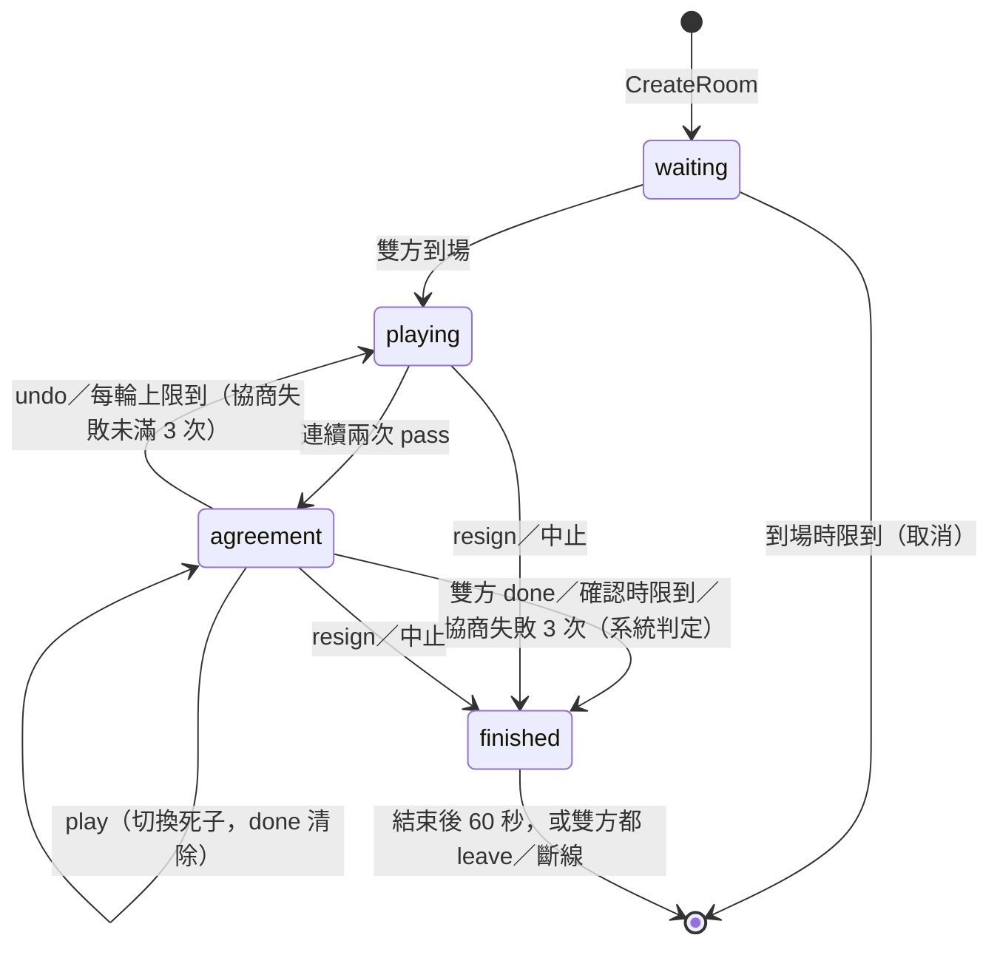
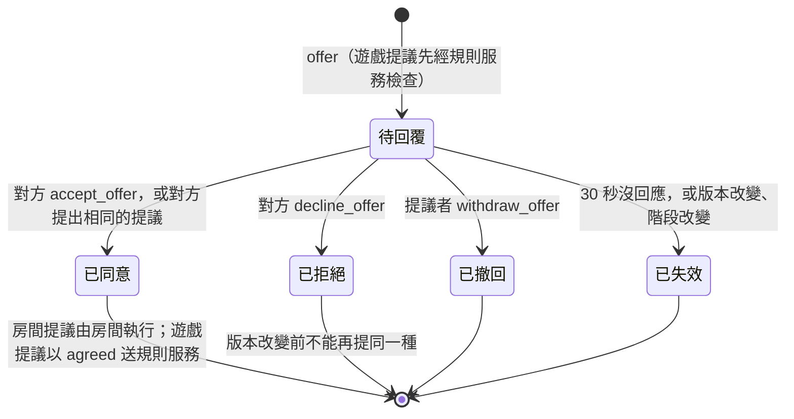
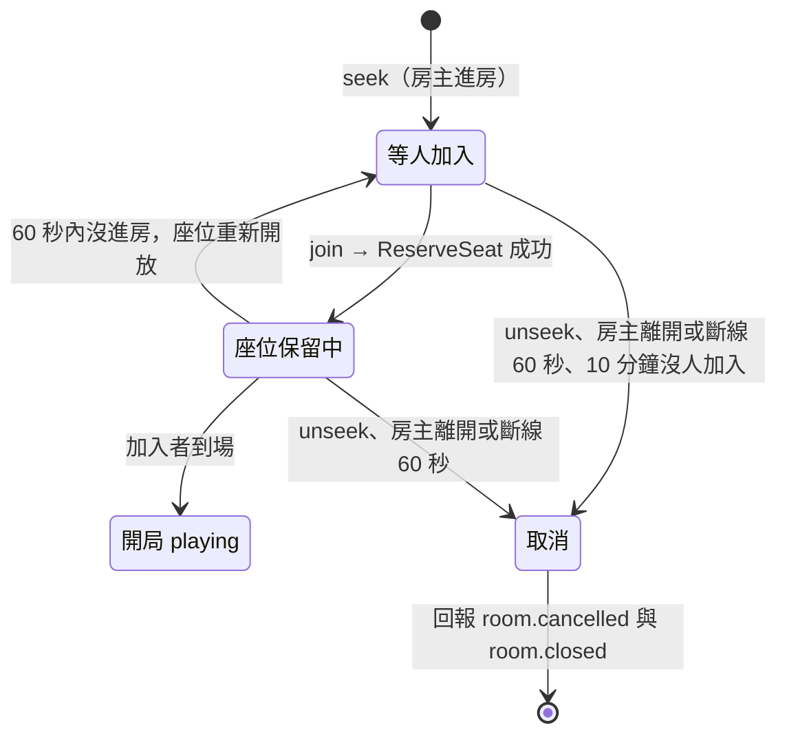
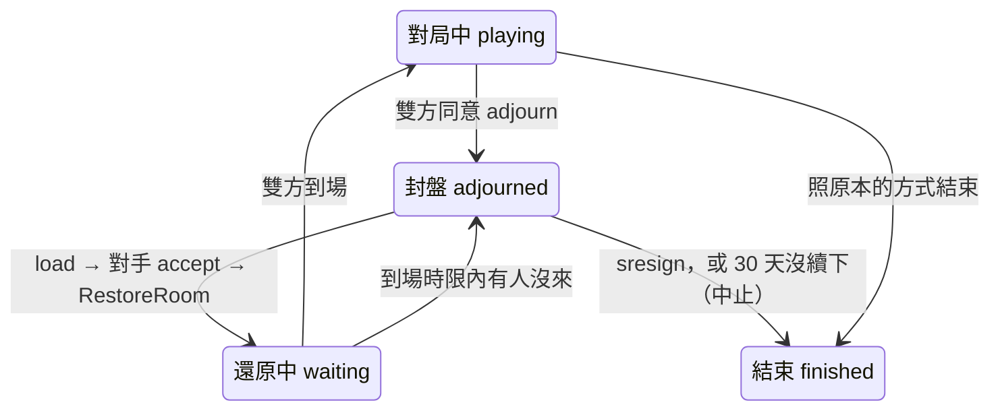

# 規格 v2：里程碑 1（對局功能與 NNGS 對齊）

> 整理日期：2026-11-02。狀態：**M1 的實作規格**。
> 只涵蓋 M1。完整的功能規劃見 [spec_v1.md](spec_v1.md)，階段見 [feature-list.md](feature-list.md)，理由見 [decisions.md](decisions.md)（文中以 D-xx 標註）。
> 訊息以 JSON 描述欄位；實際的 proto 定義在 `proto/`，以本文件為準。
> 2026-11-02 起只分兩個里程碑（D-31）：原本的 M2（對齊 NNGS 的對局功能、簡易註冊）併入 M1，原本的 M3 改稱 M2。核心在第 1～11 章；併入的功能在第 12 章。登入改用簡易註冊，不設訪客（D-30）。已結束的棋譜與戰績由棋譜服務負責（D-33）。
> **指令名稱沿用 NNGS**（D-22），對照見附錄 A；**一位玩家可以同時在多個房間對局**（D-21）；**M1 同時支援圍棋與五子棋**（D-23）。
> 2026-11-02 依「遊戲知識只放在規則服務」調整三個服務的分工（D-27）：大廳不驗證遊戲設定、房間不解析座標與提案、座位改用 `1`／`2`。
> 2026-11-01 參考 NNGS 1.1.22 原始碼的做法補齊疏漏（斷線、終局確認、版本號等），對照見附錄 C。

## 1. 範圍

**M1 要做到**：NNGS 有的對局功能都要有（D-28）。核心是：玩家註冊登入後在大廳約局，進房下完 9 路或 19 路圍棋（雙方確認死子與目數後定案），或 15 路五子棋（連成五子即結束），結果與棋譜保存下來。一位玩家可以同時進行多盤對局。五子棋用來證明平台不改程式就能跑第二種遊戲（D-10、D-23）。

**M1 包含：核心（本文件第 1～11 章）**

- 簡易註冊與登入（D-30，不設訪客）、玩家列表（`who`）、房間列表（`games` 與推送）
- 約局：`match`（含設定）、`accept`、`decline`、`withdraw`、`pending`、逾時
- 同時參與多個房間（多盤對局）
- 建房、入場券、重連憑證、從大廳回到對局（`rejoin`）
- 對局：落子、`pass`、`resign`、`say`、`refresh`
- 圍棋終局：死子提案、點選切換死子、`done`、`undo`（回到對局）、`score`、數子法計分；點目每輪限時，協商失敗 3 次由系統自動判定（D-26）
- 五子棋：15 路 freestyle（無禁手），連五以上獲勝，下滿和局
- 保底時限，包括斷線 10 分鐘判負（D-25）
- **棋鐘**：加拿大讀秒與日式讀秒、延遲補償、超時判定、送時間、查詢剩餘時間（規格寫在 12.3 節，但屬於核心，D-35）；暫停要用到提議流程，留在第二段
- 棋譜記錄；對局結束後交給棋譜服務，提供 `moves`、`results`（D-33）
- 強制關房（管理用）

**M1 包含：與 NNGS 對齊（第 12 章）**

還價、`open` 開關、忙碌訊息、讓子、開放房間、悔棋、對局中改貼目、對局標題、觀戰（講評、觀戰者列表、同時看多局）、封盤續下、匯出 SGF、覆盤、覆盤房間（獨立的遊戲 `go_review`）、保留座位倒數、伺服器資訊、公告、基本管理、查詢玩家與看別人的戰績。

**M1 不包含**（M2 或之後）：好友、私訊、離線訊息、封鎖、大廳聊天、聊天頻道、等級分與排行榜、天梯、第三方登入、個人資料（自我介紹、頭像）；聯棋、比賽、死活題；五子棋的連珠規則（禁手）；日本規則。

## 2. 系統組成

| 服務 | 語言 | 對外 | 對內 |
| --- | --- | --- | --- |
| 大廳服務 | Go | WebSocket（前端） | gRPC 伺服器（接收房間事件）；gRPC 客戶端（呼叫房間服務；呼叫規則服務驗證設定） |
| 房間服務 | Go | WebSocket（前端） | gRPC 伺服器（接收大廳呼叫）；gRPC 客戶端（呼叫大廳、規則服務） |
| 規則服務 | Node.js | — | gRPC 伺服器（接收房間的 `Apply`、大廳的 `ValidateSettings`） |
| 身分服務（簡易註冊） | Go | HTTP（前端：註冊、登入、改密碼） | 提供驗證 token 用的公鑰（D-30） |
| 棋譜服務 | Go | HTTP（前端：查已結束的棋譜、SGF、戰績） | gRPC 伺服器（接收房間服務送來的完整棋譜）；gRPC 客戶端（呼叫規則服務產生 SGF）（D-33） |
| PostgreSQL | — | — | 四個資料庫：`lobby`、`rooms`、`auth`、`records`，各自的帳號 |

**資料流向**（每條線上是傳的資料；→ 是箭頭起點送往終點，← 是回傳）：

- **棋譜以「對局結束」為界**（D-33）：還沒結束的局（進行中、封盤中）在房間服務；結束時房間服務把完整棋譜送給棋譜服務，之後的查詢、SGF、戰績都由棋譜服務負責。大廳不存棋譜也不存戰績。
- **規則服務不存任何資料**：每次由房間帶完整的動作紀錄來重放（D-05）。
- **先登入再進大廳**：前端向身分服務登入取得 token，連大廳時出示；大廳只用公鑰驗證，不碰密碼（D-30）。
- **前端同時連兩個服務**：大廳畫面連大廳（約局），對局畫面直接連房間（下棋），兩條 WebSocket。
- **前端連房間要靠大廳發的入場券**：大廳與房間之間不同步玩家連線，只靠入場券與房間事件。
- 大廳與房間只透過 gRPC 溝通，不共用資料庫（D-01）。
- **遊戲知識只在規則服務**（D-27）：大廳不知道有哪些設定、房間不知道座標與提案的格式，遇到都交給規則服務。大廳呼叫規則服務只為了驗證設定；規則服務沒有狀態，所以不會造成資料不一致。

**連線**：前端與大廳一條 WebSocket；與房間服務**一條 WebSocket，同時承載多個房間**，每則訊息帶 `room_id`（D-21）。

開發用埠號（可由環境變數覆寫）：

| 用途 | 埠 |
| --- | --- |
| 大廳 WebSocket | 8930 |
| 大廳 gRPC | 8931 |
| 房間 WebSocket | 8932 |
| 房間 gRPC | 8933 |
| 規則 gRPC | 8934 |
| 身分服務 HTTP | 8935 |
| 棋譜服務 HTTP | 8936 |
| 棋譜服務 gRPC | 8937 |
| PostgreSQL | 5445 |

**伺服器設定**（環境變數，括號內為預設值）：

| 設定 | 預設 |
| --- | --- |
| `MAX_GAMES_PER_PLAYER`：每人同時對局上限 | 5 |
| `MAX_PENDING_MATCHES`：每人同時送出的待回覆邀請上限 | 5 |
| `MATCH_TTL`：邀請逾時 | 60 秒 |
| `HEARTBEAT`：WebSocket ping 間隔；連續 2 次沒有回應即視為斷線 | 20 秒 |
| `TICKET_SECRET`：入場券簽章密鑰 | （必填） |
| `AUTH_ISSUER`、`AUTH_JWKS_URL`：大廳驗證 token 用的簽發者與公鑰位置 | 身分服務的位址 |
| `TOKEN_TTL`：登入 token 有效期（身分服務） | 7 天 |
| `ESTIMATOR`：死子估算器 `on`／`off`（只有規則服務讀取） | `on` |
| `MOVE_IDLE_LIMIT`：`playing` 階段輪到的人多久沒動作就判負 | 15 分鐘 |
| `AGREEMENT_ROUND_LIMIT`：每一輪點目的上限，切換死子不會重設 | 3 分鐘 |
| `MAX_AGREEMENT_ROUNDS`：點目協商失敗幾次後，改由系統自動判定勝負 | 3 |

程式碼結構與分離規則見 [spec_v1.md 2.2 節](spec_v1.md#22-程式碼分離)：`lobby/` 與 `room/` 互不 import，只共用 `proto/`（D-01）；`lobby/` 與 `room/` 裡不得出現任何遊戲名稱或遊戲規則（D-27）。

## 3. 資料定義

### 3.1 對局設定 `Settings`

`Settings` 對大廳與房間來說是**看不懂內容的 JSON**，只有 `game` 欄位是通用的。大廳在 `match` 時呼叫規則服務 `ValidateSettings`：不合法 → `invalid_settings`；合法則回傳**補上預設值**的設定，之後一路原樣傳遞（D-27）。

| 欄位 | 說明 |
| --- | --- |
| `game` | 通用欄位：遊戲名稱。M1 規則服務支援 `go`、`gomoku`；預設 `go` |
| `time`、`title`、`event` | 通用欄位：計時方式、標題、賽事名稱，由大廳檢查（12.1 節） |
| 其他欄位 | 由各遊戲定義，見下表 |

M1 規則服務接受的設定：

| 欄位 | 型別 | 圍棋 `go` | 五子棋 `gomoku` |
| --- | --- | --- | --- |
| `size` | 整數 | `9`、`19`，預設 `19` | `15`，預設 `15` |
| `color` | 字串 | 座位 `1`（發出邀請者）執的顏色：`B`、`W`、`random`，預設 `random` | 同左 |
| `komi` | 數字 | 0～10，間隔 0.5，預設 `7.5` | 不使用 |
| `rules` | 字串 | `chinese`（數子法，D-07） | `freestyle`（無禁手） |
| `handicap` | 整數 | 0 或 2～9（9 路最多 5），見 12.1 節 | 不使用 |
| `undo_limit` | 整數 | 每人每局悔棋次數 0～10，預設 3 | 同左 |

不屬於該遊戲的欄位會被忽略。`random` 由規則服務依開局時房間給的種子決定（5.5 節），大廳不決定顏色。

### 3.2 座標

座標是遊戲自己的事：房間把 `at` 原樣轉給規則服務，格式錯誤由規則服務回 `invalid_coordinate`（D-27）。M1 的圍棋與五子棋沿用 NNGS 寫法：欄為英文字母（跳過 `I`），列為數字、由下往上算，例如 19 路的 `A1` 是左下角、`T19` 是右上角；15 路五子棋為 `A1`～`P15`。

### 3.3 玩家 `Player`

| 欄位 | 說明 |
| --- | --- |
| `user_id` | 帳號的不變 ID（UUID），由身分服務產生；大廳、房間、棋譜都以它認人 |
| `name` | 顯示名稱：註冊時決定，英數字與底線，1～20 字元。**不分大小寫唯一**（`Alice` 與 `alice` 是同一個名稱，與 NNGS 相同），顯示時保留註冊時的寫法 |
| `games` | 正在對局的 `room_id` 列表（0～`MAX_GAMES_PER_PLAYER` 個） |

### 3.4 邀請 `Match`

| 欄位 | 說明 |
| --- | --- |
| `match_id` | 大廳產生 |
| `room_id` | 大廳在建立邀請時就產生；接受後建房用這個 ID，重送 `CreateRoom` 也用同一個（5.3 節） |
| `from`、`to` | 玩家名稱 |
| `settings` | `Settings` |
| `expires_at` | 建立後 `MATCH_TTL` |

### 3.5 房間列表項 `RoomItem`

| 欄位 | 說明 |
| --- | --- |
| `room_id` | |
| `settings` | 完整的 `Settings`（含 `game`）；前端依遊戲決定怎麼顯示 |
| `players` | `[{seat, user_id, name}]`，座位 `1` 是發出邀請者、`2` 是被邀請者 |
| `status` | `waiting`（等待棋手到場）、`playing`、`finished` |

### 3.6 局面 `View`（由規則服務產生，房間原樣轉送）

`View` 的內容由各遊戲定義，房間不解讀（D-27）。M1 的圍棋與五子棋：

| 欄位 | 說明 |
| --- | --- |
| `colors` | 座位對應的顏色，例如 `{1: B, 2: W}` |
| `board` | 二維陣列，0 空、1 黑、2 白 |
| `to_move` | 輪到的顏色 `B` 或 `W`（給前端顯示；是否輪到由規則服務判斷） |
| `last_move` | 最後一手的座標或 `pass` |
| `move_number` | 手數 |
| `captures` | 只有圍棋：`{B, W}` 各自提掉的子數 |
| `win_line` | 只有五子棋：連成五子的座標，結束時給前端標示 |

### 3.7 提案 `Proposal`（終局時）

提案的內容由各遊戲定義，**房間不解讀**，只認得它的版本（等於提案產生時的 `state.version`）與雙方誰已 `done`（D-27）。圍棋的提案：

| 欄位 | 說明 |
| --- | --- |
| `dead` | 判為死子的座標列表 |
| `score` | `{B: {stones, territory, total}, W: {stones, territory, komi, total}}` |
| `result` | 依目前提案計算的結果，例如 `B+3.5` |

### 3.8 結果 `Result`

圍棋 `score` 或 `adjudicated` 雙方總分相同（整數貼目才會發生）時：`winner: none`、`text: 0`，`reason` 不變。

| 欄位 | 說明 |
| --- | --- |
| `winner` | 獲勝的座位 `1`、`2`，或 `none`（和局、中止、取消） |
| `reason` | `score`（圍棋點目）、`five`（五子棋連五）、`board_full`（五子棋下滿和局）、`resign`（認輸）、`disconnect`（斷線判負）、`timeout`（輪到卻超過 15 分鐘沒動作，判負）、`adjudicated`（點目協商失敗 3 次，系統判定）、`time`（棋鐘用完判負）、`draw`（雙方同意和棋）、`abort`（中止）、`cancelled`（棋手沒到場，沒有開局） |
| `detail` | 只用於 `abort`：`all_disconnected`（全員斷線）、`time_limit`（對局總時長）、`admin`（強制關房）、`restart`（房間服務重啟） |
| `text` | 由規則服務產生（中止、取消由房間產生 `Void`），沿用 SGF 的 `RE` 寫法，不含自然語言：`B+3.5`、`W+R`、`B+`（連五獲勝）、`W+F`（對方斷線判負）、`W+T`（對方閒置判負）、`0`（和局，包括圍棋整數貼目同分）、`Void`（中止、取消）。畫面上的文字由前端依 `winner`、`reason`、`detail` 組出 |

### 3.9 戰績摘要 `Summary`

棋譜服務收到完整棋譜後產生，一局拆成雙方各一筆，存進 `records.summaries`（8.3 節）。

| 欄位 | 說明 |
| --- | --- |
| `room_id` | 也是棋譜 ID |
| `settings` | 完整的 `Settings` |
| `players` | `[{seat, user_id, name}]`；`name` 是對局當時的名稱 |
| `result` | `Result` |
| `started_at`、`ended_at` | 開局與結束時間；沒開局就取消的局不會有 `Summary` |

`results` 回傳給前端的是自己的那一筆：`{room_id, game, settings, seat, opponent, outcome: win/loss/draw/void, reason, result: Result.text, ended_at}`。

### 3.10 棋譜 `GameRecord`

房間服務在對局結束時送給棋譜服務的資料（`record.completed`），也是棋譜服務 `GET /records/{room_id}` 回傳的資料。進行中的局在房間裡用 `moves` 查，格式相同但沒有 `result`。

| 欄位 | 說明 |
| --- | --- |
| `room_id` | 棋譜 ID |
| `settings`、`players` | 同 `Summary` |
| `status` | `waiting`、`playing`、`agreement`、`finished`、`cancelled`、`closed`（8.1 節） |
| `result` | `Result`；還沒結束時沒有 |
| `actions` | `[{seq, type, seat?, data?, received_at}]`，依 `seq` 排序；只有遊戲指令、系統動作與 `done`，不含 `say`、`enter`、`leave`（4.8 節） |
| `kibitz` | 觀戰講評 `[{seq, user_id, name, text}]`；`seq` 是講評當時的手數位置；對局結束後才公開（12.7 節） |
| `rules_version` | 規則庫版本 |
| `created_at`、`started_at`、`ended_at` | |

## 4. 功能

### 4.1 登入與大廳

1. 玩家先在身分服務註冊、登入（4.11 節），取得 token。
2. 前端連上大廳，第一則訊息送 `login{token}`。大廳用身分服務的公鑰驗證簽章與到期時間，取出 `user_id`、`name`、`role`；無效或過期 → `error{invalid_token}` 並斷線。
3. 同一個帳號可以同時開多個分頁、多台裝置，各自是一條大廳連線，不互踢。
4. 成功 → `welcome{you, players, rooms, games}`，其中 `games` 是自己正在進行的房間（重新登入時用來回到對局）。
   - **`games` 的來源**：大廳以房間列表為準，列出 `players` 有這個 `user_id`、且 `status` 為 `waiting` 或 `playing` 的房間。所以玩家離線再登入、或建房完成時他不在線，`games` 都不會遺失；它不綁在大廳連線上。對局數上限（4.2 節）與 `rejoin`（4.7 節）用同一個來源。
5. 玩家列表**不推送**（D-09）；前端送 `who` 取得 `players`。
6. 房間列表：送 `games` 取得完整列表；房間新增、狀態變更、移除時，大廳主動推送 `rooms{op, room}` 給**所有連著大廳的玩家**（對局中的玩家也收得到，是否顯示由前端決定）。
7. 玩家與大廳斷線：他送出與收到的待回覆邀請都結束（`cancelled`），與 NNGS 相同；他進行中的對局不受影響（對局在房間服務，另有連線）。
8. 大廳以單一事件迴圈處理所有指令；呼叫房間服務 `CreateRoom` 在另一個 goroutine 進行，完成後把結果送回事件迴圈（因此有 4.2 節的「建房中」狀態），等待期間不會卡住其他玩家的指令。

### 4.2 約局

1. 發出：`match{to, settings}`。大廳呼叫規則服務 `ValidateSettings`，取得補上預設值的設定；不合法 → `error{invalid_settings}`；規則服務無法連線 → `error{rules_unavailable}`。
2. 大廳依序檢查，失敗就回對應錯誤：
   1. 對方在線 → `no_such_player`；
   2. 不是自己 → `invalid`；
   3. 雙方的對局數都小於 `MAX_GAMES_PER_PLAYER` → `too_many_games`（某位玩家的對局數 = 他 `games` 中的房間 + 他參與、正在「建房中」的邀請）；
   4. 自己送出的待回覆邀請少於 `MAX_PENDING_MATCHES` → `too_many_matches`；
   5. 兩人之間沒有其他待回覆的邀請（任一方向）→ `duplicate_match`。
3. 通過：建立 `Match`（同時產生 `room_id`），送 `match_request` 給對方，送 `match_sent` 給自己。
4. 回覆與結束：

   | 指令或事件 | 誰可以 | 結果 |
   | --- | --- | --- |
   | `accept{match_id}` | 被邀請者 | 再檢查一次雙方對局數（滿了 → `too_many_games`，邀請保留）；通過則進入「建房中」並呼叫 `CreateRoom`（4.3）：成功 → 雙方收到 `match_result{accepted}`；失敗 → 被邀請者收到 `error{room_unavailable}`，邀請回到待回覆 |
   | `decline{match_id}` | 被邀請者 | 雙方收到 `match_result{declined}` |
   | `withdraw{match_id}` | 邀請者 | 雙方收到 `match_result{withdrawn}` |
   | 逾時 | — | 雙方收到 `match_result{expired}` |
   | 任一方與大廳斷線 | — | 仍在線的一方收到 `match_result{cancelled}` |

5. 不是邀請的對象卻 `accept`／`decline`，或不是邀請者卻 `withdraw` → `no_such_match`。
6. 與某個邀請有關的錯誤都帶 `match_id`：`error{code, message, match_id}`，前端才分得出是哪一個邀請失敗。
7. `pending` → 回傳自己送出與收到的待回覆邀請。
8. 一個人可以同時有多個邀請；與 NNGS 不同的是，開局後**不會**清掉雙方其他的邀請（多房間下仍可再開局）。
9. **建房中**：等待 `CreateRoom` 回應的期間，`accept`／`decline`／`withdraw` 都回 `no_such_match`，逾時不觸發，斷線也不取消（房間建好後，斷線的一方可用 `rejoin` 進房，否則由到場時限取消）。若回到待回覆時已超過 `MATCH_TTL`，立即逾時。

邀請的狀態：

第 2 步檢查失敗時不建立 `Match`，只回 `error`。除了「建房中」以外，每次狀態改變都會送 `match_result` 給雙方（`cancelled` 只送給仍在線的一方）；結束的邀請從 `pending` 列表移除。

### 4.3 建房與入房

1. `accept` 通過後，大廳以邀請的 `room_id` 呼叫房間服務 `CreateRoom`：發出邀請者坐座位 `1`，被邀請者坐座位 `2`。大廳不決定顏色。
2. 房間服務建立房間、啟動 goroutine、設到場時限，回傳 `ws_url`。
3. 大廳為雙方簽發棋手入場券（4.9 節），送 `game_ready{room_id, ws_url, ticket, seat}` 給雙方；把 `room_id` 加進雙方的 `games`；推送 `rooms{op: add}`（`waiting`）。
4. 前端若還沒連房間服務就先連上；之後送 `enter{room_id, ticket}`。同一條連線可以 `enter` 多個房間。
5. 閘道驗證入場券：無效 → `error{room_id, invalid_ticket | ticket_used | ticket_expired}`（只拒絕這個房間，不斷開連線）。
6. 成功 → 房間送 `reconnect_token{room_id, token}` 與 `state`。
   - 這個座位若已經有另一條連線（例如另一個分頁），**舊連線離開這個房間**（送 `error{room_id, entered_elsewhere}`），舊的重連憑證作廢；同一個座位同時只有一條連線（與 NNGS「同名登入就踢掉舊的」相同）。
7. 兩位棋手都到場：房間產生一個隨機種子，以 `start{seed}` 呼叫規則服務開局（規則服務依設定與種子決定顏色），送 `state` 給雙方，回報 `room.started`。

房間在 `waiting` 階段的狀態：

到場的一方在 `waiting` 斷線不會退回「沒人到場」（座位已確定），只是還不能開局；`waiting` 期間不跑斷線時限，由到場時限保底。

**取消**：已進房的棋手收到 `game_over{result: {winner: none, reason: cancelled, text: Void}}`（還沒開局，結果由房間產生，不呼叫規則服務）；`games` 資料表記為 `cancelled`，不產生戰績。大廳收到 `room.cancelled` 後把房間從雙方的 `games` 移除，推送 `rooms{op: remove}`；沒進房的一方由此得知這局取消。

### 4.4 對局

所有對局指令都帶 `room_id`，以下省略。

1. 指令分成兩類（第 6 章）：
   - **房間指令**（房間自己處理）：`enter`、`leave`、`say`、`refresh`、`done`、`score`。
   - **遊戲指令**（房間轉給規則服務）：M1 有 `play{at, base_version}`、`pass{base_version}`、`undo`、`resign`。房間不知道它們的意思，只把指令名稱與參數原樣包成 `Action`，加上送出者的座位。
2. 遊戲指令的處理順序：
   1. 這條連線已 `enter` 這個房間且是棋手 → 否則 `not_in_room`（房間）；
   2. 階段是 `playing` 或 `agreement` → 否則 `wrong_phase`（房間；`waiting` 與 `finished` 不接受遊戲指令）；
   3. 有帶 `base_version` 時，等於目前版本 → 否則 `stale_version`（房間）；
   4. 呼叫規則服務 `Apply`，由規則服務判斷其他一切：這個階段能不能用（`wrong_phase`）、是否輪到（`not_your_turn`）、座標格式（`invalid_coordinate`）、合不合法（圍棋 `occupied`、`suicide`、`ko`、`out_of_board`）、這個遊戲有沒有這個指令（`not_supported`，例如五子棋的 `pass`）。
   - 例：圍棋 `playing` 階段只有輪到的人能 `play`、`pass`；`agreement` 階段雙方都能 `play`（切換死子）與 `undo`；`resign` 兩個階段都能用，不必輪到自己。這些都是規則服務的判斷。
3. 合法：寫入棋譜（第 8 章）；成功後版本加 1，送新的 `state` 給雙方。
   - **版本**（`state.version`）只在局面、提案或階段改變時加 1（規則服務回傳的 `view`、`proposal` 或 `phase` 有變）：`play`、`pass`、切換死子、`undo`（回到對局）、每輪上限到期的自動恢復對局、定案（雙方 `done` 或確認時限到）、系統判定、`resign`、斷線判負、閒置判負、中止、取消。
   - 一次改變只加 1，即使寫入多筆紀錄：例如第二次 `pass` 會寫入 `pass` 與 `propose` 兩筆，版本只加 1。
   - `done`、`say`、棋手連線狀態改變**不會**讓版本加 1。所以一方送 `done` 後，另一方手上的版本仍然有效；聊天也不會讓對手正要送的落子變成 `stale_version`。
4. 錯誤只回給送出者：`error{room_id, code, version, state}`。
5. **先擺子**：前端在 `playing` 階段輪到自己時，用與規則服務同一份規則庫先檢查並顯示（圍棋用 `goban`，五子棋用五子棋模組）；收到 `error` 或版本不符時，依 `state` 重畫（D-14）。
6. `say{text}`：1～500 字元，送給同房的棋手，寫入資料庫（與 NNGS 相同，NNGS 也把 `say` 存在棋局裡；但 `moves` 不回傳，見 4.8）。
7. `refresh`：重送目前的 `state`。
8. **五子棋的結束**：落子後連成五子以上，規則服務直接回傳 `finished` 與 `Result{winner, reason: five}`；棋盤下滿仍沒人連五則為和局（`reason: board_full`）。五子棋不會進入 `agreement` 階段。
9. **連線狀態**：棋手在房間斷線或重連時，房間送 `state` 給在線的對手（`connected` 改變，版本不變），並回報大廳 `room.player_disconnected`／`room.player_reconnected`。

### 4.5 圍棋終局

以下是圍棋的流程。房間只處理通用的部分：規則服務回傳 `agreement` 階段與提案時，房間收集雙方的 `done`、管時限、計算協商失敗次數；提案內容與切換死子都由規則服務處理。

1. 連續兩次 `pass`（中間沒有落子）→ 規則服務回傳階段 `agreement` 與提案。
2. **初始提案**：規則服務用估算器判斷死子（D-17）。`ESTIMATOR=off` 或估算失敗時，初始提案為**沒有死子**，由雙方手動點選；流程不變。
3. 房間把 `pass` 與提案（`propose`）寫入棋譜，版本加 1（只加一次），設確認時限（60 秒）與每輪上限（3 分鐘），送 `state` 給雙方。
4. 在 `agreement` 階段，棋手可以：

   | 指令 | 效果 |
   | --- | --- |
   | `play{at, base_version}` | 與 NNGS 相同，點目時輸入座標就是**切換該塊棋的死活**（規則服務的解讀）；規則服務回傳新提案；版本加 1；**雙方的 `done` 清除**（房間看到提案改變就清除）；確認時限重新計算 |
   | `done{version}` | 同意目前版本的提案；`version` 不是目前版本 → `stale_version`。`done` 寫入棋譜（含版本），不改變版本 |
   | `undo` | 房間原樣轉給規則服務；圍棋在點目時把 `undo` 解讀為**回到對局**：階段回到 `playing`，照正常輪次繼續（D-07），死子標記清除。雙方都可以送。與 NNGS 的差別見附錄 A.3 |
   | `score` | 房間重送目前的提案（房間不解讀內容） |
   | `resign` | 認輸，對局結束 |

5. 雙方都對同一版本 `done` → 房間送 `finalize` 給規則服務，取得 `Result`，階段 `finished`。
6. 確認時限到：
   - 沒有 `done` 的棋手**都在線** → 視為同意目前提案（D-07），同第 5 步。
   - **確認時限只在「所有還沒 `done` 的棋手都在線」時倒數**（D-25）；有任何一位還沒 `done` 的棋手斷線，確認時限就停止，等所有還沒 `done` 的棋手都在線時，再重新設為 60 秒。若一直沒回來，10 分鐘後他判負（4.6 節）。NNGS 在點目中斷線也不會替斷線的人同意，而是封盤。
   - 這也涵蓋「已 `done` 的一方斷線後，對手切換死子」：切換會清除他的 `done`，他就成了「還沒 `done` 且斷線」，所以確認時限不會因為這次切換而開始倒數。
   - 斷線期間，在線的一方仍可切換死子；斷線者重連後看到的是最新提案，`done` 也已清除。
7. 結束時：寫入結果，送 `game_over{result}` 給雙方，回報 `room.finished`。
8. **協商失敗與自動判定**（D-26）：故意亂切換死子很難靠規則禁止，所以改成限制協商的次數與長度，談不攏就交給系統判定，亂改沒有好處：
   - **每一輪點目最多 `AGREEMENT_ROUND_LIMIT`（3 分鐘）**，從進入 `agreement` 開始算，切換死子**不會**重設。確認時限（60 秒）照舊，先到者先處理。
   - **切換死子後至少留 60 秒**：每輪上限剩不到 60 秒時有人切換死子，每輪上限延長到「切換後 60 秒」，讓對方至少有一次完整的確認時間，避免最後幾秒故意切換、對方來不及反應。
   - **有棋手斷線時，每輪上限暫停**，他重連後以剩餘時間繼續。否則斷線的人會因為每輪上限到期而被算成協商失敗、甚至被系統判定；斷線一律由斷線時限處理（10 分鐘判負，D-25）。
   - **一輪協商失敗**：該輪以 `undo` 或每輪上限到期結束，而不是定案。
   - 失敗未滿 `MAX_AGREEMENT_ROUNDS`（3）次：回到 `playing`，照 D-07 繼續下（每輪上限到期時，由房間自動送 `resume`）。
   - **第 3 次失敗**：不再回到對局。房間送 `adjudicate` 給規則服務，由系統**自動判定勝負**，局結束（`Result.reason: adjudicated`）；棋譜照常保存，並在 `games` 標記 `adjudicated`，之後可在後台複查。
   - M1 的自動判定：用估算器（D-17）判斷死子後計分，**不採用任何一方的切換**；`ESTIMATOR=off` 時，以盤面上所有棋子都活計分（前兩輪談不攏時，雙方都有機會把對方的死子提掉，所以仍然公平）。之後改用 KataGo 判定（D-26），只換規則服務裡的判定程式，房間與大廳不需要改。
   - 失敗次數由房間計算：規則服務回傳的階段從 `agreement` 變回 `playing` 就算一次（通用的「等待雙方同意」處理，不涉及圍棋規則，D-10、D-27）；第 3 次失敗時房間不送 `resume`，改送 `adjudicate`；`state` 帶 `round`（目前第幾輪），前端在 `agreement` 階段提示「第 3 輪再談不攏將由系統判定」。

雙 pass 之後的狀態（只有圍棋）：

- 切換死子：提案版本加 1（vN+1）、重設確認時限；`done` 都要帶目前版本 `done{vN}`。
- `undo`：死子標記清除，照正常輪次繼續。
- 任何狀態下 `resign` 或保底時限中止，都直接到 `finished`（圖中省略）。
- 確認時限到期時若沒有 `done` 的一方斷線，不會轉到「finalize」，而是停在原狀態（第 6 步）。
- 已 `done` 的一方再送 `done` 不改變狀態；`done` 帶的版本不是 vN → `stale_version`，狀態不變。
- 切換死子由**任一方**送出都會清除**雙方**的 `done`，包括送出者自己的。
- 從 `undo` 回到 `playing` 後，要再連續兩次 `pass` 才會重新進入 `agreement`，重新產生初始提案（版本號繼續累加，不重設）。
- **防止一直切換死子**（D-26）：見第 8 步。

### 4.6 保底時限

M1 沒有棋鐘，但房間一定要會結束（D-13）。每個房間各自計算。

| 時限 | 開始 | 取消 | 到期時 |
| --- | --- | --- | --- |
| 到場 60 秒 | 建房 | 兩位棋手都到場 | 這局取消（4.3 節）：回報 `room.cancelled` 與 `room.closed`，房間關閉 |
| 點目每輪 3 分鐘 | 進入 `agreement`；斷線的棋手重連時以剩餘時間繼續 | 定案、`undo`、認輸；有棋手斷線時暫停 | 算一次協商失敗：未滿 3 次自動 `resume` 回到 `playing`；第 3 次由系統自動判定（4.5 節第 8 步） |
| 確認 60 秒 | 進入 `agreement`、提案改變、斷線的棋手重連；**只在所有還沒 `done` 的棋手都在線時倒數** | 定案、`undo`、認輸；還沒 `done` 的棋手有人斷線時停止 | 沒有 `done` 的一方視為同意，定案（4.5 節第 6 步） |
| 閒置 15 分鐘（`MOVE_IDLE_LIMIT`；有棋鐘時不啟用，12.3 節） | `playing` 階段，規則服務回傳的 `waiting_on` 有座位時 | 版本改變（有人下了、pass 了等）、離開 `playing` | **輪到的一方判負**：房間送 `forfeit{seat, reason: timeout}` 給規則服務 |
| 單一棋手斷線 10 分鐘 | 一位棋手的連線斷開 | 該棋手重連 | **斷線方判負**：房間送 `forfeit{seat, reason: disconnect}` 給規則服務，取得 `Result{winner: 對手, reason: disconnect}`（D-25） |
| 全員斷線 5 分鐘 | 兩位棋手都斷線 | 任一位重連 | 先斷線的人比另一位早斷線 **2 分鐘以上** → 他判負；否則這局中止（`abort`） |
| 對局總時長 6 小時（有棋鐘時不啟用，12.3 節） | 開局 | — | 這局中止（`abort`）。有閒置判負後，只有雙方都持續下、但下得非常慢的局才會走到這裡 |
| 結束後 60 秒 | 局結束 | — | 房間關閉。**提前關閉**：兩位棋手都 `leave` 或都斷線時，取消這個計時器並立即關房 |

斷線判負與中止的局同樣寫入結果與棋譜，回報 `room.finished`。斷線判負的結果由規則服務產生（誰算對手、結果怎麼寫是遊戲的事）；中止與取消不分勝負，結果由房間直接產生 `Void`，規則服務無法連線時也能結束。斷線判負計入戰績；中止（`Result{winner: none, reason: abort, detail}`）不分勝負。一位玩家斷線時，他所在的每個房間都各自開始計時。

**斷線的判定**：房間服務與大廳每 `HEARTBEAT`（20 秒）送一次 WebSocket ping，連續 2 次沒有 pong（約 40 秒）或連線關閉，即視為斷線；斷線時限從判定斷線的時間開始算。

各階段會跑的時限（進入 `finished` 時，其他時限全部取消）：

| 階段 | 時限 |
| --- | --- |
| `waiting` | 到場 |
| `playing` | 對局總時長、閒置、斷線（單一棋手、全員） |
| `agreement` | 對局總時長、斷線（單一棋手、全員）、確認、點目每輪上限 |
| `finished` | 結束後 |

**每一個計時器**的狀態（計時器編號的做法見 [spec_v1.md 5.3](spec_v1.md#53-超時判定)）：

- **閒置時限的對象由規則服務決定**：`Apply` 回應中的 `waiting_on` 列出現在在等哪些座位動作（圍棋、五子棋就是輪到的人；`agreement` 階段為空，由確認時限處理）。房間不判斷輪次，只對 `waiting_on` 計時（D-27）。
- 計時器到期只把 `TimerFired{編號}` 放進房間的事件佇列，不直接改狀態；房間依序處理，所以排在它前面的指令（例如確認時限前送到的 `done` 或切換死子）會先生效，切換死子會重設確認時限，使這個 `TimerFired` 變成舊編號而被忽略。
- 收到編號不是 g 的 `TimerFired`（已取消或已重設的舊計時）一律忽略，狀態不變。
- 「取消」與「重設」都讓編號加 1，因此已經在佇列裡的舊 `TimerFired` 一律無效。
- 「暫停」（點目每輪上限遇到斷線）＝取消並記住剩餘時間；「繼續」＝以剩餘時間重新設定。兩者都讓編號加 1。

**斷線時限**（`playing`、`agreement` 階段）：

- 每位棋手的 10 分鐘各自獨立，從**他自己**斷線時開始算，不因對方斷線或重連而重設。
- 全員斷線時：
  - 先斷線的人的 10 分鐘先到 → 他判負。
  - 全員斷線的 5 分鐘先到：先斷線的人比另一位**早 2 分鐘以上**斷線 → 他判負（避免後斷線的人反而讓先逃跑的人免於判負）；兩人斷線時間差不到 2 分鐘（例如伺服器或網路同時出問題）→ 中止、不分勝負。
- 點目（`agreement`）中斷線也一樣：10 分鐘沒回來就判負，不會因為點目而改用系統判定；斷線期間確認時限不替他同意（4.5 節第 6 步），每輪上限也暫停（4.5 節第 8 步）。
- 「斷線」指該棋手在這個房間沒有任何連線；他重新 `enter` 這個房間才算重連，只重連大廳不算。

### 4.7 重連

**同一個分頁**（重新整理、網路斷線）：

1. 前端在 sessionStorage 保存每個房間的重連憑證（`room_id → token`）。
2. 重新連上房間服務後，對每個房間送 `enter{room_id, reconnect_token}`。
3. 房間驗證後回到原座位，**換發新的重連憑證**（舊的立即失效），並送目前的 `state`。同一座位若還有舊連線，舊連線離開該房間。
4. 房間已關閉 → `error{room_id, room_closed}`。

**新分頁或其他裝置**（沒有重連憑證）：

1. 玩家用同一個帳號登入（新分頁可直接用瀏覽器裡的 token），`welcome.games` 列出他進行中的房間。
2. 送 `rejoin{room_id}` → 大廳確認這個房間在他的 `games` 裡（4.1 節：`waiting` 或 `playing`；已結束的局改用 `moves` 查棋譜），否則 `not_your_game`；確認後重新簽發入場券，送 `game_ready`；之後同 4.3 節第 4 步。舊分頁在這個房間的連線被踢掉（4.3 節第 6 步）。

換裝置也一樣：在另一台裝置登入同一個帳號，再 `rejoin`。

### 4.8 棋譜與戰績

1. 每個被接受的指令都寫入房間服務的資料庫，成功後才廣播（D-11）。
2. **對局結束時**（D-33）：房間服務在寫入結果的同一筆交易裡，把 `record.completed{GameRecord}` 放進 outbox，送給棋譜服務；同時照舊回報大廳 `room.finished`（大廳只用它更新房間列表與雙方的 `games`，不存戰績）。
   - 送：正常結束、認輸、超時、斷線判負、中止、系統判定（有下過的手）。
   - 不送：沒開局就取消（沒有棋譜）；封盤（還沒結束，續下後結束或封盤中認輸時才送）。
   - 覆盤房間這類非比賽的遊戲（`competitive: false`，12.9 節）也送，但不列入戰績。
3. **棋譜服務收到後**：以 `room_id` 存一份（重複收到不會存兩次），拆出雙方各一筆戰績摘要（依 `Result.winner` 與座位算出勝、負、和、無效），請規則服務以 `ExportRecord` 產生 SGF 一併存起來；然後回應確認，房間服務才把這則事件從 outbox 刪除。
4. **房間服務的副本**：棋譜服務確認後，房間服務的那份保留 30 天（`ROOM_RECORD_TTL`），之後可以清除；長期保存是棋譜服務的事。
5. **查詢**：

   | 想查的 | 去哪裡 | 誰可以 |
   | --- | --- | --- |
   | 已結束的棋譜（`moves`） | 棋譜服務 `GET /records/{room_id}` | 任何登入的人（與 NNGS 相同；M1 沒有不公開的對局） |
   | SGF（`sgf`） | 棋譜服務 `GET /records/{room_id}.sgf` | 同上 |
   | 自己的戰績（`results`） | 棋譜服務 `GET /users/me/results` | 本人；最新在前，每頁 50 筆 |
   | 別人的戰績（`rresults`） | 棋譜服務 `GET /users/{user_id}/results` | 任何登入的人（12.11 節） |
   | 進行中的棋譜 | 在房間裡送 `moves` | 這局的棋手與觀戰者；不在房間的人要先觀戰（與 NNGS 不同，NNGS 不必觀戰也能查） |
   | 封盤中的局 | `stored`、`look`（12.8 節） | 這局的棋手 |

6. 棋譜服務的 HTTP 介面以身分服務的 token 驗證（與大廳相同）。
7. **剛結束的空檔**：棋譜服務可能晚一兩秒才收到。房間在結束後還開 60 秒，這段時間房間裡的 `moves` 照樣可以查；前端先向房間查，房間已關閉再向棋譜服務查。棋譜服務還沒收到時回 `record_not_ready`，前端稍後重試。
8. 棋譜**只包含對局動作**（落子、pass、提案、`done`、結果等）與結束後公開的講評，**不包含 `say`**，與 NNGS 的 `moves` 只列棋步相同。

### 4.9 入場券與重連憑證

| 憑證 | 簽發者 | 格式與內容 | 有效期 |
| --- | --- | --- | --- |
| 棋手入場券 | 大廳 | 以 `TICKET_SECRET` 做 HMAC-SHA256 簽章；內容 `room_id, user_id, name, seat (1/2), jti, exp` | 60 秒，只能用一次 |
| 重連憑證 | 房間 | 128 位元隨機字串，存在房間的座位資料中，不簽章 | 到房間關閉；每次重連成功即換發，舊的作廢 |

- 閘道記住已使用的 `jti`，到入場券過期為止。
- 重連憑證不簽章，因為房間本來就保存座位資料，比對即可，並且能隨時作廢。M1 的房間服務重啟時對局直接中止，憑證不需要在重啟後有效。

### 4.10 強制關房

- 管理用：大廳以 gRPC 呼叫 `CloseRoom{room_id}`（M1 只需能從命令列或測試呼叫）。
- `waiting` 的房間：記為取消，同 4.3 節的「取消」。
- `playing`、`agreement` 的房間：記為中止（`detail: admin`），送 `game_over` 給在線棋手，回報 `room.finished` 與 `room.closed`。
- `finished` 的房間：直接關閉，回報 `room.closed`。

### 4.11 簡易註冊與登入（身分服務）

設計理由與之後換成正式身分服務的做法見 D-30。

| 方法 | 內容 | 說明 |
| --- | --- | --- |
| `POST /register` | `{name, password}` → `{user_id}` | 名稱規則見 3.3 節；密碼至少 8 字元；名稱已被註冊 → `name_taken` |
| `POST /login` | `{name, password}` → `{token, expires_at}` | 名稱或密碼錯誤 → `wrong_password`；token 有效 `TOKEN_TTL`（7 天），過期重新登入 |
| `POST /password` | `{old, new}`（帶 token） | 改密碼 |
| `GET /users?name=` | — | 用名稱查玩家（不分大小寫，離線的人也查得到）→ `{user_id, name, created_at}`；也支援前綴搜尋，最多 20 筆（12.11 節） |
| `GET /users/{user_id}` | — | 查單一玩家 → `{user_id, name, created_at}` |
| `GET /.well-known/jwks.json` | — | 驗證 token 用的公鑰，大廳啟動時取得並定期更新 |
| 管理員命令列 | — | 重設密碼、停用帳號、設定管理員 |

- **token**：JWT，非對稱金鑰簽章；內容 `iss`、`sub`（`user_id`）、`name`、`role`（`player`／`admin`）、`iat`、`exp`。大廳只有公鑰，驗證得了、簽發不了。
- **資料表** `auth.users`：`user_id`、`name`、`name_lower`（唯一）、`password_hash`（argon2id）、`role`、`disabled`、`created_at`。
- **次數限制**：同一名稱加 IP 每分鐘最多嘗試登入 5 次；同一 IP 每小時最多註冊 5 個帳號；超過 → `rate_limited`。
- **不做**：email 驗證、自助忘記密碼、第三方登入、兩步驟驗證、驗證碼（M2 換成正式的身分服務時再處理）。
- 前端把 token 存在 localStorage（簡易版的做法）。

## 5. 介面

每則訊息：`{"type": "...", "data": {...}}`。

### 5.1 前端 ↔ 大廳（WebSocket）

| 方向 | `type` | `data` |
| --- | --- | --- |
| → 大廳 | `login` | `{token}` |
| → 大廳 | `who` | — |
| → 大廳 | `games` | — |
| → 大廳 | `match` | `{to, settings}` |
| → 大廳 | `accept` | `{match_id}` |
| → 大廳 | `decline` | `{match_id}` |
| → 大廳 | `withdraw` | `{match_id}` |
| → 大廳 | `pending` | — |
| → 大廳 | `rejoin` | `{room_id}` |
| ← 大廳 | `welcome` | `{you: Player, players: [Player], rooms: [RoomItem], games: [room_id]}` |
| ← 大廳 | `players` | `{players: [Player]}` |
| ← 大廳 | `rooms` | `{op: add/update/remove, room: RoomItem}`（推送）或 `{rooms: [RoomItem]}`（回應 `games`） |
| ← 大廳 | `match_request` | `Match`（給被邀請者） |
| ← 大廳 | `match_sent` | `Match`（給邀請者） |
| ← 大廳 | `match_result` | `{match_id, result: accepted/declined/withdrawn/expired/cancelled}` |
| ← 大廳 | `pending` | `{sent: [Match], received: [Match]}` |
| ← 大廳 | `game_ready` | `{room_id, ws_url, ticket, seat}` |
| ← 大廳 | `error` | `{code, message, match_id?, room_id?}`（與某個邀請或房間有關時帶上） |

### 5.2 前端 ↔ 房間服務（WebSocket，一條連線承載多個房間）

所有訊息的 `data` 都帶 `room_id`。

| 方向 | `type` | `data`（除 `room_id` 外） |
| --- | --- | --- |
| → 房間 | `enter` | `{ticket}` 或 `{reconnect_token}` |
| → 房間 | `play` | `{at, base_version}` |
| → 房間 | `pass` | `{base_version}` |
| → 房間 | `resign` | — |
| → 房間 | `done` | `{version}` |
| → 房間 | `undo` | —（M1 只在 `agreement` 階段有效） |
| → 房間 | `score` | — |
| → 房間 | `say` | `{text}` |
| → 房間 | `refresh` | — |
| → 房間 | `moves` | —（進行中的棋譜；棋手與觀戰者可用） |
| → 房間 | `leave` | —（局結束後離開） |
| ← 房間 | `reconnect_token` | `{token}` |
| ← 房間 | `state` | `{version, phase: waiting/playing/agreement/finished, seats: {1: {name, connected, done?}, 2: {...}}, view: View, proposal?: Proposal, round?, deadlines: {名稱: 到期時間}}` |
| ← 房間 | `score` | `{proposal: Proposal}`（目前的提案，內容由規則服務定義） |
| ← 房間 | `say` | `{from, text}` |
| ← 房間 | `game_over` | `{result: Result}`（棋譜 ID 即 `room_id`） |
| ← 房間 | `moves` | `GameRecord`（沒有 `result`） |
| ← 房間 | `error` | `{code, version?, state?}` |

`deadlines` 列出目前所有在跑的保底時限，供前端倒數顯示；名稱為 `arrival`（到場）、`confirm`（確認）、`disconnect_1`、`disconnect_2`（單一棋手斷線）、`idle`（閒置）、`all_disconnected`（全員斷線）、`round_limit`（點目每輪上限）、`total`（對局總時長）、`close`（結束後）。前端自行決定顯示哪些，建議優先顯示 `confirm` 與 `round_limit` 中較早到期的一個，以及對手的斷線倒數。

### 5.3 大廳 → 房間（gRPC `RoomService`）

| 方法 | 請求 | 回應 |
| --- | --- | --- |
| `CreateRoom` | `{room_id, settings, players: [{seat: 1, name}, {seat: 2, name}]}` | `{ws_url}` |
| `ListRooms` | — | `{rooms: [RoomItem]}`：所有還沒關閉的房間（`status` 為 `waiting`、`playing`、`finished`）；已 `closed` 的不回傳 |
| `CloseRoom` | `{room_id}` | — |

- **`CreateRoom` 是冪等的**：同一個 `room_id` 重送，房間已存在就直接回傳 `ws_url`，不會建第二間。大廳呼叫逾時 5 秒；逾時就把邀請退回待回覆（4.2 節），之後再 `accept` 用同一個 `room_id` 重送。
- 逾時但房間其實已建好、之後也沒有再 `accept` 的房間，沒有人進房，由到場時限自動取消；大廳收到不認得的房間的事件時直接忽略。

### 5.4 房間 → 大廳（gRPC `LobbyEvents`）

`ReportRoomEvent{room_id, seq, type, payload}`。

| `type` | `payload` | 大廳的處理 |
| --- | --- | --- |
| `room.started` | — | 列表項改為 `playing` |
| `room.player_disconnected`、`room.player_reconnected` | `{name}` | 記錄（M1 不另外通知） |
| `room.cancelled` | — | 從雙方的 `games` 移除，移除列表項（推送 `rooms{op: remove}`） |
| `room.finished` | `{result: Result}` | 從雙方的 `games` 移除，列表項改為 `finished`（戰績由棋譜服務負責） |
| `room.closed` | — | 移除列表項；並確認已從雙方的 `games` 移除（防止漏掉的 `room.finished`） |

- `seq` 為房間內遞增序號；大廳忽略不大於已處理序號的事件。
- 同一個 outbox 也負責送給棋譜服務的 `record.completed`（5.6 節）；兩個收件者各自確認、各自重試。
- **事件先存再送**：房間把事件與對應的狀態變更寫進同一個資料庫交易（`outbox` 資料表，第 8 章），再由背景程序依 `seq` 送出；大廳回應成功才刪除，失敗以指數退避（最長間隔 30 秒）**一直重試**。因此 `room.finished` 的戰績不會因為大廳暫時無法連線而遺失。
- `room.finished` 的處理是冪等的（8.2 節的唯一鍵），重送不會重複寫入。
- 大廳每 30 秒呼叫 `ListRooms` 對帳：房間服務沒有的房間，從列表與玩家的 `games` 移除；房間服務有、大廳沒有的房間，補進列表。**只有 `waiting`、`playing` 的房間算進玩家的 `games`**，`finished` 的只放進列表，避免對局名額被已結束的房間佔住。

### 5.5 房間 → 規則（gRPC `RulesService`）

| 方法 | 請求 | 回應 |
| --- | --- | --- |
| `Apply` | `{settings, actions: [Action], action: Action}` | `{ok, error_code?, phase, waiting_on: [seat], view, proposal?, result?}` |
| `ValidateSettings` | `{settings}` | `{ok, error_code?, settings, traits}`：`settings` 補上預設值；`traits` 是這種遊戲的通用性質，例如 `competitive`（是不是比賽，12.9 節）、`seats`（座位數）。大廳在 `match`、`seek`、`review` 時呼叫，並把 `traits` 交給房間 |

- `Action`：`{type, seat?, data?}`，`data` 的內容由遊戲定義（例如 `{at: "D4"}`）。
  - **遊戲指令**：棋手送的遊戲指令原樣轉成 `Action`，`type` 就是指令名稱（M1：`play`、`pass`、`undo`、`resign`）。房間不知道它們的意思；`play` 在點目時是切換死子、`undo` 在點目時是回到對局，都是規則服務的解讀。
  - **系統動作**（房間在通用流程中送出）：`start{seed}`（開局，`seed` 是房間產生的隨機種子）、`propose{proposal}`（記錄規則服務提出的提案）、`finalize`（雙方同意後定案）、`resume`（每輪上限到期，結束這輪協商）、`adjudicate`（協商失敗 3 次，系統判定）、`forfeit{seat, reason}`（該座位斷線或閒置判負，`reason` 為 `disconnect` 或 `timeout`）。
  - `done` 不送規則服務：同意由房間收集，雙方同意後房間送 `finalize`。
  - `propose`：規則服務回傳新的初始提案時，房間把它記成一筆 `propose`；重放時直接使用，不重新估算。
- **重放與新動作的分別**：
  - 重放 `actions`（歷史）時，規則服務**一律不呼叫估算器**：第二個 `pass` 只把階段推進到 `agreement`；遇到 `propose` 才把其中的死子載入；之後的 `play` 依序切換死子；`adjudicate` 直接採用紀錄中的結果。
  - 只有本次的新 `action` 是讓局面進入 `agreement` 的第二個 `pass` 時，規則服務才執行估算器，在回應的 `proposal` 帶回初始提案；房間在同一筆交易寫入 `pass` 與 `propose`（版本只加 1）。
  - `adjudicate` 同理：只在新動作時估算，房間把回傳的提案與結果記在這筆 `adjudicate` 的 `data`，之後重放與查棋譜都用紀錄的結果，不會因為估算器版本更新而改變。
- **規則服務必須是確定性的**：同樣的 `settings` 與 `actions`，重放結果一定相同，所以**不得使用隨機數或目前時間**；需要隨機時用 `start` 帶來的種子（D-27）。
- 規則服務不保存狀態，每次重放 `actions`（D-05）。`settings` 內含 `game`，規則服務依此分派。`actions` 只包含遊戲指令與上列系統動作；棋譜中的 `enter`、`leave`、`done`、`say`、`abort`、`cancel` 等紀錄由房間過濾掉，不送規則服務。
- 房間呼叫逾時 2 秒；逾時或錯誤時，該指令回 `error{rules_unavailable}`，不寫入紀錄。

### 5.6 棋譜服務（D-33）

**房間 → 棋譜**（gRPC `RecordService`）

| 方法 | 請求 | 回應 |
| --- | --- | --- |
| `Complete` | `GameRecord`（含 `result` 與講評） | `{}`；同一個 `room_id` 重送不會重複存（冪等） |

**前端 → 棋譜**（HTTP，帶身分服務的 token）

| 方法 | 回應 |
| --- | --- |
| `GET /records/{room_id}` | `GameRecord`；不存在 → `no_such_record`；對局還沒結束或還沒收到 → `record_not_ready` |
| `GET /records/{room_id}.sgf` | SGF 文字 |
| `GET /users/me/results?before=` | `{results: [Summary], next}`，最新在前，每頁 50 筆 |
| `GET /users/{user_id}/results?before=` | 同上，查別人的戰績（12.11 節） |
| `GET /users/{user_id}/stats` | `{games, wins, losses, draws, by_game: {go: {...}, gomoku: {...}}}`：勝負統計，不含段位（段位在 M2） |

**棋譜 → 規則**（gRPC `RulesService.ExportRecord`）：收到棋譜時產生 SGF（格式是遊戲的知識，D-27）。

## 6. 房間的階段與指令

圖中的 `pass`、`undo`、`play` 是圍棋的例子；房間實際只看規則服務回傳的階段變化。

房間只認得下表的階段與**房間指令**；遊戲指令（`play`、`pass`、`undo`、`resign` 等）在 `playing`、`agreement` 一律轉給規則服務，能不能用由規則服務決定（D-27）。

| 階段 | 房間指令 | 遊戲指令 |
| --- | --- | --- |
| `waiting` | `say`、`refresh`、`title` | 不接受（`wrong_phase`） |
| `playing` | `say`、`refresh`、`title`；提議（`offer`、`accept_offer`、`decline_offer`、`withdraw_offer`）、`unpause`、`addtime`、`time` | 轉給規則服務（暫停中回 `paused`） |
| `agreement` | `done`、`score`、`say`、`refresh`、`time` | 轉給規則服務 |
| `finished` | `say`、`refresh`、`leave`（一方 `leave` 只是他離開；兩位都離開才關房） | 不接受（`wrong_phase`） |

觀戰者在任何階段只能用 `kibitz`、`refresh`、`all`、`leave`（12.7 節）。另外還有 `adjourned`（封盤，房間已關閉，12.8 節）。

房間內部的原則（事件迴圈、先寫紀錄再廣播、送出佇列、計時器編號、`recover`）同 [spec_v1.md 第 5 章](spec_v1.md#5-房間內部)；計時器用於第 4.6 節的保底時限與 12.3 節的棋鐘。閘道依訊息的 `room_id` 把指令送到對應房間的事件佇列；一條連線 `enter` 的每個房間，都各自是房間的一條棋手連線。

## 7. 規則服務

規則服務依 `settings.game` 分派到規則庫。房間與大廳不判斷遊戲類型（D-10、D-27）。每個規則庫負責：

- 驗證設定、補預設值（`ValidateSettings`）；
- 依設定與 `start` 的種子決定座位對應的顏色；
- 解析座標、判斷輪到誰、每個階段能用哪些遊戲指令、合不合法；
- 產生 `View`、提案、`Result`（包括 `resign` 與 `forfeit` 的結果寫法）；
- 自己的錯誤代碼（第 10 章列的是 M1 會出現的）。

### 7.1 圍棋（`goban-engine`）

- 以 `goban-engine` 重放 `actions`，判斷合法、提子、打劫（positional superko）、禁止自殺；座標由 `D4` 形式轉為 (x, y)。
- `pass` 後判斷是否連續兩次 pass；是則進入 `agreement` 並產生提案：
  - 估算器可用：估算器算出每點歸屬 → `autoscore` 判死子 → `computeScore` 計分。
  - 估算器不可用：死子為空，直接 `computeScore`。
- `agreement` 階段：`play` 以 `toggleSingleGroupRemoval` 切換後重新計分；`undo` 與系統動作 `resume` 都回到 `playing`，清除死子標記。雙方都能送，不檢查輪次。
- `playing` 階段：只有輪到的人能 `play`、`pass`，否則 `not_your_turn`；`resign` 任何一方都能送。
- `adjudicate`：用估算器判斷死子後計分（不採用棋手的切換）；估算器不可用時以盤面所有棋子都活計分；回傳 `finished` 與 `Result{reason: adjudicated}`（D-26）。
- `finalize`：依最後的提案產生 `Result`。
- `resign`、`forfeit{seat, reason}`：該座位的對手獲勝，`text` 為 `W+R`／`B+R`、`W+F`／`B+F`（斷線）或 `W+T`／`B+T`（閒置）。
- `waiting_on`：`playing` 階段為輪到的座位；`agreement` 階段為空。
- `start{seed}`：`color` 為 `random` 時，依種子決定座位 `1` 執黑或執白。
- 實作注意：`autoscore` 會修改傳入的棋盤陣列，要傳副本；估算器回傳 1／2，要轉換成正負數值。

### 7.2 五子棋（五子棋模組）

- 規則模組沿用三框架 PoC 的 `rules.ts`（含單元測試）：15 路、黑先、輪流落子、不可下在已有棋子的點。
- 落子後檢查四個方向，連成五子以上即獲勝（freestyle，無禁手）。
- 棋盤下滿仍沒人連五：和局。
- 不支援 `pass`、`undo`、`resume`、`propose`、`finalize`、`adjudicate`（回 `not_supported`）；`resign`、`forfeit` 與圍棋相同。
- 連成五子時 `view.win_line` 回傳那五顆（以上）的座標。
- 前端用同一份模組做先擺子的檢查。

## 8. 資料庫

### 8.1 `rooms` 資料庫（房間服務擁有）

| 資料表 | 欄位 |
| --- | --- |
| `games` | `room_id`、`settings`（JSON）、`players`（JSON：`[{seat, user_id, name}]`）、`status`、`result`（JSON）、`adjudicated`（布林，供後台複查）、`rules_version`、`created_at`、`started_at`、`ended_at`、`closed_at` |
| `actions` | `room_id`、`seq`、`type`、`seat`、`data`（JSON：座標、提案、版本、對話內容）、`received_at` |
| `outbox` | `room_id`、`seq`、`target`（`lobby` 或 `records`）、`type`、`payload`（JSON）、`created_at`；收件者確認後刪除（5.4、5.6 節） |

- `games.status`：`waiting`、`playing`、`agreement`、`finished`、`cancelled`、`closed`，以及封盤的 `adjourned`（12.8 節）。局結束是 `finished`（或取消的 `cancelled`），房間關閉後改為 `closed`，並記 `closed_at`。`ListRooms` 不回傳 `closed`。
- 寫入 `room.closed` 到 `outbox` 與把狀態改為 `closed` 在同一筆交易。
- `actions.type`：遊戲指令（M1：`play`、`pass`、`undo`、`resign`）、系統動作（`start`、`propose`、`finalize`、`resume`、`adjudicate`、`forfeit`）與房間紀錄（`enter`、`leave`、`done`、`say`、`abort`、`cancel`）。
- `GameRecord` = `games` 一筆 + 依 `seq` 排序的 `actions`（`say` 除外，4.8 節）。棋譜 ID 即 `room_id`。
- `rules_version` 記錄規則服務使用的規則庫版本（`goban-engine` 或五子棋模組）。
- 已結束的局在棋譜服務確認收到後，保留 `ROOM_RECORD_TTL`（30 天）即可清除。

### 8.2 `lobby` 資料庫（大廳服務擁有）

| 資料表 | 欄位 |
| --- | --- |
| `news` | 公告（12.11 節） |
| `moderation` | 禁言、封鎖（帳號與 IP）、到期時間（12.11 節） |
| `logins` | `user_id`、IP、時間（12.11 節） |

大廳不再存戰績（D-33）。

### 8.3 `records` 資料庫（棋譜服務擁有）

| 資料表 | 欄位 |
| --- | --- |
| `records` | `room_id`（主鍵）、`settings`（JSON）、`players`（JSON）、`result`（JSON）、`actions`（JSON）、`kibitz`（JSON）、`rules_version`、`started_at`、`ended_at`、`received_at` |
| `summaries` | `user_id`、`room_id`、`game`、`settings`（JSON）、`seat`、`opponent`、`outcome`（`win`、`loss`、`draw`、`void`）、`reason`、`result`（`Result.text`）、`ended_at` |
| `sgf` | `room_id`、`text`、`rules_version` |

- `outcome` 由 `Result.winner` 與自己的座位算出，棋譜服務不需要知道顏色。
- `(user_id, room_id)` 唯一，重送不會產生重複資料；非比賽的遊戲（`competitive: false`）不寫 `summaries`。
- 規則庫升級後，SGF 可以依 `rules_version` 重新產生。

## 9. 故障處理

| 情況 | M1 的處理 |
| --- | --- |
| 寫入棋譜失敗 | 指令不算數，回 `error{storage_unavailable}` |
| `CreateRoom` 失敗或逾時（5 秒） | 邀請回到待回覆，被邀請者收到 `error{room_unavailable}`，可以再 `accept`；重送用同一個 `room_id`，不會建出兩間（5.3 節） |
| 規則服務無法連線（大廳） | `match` 回 `error{rules_unavailable}`，邀請不建立 |
| 規則服務逾時或錯誤 | 指令不算數，回 `error{rules_unavailable}`；棋手可以重送 |
| 房間服務重啟 | 進行中的局**還原**（12.8 節；核心階段先做中止，第二段改為還原）。房間服務啟動時，對所有還沒 `closed` 的房間：`waiting` → 取消，寫入 `room.cancelled`、`room.closed`；`playing`／`agreement` → 重放動作紀錄還原，時鐘在雙方重連前不走；還原失敗才中止（`detail: restart`），寫入 `room.finished`、`room.closed`；`finished`（重啟前已結束、還在 60 秒倒數）→ 直接關閉，寫入 `room.closed`。都寫進 `outbox` 照常回報大廳（戰績不會遺失），之後送出 `outbox` 中尚未送出的事件 |
| 身分服務無法連線 | 已登入的人不受影響（大廳用已取得的公鑰驗證）；新的註冊與登入失敗，前端提示稍後再試 |
| 大廳服務重啟 | 對局不受影響；玩家重新 `login`（token 仍有效）；大廳以 `ListRooms` 重建房間列表，玩家的 `games` 只取 `waiting`、`playing` 的房間（5.4 節） |
| 房間事件送不出去 | 存在 `outbox`，一直重試到收件者確認（5.4、5.6 節）；列表另以對帳修正 |
| 棋譜服務無法連線 | 對局完全不受影響；`record.completed` 留在 outbox 一直重試；這段期間查不到剛結束的棋譜與戰績（前端顯示稍後再試） |
| 送出佇列滿（連線太慢） | 斷開該連線；棋手用重連憑證回到所有房間 |
| 心跳沒有回應 | 視為斷線（4.6 節），關閉連線 |

## 10. 錯誤代碼

第 12 章新增的代碼見 12.13 節。

| 代碼 | 來源 | 意思 |
| --- | --- | --- |
| `invalid_name`、`name_taken`、`weak_password` | 身分服務 | 註冊時名稱不合法、已被註冊、密碼太短 |
| `wrong_password`、`rate_limited` | 身分服務 | 名稱或密碼錯誤；嘗試太多次 |
| `invalid_token` | 大廳 | 登入 token 無效、過期或帳號已停用 |
| `invalid_settings` | 大廳（由規則服務判斷） | 對局設定不合法 |
| `no_such_player` | 大廳 | 對方不在線 |
| `invalid` | 大廳 | 邀請自己 |
| `too_many_games` | 大廳 | 一方已達同時對局上限 |
| `too_many_matches` | 大廳 | 自己送出的待回覆邀請已達上限 |
| `duplicate_match` | 大廳 | 兩人之間已有待回覆的邀請 |
| `no_such_match` | 大廳 | 邀請不存在，或你不能對它做這個動作 |
| `room_unavailable` | 大廳 | 房間服務無法建房，邀請保留 |
| `not_your_game` | 大廳 | `rejoin` 的房間不是你進行中的對局（已結束的局請用 `moves`） |
| `no_such_record`、`record_not_ready` | 棋譜服務 | 棋譜不存在；對局還沒結束或棋譜服務還沒收到 |
| `invalid_ticket`、`ticket_used`、`ticket_expired` | 房間 | 入場券有問題 |
| `invalid_token` | 房間 | 重連憑證無效或已作廢 |
| `room_closed` | 房間 | 房間已關閉 |
| `entered_elsewhere` | 房間 | 同一個座位從別的連線進入，這條連線離開該房間 |
| `not_in_room` | 房間 | 這條連線沒有以棋手身分進入此房間 |
| `wrong_phase` | 房間、規則 | 目前階段不允許此指令 |
| `stale_version` | 房間 | 版本已過時 |
| `not_your_turn` | 規則 | 還沒輪到你 |
| `invalid_coordinate` | 規則 | 座標格式錯誤 |
| `occupied`、`suicide`、`ko`、`out_of_board` | 規則 | 落子不合法 |
| `not_supported` | 規則 | 此遊戲不支援這個指令（例如五子棋的 `pass`） |
| `rules_unavailable` | 大廳、房間 | 規則服務暫時無法連線 |
| `storage_unavailable` | 房間 | 資料庫暫時無法寫入 |

標「規則」的代碼由各遊戲的規則庫定義，房間原樣轉給前端；之後的遊戲可以有自己的代碼（例如連珠的 `forbidden`），房間與大廳不需要改。

## 11. 驗收條件

以下是核心的驗收條件；第 12 章的見 12.14 節。

- [ ] Alice 對 Bob `match`，Bob `accept`，雙方用入場券 `enter` 房間；房間列表即時出現此房間。
- [ ] `decline`、`withdraw`、逾時、一方與大廳斷線，都正確結束邀請並通知；`pending` 列出正確的邀請。
- [ ] 超過同時對局上限、待回覆邀請上限、兩人重複邀請時，回正確的錯誤代碼。
- [ ] 在 19 路與 9 路棋盤各下完一局：提子、打劫正確，不合法的落子回正確的錯誤代碼。
- [ ] **多房間**：Alice 同時與 Bob、Carol 各下一盤，兩盤的指令經同一條連線送出，各自正確送到對的房間，互不影響。
- [ ] 連續兩次 `pass` 進入終局：點目時輸入座標會切換死子並清除雙方的 `done`；雙方 `done` 同一版本後定案。也測「`undo` 回到對局 → 再次 pass → 定案」與「確認時限到自動定案」。
- [ ] `ESTIMATOR=off` 時，終局流程仍可完成（手動點死子）。
- [ ] `resign` 可以在 `playing` 與 `agreement` 結束對局。
- [ ] 重新整理頁面，用重連憑證回到所有進行中的房間；舊的重連憑證失效。
- [ ] 註冊、登入、改密碼可用；名稱大小寫不同視為同一個，不能重複註冊；token 過期或帳號停用後無法登入大廳。
- [ ] 開新分頁或換裝置，用同一個帳號登入後 `rejoin` 回到對局，舊分頁在該房間的連線被踢掉（同一座位只留一條連線）；大廳連線可以同時有多條。
- [ ] `CreateRoom` 失敗時，被邀請者收到帶 `match_id` 的 `room_unavailable`，邀請仍可再 `accept`；兩個邀請同時建房不會超過對局上限。
- [ ] 一方送 `done` 後，另一方用原本的版本送 `done` 仍然成功；對方切換死子後才送的舊版本 `done` 回 `stale_version`。
- [ ] 點目時一方斷線，確認時限到期不會定案；他重連後確認時限重新計算。
- [ ] 在線但輪到時 15 分鐘不動作，判負（`timeout`）。
- [ ] 一方先斷線、對手幾分鐘後也斷線：5 分鐘到時先斷線的人判負；兩人同時斷線則中止。
- [ ] 已 `done` 的一方斷線後對手切換死子，確認時限不會開始倒數；每輪上限最後幾秒切換死子，對方仍有 60 秒。
- [ ] 大廳在有房間處於 `finished` 時重啟，玩家的對局名額不會被佔住；房間服務重啟時，所有未關閉的房間都會回報 `room.closed`。
- [ ] 重放含點目的棋譜時不呼叫估算器（以計數或 mock 驗證）。
- [ ] 一方斷線超過 10 分鐘判負（`W+F`／`B+F`），計入雙方戰績。
- [ ] 點目時雙方不停切換死子：3 分鐘後自動恢復對局；第 3 次協商失敗時局結束，結果為系統判定（`adjudicated`），棋譜完整保存。
- [ ] 大廳停機期間結束的局，大廳恢復後房間列表與 `games` 正確；房間服務重啟時，進行中的局記為中止並出現在戰績中。
- [ ] 到場時限、單一棋手斷線、全員斷線、結束後關房，都在時限內完成，不留下殘留的房間或 `games` 紀錄。
- [ ] 進行中的棋譜在 `rooms` 資料庫，房間裡的 `moves` 可以查；對局結束後棋譜服務收到完整棋譜，`GET /records/{room_id}` 與 `results` 回傳正確；大廳不存棋譜與戰績。
- [ ] 棋譜服務停機期間對局照常；恢復後剛結束的棋譜與戰績都補進來，沒有重複。
- [ ] 下完一局五子棋：連五獲勝、下滿和局都正確，五子棋送 `pass` 回 `not_supported`；**房間服務與大廳服務沒有為五子棋寫任何專屬的程式碼**，只有規則服務多一個模組、前端多一個棋盤元件（D-10、D-23）。
- [ ] 三個服務各自獨立啟動；`lobby/` 與 `room/` 沒有互相 import。
- [ ] `lobby/` 與 `room/` 的程式碼裡沒有遊戲名稱、座標、顏色、提案欄位；大廳的設定檢查全部來自 `ValidateSettings`，房間不解析座標也不檢查輪次（D-27）。
- [ ] 同樣的 `actions` 重放兩次，規則服務回傳完全相同的結果（包括 `random` 執色）。
- [ ] `CreateRoom` 用同一個 `room_id` 重送兩次，只建一間房。

## 12. M1 第二段：與 NNGS 對齊

本章補齊併入 M1 的功能（D-28、D-31）。其中 **12.3 節的棋鐘屬於核心（第一段）**，與保底時限一起做（D-35）；只有暫停要用到 12.2 節的提議流程，留在第二段。其餘是第二段。原則沿用 D-27：**房間只處理通用的事（提議與同意、時間、座位、連線、棋譜），遊戲本身的判斷一律交給規則服務**；新增的設計決定見 D-32。

### 12.1 設定與結果的補充

`Settings` 新增**通用欄位**（不屬於任何遊戲，大廳與房間看得懂，由大廳在 `match`／`seek` 時檢查）：

| 欄位 | 說明 | 預設 |
| --- | --- | --- |
| `time` | 計時方式，見 12.3 節 | 加拿大讀秒 10 分鐘 + 每 25 手 10 分鐘（NNGS 的預設） |
| `title` | 對局標題，0～60 字元 | 空 |
| `event` | 賽事名稱，0～60 字元 | 空 |

圍棋新增的遊戲欄位（由規則服務 `ValidateSettings` 檢查）：

| 欄位 | 說明 |
| --- | --- |
| `handicap` | 讓子數：0 或 2～9（9 路最多 5）；讓子時黑棋先擺子、白棋先下；`komi` 沒有指定時預設 0.5 |
| `undo_limit` | 每位棋手每局可以悔棋的次數，0～10，預設 3；五子棋也支援 |

`Result` 新增的 `reason`：

| `reason` | 說明 | `text` |
| --- | --- | --- |
| `time` | 棋鐘用完判負 | `B+T`、`W+T` |
| `draw` | 雙方同意和棋（12.6 節） | `0` |

### 12.2 提議與同意

需要對方同意的事都走同一套流程：悔棋、改貼目、和棋、暫停、封盤。NNGS 對這些是各自一個指令、雙方都送才成立；我們統一成「一方提議，另一方同意」，雙方都主動提出同一件事也算同意（與 NNGS 相同）。

**提議的種類**

| 種類 | 誰判斷能不能提、同意後做什麼 | M1 |
| --- | --- | --- |
| 房間提議：`pause`、`adjourn` | 房間（與遊戲無關） | 圍棋、五子棋都可以 |
| 遊戲提議：`undo`、`komi`、`draw` | 規則服務 | 圍棋：三種；五子棋：`undo`、`draw` |

**指令**（都帶 `room_id`）

| 指令 | 誰送 | 說明 |
| --- | --- | --- |
| `offer{type, data?}` | 棋手 | 提出；例如 `offer{type: komi, data: {komi: 6.5}}` |
| `accept_offer{offer_id}` | 對方 | 同意 |
| `decline_offer{offer_id}` | 對方 | 拒絕 |
| `withdraw_offer{offer_id}` | 提議者 | 撤回 |

**規則**

1. 只能在 `playing` 階段提出；暫停中只能提 `adjourn`。
2. 遊戲提議先問規則服務：房間以 `check_offer{seat, type, data}` 呼叫 `Apply`，規則服務回傳能不能提，以及補完的內容（例如悔棋要撤回幾手）。這個呼叫不改局面、不寫入棋譜。不行 → `offer_not_allowed` 或規則服務自己的代碼（例如 `undo_limit`）。
3. 一個房間同時最多一個待回覆的提議；有提議時再提 → `offer_pending`。**例外**：對方提出同一種、內容相同的提議，視為同意。
4. 提議綁定提出時的版本。**版本一改變**（有人落子、pass、定案……），提議自動失效（`superseded`）。例如悔棋提議送出後對方直接落子，就等於拒絕，與 spec_v1 3.7 相同。
5. 30 秒（`OFFER_TTL`）沒有回應 → 失效（`expired`）。
6. 被拒絕後，同一位棋手在版本改變前不能再提同一種提議 → `offer_cooldown`，避免洗版。
7. 同意之後：
   - 房間提議由房間執行（12.3 節的暫停、12.8 節的封盤）。
   - 遊戲提議由房間以 `agreed{type, data}` 呼叫 `Apply`，這是一筆規則動作，寫入棋譜；規則服務更新局面，版本加 1。
8. 提議、同意、拒絕、撤回、失效都寫入棋譜（房間紀錄）。**遊戲提議沒被同意就結束時**（拒絕、撤回、失效），房間另外以系統動作 `offer_ended{seat, type, data, result}` 通知規則服務，由規則服務決定要不要記帳（例如悔棋次數，12.6 節）；這筆是規則動作，寫入棋譜，但不改變局面、不讓版本加 1。

**訊息**：房間送給雙方 `offer{offer_id, from_seat, type, data, expires_at}` 與 `offer_result{offer_id, result: accepted/declined/withdrawn/expired/superseded}`；`state` 帶 `offer?`（目前待回覆的提議）。

### 12.3 棋鐘（屬於核心，D-35）

棋鐘在房間服務（時間是房間的知識，D-27），計時模組的做法見 [spec_v1 5.5](spec_v1.md#55-計時模組)；以座位運作，不知道是哪種遊戲。

**計時方式** `time`：

| `system` | 參數 | 說明 |
| --- | --- | --- |
| `none` | — | 不計時，只有保底時限（第 4.6 節） |
| `canadian` | `main`（0～120 分鐘）、`period`（1～30 分鐘）、`stones`（1～50） | 基本時間用完後，每 `period` 內要下滿 `stones` 手；下滿就重新計算，沒下滿就超時負。NNGS 的預設方式 |
| `japanese` | `main`（0～120 分鐘）、`periods`（1～10 次）、`period`（10～300 秒） | 基本時間用完後，每手在 `period` 內下完不消耗次數，超過則用掉一次（超過幾個 `period` 就用掉幾次）；次數用完超時負 |

**誰的時鐘在走**：規則服務回應中的 `waiting_on`（現在在等哪些座位動作）就是時鐘在走的座位；房間不判斷輪次。`agreement` 階段 `waiting_on` 為空，時鐘停止；恢復對局後繼續。

**扣時**（D-18）

1. 輪到某座位時，記下開始時間（版本改變、`state` 送出的時刻）。
2. 他的遊戲指令被接受、而且讓版本改變時，用時 = 閘道蓋的收到時間 − 開始時間 − 延遲補償。
3. 延遲補償 = min(估計單程延遲, 1 秒)，每位棋手每局累計最多 30 秒。估計單程延遲取心跳 ping 往返時間的一半。
4. 被拒絕的指令不停錶。
5. 每手的用時、補償與扣完後的剩餘時間寫入那筆動作的 `data`（封盤續下與重啟還原會用到）。

**超時**：計時模組算出截止時間；房間把計時器設在「截止時間 + 0.5 秒寬限」。到期時先處理佇列中已排隊的指令，其中有截止前收到的合法一手就以那手為準；否則送 `forfeit{seat, reason: time}` 給規則服務，取得 `Result{reason: time}`（D-08）。

**與保底時限的關係**：有棋鐘時，閒置時限（`MOVE_IDLE_LIMIT`）與對局總時長（6 小時）不啟用，由棋鐘保證對局會結束；斷線時限照舊。斷線**不停錶**（D-18）：斷線者的時鐘照走，先用完就超時負。

**暫停**（NNGS 的 `pause`、`unpause`；第二段，要用到 12.2 節）

- `offer{type: pause}` 經對方同意後，所有時鐘停止，`state.paused = true`；暫停中遊戲指令回 `paused`。
- 任何一位棋手送 `unpause` 立即恢復；暫停最長 `PAUSE_LIMIT`（10 分鐘），到期自動恢復。
- 斷線時限在暫停中照常計算。

**送時間**（NNGS 的 `addtime`、`moretime`）：`addtime{minutes}`（1～60）把時間加給對手，不需要對方同意。對手還在基本時間就加進基本時間；已在讀秒就加進目前這段讀秒。寫入棋譜。

**查詢**（NNGS 的 `time`）：`state` 帶 `clock: {1: {main, period, periods, stones}, 2: {...}, running: 座位或 null, paused, as_of}`（毫秒；`as_of` 是伺服器時間），前端自行倒數；`time` 指令重送目前的 `clock`。

### 12.4 約局補充

**還價**（NNGS：用不同條件回發 `match`）

- B 有一個來自 A 的待回覆邀請時，B 送 `match{to: A, settings}`：
  - 條件與 A 的邀請相同（顏色互補、其他設定一樣）→ 視為 B `accept` A 的邀請。
  - 條件不同 → A 的邀請以 `match_result{declined, reason: countered}` 結束，同時建立 B 給 A 的新邀請。
- 這是 4.2 節第 2.5 步 `duplicate_match` 的例外；只有「對方給我的邀請」可以這樣取代，自己送出的邀請要先 `withdraw`。

**不接受邀請**（NNGS 的 `open`）

- `open{on: false}` 之後，別人邀請他 → `not_open`；`open{on: true}` 恢復。預設開啟。
- 自己送出邀請時自動開啟（與 NNGS 相同）。
- 狀態顯示在 `Player.open`（`who` 看得到）。

**忙碌訊息**（NNGS 的 `set busy`）：`busy{text}`（0～60 字元，空字串清除）；顯示在 `Player.busy`，不影響能不能被邀請。

**讓子**：設定 `handicap`（12.1 節），由規則服務擺子與決定先手；房間與大廳不需要知道。

### 12.5 開放房間

建房等任何人加入，不指定對手。`seek` 與 `join` 是我們自己取的名稱，NNGS 沒有這個功能。

1. 房主送 `seek{settings}`。大廳檢查設定（與 `match` 相同）與房主的對局數，產生 `room_id`，以 `CreateRoom{room_id, settings, players: [{seat: 1, 房主}], open_seats: [2]}` 建房，簽發房主的入場券並送 `game_ready`。房間列表顯示這間，`open_seats` 有空位。
2. 其他玩家送 `join{room_id}`。大廳檢查：不是房主、對局數未達上限 → 呼叫房間服務 `ReserveSeat{room_id, user_id, name}`。
3. 房間把空位保留給他 60 秒，回傳座位；大廳簽發入場券、送 `game_ready`、把房間加進他的 `games`。已經沒有空位 → `room_full`。
4. 被保留的人 60 秒內沒進房 → 座位重新開放（回報 `room.seat_changed`），大廳把房間從他的 `games` 移除。
5. 兩個座位都有人到場 → 開局，同 4.3 節第 7 步。
6. 結束條件：房主送 `unseek{room_id}`、房主在 `waiting` 中離開或斷線超過 60 秒、或 `SEEK_TTL`（10 分鐘）內沒人加入 → 取消，同 4.3 節的「取消」。
7. 開放房間算在房主的對局數內。

新增的 gRPC：`RoomService.ReserveSeat{room_id, user_id, name}` → `{seat}` 或 `room_full`；`LobbyEvents` 新增 `room.seat_changed{players, open_seats}`。座位都是編號（D-27），之後聯棋（4 個座位，D-29）沿用同一套。

### 12.6 悔棋、改貼目、和棋

都是 12.2 節的遊戲提議，內容由規則服務決定：

| 提議 | 規則服務的檢查（`check_offer`） | 同意後（`agreed`） |
| --- | --- | --- |
| `undo`（悔棋，NNGS 對局中的 `undo`） | 這位棋手還有悔棋次數（`undo_limit`）；算出撤回幾手：自己剛下完、對手還沒下 → 1 手；對手已回應一手 → 2 手（spec_v1 3.7） | 重放時去掉最後幾手，輪回到提議者；次數減 1 |
| `komi`（改貼目，NNGS 的 `komi`） | 只有圍棋；新貼目 0～10、間隔 0.5 | 之後計分用新貼目；寫入棋譜 |
| `draw`（和棋） | 兩種遊戲都可以 | 對局結束，`Result{winner: none, reason: draw, text: 0}` |

- **悔棋次數**：**提出就算一次**，不論對方同意、拒絕、30 秒沒回應或直接落子讓提議失效，都扣一次；只有提議者自己 `withdraw_offer` 撤回不扣。規則服務靠 `agreed` 與 `offer_ended` 兩種動作記帳（12.2 節第 8 條），房間不需要知道。
- 悔棋一定要對方同意。（覆盤房間裡的「退回」是覆盤遊戲自己的動作，不是悔棋，12.9 節。）
- 悔棋不退還時間；撤回後時鐘改走 `waiting_on` 的座位。
- `agreement` 階段不能提這三種（點目時要回到對局，用 `undo`，見 4.5 節）。

### 12.7 觀戰與講評

**進場**

1. 玩家在大廳送 `observe{room_id}`。大廳檢查：
   - 房間存在且狀態是 `waiting` 或 `playing` → 否則 `room_closed`；
   - 他不是這局的棋手 → 否則 `cannot_observe_own_game`（講評只給觀戰者，D-12、D-21）；
   - 他正在觀戰的房間少於 `MAX_OBSERVING`（10）→ 否則 `too_many_observing`；
   - 這間的觀戰人數少於 `MAX_OBSERVERS`（100）→ 否則 `observers_full`。人數來自房間服務回報的進出事件；滿了就不發入場券，不讓他白跑一趟。
2. 大廳簽發**觀戰入場券**（內容多 `role: observer`，沒有座位），送 `observe_ready{room_id, ws_url, ticket}`。
3. 前端以同一條房間連線送 `enter{room_id, ticket}`。房間做最後確認：觀戰人數少於 `MAX_OBSERVERS`（100）→ 否則 `observers_full`（兩人同時搶最後一個名額時會發生）；成功後送重連憑證與 `state`，之後每次更新都會收到。
4. 離開：在房間送 `leave`（NNGS 的 `unobserve`）。

**觀戰者能做的事**：`kibitz`、`refresh`、`moves`（看到目前為止的手順）、`all`、`leave`。不能送遊戲指令、`say`、`offer`（`not_in_room`：不是以棋手身分進入）。

**講評**（NNGS 的 `kibitz`）

- `kibitz{text}`（1～500 字元）只送給觀戰者，對局中的棋手收不到（D-12）。非比賽的遊戲（`competitive: false`，例如覆盤房間）不隱藏，所有人都看得到。
- 對局結束後，講評隨 `game_over` 一起開放：棋手也看得到；講評隨完整棋譜送給棋譜服務，查棋譜與 SGF 都包含講評。
- 被禁言的人 → `muzzled`（12.11 節）。

**觀戰者列表與統計**

- `all`（在房間送）→ 回傳觀戰者 `[{user_id, name}]`。
- 房間回報大廳 `room.observer_joined{user_id}`、`room.observer_left{user_id}`；大廳據此維護每人的觀戰數（`MAX_OBSERVING`）、`watching`（NNGS：自己正在看哪些房間）與房間列表的 `observers` 人數。

**其他**

- 觀戰者不影響任何時限；房間照原規則關閉，關閉時觀戰者收到 `room_closed`。
- 觀戰者的畫面：M1 的圍棋與五子棋沒有隱藏資訊，與棋手相同；之後有隱藏資訊的遊戲，由規則服務依身分回傳（D-27）。
- 觀戰者的重連與棋手相同，用重連憑證。

### 12.8 封盤續下與重啟還原

**封盤**（NNGS 的 `adjourn`）

1. 只能在 `playing` 階段以 `offer{type: adjourn}` 提出，對方同意才成立。
2. 房間寫入 `adjourn` 紀錄（含雙方時鐘的剩餘時間），`games.status` 改為 `adjourned`，送 `game_adjourned{room_id}` 給棋手與觀戰者，回報 `room.adjourned`，然後關閉房間。
3. 大廳收到後把房間從列表與雙方的 `games` 移除；**封盤中的局不算對局數**。

**查詢與預覽**

- `stored`（NNGS）→ 大廳以 `RoomService.ListAdjourned{user_id}` 查詢 → `[{room_id, settings, players, move_number, adjourned_at}]`。
- `look{room_id}`（NNGS）→ 只有這局的棋手可以看，回傳棋譜（同 `moves`），前端畫出盤面。

**續下**（NNGS 的 `load`）

1. 一方送 `load{room_id}`。大廳確認他是這局的棋手、對手在線，像邀請一樣送給對手（`Match` 多一個 `resume: room_id`，同樣有逾時、拒絕、撤回）。
2. 對手 `accept` → 大廳呼叫 `RoomService.RestoreRoom{room_id}`（冪等）。
3. 房間服務重建房間：讀出動作紀錄，呼叫規則服務重放得到局面；時鐘回到封盤時的剩餘時間；階段為 `waiting`，兩個座位都已指定，設到場時限。
4. 大廳送 `game_ready` 給雙方（新的入場券），房間加回雙方的 `games`。
5. 雙方到場 → 回到 `playing`，版本接續。到場時限內有人沒來 → 回到 `adjourned`（不是取消）。

**封盤中認輸**（NNGS 的 `sresign`）：`sresign{room_id}` → 大廳以 `RoomService.ResignAdjourned{room_id, user_id}` 處理；房間服務以 `resign` 呼叫規則服務取得 `Result`，記為結束，回報 `room.finished`，並把完整棋譜送給棋譜服務（4.8 節）。

**期限**：封盤超過 `ADJOURN_TTL`（30 天）沒有續下 → 中止（`Result{reason: abort, detail: adjourn_expired}`），回報 `room.finished`。

**房間服務重啟改為還原**（取代第 9 章原本的「重啟就中止」）

- 啟動時，`playing`、`agreement` 的局用同一套方式重建：重放動作紀錄、時鐘回到最後一手記錄的剩餘時間、**暫停時鐘直到兩位棋手都重新連上**（spec_v1 5.4）。
- 重建後棋手都是斷線狀態，斷線時限從重啟完成時開始算（D-25）。
- `waiting` 的局仍取消；`finished` 未關閉的局直接關閉（同第 9 章）。
- 重建失敗（例如規則服務重放出錯）的局才中止（`detail: restart`）。

`games.status` 新增 `adjourned`；`ListRooms` 不回傳 `adjourned`。

### 12.9 棋譜工具

**匯出 SGF**（NNGS 的 `sgf`）

- 前端向棋譜服務 `GET /records/{room_id}.sgf` 下載。SGF 在棋譜服務收到完整棋譜時，以 `ExportRecord{settings, players, actions, kibitz, result}` 請規則服務產生並存起來（格式是遊戲的知識，D-27）。進行中的局不能匯出。
- 內容：棋盤大小、貼目、讓子、雙方名稱、結果（`RE`）、日期、每一手；圍棋 `GM[1]`、五子棋 `GM[4]`。結束後的講評以註解 `C[]` 放在對應的手數；棋手對話（`say`）不放。
- 誰可以匯出：同 `moves`（任何人）。NNGS 的 `mail` 不做，改網頁下載。

**覆盤**（NNGS 的 `review`）：只在前端。向棋譜服務取得棋譜，以前端的規則庫（圍棋 `goban`、五子棋模組）逐手重放，可以前後移動；伺服器不需要新功能。

**覆盤房間**（多人一起看；NNGS 的 `review` 與 `teach`，D-34）

覆盤是**獨立的遊戲種類**，有自己的規則模組，不是圍棋加一個模式。M1 做 `go_review`（圍棋）；五子棋需要時再加 `gomoku_review`，房間與大廳不用改。

| 項目 | 內容 |
| --- | --- |
| 設定 | `{game: go_review, size, komi, sgf?}`：`sgf` 有值時載入那盤棋（前端先向棋譜服務取得 SGF），沒有就從空盤開始（等於 NNGS 的研究盤 `teach`） |
| 性質 | `ValidateSettings` 回傳 `traits: {competitive: false, seats: 1}` |
| 座位 | 一個座位：開房的人，持有**操作權**；其他人以觀戰者身分進來 |
| 遊戲指令（規則服務解讀） | `goto{node}` 跳到棋譜樹上某一手；`play{at}` 從目前這手擺出變化；`back`、`forward`；`delete{node}` 刪掉一條變化；`mainline` 回到主線 |
| 輪次 | `waiting_on` 永遠是持有操作權的座位；沒有勝負、不會結束於點目 |
| 資料結構 | 棋譜樹（主線加變化），和 SGF 相同；圍棋用 `goban-engine` 的棋譜樹 |

1. **開房**：`review{settings}` → 大廳以 `ValidateSettings` 檢查 → 建房，開房的人坐座位 `1`。
2. **其他人加入**：用一般的 `observe`。在非比賽的遊戲裡，**講評所有人都看得到**（包括操作者），因為沒有對局要保護（D-12 只適用於比賽）。
3. **交出操作權**：操作者送 `pass_seat{user_id}`，把座位交給某位觀戰者，自己變成觀戰者。這是房間的通用操作（換座位），只在 `competitive: false` 的房間允許。
4. **結束**：操作者 `leave`、或房間裡沒有人超過 10 分鐘，就關房。關房時把整棵棋譜樹（含變化）當成棋譜送給棋譜服務，可以下載成帶變化的 SGF。

**`competitive: false` 對房間與大廳的影響**（房間只看這個性質，不知道是覆盤）：

- 不跑閒置時限、不判斷線負、不提供棋鐘（`time` 一律 `none`）；
- 不產生戰績（棋譜服務不寫 `summaries`）；
- 講評不對座位上的人隱藏；
- 允許 `pass_seat`。

**一個人自己看**：仍然只在前端做（上一段的「覆盤」），不必開房。NNGS 的 `fteach`（兩人下的不計分練習對局）就是一般對局，因為 M1 的對局都不計分。

### 12.10 斷線補充

M1 核心已經有斷線判負（D-25）與重連；這裡補的是顯示與棋鐘：

- **保留座位倒數**：`state.deadlines` 已有 `disconnect_1`、`disconnect_2`（4.6 節）。前端在對手與觀戰者的畫面上顯示「某某斷線，座位保留到 mm:ss」，到期即判負。
- **斷線期間的計時**：斷線不停錶（12.3 節）。有棋鐘時，斷線者的時鐘照走；時鐘先用完就超時負（`time`），10 分鐘先到就斷線負（`disconnect`），以先到者為準。
- 暫停中斷線：時鐘不走，但斷線時限照算。

### 12.11 大廳資訊與管理

**對局標題**（NNGS 的 `title`、`event`）：`settings.title`、`settings.event` 在約局時設定；對局中任一位棋手可以送 `title{text}` 修改標題（寫入棋譜，回報 `room.updated`，房間列表跟著更新）。

**查詢玩家與看別人的戰績**（NNGS 的 `find`、`stats`、`rresults`）

有了簡易註冊，每個人都有不變的 `user_id`，所以這兩項不必等到 M2。前端的「玩家頁面」由前端自己組起來，三個服務各自只回答自己的資料，彼此不互相呼叫：

| 頁面上的資料 | 來源 |
| --- | --- |
| 名稱、註冊時間；用名稱找人（離線也找得到） | 身分服務 `GET /users?name=`、`GET /users/{user_id}`（4.11 節） |
| 在不在線、正在下哪幾盤、在看哪幾盤 | 大廳 `who`（只有在線的人） |
| 戰績列表、勝負統計 | 棋譜服務 `GET /users/{user_id}/results`、`/stats`（5.6 節） |
| 某一盤的棋譜 | 從戰績列表點進去：棋譜服務 `GET /records/{room_id}` |

- 任何登入的人都能查任何人（與 NNGS 相同）。
- 段位、等級分、自我介紹、頭像仍在 M2。

**伺服器資訊**（NNGS 的 `uptime`、`date`）：`server_info` → `{online_players, rooms, uptime_seconds, server_time}`。

**公告**（NNGS 的 `news`、`announce`）

- `news` → 最新 20 則公告 `[{news_id, title, body, posted_at}]`。
- 管理員：`post_news{title, body}`、`delete_news{news_id}`；`announce{text}` 立即推送 `announcement{text}` 給所有連著大廳的玩家。

**管理**（只有 token 的 `role` 是 `admin` 才能用，否則 `not_admin`）

| 指令 | NNGS | 效果 |
| --- | --- | --- |
| `muzzle{name, minutes}`、`unmuzzle{name}` | `muzzle` | 禁言：不能 `say`、`kibitz` → `muzzled` |
| `kick{name}` | `nuke` | 斷開他的大廳與房間連線；對局照常，適用斷線時限 |
| `ban{name, minutes}` | `aban`（帳號） | 封鎖帳號：拒絕登入大廳（`banned`）並踢出；`minutes` 為 0 表示永久 |
| `ban_ip{ip, minutes}` | `aban`（IP） | 封鎖 IP：大廳與房間都拒絕這個 IP 的連線 |
| `chkpl{name}` | `chkpl` | 查玩家：`user_id`、是否在線、對局與觀戰中的房間、最近登入 IP |
| `chkip{ip}` | `chkip` | 查這個 IP 最近登入過的帳號 |
| `logons{name}`、`last` | `logons`、`last` | 某人最近 20 次登入；全站最近 50 次登入 |

- 禁言與封鎖存在大廳的資料庫；大廳以 `RoomService.SetModeration{muzzled, banned_users, banned_ips}` 同步給房間服務（變更時推送，另外每 30 秒對帳），房間服務據此拒絕 `say`、`kibitz` 與連線。
- 大廳記錄每次登入（`user_id`、IP、時間）供查詢。
- 強制關房仍是 `CloseRoom`（4.10 節）。

### 12.12 新增的介面

**前端 → 大廳**

| 指令 | 資料 | 節 |
| --- | --- | --- |
| `open`、`busy` | `{on}`、`{text}` | 12.4 |
| `seek`、`unseek`、`join` | `{settings}`、`{room_id}`、`{room_id}` | 12.5 |
| `observe`、`watching` | `{room_id}`、— | 12.7 |
| `stored`、`look`、`load`、`sresign` | —、`{room_id}`、`{room_id}`、`{room_id}` | 12.8 |
| `review` | `{settings}` | 12.9 |
| `server_info`、`news` | — | 12.11 |
| 管理員指令 | 見 12.11 節 | 12.11 |

大廳新增送出：`observe_ready{room_id, ws_url, ticket}`、`announcement{text}`；`Player` 多 `open`、`busy`；`RoomItem` 多 `open_seats`、`observers`、`title`；`match_result` 多 `reason`（例如 `countered`）。

**前端 → 房間**（都帶 `room_id`）

| 指令 | 誰 | 節 |
| --- | --- | --- |
| `offer`、`accept_offer`、`decline_offer`、`withdraw_offer` | 棋手 | 12.2 |
| `unpause`、`addtime{minutes}`、`time` | 棋手 | 12.3 |
| `title{text}` | 棋手 | 12.11 |
| `kibitz{text}`、`all` | 觀戰者 | 12.7 |
| `pass_seat{user_id}` | 座位上的人（只限 `competitive: false` 的房間） | 12.9 |

房間新增送出：`offer`、`offer_result`、`kibitz{from, text}`、`observers{list}`、`game_adjourned`；`state` 多 `clock`、`paused`、`offer?`、`observers`（人數）。

**gRPC**

| 介面 | 新增 |
| --- | --- |
| `RoomService`（大廳 → 房間） | `ReserveSeat`、`ListAdjourned`、`RestoreRoom`、`ResignAdjourned`、`SetModeration`、`Kick`；`CreateRoom` 多 `open_seats` |
| `LobbyEvents`（房間 → 大廳） | `room.seat_changed`、`room.observer_joined`、`room.observer_left`、`room.adjourned`、`room.updated` |
| `RulesService`（→ 規則） | `ExportRecord`（棋譜服務呼叫）；`Apply` 的動作多 `check_offer`（不改局面、不寫入）、`agreed` 與 `offer_ended` |
| `RecordService`（房間 → 棋譜） | `Complete`（5.6 節） |

### 12.13 新增的錯誤代碼

| 代碼 | 來源 | 意思 |
| --- | --- | --- |
| `offer_pending`、`no_such_offer`、`offer_not_allowed`、`offer_cooldown` | 房間 | 已有待回覆的提議；提議不存在；不能提這種提議；被拒絕後要等局面改變才能再提 |
| `undo_limit` | 規則 | 悔棋次數用完 |
| `paused` | 房間 | 暫停中，不能下 |
| `not_open` | 大廳 | 對方目前不接受邀請 |
| `room_full` | 大廳、房間 | 開放房間已經沒有空位 |
| `cannot_observe_own_game`、`too_many_observing`、`observers_full` | 大廳、房間 | 不能觀戰自己的對局；觀戰的房間太多；這間觀戰人數已滿 |
| `muzzled`、`banned` | 大廳、房間 | 被禁言；帳號或 IP 被封鎖 |
| `not_admin` | 大廳 | 不是管理員 |
| `not_adjourned` | 大廳 | 這局不是封盤中的局 |

### 12.14 驗收條件

- [ ] 加拿大讀秒與日式讀秒各下一局：讀秒正確、超時判負；截止前 0.1 秒收到的一手不算超時；延遲補償累計不超過 30 秒。
- [ ] 暫停與恢復（含 10 分鐘自動恢復）、送時間給對手、查詢剩餘時間。
- [ ] 悔棋：撤回 1 手與 2 手的情況；被拒絕、沒回應、對方直接落子都扣次數，自己撤回不扣；次數用完回 `undo_limit`；被拒絕後不能立刻再提；改貼目、和棋。
- [ ] 雙方同時提出相同的提議，視為同意。
- [ ] 還價：條件相同時直接成立，條件不同時原邀請結束、新邀請建立；`open` 關閉時別人邀請不到；忙碌訊息顯示在 `who`。
- [ ] 讓子 2～9 子的圍棋：擺子位置正確、白棋先下、貼目預設 0.5。
- [ ] 開放房間：有人加入就開局；兩人同時 `join` 只有一人成功；保留座位 60 秒沒來會重新開放；房主取消、10 分鐘沒人加入會關房。
- [ ] 觀戰：人數已滿時大廳直接回 `observers_full`；看得到即時局面；講評只有觀戰者看得到，結束後棋手也看得到並寫進棋譜；不能觀戰自己的對局；最多同時看 10 局；觀戰者列表正確。
- [ ] 封盤：同意後房間關閉、不算對局數；`stored`、`look`、`load` 續下（盤面與時鐘回到封盤時）、`sresign`。
- [ ] 房間服務重啟後，進行中的局還原，時鐘在雙方重連前不走。
- [ ] 匯出 SGF：圍棋與五子棋都能被常見的 SGF 軟體讀入；覆盤可以逐手前後移動；覆盤房間可以載入一盤棋、擺變化、交出操作權，多人看到同一個盤面，關房後能下載帶變化的 SGF。
- [ ] 斷線時對手看到保留座位倒數；有棋鐘時斷線者時鐘照走。
- [ ] 用名稱找到離線的玩家，看到他的戰績列表、勝負統計，點進去看棋譜。
- [ ] 公告推送、伺服器資訊；管理員可以禁言、踢人、封帳號與 IP、查玩家與登入紀錄；一般玩家用管理指令回 `not_admin`。
- [ ] 房間服務與大廳服務仍然沒有任何遊戲專屬的程式碼（D-27）：悔棋手數、改貼目、讓子、SGF 格式都在規則服務。

## 附錄 A：NNGS 指令對照與函式呼叫（M1）

NNGS 1.1.22 的完整指令對照見 [feature-list.md 附錄](feature-list.md#附錄nngs-指令對照)。本附錄只列 M1 範圍。

### A.1 命名原則

- **前端送出的指令名稱沿用 NNGS**（例如 `who`、`match`、`accept`、`say`、`done`），語意盡量相同；參數改成 JSON 欄位（D-22）。
- **座標沿用 NNGS 的寫法**：例如 `D4`（3.2 節）。
- NNGS 的指令打在一條 telnet 連線上；我們分成兩條連線：**大廳指令**送大廳服務，**對局指令**送房間服務（D-01）。
- NNGS 以遊戲編號指定對局，而且同一時間只能下一盤，對局指令預設作用在「目前這盤」；我們允許同時多盤（D-21），所以對局指令都帶 `room_id`。
- 少數指令是我們新增、NNGS 沒有的：`enter`（以入場券進房）、`rejoin`（從大廳回到對局）、`leave`（離開已結束的房間）。
- NNGS 只有圍棋；五子棋沿用同一套指令（`match` 時設 `game: gomoku`），不使用圍棋專屬的 `pass`、`done`、`score` 與點目階段的 `undo`。

### A.2 大廳指令

| NNGS 指令 | M1 指令 | 函式呼叫（大廳服務） | 架構差異與做法 |
| --- | --- | --- | --- |
| `register`、登入時輸入名稱與密碼 | 身分服務 `/register`、`/login`，再 `login{token}` | `Gateway.Accept` → `Lobby.Login(token)` → `Tokens.Verify()`（公鑰）→ `Session.Send(welcome)` | NNGS 的登入是 telnet 提示，同名重複登入會踢掉舊的；我們先向身分服務登入拿 token，再以 WebSocket 第一則訊息出示；同一個帳號可以同時多條連線（D-30） |
| `who` | `who` | `Lobby.Who()` → 回傳 `players` | NNGS 的篩選參數（例如 `who o`）M1 不做 |
| `games` | `games` | `Lobby.Games()` → 回傳房間列表 | NNGS 只能查；我們另外在列表變化時主動推送 `rooms` |
| `match bob B 19 10 10` | `match{to, settings}` | `Lobby.Match()` → `RulesClient.ValidateSettings()`（gRPC）→ `checkMatch()` → `Matches.Create()` → `Session(to).Send(match_request)` | 時間、讀秒參數放在 `settings.time`（12.3 節）；多了 `komi`。邀請會逾時（NNGS 沒有逾時） |
| `accept [n]` | `accept{match_id}` | `Lobby.Accept()` → 再檢查對局數 → `RoomClient.CreateRoom()`（gRPC）→ `Tickets.Sign()` × 2 → 雙方 `Send(game_ready)` | **架構差異最大的一步**：NNGS 接受當下就開局；我們要建房、簽入場券，玩家再另外連進房間服務（4.3 節） |
| `decline [who]` | `decline{match_id}` | `Lobby.Decline()` → `Matches.End(declined)` → 雙方 `Send(match_result)` | |
| `withdraw` | `withdraw{match_id}` | `Lobby.Withdraw()` → `Matches.End(withdrawn)` | |
| `pending` | `pending` | `Lobby.Pending()` → 回傳自己送出與收到的邀請 | |
| `results [user]`、`rresults` | `results` | 前端 → 棋譜服務 `GET /users/me/results` 或 `/users/{user_id}/results` | 自己的與別人的戰績都能查（12.11 節）；戰績由棋譜服務負責，不在大廳（D-33） |
| `moves [game]` | 進行中：在房間送 `moves{room_id}`；已結束：棋譜服務 `GET /records/{room_id}` | 進行中：`Room.sendRecord()`；已結束：棋譜服務讀 `records` | NNGS 的棋步在伺服器記憶體或檔案，任何人隨時可查；我們以對局結束為界：進行中的在房間服務（要先觀戰），結束後交給棋譜服務（D-33） |
| `quit` | （關閉連線） | `Lobby.Logout()` → 結束他所有的邀請 | NNGS 斷線時把進行中的對局封盤；我們的對局在房間服務，不受大廳連線影響 |
| — | `rejoin{room_id}` | `Lobby.Rejoin()` → 確認是棋手 → `Tickets.Sign()` → `Send(game_ready)` | NNGS 沒有；我們的對局在另一個服務，沒有重連憑證時由大廳重發入場券（4.7 節） |
| `help`、`alias`、`set`、`toggle` 等文字介面指令 | 不實作 | — | 網頁介面取代 |

### A.3 對局指令

| NNGS 指令 | M1 指令 | 函式呼叫（房間服務 → 規則服務） | 架構差異與做法 |
| --- | --- | --- | --- |
| （開局即在對局中） | `enter{room_id, ticket}` 或 `enter{room_id, reconnect_token}` | `Gateway.Route` → `Tickets.Verify()` 或核對重連憑證 → `Room.Join(seat)` → `Send(reconnect_token, state)` | NNGS 開局時兩人已在同一條連線上；我們要出示入場券，斷線後用重連憑證回來 |
| 座標（例如 `D4`） | `play{room_id, at, base_version}` | `Gateway` 蓋收到時間 → 依 `room_id` 送進 `Room.events` → `Room.handleCommand()` → `RulesClient.Apply()`（gRPC）→ `goban-engine.place()` → `Store.AppendAction()` → `Room.broadcastState()` | NNGS 在同一個程式裡直接改棋盤；我們由規則服務重放判斷、房間先寫棋譜再廣播。多了 `base_version`（D-14）與 `room_id`（D-21） |
| `pass` | `pass{room_id, base_version}` | 同上；`RulesClient.Apply()` 判斷是否連續兩次 pass | |
| `resign` | `resign{room_id}` | `Room.handleCommand()` → `RulesClient.Apply()` → `Room.finish()` → `LobbyClient.ReportRoomEvent(room.finished)`（gRPC） | 結束後要回報大廳更新列表與戰績；NNGS 在同一程式內直接處理 |
| `say` | `say{room_id, text}` | `Room.handleSay()` → `Store.AppendAction()` → 送給對手 | |
| `refresh` | `refresh{room_id}` | `Room.sendState()` | 每次指令後本來就會推送狀態 |
| `status` | 不實作 | — | 與 `refresh` 重複 |
| 點目階段輸入座標 | `play{room_id, at, base_version}` | 在 `agreement` 階段，`RulesClient.Apply()` 解讀為切換死活（`toggleSingleGroupRemoval`）→ 新提案 → `Room.clearDone()` | 與 NNGS 相同；差別是**任一方改動都會清除雙方的 `done`**，而且一開始會有估算器提出的判斷 |
| `undo`（點目階段） | `undo{room_id}` | 房間原樣轉送：`RulesClient.Apply(undo)` → 規則服務在 `agreement` 階段解讀為回到 `playing` | **與 NNGS 不同**：NNGS 會撤回最後一個 `pass`（第二個 pass 的人重下，而且他再 pass 一次就直接回到點目）；我們照 D-07，兩個 pass 都保留、照正常輪次由下一位下，要再連續兩次 pass 才回到點目。對局中的 `undo`（悔棋）在 M1 第二段 |
| `done` | `done{room_id, version}` | `Room.handleDone()` → 記錄同意 → 雙方都同意同一版本 → `RulesClient.Apply(finalize)` → `Room.finish()` | NNGS 兩人都 `done` 就定案，任一方移除死子都清除雙方的 `done`（與我們相同）；我們另外要指定版本，避免同意到對方剛改過的判斷。NNGS 沒有確認時限；我們有，但不替斷線的人同意（D-25） |
| `score` | `score{room_id}` | `Room.sendProposal()` | 房間重送目前的提案，不解讀內容；每次提案的 `state` 已附目數 |
| — | `leave{room_id}` | `Room.Leave()` | NNGS 沒有；我們的房間在局結束後保留 60 秒，可提前離開 |

### A.4 M1 第二段才實作、或不在 M1 的相關指令

| NNGS 指令 | 用途 | 階段 |
| --- | --- | --- |
| `match`（用不同條件回發） | 還價 | M1 第二段 |
| `open`、`set busy` | 是否接受邀請、忙碌訊息 | M1 第二段 |
| `handicap` | 讓子 | M1 第二段 |
| `time`、`addtime`、`moretime` | 計時 | M1 核心（12.3 節） |
| `pause`、`unpause` | 暫停時鐘 | M1 第二段（12.3 節，用提議流程） |
| `undo`（對局中） | 悔棋 | M1 第二段 |
| `komi` | 對局中改貼目 | M1 第二段 |
| `observe`、`unobserve`、`kibitz`、`all`、`watching` | 觀戰、講評（可邊下邊看，不能觀戰自己的對局） | M1 第二段 |
| `adjourn`、`load`、`stored`、`look`、`sresign` | 封盤、續下 | M1 第二段 |
| `sgf`、`review`、`teach` | 匯出 SGF、覆盤（覆盤房間是獨立的遊戲 `go_review`） | M1 第二段 |
| `title`、`event`、`uptime`、`news` | 對局標題、伺服器資訊、公告 | M1 第二段 |
| `mail` | 寄棋譜 | 不做（改網頁下載） |
| `tell`、`censor`、`stats`、`notify`、`shout` | 私訊、封鎖、個人資料、好友通知、大廳聊天 | M2 |
| `rating`、`rank`、`ladder` | 等級分、天梯 | M2 |
| `tmatch`、`pair`、`problem` | 比賽、聯棋、死活題 | 未來 |
| `nuke`（管理） | 把玩家踢下線 | 核心以房間服務 gRPC `CloseRoom` 直接中止對局；踢人、禁言、封 IP 在 M1 第二段 |

## 附錄 B：約局流程對照（NNGS ↔ M1）

### B.1 流程

| 步驟 | NNGS | M1 |
| --- | --- | --- |
| 1. 發出邀請 | `match bob B 19 10 10`：對手、執色、棋盤、時間、讀秒 | `match{to: "bob", settings: {color: "B", size: 19, komi: 7.5}}`；時間設定放在 `settings.time`（12.3 節），多了貼目 |
| 2. 發出前的檢查 | 自己不在對局中；對手在線；不是自己（自己請用 `teach`）；雙方沒有互相封鎖；對手是 `open` 狀態；對手不在對局中；待回覆的邀請數未達上限 | 對手在線；不是自己；雙方都未達同時對局上限；自己的待回覆邀請未達上限；兩人之間沒有其他待回覆的邀請 |
| 3. 自己的狀態 | 發出邀請時自動把自己設為 `open` | 不變 |
| 4. 對方收到 | 文字提示，附「用 `match alice W 19 10 10` 接受或 `decline alice` 拒絕」 | `match_request`，附設定與 `match_id` |
| 5. 接受 | `accept`，或回發完全相同的 `match`（顏色互補） | `accept{match_id}`；接受時再檢查一次對局數 |
| 6. 還價 | 用不同條件回發 `match`：自動拒絕原邀請，改由對方提出新邀請 | 同 NNGS（M1 第二段） |
| 7. 拒絕 | `decline` | `decline{match_id}` |
| 8. 撤回 | `withdraw` | `withdraw{match_id}` |
| 9. 查看 | `pending` | `pending` |
| 10. 逾時 | **沒有**，邀請一直留著，直到處理或登出 | 60 秒自動結束 |
| 11. 開局 | 接受的當下立刻開局；雙方本來就連在同一台伺服器上 | 大廳 `CreateRoom` → 簽發入場券 → 雙方 `enter` 房間 → 都到場才開局；60 秒內沒到場則取消 |
| 12. 開局後的清理 | 清掉雙方其他所有約局邀請 | 不清掉：允許多盤同時進行（D-21） |
| 13. 通知其他人 | 推送「Match N: X vs Y」給開啟 `ginform` 的玩家 | 推送 `rooms{op: add}` 給所有連著大廳的玩家 |
| 14. 一方登出 | 清掉他所有的邀請（對方收到撤回通知） | 邀請結束，仍在線的一方收到 `match_result{cancelled}`；他進行中的對局不受影響 |

### B.2 主要差異

| 項目 | NNGS | M1 | 原因 |
| --- | --- | --- | --- |
| 同時對局數 | 一盤 | 最多 `MAX_GAMES_PER_PLAYER`（預設 5） | 支援同時多盤（D-21） |
| 同時的邀請數 | 多個，有上限 | 送出最多 `MAX_PENDING_MATCHES`（預設 5），同一對玩家之間一個 | 避免同一對玩家重複邀請 |
| 逾時 | 無 | 60 秒 | 網頁上離開不一定會登出，避免邀請一直掛著 |
| 接受方式 | `accept` 或回發相同條件 | `accept` | 網頁按鈕不需要用「回發相同條件」表示接受 |
| 還價 | 有 | 有（M1 第二段） | 核心先求能下完一盤 |
| `open` 開關 | 有，發邀請會自動打開 | 有（M1 第二段） | 同上 |
| 封鎖檢查 | 有 | M2（封鎖功能在 M2） | |
| 開局 | 立即 | 經過入場券與到場時限 | 大廳與房間是不同服務（D-01），玩家要另外連進房間 |
| 計時設定 | 有 | 有（M1 核心，12.3 節） | — |

## 附錄 C：參考 NNGS 原始碼修正的項目

2026-11-01 檢查規格時發現的疏漏，參考 NNGS 1.1.22 原始碼的做法修正。

| 項目 | NNGS 的做法（原始碼位置） | M1 的修正 | 本文 |
| --- | --- | --- | --- |
| 同名重複登入 | 註冊帳號：踢掉舊連線（`command.c` 的 `boot_out`）；訪客：拒絕 | 原本照 NNGS 踢掉舊連線（D-24）；改為簡易註冊後，同一個帳號可以同時多條連線，也不設訪客（D-30） | 4.1 |
| 名稱大小寫 | 登入名稱一律轉小寫比對（`command.c` 的 `stolower(login)`） | 比對不分大小寫 | 3.3 |
| 同一座位兩條連線 | 一個名稱只能有一條連線 | 同一座位只留最新的連線，舊的收到 `entered_elsewhere` | 4.3 |
| 斷線 | 對局封盤（`gamedb.c` 的 `game_disconnect` → `END_LOSTCONNECTION` → `game_save`），不分勝負、可續下；邀請全部清除 | **與 NNGS 不同**：單一棋手斷線 10 分鐘判負（避免輸棋的人斷線逃避）；全員斷線 5 分鐘中止、不分勝負；邀請全部清除 | 4.6（D-25） |
| 點目中的同意 | 兩人都 `done` 才定案，沒有時限；任一方移除死子就清除雙方的 `done`（`gameproc.c`） | 確認時限到只替**在線**的人同意；斷線者不視為同意 | 4.5（D-25） |
| 點目時的輪次 | 移除死子、`undo` 不檢查輪次（`com_undo` 在 `STAT_SCORING` 時跳過檢查） | `agreement` 階段不檢查輪次 | 4.4 |
| 點目時的 `undo` | 撤回最後一個 pass，`num_pass = 1` | 保留 D-07（照正常輪次），在附錄 A.3 寫明差異 | A.3 |
| 切換死子次數 | 不限制，沒有時限 | 每輪點目 3 分鐘；協商失敗 3 次即保存棋譜、由系統自動判定勝負（D-26） | 4.5 |
| `say` 與棋譜 | `say` 存進棋局紀錄（`com_say` → `add_kib`）；`moves` 只列棋步 | `say` 寫入資料庫，`moves` 不回傳 | 4.8 |
| `moves` 的權限 | 任何人可查，除非是不公開的對局（`com_moves`） | 任何人可查（M1 沒有不公開的對局） | 4.8 |
| 伺服器關機 | 所有進行中的對局封盤（`TerminateCleanup`） | 房間服務重啟後，進行中的局記為中止並照常回報戰績 | 第 9 章 |

另外修正了規格本身的問題（與 NNGS 無關）：版本號只在局面或提案改變時加 1（4.4）；`resign` 只在 `playing`、`agreement`（4.4）；兩位都 `leave` 才關房（第 6 章）；「建房中」的邀請計入對局數（4.2）；錯誤帶 `match_id`（4.2）；取消時通知棋手（4.3）；心跳（4.6）；`deadlines` 列出所有時限（5.2）；`outbox` 保證房間事件送達（5.4）；`ListRooms` 與 `Summary` 補 `game`（5.3、8.2）；`Result.text` 改用 SGF 寫法（3.8）；強制關房依階段處理（4.10）。
