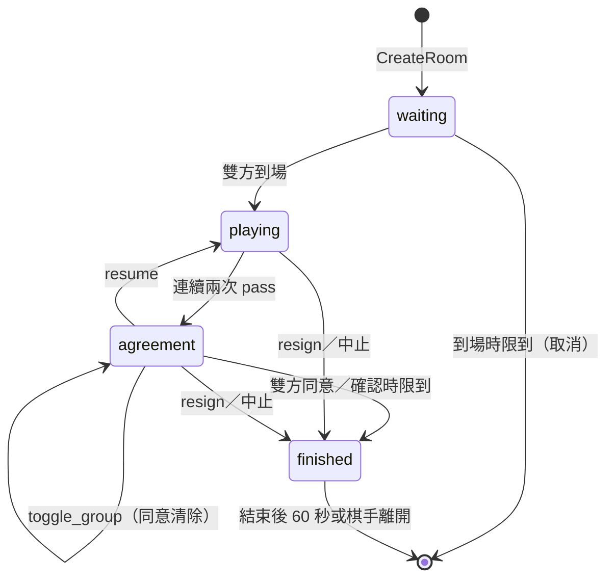

# 規格 v2：里程碑 1（能完整下一盤圍棋）

> 整理日期：2026-11-01。狀態：**M1 的實作規格**。
> 只涵蓋 M1。完整的功能規劃見 [spec_v1.md](spec_v1.md)，階段見 [feature-list.md](feature-list.md)，理由見 [decisions.md](decisions.md)（文中以 D-xx 標註）。
> 訊息與介面以 JSON 描述欄位；實際的 proto 定義在 `proto/`，以本文件為準。

## 1. 範圍

**M1 要做到**：兩位訪客在大廳約局，進房下完一盤 9 路或 19 路圍棋，雙方確認死子與目數後定案，結果與棋譜保存下來，回到大廳。

**M1 包含**

- 訪客登入、玩家列表（查詢）、房間列表（推送）
- 邀局：邀請（含設定）、接受、拒絕、撤回、逾時
- 建房、入場券、重連憑證
- 對局：落子、pass、認輸、棋手對話
- 終局：死子提案、切換死子、同意、恢復對局、數子法計分
- 保底時限（不是棋鐘）
- 棋譜記錄、查看棋譜、我的對局紀錄
- 強制關房（管理用）

**M1 不包含**：棋鐘、悔棋、觀戰與講評、開放房間、還價、讓子、五子棋、帳號登入、好友與私訊、大廳聊天、匯出 SGF。

## 2. 系統組成

| 服務 | 語言 | 對外 | 對內 |
| --- | --- | --- | --- |
| 大廳服務 | Go | WebSocket（前端） | gRPC 伺服器（接收房間事件）；gRPC 客戶端（呼叫房間服務） |
| 房間服務 | Go | WebSocket（前端） | gRPC 伺服器（接收大廳呼叫）；gRPC 客戶端（呼叫大廳、規則服務） |
| 規則服務 | Node.js | — | gRPC 伺服器（接收房間呼叫） |
| PostgreSQL | — | — | 兩個資料庫：`lobby`、`rooms`，各自的帳號 |

開發用埠號（可由環境變數覆寫）：

| 用途 | 埠 |
| --- | --- |
| 大廳 WebSocket | 8930 |
| 大廳 gRPC | 8931 |
| 房間 WebSocket | 8932 |
| 房間 gRPC | 8933 |
| 規則 gRPC | 8934 |
| PostgreSQL | 5445 |

程式碼結構與分離規則見 [spec_v1.md 2.2 節](spec_v1.md#22-程式碼分離)：`lobby/` 與 `room/` 互不 import，只共用 `proto/`（D-01）。

## 3. 資料定義

### 3.1 對局設定 `Settings`

| 欄位 | 型別 | M1 允許值 | 預設 |
| --- | --- | --- | --- |
| `game` | 字串 | `go` | `go` |
| `board_size` | 整數 | `9`、`19` | `19` |
| `color` | 字串 | `black`、`white`、`random`（邀請者執的顏色） | `random` |
| `komi` | 數字 | 0～10，間隔 0.5 | `7.5` |
| `rules` | 字串 | `chinese`（數子法，D-07） | `chinese` |
| `rated` | 布林 | `false` | `false` |

### 3.2 玩家 `Player`

| 欄位 | 說明 |
| --- | --- |
| `name` | 訪客名稱：英數字與底線，1～20 字元，線上不可重複 |
| `status` | `idle`（空閒）、`playing`（對局中） |
| `room_id` | 對局中時所在的房間 |

### 3.3 邀請 `Invite`

| 欄位 | 說明 |
| --- | --- |
| `invite_id` | 大廳產生 |
| `from`、`to` | 玩家名稱 |
| `settings` | `Settings` |
| `expires_at` | 建立後 60 秒 |

### 3.4 房間列表項 `RoomItem`

| 欄位 | 說明 |
| --- | --- |
| `room_id` | |
| `game`、`board_size` | |
| `black`、`white` | 棋手名稱 |
| `status` | `waiting`（等待棋手到場）、`playing`、`finished` |

### 3.5 局面 `View`（由規則服務產生，房間原樣轉送）

| 欄位 | 說明 |
| --- | --- |
| `board` | 二維陣列，0 空、1 黑、2 白 |
| `to_move` | `black` 或 `white` |
| `captures` | `{black, white}` 各自提掉的子數 |
| `last_move` | 最後一手的座標或 `pass` |
| `move_number` | 手數 |

### 3.6 提案 `Proposal`（終局時）

| 欄位 | 說明 |
| --- | --- |
| `dead` | 判為死子的座標列表 |
| `score` | `{black: {stones, territory, total}, white: {stones, territory, komi, total}}` |
| `result` | 依目前提案計算的結果，例如 `B+3.5` |

### 3.7 結果 `Result`

| 欄位 | 說明 |
| --- | --- |
| `winner` | `black`、`white` 或 `none`（中止） |
| `reason` | `score`（點目）、`resign`（認輸）、`abort`（中止） |
| `text` | 例如 `B+3.5`、`W+R`、`中止` |

## 4. 功能

### 4.1 登入與大廳

1. 前端連上大廳，第一則訊息送 `hello{name}`。
2. 名稱不合法 → `error{invalid_name}` 並斷線；重複 → `error{name_taken}` 並斷線。
3. 成功 → `welcome{you, players, rooms}`。
4. 玩家列表**不推送**（D-09）；前端送 `who` 取得最新列表 `players`。
5. 房間列表推送：房間新增、狀態變更、移除時，送 `rooms{op, room}` 給所有 `idle` 的玩家；`playing` 的玩家不收，回到大廳時重新收到 `welcome`。
6. 玩家斷線：大廳移除該玩家；若該玩家有待回覆的邀請，邀請結束（`cancelled`）。對局中的房間不受影響。

### 4.2 邀局

1. 邀請者送 `invite{to, settings}`。`settings` 缺漏的欄位用預設值；不合法 → `error{invalid_settings}`。
2. 大廳依序檢查，失敗就回對應錯誤：
   1. 對方在線 → `no_such_player`；
   2. 不是自己 → `invalid`；
   3. 雙方都 `idle` → `busy`；
   4. 雙方都沒有待回覆的邀請（發出或收到都算）→ `busy`。
3. 通過：建立 `Invite`，送 `invite` 給雙方。
4. 回覆與結束：

   | 事件 | 誰可以 | 結果 |
   | --- | --- | --- |
   | `invite_reply{accept: true}` | 被邀請者 | 建房（4.3），送 `invite_result{accepted}` |
   | `invite_reply{accept: false}` | 被邀請者 | 送 `invite_result{declined}` 給雙方 |
   | `withdraw` | 邀請者 | 送 `invite_result{withdrawn}` 給雙方 |
   | 60 秒到 | — | 送 `invite_result{expired}` 給雙方 |
   | 任一方斷線 | — | 送 `invite_result{cancelled}` 給仍在線的一方 |

5. 不是邀請的對象卻回覆 → `no_such_invite`。

### 4.3 建房與入房

1. 接受邀請後，大廳決定執色（`color=random` 時隨機），呼叫房間服務 `CreateRoom`。
2. 房間服務建立房間、啟動 goroutine、設到場時限，回傳 `ws_url`。
3. 大廳為雙方簽發棋手入場券（4.9 節），送 `game_ready{room_id, ws_url, ticket, color}` 給雙方，雙方狀態改為 `playing`，房間列表新增此房間（`waiting`）。
4. 前端連房間服務，第一則訊息送 `hello{ticket}`。閘道驗證入場券，失敗 → `error{invalid_ticket | ticket_used | ticket_expired}` 並斷線。
5. 成功 → 房間送 `reconnect_token{token}` 與目前的 `state`。
6. 兩位棋手都到場：房間呼叫規則服務開局，送 `state` 給雙方，回報 `room.started`。

### 4.4 對局

1. 輪到的棋手送 `action{base_version, type, x?, y?}`：
   - `play{x, y}`：座標從 0 起算，`x` 為欄、`y` 為列。
   - `pass`。
   - `resign`：任何階段都可以（包含終局確認）。
2. 房間依序檢查：
   1. 送出者是棋手 → 否則 `not_a_player`；
   2. 階段允許此動作（第 6 章）→ 否則 `wrong_phase`；
   3. `base_version` 等於目前版本 → 否則 `stale_version`；
   4. 輪到送出者（`play`、`pass`）→ 否則 `not_your_turn`；
   5. 呼叫規則服務 `Apply`；不合法 → 規則服務的錯誤代碼（`occupied`、`suicide`、`ko`、`out_of_board`）。
3. 合法：寫入棋譜（第 8 章）；成功後版本加 1，送新的 `state` 給雙方。
4. 錯誤只回給送出者：`error{code, version}`，並附目前的 `state`。
5. **先擺子**：前端在 `playing` 階段輪到自己時，用 `goban` 先檢查並顯示；收到 `error` 或版本不符時，依 `state` 重畫（D-14）。
6. **棋手對話**：`chat{text}`，1～500 字元，送給同房的棋手，寫入棋譜。

### 4.5 終局

1. 連續兩次 `pass`（中間沒有落子）→ 規則服務回傳階段 `agreement` 與提案。
2. **初始提案**：規則服務用估算器判斷死子（D-17）。估算器未啟用或失敗時，初始提案為**沒有死子**，由雙方手動點選；流程不變。
3. 房間把提案寫入棋譜，版本加 1，設確認時限（60 秒），送 `state` 給雙方。
4. 棋手在 `agreement` 階段可以：

   | 動作 | 效果 |
   | --- | --- |
   | `toggle_group{x, y}` | 切換 (x, y) 所在棋塊的死活；規則服務回傳新提案；版本加 1；**雙方的同意清除**；確認時限重新計算 |
   | `agree{version}` | 同意目前版本的提案；`version` 不是目前版本 → `stale_version` |
   | `resume` | 回到 `playing`，照正常輪次繼續（D-07）；死子標記清除 |
   | `resign` | 認輸，對局結束 |

5. 雙方都同意同一版本 → 房間送 `finalize` 給規則服務，取得 `Result`，階段 `finished`。
6. 確認時限到：未同意的一方視為同意目前提案（D-07），同第 5 步。
7. 結束時：寫入結果，送 `game_over{result}` 給雙方，回報 `room.finished`。

### 4.6 保底時限

M1 沒有棋鐘，但房間一定要會結束（D-13）。

| 時限 | 開始 | 取消 | 到期時 |
| --- | --- | --- | --- |
| 到場 60 秒 | 建房 | 兩位棋手都到場 | 這局取消：回報 `room.cancelled`，房間關閉 |
| 確認 60 秒 | 進入 `agreement`、提案改變 | 定案、恢復對局、認輸 | 未同意者視為同意，定案 |
| 單一棋手斷線 10 分鐘 | 一位棋手斷線 | 該棋手重連 | 這局中止（`abort`） |
| 全員斷線 5 分鐘 | 兩位棋手都斷線 | 任一位重連 | 這局中止（`abort`） |
| 對局總時長 6 小時 | 開局 | — | 這局中止（`abort`） |
| 結束後 60 秒 | 局結束 | — | 房間關閉（棋手也可以先離開） |

中止的局同樣寫入結果與棋譜，回報 `room.finished`。

### 4.7 重連

1. 前端把 `reconnect_token` 存在 sessionStorage。
2. 斷線或重新整理後，連房間服務並送 `hello{reconnect_token}`。
3. 房間驗證後回到原座位，送目前的 `state`。若同一位棋手已有連線，舊連線被關閉。
4. 房間已關閉 → `error{room_closed}`，前端回到大廳。

### 4.8 棋譜與戰績

1. 每個被接受的動作都寫入房間服務的資料庫，成功後才廣播（D-11）。
2. 局結束時，房間回報 `room.finished`，附摘要；大廳把摘要寫入 `lobby` 資料庫，雙方各一筆。
3. 玩家送 `my_games` → 大廳回傳 `games`：自己的摘要列表（最新在前，最多 50 筆）。
4. 玩家送 `get_record{record_id}` → 大廳以 gRPC 向房間服務 `GetRecord` 查詢，回傳 `record`。M1 不限制誰可以查。

### 4.9 入場券與重連憑證

| 憑證 | 簽發者 | 內容 | 有效期 |
| --- | --- | --- | --- |
| 棋手入場券 | 大廳 | `room_id, name, seat (black/white), jti, exp` | 60 秒，只能用一次 |
| 重連憑證 | 房間 | `room_id, name, seat` | 到房間關閉 |

- 以 HMAC-SHA256 簽章，密鑰由環境變數 `TICKET_SECRET` 提供，大廳與房間共用。
- 房間記住已使用的 `jti`，到入場券過期為止。

### 4.10 強制關房

- 管理用：大廳以 gRPC 呼叫 `CloseRoom{room_id}`（M1 只需能從命令列或測試呼叫）。
- 房間把這局記為中止，送 `game_over` 給在線棋手，回報 `room.finished` 與 `room.closed`。

## 5. 介面

### 5.1 前端 ↔ 大廳（WebSocket，JSON）

每則訊息：`{"type": "...", "data": {...}}`。

| 方向 | `type` | `data` |
| --- | --- | --- |
| → 大廳 | `hello` | `{name}` |
| → 大廳 | `who` | — |
| → 大廳 | `invite` | `{to, settings}` |
| → 大廳 | `invite_reply` | `{invite_id, accept}` |
| → 大廳 | `withdraw` | `{invite_id}` |
| → 大廳 | `my_games` | — |
| → 大廳 | `get_record` | `{record_id}` |
| ← 大廳 | `welcome` | `{you, players: [Player], rooms: [RoomItem]}` |
| ← 大廳 | `players` | `{players: [Player]}` |
| ← 大廳 | `rooms` | `{op: add/update/remove, room: RoomItem}` |
| ← 大廳 | `invite` | `Invite` |
| ← 大廳 | `invite_result` | `{invite_id, result: accepted/declined/withdrawn/expired/cancelled}` |
| ← 大廳 | `game_ready` | `{room_id, ws_url, ticket, color}` |
| ← 大廳 | `games` | `{games: [Summary]}` |
| ← 大廳 | `record` | `GameRecord`（第 8 章） |
| ← 大廳 | `error` | `{code, message}` |

### 5.2 前端 ↔ 房間（WebSocket，JSON）

| 方向 | `type` | `data` |
| --- | --- | --- |
| → 房間 | `hello` | `{ticket}` 或 `{reconnect_token}` |
| → 房間 | `action` | `{base_version, type: play/pass/resign/toggle_group/agree/resume, x?, y?, version?}` |
| → 房間 | `chat` | `{text}` |
| → 房間 | `leave` | —（局結束後離開） |
| ← 房間 | `reconnect_token` | `{token}` |
| ← 房間 | `state` | `{version, phase: waiting/playing/agreement/finished, black, white, connected: {black, white}, view: View, proposal?: Proposal, agreed?: {black, white}, deadline?}` |
| ← 房間 | `chat` | `{from, text}` |
| ← 房間 | `game_over` | `{result: Result, record_id}` |
| ← 房間 | `error` | `{code, version, state}` |

`deadline` 是目前生效的保底時限（例如確認時限）的到期時間，供前端倒數顯示。

### 5.3 大廳 → 房間（gRPC `RoomService`）

| 方法 | 請求 | 回應 |
| --- | --- | --- |
| `CreateRoom` | `{room_id, settings, black: {name}, white: {name}}` | `{ws_url}` |
| `ListRooms` | — | `{rooms: [{room_id, status, black, white}]}` |
| `GetRecord` | `{record_id}` | `GameRecord` |
| `CloseRoom` | `{room_id}` | — |

### 5.4 房間 → 大廳（gRPC `LobbyEvents`）

`ReportRoomEvent{room_id, seq, type, payload}`。

| `type` | `payload` |
| --- | --- |
| `room.started` | — |
| `room.player_disconnected`、`room.player_reconnected` | `{name}` |
| `room.cancelled` | — |
| `room.finished` | `Summary`（第 8 章） |
| `room.closed` | — |

- `seq` 為房間內遞增序號；大廳忽略不大於已處理序號的事件。
- 失敗以指數退避重試，最多 1 分鐘；之後靠對帳修正。
- 大廳每 30 秒呼叫 `ListRooms` 對帳：房間服務沒有的房間從列表移除、相關玩家改回 `idle`。

### 5.5 房間 → 規則（gRPC `RulesService`）

| 方法 | 請求 | 回應 |
| --- | --- | --- |
| `Apply` | `{game, settings, actions: [Action], action: Action}` | `{ok, error_code?, phase, view, proposal?, result?}` |

- `Action`：`{type, seat?, x?, y?, proposal?}`。`type` 為 `start`、`play`、`pass`、`resign`、`toggle_group`、`resume`、`propose`（系統動作，記錄規則服務提出的提案）、`finalize`。
- 規則服務不保存狀態，每次重放 `actions`（D-05）。
- 終局提案以 `propose` 動作寫入紀錄；重放時使用紀錄中的提案，不重新估算。
- 房間呼叫逾時 2 秒；逾時或錯誤時，該動作回 `error{rules_unavailable}`，不寫入紀錄。

## 6. 房間的階段與動作

| 階段 | 允許的動作 |
| --- | --- |
| `waiting` | `chat` |
| `playing` | `play`、`pass`（輪到者）、`resign`、`chat` |
| `agreement` | `toggle_group`、`agree`、`resume`、`resign`、`chat` |
| `finished` | `chat`、`leave` |

房間內部的原則（事件迴圈、先寫紀錄再廣播、送出佇列、計時器編號、`recover`）同 [spec_v1.md 第 5 章](spec_v1.md#5-房間內部)；M1 沒有棋鐘，計時器只用於第 4.6 節的保底時限。

## 7. 規則服務（圍棋）

- 以 `goban-engine` 重放 `actions`，判斷合法、提子、打劫（positional superko）、禁止自殺。
- `pass` 後判斷是否連續兩次 pass；是則進入 `agreement` 並產生提案：
  - 估算器可用：估算器算出每點歸屬 → `autoscore` 判死子 → `computeScore` 計分。
  - 估算器不可用（環境變數 `ESTIMATOR=off` 或載入失敗）：死子為空，直接 `computeScore`。
- `toggle_group`：以 `toggleSingleGroupRemoval` 切換後重新計分。
- `finalize`：依最後的提案產生 `Result`。
- `resign`：產生 `W+R` 或 `B+R`。
- 實作注意：`autoscore` 會修改傳入的棋盤陣列，要傳副本；估算器回傳 1／2，要轉換成正負數值。

## 8. 資料庫

### 8.1 `rooms` 資料庫（房間服務擁有）

| 資料表 | 欄位 |
| --- | --- |
| `games` | `record_id`（= `room_id`）、`settings`（JSON）、`black`、`white`、`status`、`result`（JSON）、`rules_version`、`created_at`、`started_at`、`ended_at` |
| `actions` | `record_id`、`seq`、`type`、`seat`、`data`（JSON：座標、提案、聊天內容）、`received_at` |

- `GameRecord` = `games` 一筆 + 依 `seq` 排序的 `actions`。
- `rules_version` 記錄規則服務使用的 `goban-engine` 版本。

### 8.2 `lobby` 資料庫（大廳服務擁有）

| 資料表 | 欄位 |
| --- | --- |
| `summaries` | `player`、`record_id`、`opponent`、`color`、`result`（文字）、`board_size`、`ended_at` |

- `Summary`（`room.finished` 的 payload）：`record_id, black, white, board_size, result, started_at, ended_at`；大廳拆成雙方各一筆。
- `(player, record_id)` 唯一，重送的事件不會產生重複資料。

## 9. 故障處理

| 情況 | M1 的處理 |
| --- | --- |
| 寫入棋譜失敗 | 動作不算數，回 `error{storage_unavailable}` |
| 規則服務逾時或錯誤 | 動作不算數，回 `error{rules_unavailable}`；棋手可以重送 |
| 房間服務重啟 | 進行中的局中止（M1 不還原）；大廳對帳時移除房間、玩家改回 `idle` |
| 大廳服務重啟 | 對局不受影響；玩家需重新登入大廳；大廳以 `ListRooms` 重建房間列表 |
| 房間事件遺失 | 重試；最後以對帳修正 |
| 送出佇列滿（連線太慢） | 斷開該連線；棋手可用重連憑證回來 |

## 10. 錯誤代碼

| 代碼 | 來源 | 意思 |
| --- | --- | --- |
| `invalid_name`、`name_taken` | 大廳 | 登入名稱不合法或重複 |
| `invalid_settings` | 大廳 | 對局設定不合法 |
| `no_such_player` | 大廳 | 對方不在線 |
| `invalid` | 大廳 | 邀請自己 |
| `busy` | 大廳 | 一方不空閒或已有待回覆的邀請 |
| `no_such_invite` | 大廳 | 邀請不存在或不是給你的 |
| `no_such_record` | 大廳 | 棋譜不存在 |
| `invalid_ticket`、`ticket_used`、`ticket_expired` | 房間 | 入場券有問題 |
| `room_closed` | 房間 | 房間已關閉 |
| `not_a_player` | 房間 | 不是這局的棋手 |
| `wrong_phase` | 房間 | 目前階段不允許此動作 |
| `stale_version` | 房間 | 版本已過時 |
| `not_your_turn` | 房間 | 還沒輪到你 |
| `occupied`、`suicide`、`ko`、`out_of_board` | 規則 | 落子不合法 |
| `rules_unavailable`、`storage_unavailable` | 房間 | 暫時無法處理 |

## 11. 驗收條件

- [ ] Alice 從大廳邀請 Bob，Bob 接受，雙方用入場券進房；房間列表即時出現此房間。
- [ ] 邀請的拒絕、撤回、逾時、一方斷線，都正確結束並通知。
- [ ] 在 19 路與 9 路棋盤各下完一局：提子、打劫正確，不合法的落子回正確的錯誤代碼。
- [ ] 連續兩次 pass 進入終局：切換死子會清除雙方的同意；雙方同意後定案。也測「恢復對局 → 再次 pass → 定案」與「確認時限到自動定案」。
- [ ] 估算器關閉（`ESTIMATOR=off`）時，終局流程仍可完成（手動點死子）。
- [ ] 認輸可以在 `playing` 與 `agreement` 結束對局。
- [ ] 對局中重新整理頁面，能用重連憑證回到原座位與目前局面。
- [ ] 到場時限、單一棋手斷線、全員斷線、結束後關房，都在時限內完成，不留下殘留的房間或 `playing` 狀態。
- [ ] 棋譜完整存在 `rooms` 資料庫；`my_games` 與 `get_record` 回傳正確；大廳的 `lobby` 資料庫只有摘要。
- [ ] 房間服務的測試用一個假遊戲（連三子即結束）跑過，房間程式碼不含圍棋專屬的邏輯（D-10）。
- [ ] 三個服務各自獨立啟動；`lobby/` 與 `room/` 沒有互相 import。

## 附錄 A：NNGS 指令對照（M1）

NNGS 1.1.22 的完整指令對照見 [feature-list.md 附錄](feature-list.md#附錄nngs-指令對照)。以下只列與 M1 相關的指令。

### A.1 M1 有對應的

| NNGS 指令 | 用途 | M1 的對應 | 差異 |
| --- | --- | --- | --- |
| 輸入名稱登入（訪客） | 登入 | 大廳 `hello{name}` | 相同，都是訪客名稱 |
| `who` | 玩家列表 | 大廳 `who` → `players` | NNGS 可加篩選條件；M1 回傳全部 |
| `games` | 進行中的對局列表 | 大廳 `welcome` 的 `rooms` 與 `rooms` 推送 | NNGS 要自己查；M1 主動推送 |
| `match` | 發出邀請（含設定） | 大廳 `invite{to, settings}` | 見附錄 B |
| `accept` | 接受邀請 | 大廳 `invite_reply{accept: true}` | NNGS 也可回發相同條件的 `match` 表示接受 |
| `decline` | 拒絕邀請 | 大廳 `invite_reply{accept: false}` | |
| `withdraw` | 撤回自己的邀請 | 大廳 `withdraw{invite_id}` | |
| 座標（例如 `D4`） | 落子 | 房間 `action{type: play, x, y}` | M1 座標從 0 起算 |
| `pass` | pass | 房間 `action{type: pass}` | |
| `resign` | 認輸 | 房間 `action{type: resign}` | |
| `say` | 對手間對話 | 房間 `chat{text}` | |
| `refresh`、`status` | 重新顯示局面 | 重連時的 `state`；每次動作後的 `state` | M1 不需另外查詢 |
| 點選死子 | 標記死子 | 房間 `action{type: toggle_group, x, y}` | M1 另有估算器提出的初始判斷 |
| `undo`（點目階段） | 回到對局 | 房間 `action{type: resume}` | |
| `done` | 確認點目 | 房間 `action{type: agree, version}` | M1 需指定同意的版本；任一方改動死子會清除同意 |
| `score` | 預覽目數 | `state.proposal.score` | M1 每次提案都附目數 |
| `moves` | 查看棋步 | 大廳 `get_record` | |
| `results` | 對局結果紀錄 | 大廳 `my_games` | NNGS 可查任何人；M1 只查自己 |
| `quit` | 離開伺服器 | 關閉連線 | |
| `nuke`（管理） | 把玩家踢下線，對局因斷線而封盤 | 房間服務 gRPC `CloseRoom` | NNGS 沒有直接結束對局的指令；M1 直接把這局記為中止 |

### A.2 相關但不在 M1 的

| NNGS 指令 | 用途 | 階段 |
| --- | --- | --- |
| `pending` | 列出待回覆的邀請 | M2 |
| `match`（用不同條件回發） | 還價 | M2 |
| `open` | 是否接受邀請 | M2 |
| `handicap` | 讓子 | M2 |
| `time`、`pause`、`unpause`、`addtime` | 計時 | 棋鐘 M2；暫停、加時未來 |
| `undo`（對局中） | 悔棋 | M2 |
| `observe`、`kibitz`、`all` | 觀戰、講評 | M2 |
| `sgf`、`mail` | 取得棋譜檔 | 匯出 SGF M2 |
| `adjourn`、`load`、`stored` | 封盤、續下 | 未來 |
| `censor` | 封鎖 | M3 |
| `tell` | 私訊 | M3 |
| `komi` | 對局中改貼目 | 不做（建房時設定） |
| `tmatch`、`teach`、`pair` | 比賽、研究盤、連棋 | 未來 |

## 附錄 B：邀局流程對照（NNGS ↔ M1）

### B.1 流程

| 步驟 | NNGS | M1 |
| --- | --- | --- |
| 1. 發出邀請 | `match bob B 19 10 10`：對手、執色、棋盤、時間、讀秒 | `invite{to: "bob", settings: {color, board_size, komi}}`；M1 沒有時間設定（棋鐘在 M2），多了貼目 |
| 2. 發出前的檢查 | 自己不在對局中；對手在線；不是自己（自己請用 `teach`）；雙方沒有互相封鎖；對手是 `open` 狀態；對手不在對局中；待回覆的邀請數未達上限 | 對手在線；不是自己；雙方都 `idle`；雙方都沒有待回覆的邀請 |
| 3. 自己的狀態 | 發出邀請時自動把自己設為 `open` | 不變 |
| 4. 對方收到 | 文字提示，附「用 `match alice W 19 10 10` 接受或 `decline alice` 拒絕」 | `invite` 訊息，附設定與 `invite_id` |
| 5. 接受 | `accept`，或回發完全相同的 `match`（顏色互補） | `invite_reply{accept: true}` |
| 6. 還價 | 用不同條件回發 `match`：自動拒絕原邀請，改由對方提出新邀請 | M1 沒有（M2） |
| 7. 拒絕 | `decline` | `invite_reply{accept: false}` |
| 8. 撤回 | `withdraw` | `withdraw{invite_id}` |
| 9. 逾時 | **沒有**，邀請一直留著，直到處理或登出 | 60 秒自動結束 |
| 10. 開局 | 接受的當下立刻開局；雙方本來就連在同一台伺服器上 | 大廳呼叫 `CreateRoom` → 簽發入場券 → 雙方連進房間 → 都到場才開局；60 秒內沒到場則取消 |
| 11. 開局後的清理 | 清掉雙方其他所有約局邀請 | M1 每人同時只有一個邀請，不需要 |
| 12. 通知其他人 | 推送「Match N: X vs Y」給開啟 `ginform` 的玩家 | 房間列表推送 `rooms{op: add}` 給大廳中所有 `idle` 的玩家 |
| 13. 一方登出 | 清掉他所有的邀請（對方收到撤回通知） | 邀請結束，通知仍在線的一方 `invite_result{cancelled}` |

### B.2 主要差異

| 項目 | NNGS | M1 | 原因 |
| --- | --- | --- | --- |
| 同時的邀請數 | 可以有多個 | 每人一個 | 簡化狀態，避免同時接受兩個邀請 |
| 逾時 | 無 | 60 秒 | 網頁上離開不一定會登出，避免邀請一直掛著 |
| 接受方式 | `accept` 或回發相同條件 | 明確的接受訊息 | 網頁按鈕不需要用「回發相同條件」表示接受 |
| 還價 | 有 | M2 | M1 先求能下完一盤 |
| 接受邀請開關（`open`） | 有，發邀請會自動打開 | M2 | 同上 |
| 封鎖檢查 | 有 | M3（封鎖功能在 M3） | |
| 開局 | 立即 | 經過入場券與到場時限 | 大廳與房間是不同服務（D-01），玩家要另外連進房間 |
| 計時設定 | 有 | M2 | M1 沒有棋鐘 |
